```
┌─ muxway ─┐
```

Your tmux, from anywhere. A hub, a small agent per machine, and clients
from the browser to a phone, a watch, smart glasses and a 2002 feature
phone. Security first: a tmux pane is a shell.

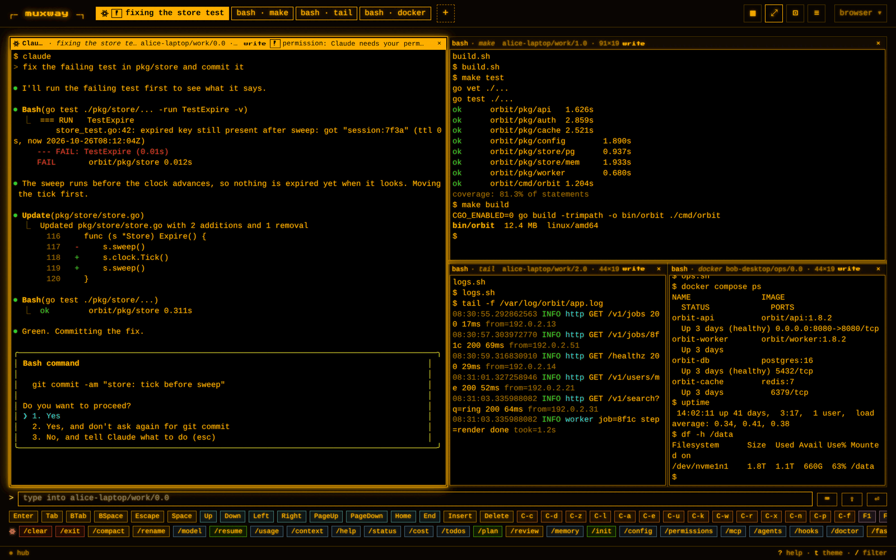

> Young, and used daily by its author. The hub, the agent, the protocol,
> the web client, sign-in with OpenID Connect, and the agent side, hooks
> for Claude Code, Codex, Gemini CLI, Antigravity CLI, Copilot CLI and
> OpenCode, a watcher for the rest, questions with fixed answers, the
> inbox, a command-line client and an MCP server, are all in; the
> [Android](https://github.com/notmarkopadjen/muxway-android),
> [glasses](https://github.com/notmarkopadjen/muxway-glasses-even) and
> [Java ME](https://github.com/notmarkopadjen/muxway-midp) clients are
> in their own repositories. Expect the protocol to grow, not to break.

## Only here

What sets muxway apart from the other ways of reaching a terminal from
a browser or a phone:

<table>
<tr>
<td width="72" valign="top"></td>
<td><strong>Panes from several machines in one view.</strong> Up to four tiles from
any mix of hosts, sessions and windows: the build on your workstation
beside the logs on a server and an AI agent on your laptop, all live
and typable. Drag a header to swap two tiles or split a place, drag a
divider to resize; tiles that are one window's panes move that window
on its host as you rearrange them here.</td>
</tr>
<tr>
<td valign="top"></td>
<td><strong>Voice input.</strong> Hold the microphone in the browser, on the phone, on
the watch or on the glasses. The hub transcribes, the words land on
the input line for you to read, and nothing is sent until you say so.</td>
</tr>
<tr>
<td valign="top"></td>
<td><strong>Files both ways.</strong> Paste a screenshot, drop a PDF, pick a zip, and
it lands in an inbox on the host with its path on your line, for the
program in the pane to read. The other way round, a path a pane prints
is a link: a click shows the file over the page, an image, a PDF, a
plan in Markdown, a CSV, with a download, from the inbox or from the
directories the host's owner opened for it.</td>
</tr>
<tr>
<td valign="top"></td>
<td><strong>Your AI agent calls you.</strong> An AI coding agent in a pane tells muxway,
through its hooks, when it asks a question, wants a permission, has
gone idle or has finished: <code>muxway hooks</code> prints them for
Claude Code, Codex, Gemini CLI, Antigravity CLI, Copilot CLI and
OpenCode, and a watcher
on the host reads the screen of a harness without hooks. The pane
lights up in every client, the phone and the watch buzz, the glasses
show a banner, the inbox lists what waits across your machines, oldest
first, and you answer from wherever you are: a tap, a key, a few typed
words, a spoken reply. An agent can also ask you a question with fixed
answers (<code>muxway ask</code>) and get your pick back without a
keystroke in its pane. Claude Code is the harness tested daily.</td>
</tr>
<tr>
<td valign="top">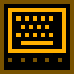</td>
<td><strong>Agents drive it too.</strong> <code>muxway client</code> is the API from
the command line (panes, inbox, read, send, answer, mail, wait, talk), <code>muxway
mcp</code> serves the same as MCP tools, and <code>muxway skill</code>
prints the guide an agent in a pane reads, so an agent on one machine
can watch, wait on and type into a pane on another, with a token that
names exactly which.</td>
</tr>
<tr>
<td valign="top">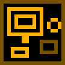</td>
<td><strong>Clients down to a 2002 feature phone.</strong> The API is small and text
mode is plain text, so a browser, an Android phone with a Wear OS
watch, Even Realities G2 glasses and a Java ME MIDlet in 30 KiB are
all clients, and yours can be too.</td>
</tr>
<tr>
<td valign="top"></td>
<td><strong>Direct keyboard input.</strong> Type as you would at the terminal: on the
web a click on the pane and every key goes to it as pressed, Esc
included, or compose a line and send it whole. A key
bar covers what a phone keyboard lacks, the web adds a full terminal
keyboard (F1 to F24, Ctrl, Alt, the keypad) and the mouse for programs
that take it. Every key goes through a fixed grammar, never a raw
escape sequence.</td>
</tr>
<tr>
<td valign="top">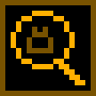</td>
<td><strong>A lens for tiny screens.</strong> A lens knows an agent's screen and
reshapes it, so the conversation fits on a watch, on glasses, or on a
96 by 65 pixel Nokia.</td>
</tr>
</table>

## Why

**Built like a remote shell service, because it is one.** Panes are
opt-in: nothing is reachable until its owner marks it. A token names
which hosts and panes it may read, and separately which it may type
into. Input is text and a fixed grammar of keys, never raw escapes.
Every authentication step is rate limited and locked out, every write is
audit logged on the host, secrets are hashed, compared in constant time
and never logged. One Go binary per role, one third-party dependency,
no cgo.

**Anything that can speak HTTP is a client.** The clients prove it: a
React web app served by the hub itself, an Android app with a Wear OS
face, an Even Realities G2 app, and a Java ME MIDlet that fits in 30
KiB. Build your own from the [protocol specification](docs/protocol/v1.md).

## How it works

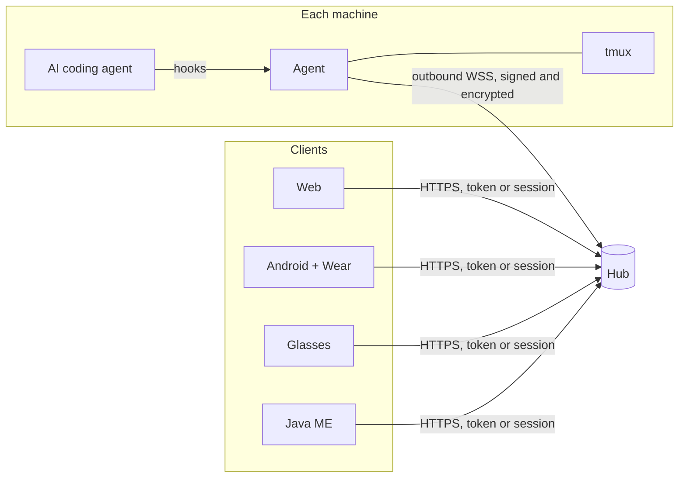

The **agent** runs next to tmux on each machine, dials out to the hub,
and exposes only the panes its owner marked. The **hub** authenticates
clients, enforces grants, relays reads and input, and serves the web
client from files embedded in its binary. Clients never reach a machine
directly. Read [the architecture](docs/ARCHITECTURE.md) for the whole
picture.

## Quick start

```sh
go install github.com/notmarkopadjen/muxway/cmd/muxway@latest

# on the hub (behind a TLS proxy here; see the docs for direct TLS)
muxway hub serve --listen 127.0.0.1:7600 --public-url https://hub.example.com --trust-proxy &
muxway hub pair-code --host alice-laptop

# on the machine with tmux (3.5 or newer, so Shift+Enter reaches the programs)
muxway agent pair <code>
muxway agent run &
muxway expose -t work:1.0 --write --name build   # or run the agent with --expose work=write
muxway hooks claude-code   # hooks so Claude Code in a pane can call for you (also codex, gemini, copilot, opencode)

# back on the hub: a token for a client
muxway hub token create --name phone --read 'alice-laptop/*' --write 'alice-laptop/@build'
```

Open `https://hub.example.com/` in a browser and paste the token, or
sign in with your identity provider if the hub has one. For scripts and
small clients, a pane is one request away:

```sh
curl -H "Authorization: Bearer $TOKEN" -H "Accept: text/plain" \
  "https://hub.example.com/v1/panes/alice-laptop/@build?width=40&lines=20"
```

[Hub and agent](docs/features/hub-and-agent.md) has the flags, the
service units, the reverse proxy, backups and token rotation.

## For the AI agents in your panes

An agent in a pane is the pane muxway is for, so it gets its own side of
the product:

```sh
muxway hooks claude-code | codex | gemini | agy | copilot | opencode   # its hooks call muxway notify
muxway agent run                       # the watcher reads the screens of the rest, on by default
muxway ask --text "deploy to staging?" --choice yes --choice no         # blocks until you pick, on any device
muxway skill > .claude/skills/muxway/SKILL.md                          # the guide an agent reads
```

And with a token of its own, narrow as you like, an agent drives muxway
back: `muxway client panes | inbox | read | send | key | answer | mail |
mailbox | wait | events | talk`, or the same as MCP tools with `muxway
mcp`, so an agent on one machine can watch, wait on and type into a pane
on another. A message for another agent is mail, held for that pane's
process and never typed: it reads it with `muxway mail`, or its Stop
hook hands it over when a turn ends, and it replies to the pane it came
from. A write or a mail from a pane names the pane it came from, and
you see it as talk: the panes framed as one group on every client, the
exchange in the messages window. See
[notifications](docs/features/notifications.md),
[the inbox](docs/features/inbox.md),
[driving muxway](docs/features/driving.md),
[talk](docs/features/talk.md) and [mail](docs/features/mail.md).

## The web client

The client installs as an app from the browser (a manifest and a
service worker that keeps the client's own files, never the hub's
answers): a standalone window with its icon on Android, desktop and the
iPhone, and a shell that opens with no network and says the hub is
unreachable. See [the web client](docs/features/web-client.md#installing-it).

Served by the hub, nothing to install. The pane list groups every host
you may reach; a badge marks a pane that needs you.

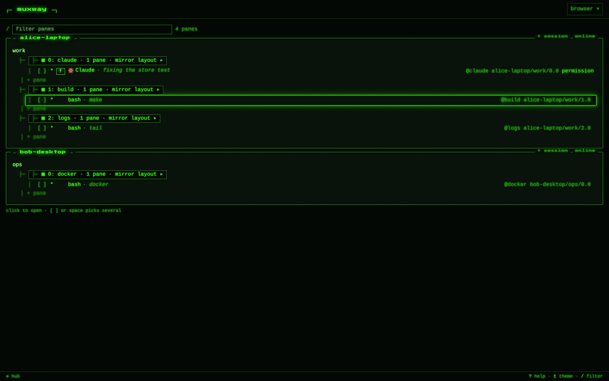

A pane running an AI agent is named by what the agent says it is doing,
with its mark (Claude's spark, Codex's hexagon, Antigravity's chevron),
the header carries its question, and the command row offers the agent's
slash commands, Claude Code's, Codex's or Antigravity's; a shell's row
starts them, each starter with its mark, and keeps the shell's recent
lines.

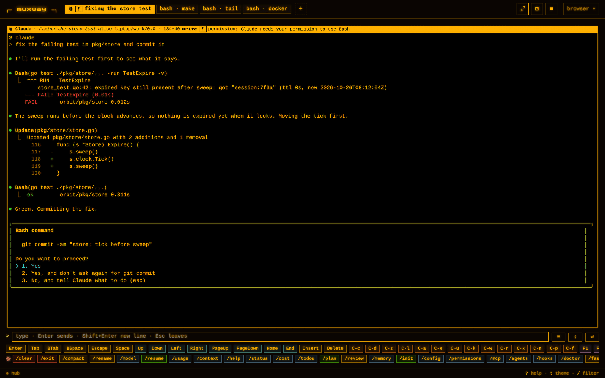

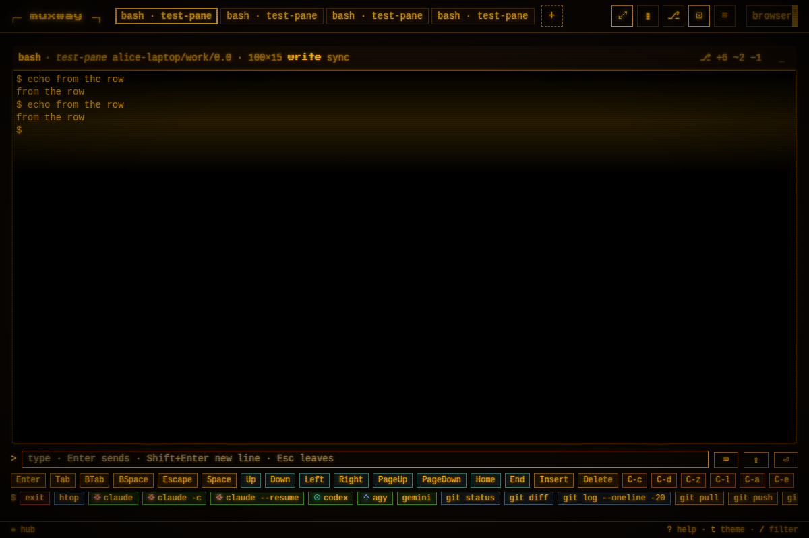

Every pane that waits for you, on every host, is one list: the inbox
(`I`), oldest first, with a question's choices as buttons; `o` opens the
oldest. A question an agent asked with `muxway ask` is answered from the
toast, the pane's header or the inbox, and the agent gets the pick
without a keystroke in its pane.

| The inbox | A question with fixed answers |
|---|---|
| 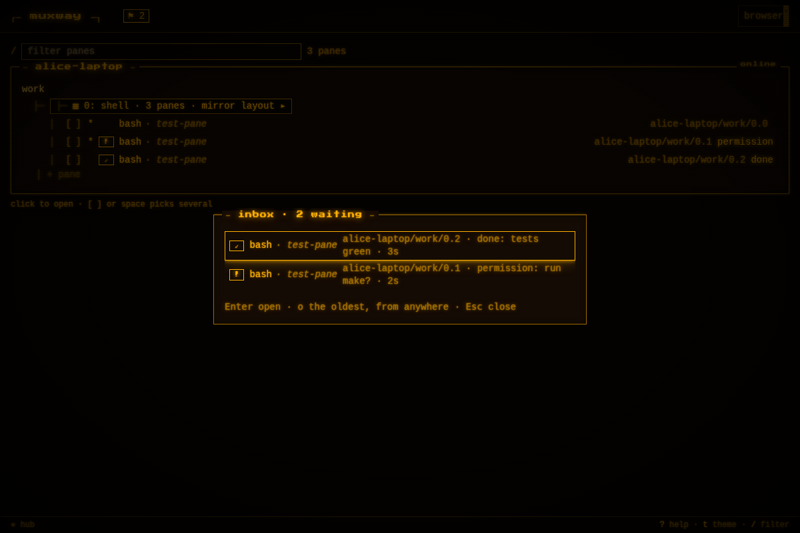 | 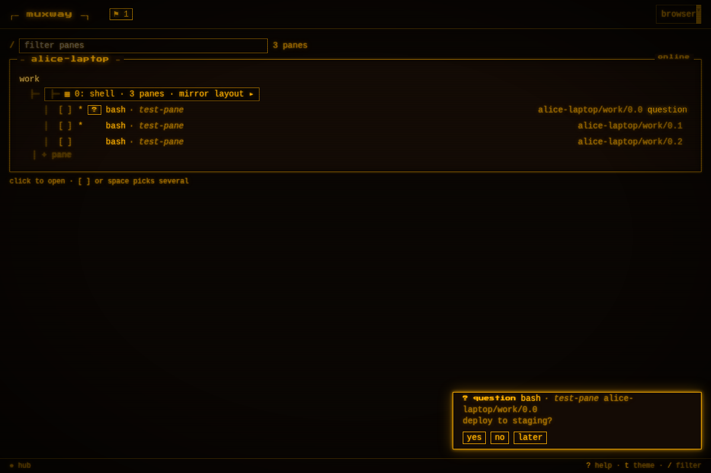 |

Amber by default; phosphor green, and paper for daylight.

| Green | Paper |
|---|---|
|  | 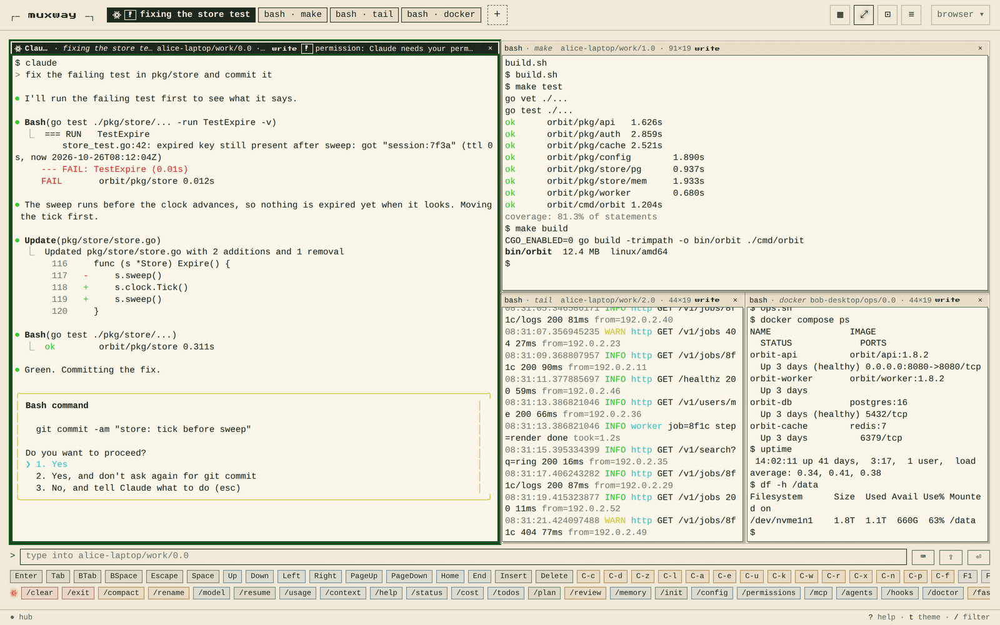 |

On a phone the keys stay under the thumb and the pane buttons fold
behind one `⋯`.

| A pane on a phone | The pane buttons, folded |
|---|---|
|  | 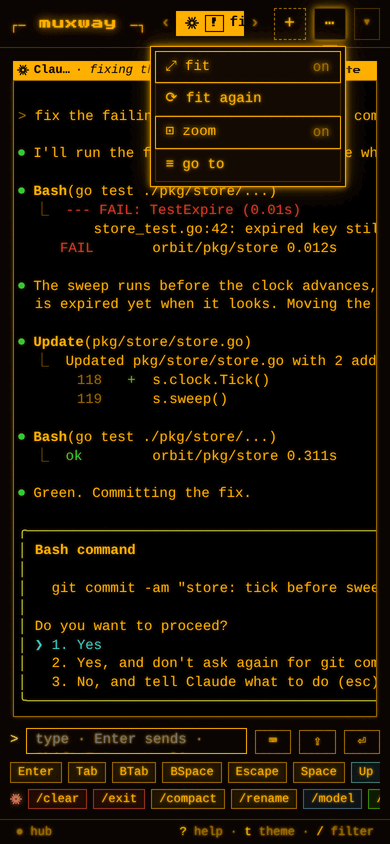 |

A path printed in a pane opens the file over the page, with a download;
a plan here, a screenshot or a PDF the same way.

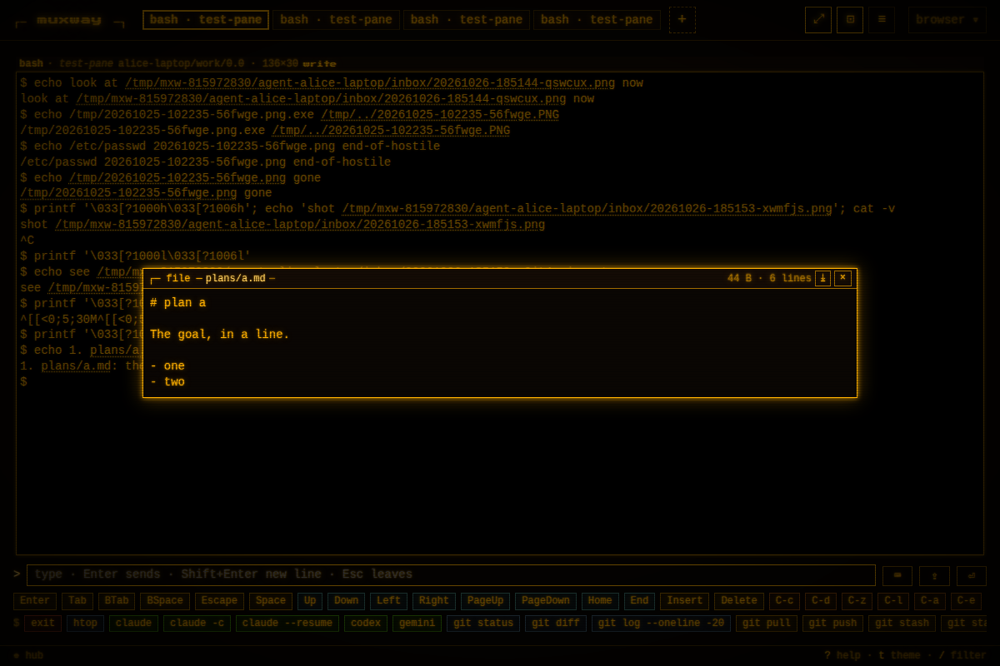

An admin sees the hub's live log, tokens and users, connected clients
and agents, and the address allow and deny lists.

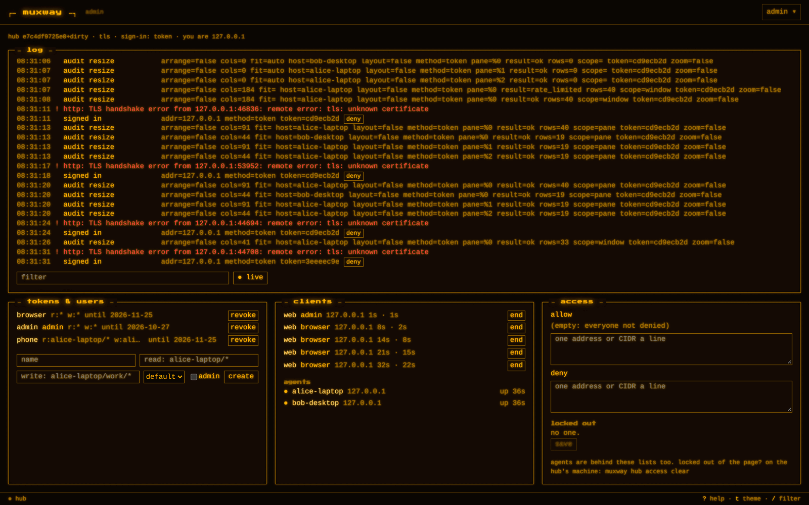

The features: [web client](docs/features/web-client.md),
[keyboard](docs/features/keyboard.md),
[direct typing](docs/features/direct.md),
[notifications](docs/features/notifications.md),
[the inbox](docs/features/inbox.md),
[driving muxway from a script or an agent](docs/features/driving.md),
[sign-in](docs/features/sign-in.md),
[attachments](docs/features/attachments.md),
[preview](docs/features/preview.md),
[changes](docs/features/changes.md),
[transcription](docs/features/transcription.md),
[new panes and sessions](docs/features/new-panes.md),
[admin](docs/features/admin.md),
[text mode](docs/features/text-mode.md).

## The other clients

| Client | What it does | Get it |
|---|---|---|
| [**muxway-android**](https://github.com/notmarkopadjen/muxway-android) | Panes on a phone, one per screen or side by side, set up by scanning a code. A Wear OS watch face, complication and tile show which panes wait; a tap opens a pane's tail on the wrist with a few answers and the microphone. | [Latest APKs](https://github.com/notmarkopadjen/muxway-android/releases/latest): the app, the watch app and the watch face |
| [**muxway-glasses-even**](https://github.com/notmarkopadjen/muxway-glasses-even) | Even Realities G2: the pane list at a glance, a pane through the Claude Code lens, a banner when it needs you, and a reply from a fixed set or by voice. | On the Even Hub: to be provided. Until then, pack it yourself |
| [**muxway-midp**](https://github.com/notmarkopadjen/muxway-midp) | Java ME, MIDP 1.0 and 2.0: list, read, reply and send keys from a Nokia 6310i over GPRS, through a small relay. | [Latest JARs](https://github.com/notmarkopadjen/muxway-midp/releases/latest): MIDP 2.0 and MIDP 1.0 |

| Even Realities G2: Claude Code through the lens | Nokia 6310i, 96 by 65 pixels: the same lens |
|---|---|
|  |  |

| Wear OS: the watch face says how many panes wait | Wear OS: a pane's tail on the wrist, record a reply |
|---|---|
|  |  |

The clients are one product: [docs/ui-guideline.md](docs/ui-guideline.md)
says what every client shows and which key or gesture does what.

## Build your own client

[docs/ARCHITECTURE.md](docs/ARCHITECTURE.md) is the entry point and
[docs/protocol/v1.md](docs/protocol/v1.md) the contract: bearer tokens,
JSON and text mode, long-polled events, the key grammar, rate limits,
error codes, and how a client learns what a hub supports. Every flow has
a diagram.

## Contributing and security

Contributors and AI agents: read [AGENTS.md](AGENTS.md) first. It holds
the privacy rules (nothing personal ever reaches this repository), the
security rules, how a feature is planned, reviewed and tested, and the
build and test commands. Security issues: see [SECURITY.md](SECURITY.md).

muxway is free software under the [Apache License 2.0](LICENSE), as are
its clients.
