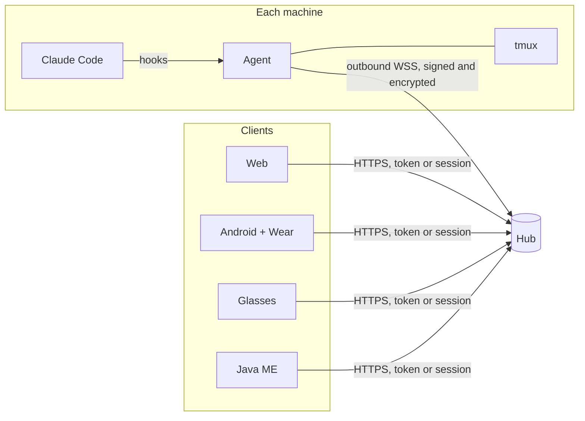
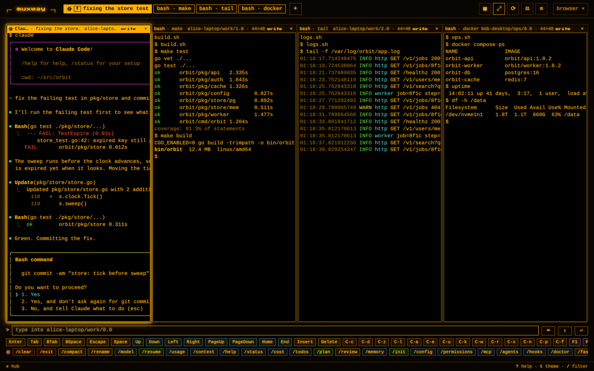
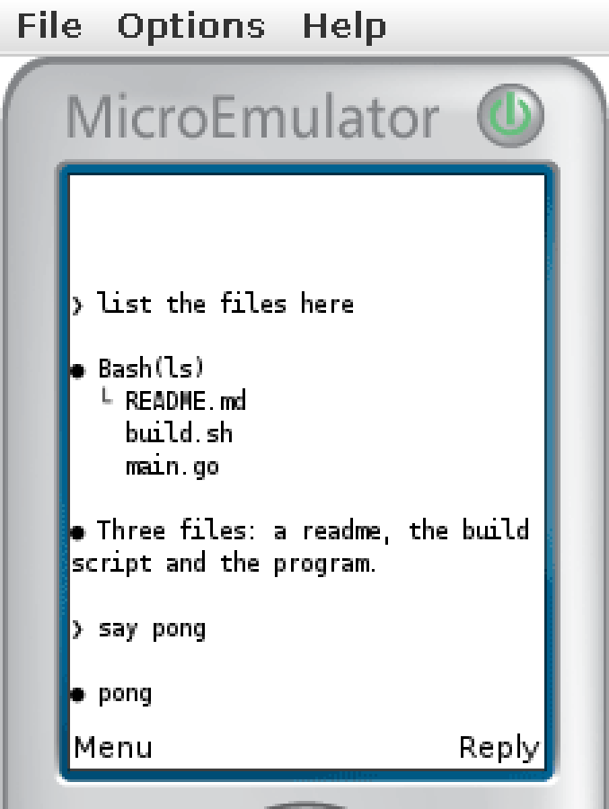

```
┌─ muxway ─┐
```

Your tmux, from anywhere. A hub, a small agent per machine, and clients
from the browser to a phone, a watch, smart glasses and a 2002 feature
phone. Security first: a tmux pane is a shell.


> Young, and used daily by its author. The hub, the agent, the protocol,
> the web client, notifications from AI coding CLIs and sign-in with
> OpenID Connect are all in; the
> [Android](https://github.com/notmarkopadjen/muxway-android),
> [glasses](https://github.com/notmarkopadjen/muxway-glasses-even) and
> [Java ME](https://github.com/notmarkopadjen/muxway-midp) clients are
> in their own repositories. Expect the protocol to grow, not to break.

## Why

**One screen, every machine.** Up to four panes side by side from any
mix of hosts, sessions and windows: the build on your workstation, the
logs on a server, an AI agent on your laptop, all live and typable. Drag
a header to rearrange; tiles that are one window's panes stay in step
with that window on its host, so a divider dragged here moves tmux's
split there.

**Your AI coding CLI calls you.** Claude Code in a pane tells muxway,
through its hooks, when it asks a question, wants a permission, has gone
idle or has finished. The pane lights up in every client, the phone and
the watch buzz, the glasses show a banner, and you answer from wherever
you are: a tap, a key, a few typed words, or a spoken reply that the hub
transcribes. A **lens** knows Claude Code's screen and reshapes it for a
tiny display, so the conversation fits on a watch, on glasses, or on a
96 by 65 pixel Nokia.

**Anything that can speak HTTP is a client.** The API is small, text
mode is plain text, and the clients prove it: a React web app served by
the hub itself, an Android app with a Wear OS face, an Even Realities G2
app, and a Java ME MIDlet that fits in 30 KiB. Build your own from the
[protocol specification](docs/protocol/v1.md).

**Built like a remote shell service, because it is one.** Panes are
opt-in: nothing is reachable until its owner marks it. A token names
which hosts and panes it may read, and separately which it may type
into. Input is text and a fixed grammar of keys, never raw escapes.
Every authentication step is rate limited and locked out, every write is
audit logged on the host, secrets are hashed, compared in constant time
and never logged. One Go binary per role, one third-party dependency,
no cgo.

## How it works



The **agent** runs next to tmux on each machine, dials out to the hub,
and exposes only the panes its owner marked. The **hub** authenticates
clients, enforces grants, relays reads and input, and serves the web
client from files embedded in its binary. Clients never reach a machine
directly. Read [the architecture](docs/ARCHITECTURE.md) for the whole
picture.

## Quick start

```sh
go install github.com/notmarkopadjen/muxway/cmd/muxway@latest

# on the hub (behind a TLS proxy here; see the docs for direct TLS)
muxway hub serve --listen 127.0.0.1:7600 --public-url https://hub.example.com --trust-proxy &
muxway hub pair-code --host alice-laptop

# on the machine with tmux
muxway agent pair <code>
muxway agent run &
muxway expose -t work:1.0 --write --name build
muxway hooks claude-code   # hooks so Claude Code in a pane can call for you

# back on the hub: a token for a client
muxway hub token create --name phone --read 'alice-laptop/*' --write 'alice-laptop/@build'
```

Open `https://hub.example.com/` in a browser and paste the token, or
sign in with your identity provider if the hub has one. For scripts and
small clients, a pane is one request away:

```sh
curl -H "Authorization: Bearer $TOKEN" -H "Accept: text/plain" \
  "https://hub.example.com/v1/panes/alice-laptop/@build?width=40&lines=20"
```

[Hub and agent](docs/features/hub-and-agent.md) has the flags, the
service units, the reverse proxy, backups and token rotation.

## The web client

Served by the hub, nothing to install. The pane list groups every host
you may reach; a badge marks a pane that needs you.


A pane running Claude Code is named by what Claude says it is doing, the
header carries the question, and the command row offers Claude's slash
commands; a shell's gets its recent lines.


Amber and paper for daylight, and a phone layout that keeps the keys
under the thumb.

| Amber | Paper |
|---|---|
|  |  |


An admin sees the hub's live log, tokens and users, connected clients
and agents, and the address allow and deny lists.


The features: [web client](docs/features/web-client.md),
[keyboard](docs/features/keyboard.md),
[notifications](docs/features/notifications.md),
[sign-in](docs/features/sign-in.md),
[attachments](docs/features/attachments.md),
[transcription](docs/features/transcription.md),
[new panes and sessions](docs/features/new-panes.md),
[admin](docs/features/admin.md),
[text mode](docs/features/text-mode.md).

## The other clients

| | |
|---|---|
| [**muxway-android**](https://github.com/notmarkopadjen/muxway-android) | Panes on a phone, one per screen or side by side, set up by scanning a code. A Wear OS watch face, complication and tile show which panes wait; a tap opens a pane's tail on the wrist with a few answers and the microphone. |
| [**muxway-glasses-even**](https://github.com/notmarkopadjen/muxway-glasses-even) | Even Realities G2: the pane list at a glance, a pane through the Claude Code lens, a banner when it needs you, and a reply from a fixed set or by voice. |
| [**muxway-midp**](https://github.com/notmarkopadjen/muxway-midp) | Java ME, MIDP 1.0 and 2.0: list, read, reply and send keys from a Nokia 6310i over GPRS, through a small relay. |

<p>


</p>

The clients are one product: [docs/ui-guideline.md](docs/ui-guideline.md)
says what every client shows and which key or gesture does what.

## Build your own client

[docs/ARCHITECTURE.md](docs/ARCHITECTURE.md) is the entry point and
[docs/protocol/v1.md](docs/protocol/v1.md) the contract: bearer tokens,
JSON and text mode, long-polled events, the key grammar, rate limits,
error codes, and how a client learns what a hub supports. Every flow has
a diagram.

## Contributing and security

Contributors and AI agents: read [AGENTS.md](AGENTS.md) first. It holds
the privacy rules (nothing personal ever reaches this repository), the
security rules, how a feature is planned, reviewed and tested, and the
build and test commands. Security issues: see [SECURITY.md](SECURITY.md).

muxway is free software under the [Apache License 2.0](LICENSE), as are
its clients.
