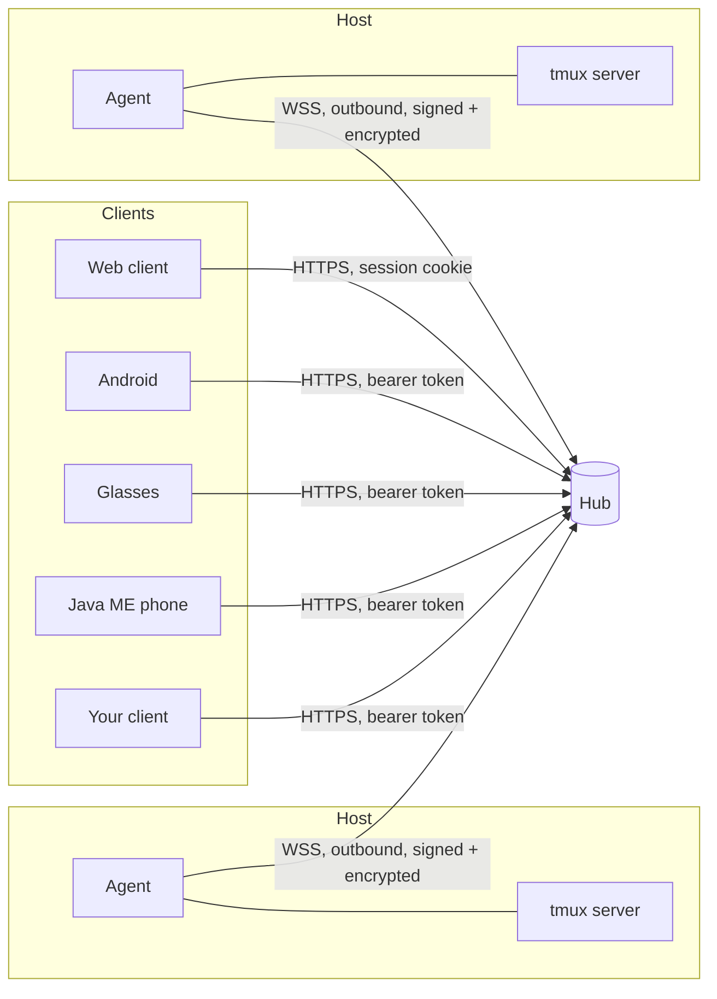
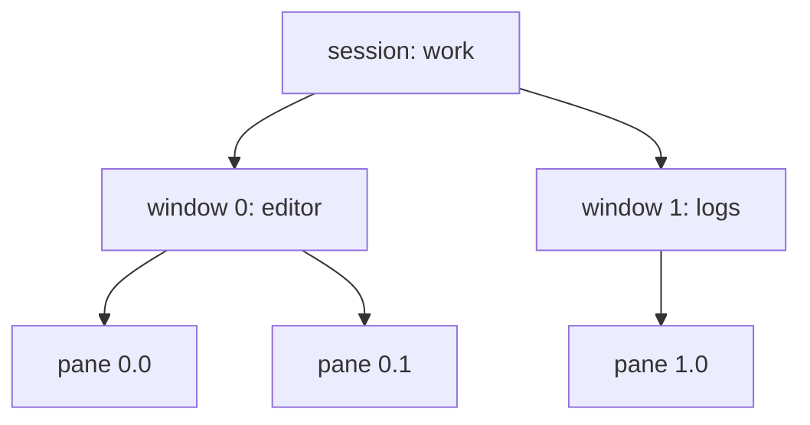
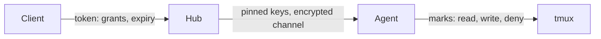
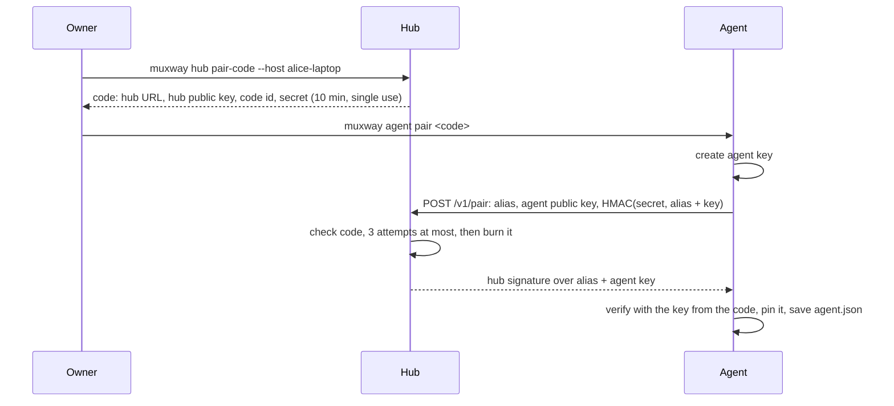
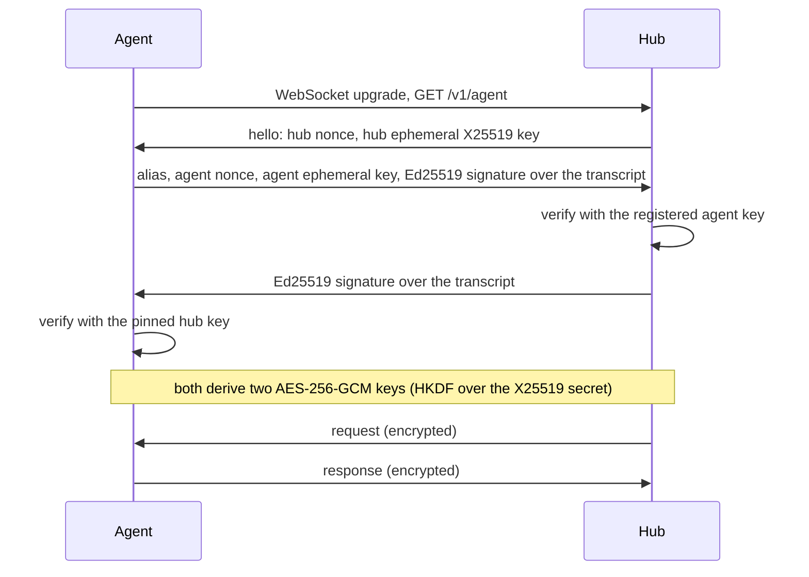
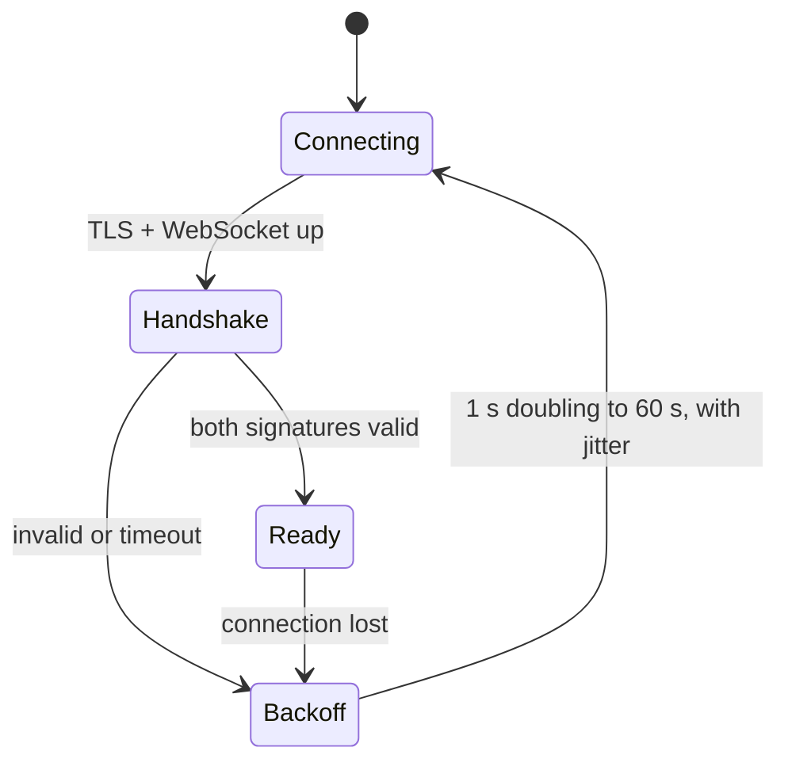
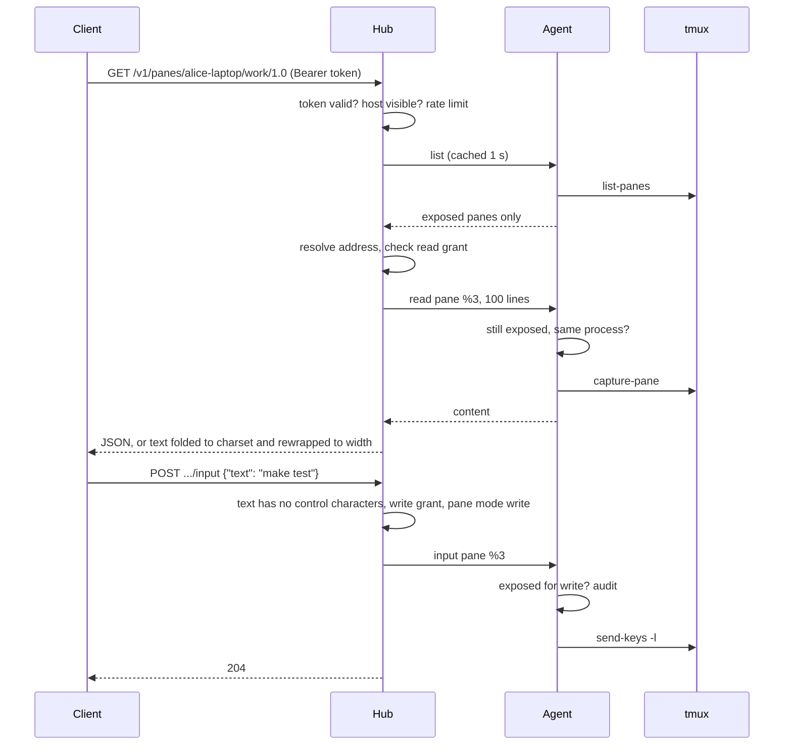
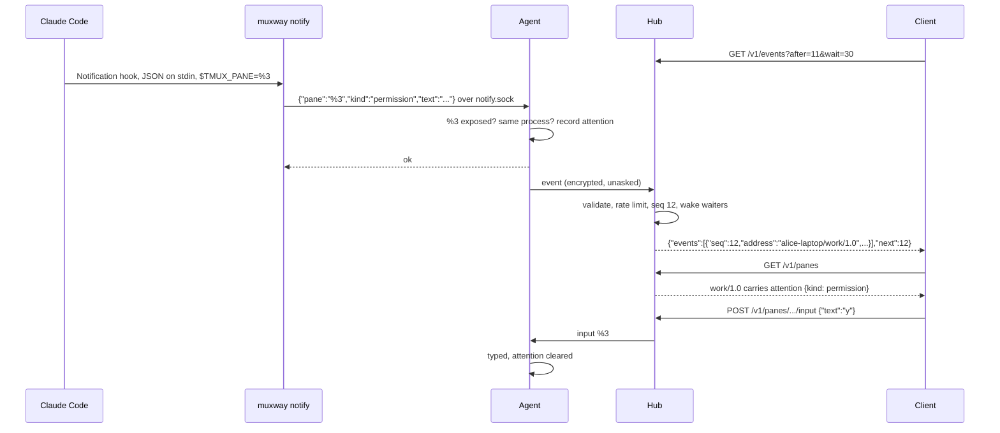

# Architecture

This page is the entry point for anyone building a muxway client or
running muxway. The wire protocol is in [protocol/v1.md](protocol/v1.md);
each feature has a page under [features/](features/).

## Components

- **Agent** (`muxway agent run`): runs next to a tmux server. It connects
  out to its hub, so a host needs no open port. It answers three requests,
  list, read and input, for the panes its owner exposed, and enforces
  exposure and modes itself.
- **Hub** (`muxway hub serve`): the meeting point. It pairs agents,
  authenticates clients by token, enforces each token's grants, and routes
  requests to the right agent.
- **Clients**: anything that speaks [the protocol](protocol/v1.md). Rich
  clients use JSON; small ones use **text mode**, which returns plain lines
  rewrapped to the width the client asks for, in UTF-8, Latin-1 or ASCII
  (see [text mode](features/text-mode.md)).
- **Web client**: served by the hub from embedded files at `/`; its
  tile arrangements, boards and the lens that says what a pane is up to
  are browser state and never reach the hub; React, plain CSS, polling
  the API with the session cookie. See
  [features/web-client.md](features/web-client.md).
- **Notifications**: a process in a pane, such as a Claude Code hook, runs
  `muxway notify`; the agent marks the pane and the hub tells clients, see
  [features/notifications.md](features/notifications.md).

One binary, `muxway`, plays every role.

## The tmux model

Sessions hold windows, which most people use as tabs; windows hold panes,
the splits. The **pane** is the unit of access: reading and typing always
target one pane. Listings carry the whole hierarchy, including each window's
layout, so a client can group panes like tmux, show them flat, or mirror
tmux's own split. A pane's address is `<host>/<session>/<window>.<pane>`,
where the window is its index or name, for example `alice-laptop/work/1.0`
or `alice-laptop/work/logs.0`. A pane can also get a short alias:
`alice-laptop/@logs`.

## Trust boundaries

Three independent checks stand between a client and a shell:

1. **The principal's grants** at the hub: which host, session, window and
   pane patterns it may read, and which it may write. A principal is a
   token, or a user who signed in through an identity provider and holds
   a session cookie; see [features/sign-in.md](features/sign-in.md).
2. **The marks** on the host, set by its owner with `muxway expose`. A pane
   with no mark, or marked `deny`, does not exist for muxway.
3. **The agent's own enforcement.** The agent re-reads the marks for every
   request and refuses anything unexposed or read-only, whatever the hub
   asks. A compromised hub reaches only what the owners exposed.

Hub and agent authenticate each other with Ed25519 keys pinned at pairing,
and agree a fresh session key per connection; every message after that is
encrypted and authenticated end to end. A TLS-terminating proxy in front of
the hub can see client traffic but not the hub-agent channel.

Details: [features/hub-and-agent.md](features/hub-and-agent.md) and
[features/exposing-panes.md](features/exposing-panes.md).

## Flows

### Pairing

### Agent connection

### Reading and typing

### Notifications

