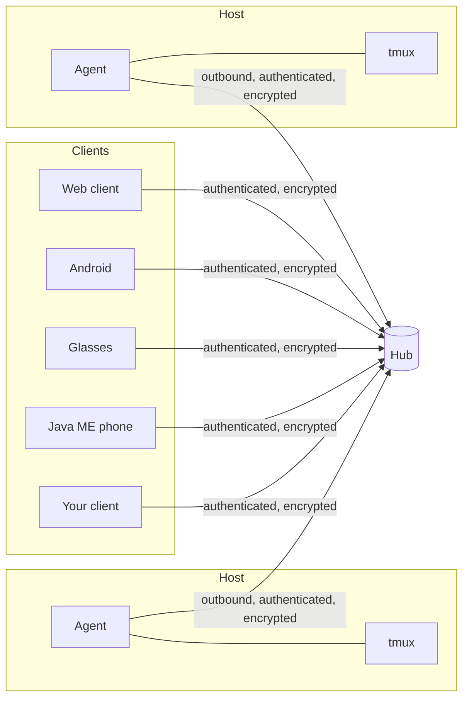

# Architecture

> Status: draft. This page is the entry point for anyone building a muxway
> client. It is filled in feature by feature; nothing here is implemented yet.

## Components

- **Agent**: runs next to tmux on each machine. It lists the panes its owner
  marked, reads them, types into them, and reports agent events (an AI CLI
  asking or finishing). It connects out to the hub, so a host needs no open
  port.
- **Hub**: the meeting point. It authenticates clients and agents, enforces
  each client's grants, routes requests, and fans out events.
- **Clients**: anything that speaks the protocol. Rich clients use the full
  stream; small ones use the **text mode**, which returns panes as plain,
  reflowed lines at a width the client chooses.

## Core flows (to be specified)

1. Pairing an agent with a hub.
2. Issuing a client token with read and write grants.
3. Listing hosts and panes.
4. Reading a pane (stream and text mode).
5. Sending text and named keys to a pane.
6. Agent events and notifications.

Each flow gets a sequence diagram and a protocol section in
`docs/protocol/` when it is implemented.
