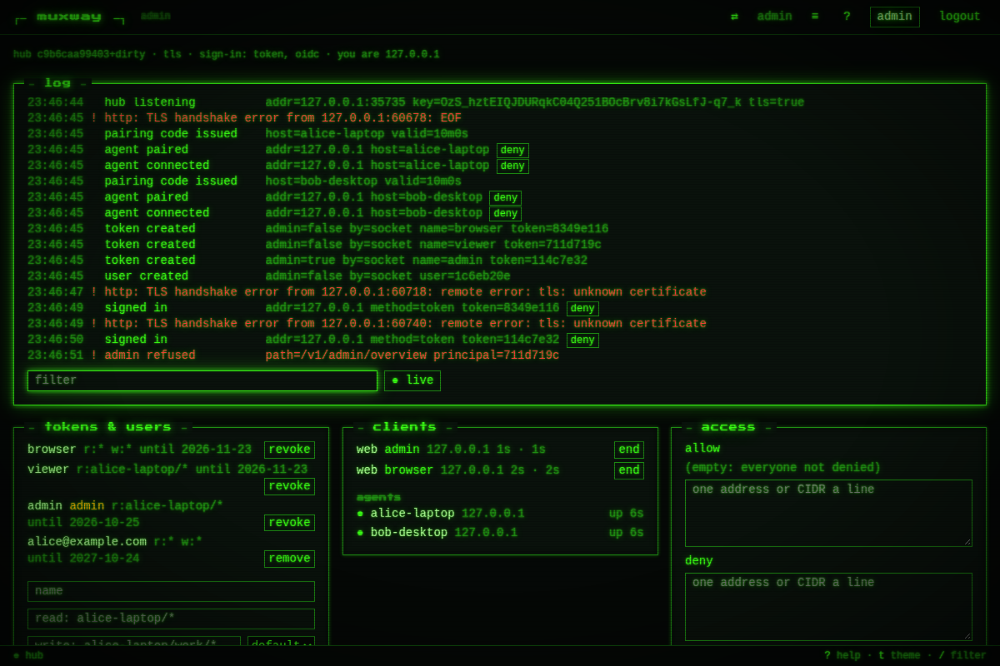
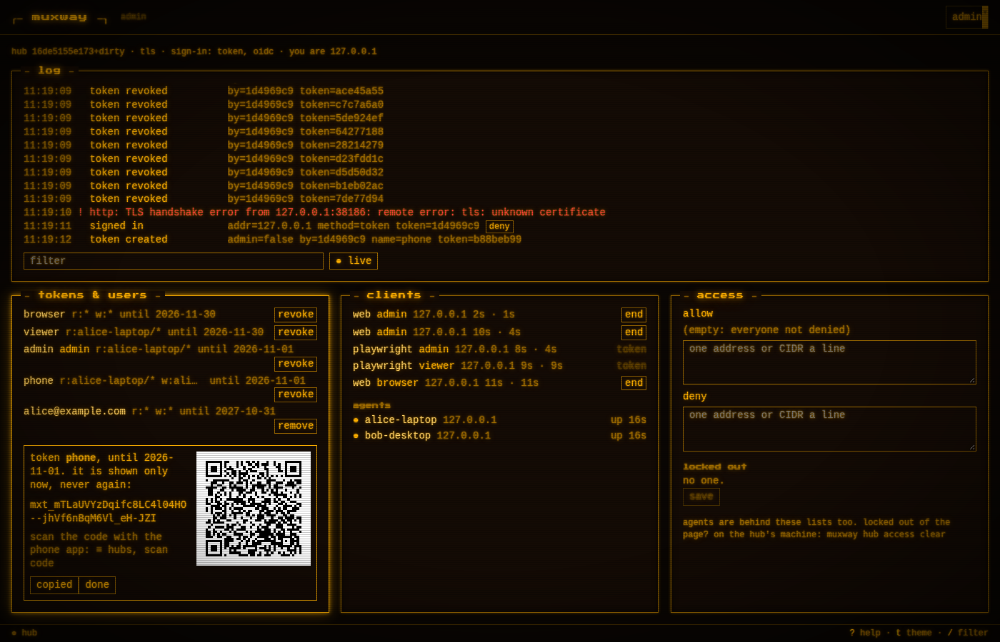
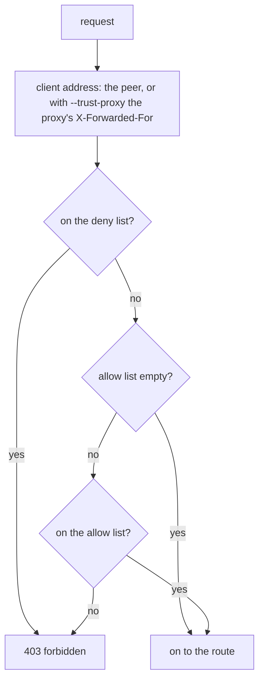
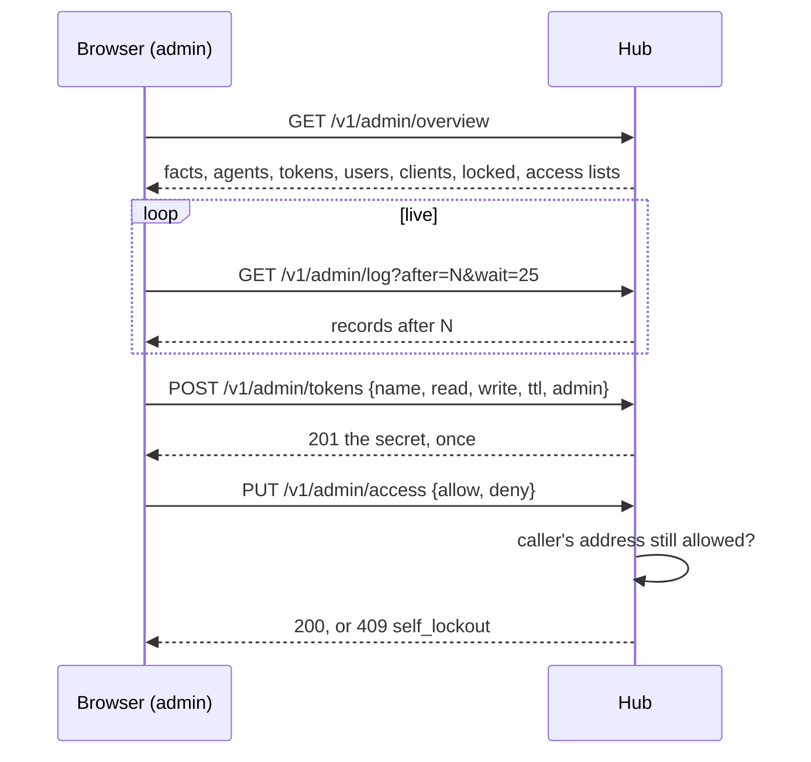

# The admin overview

Who may reach a hub is otherwise managed on the hub's machine, over its
admin socket, and read in its journal there. The **admin grant** lets the
owner do the same from anywhere: read the hub's log, see who is connected
and with what, mint and revoke tokens, end a session, and shut addresses
out.

## Using it

Give the grant to a token or a user:

```sh
muxway hub token create --name owner --read '*' --write '*' --admin   # lives 24 h unless --ttl
muxway hub user create --email alice@example.com --read '*' --admin
```

Signed in with it, the web client shows **admin** in the header. The page
`/admin` has four boxes:

```
┌ log ───────────────────────────────────────────────────────┐
│ 14:02:11  signed in       method=token token=0ddba4b5 addr=198.51.100.7 [deny] │
│ 14:02:40  audit input     token=0ddba4b5 host=alice-laptop pane=%3 bytes=12 │
│ 14:03:02 !authentication failed  addr=203.0.113.9 path=/v1/panes [deny] │
└ filter: ____________  ● live ───────────────────────────────┘
┌ tokens & users ──────┐┌ clients ─────────────┐┌ access ──────────────┐
│ phone  r:alice-* w:… ││ web      alice 1m    ││ allow: 198.51.100.0/24│
│ glasses r:… until …  ││ android  phone 12s   ││ deny:  203.0.113.0/24 │
│ name read write [create]│ agents: ● alice-laptop││ locked: 203.0.113.9   │
└──────────────────────┘└ [end] ────────────────┘└ [save] ───────────────┘
```



- **log**: the hub's own log lines, newest at the bottom, tailing live.
  Warnings are in the alert colour. The filter matches any word of a
  line. A line with an address has **deny**, which puts it on the deny
  list in the access box, to be saved there.
- **tokens & users**: every token and user with its grants, whether it is
  an admin, and until when. **revoke** (after a confirmation) ends the
  token and every session it signed in at once. The form creates a token:
  name, read and write patterns (separated by spaces or commas), a
  lifetime, admin or not. Its secret is shown **once**, with **copy** and
  as a **connect code**, a QR code the phone app scans (*≡ hubs*, *scan
  code*) to add this hub with the token; both are gone from the page at
  **done**, and the page never stores them.

  

  The code holds `muxway://connect?hub=<this hub's origin>&token=<secret>`,
  the same code the Android repository's `scripts/connect-qr.py` prints
  in a terminal. It is drawn black on white whatever the theme, since a
  scanner needs the contrast, beside the secret when the box is wide
  enough and under it when not.
- **clients**: signed-in browsers (`web`) and bearer clients (by the
  first word of their `User-Agent`: `muxway-android`, `muxway-midp`, …),
  with their principal, address, how long ago they started and were last
  seen. **end** ends a browser session; a bearer client is ended by
  revoking its token. Below them, the agents: online, from where, for how
  long.
- **access**: the address lists, one address or CIDR a line, and the
  addresses locked out after failed sign-ins, with **unlock**.

On Android an **admin** section in Settings shows the log tail and the
clients with *end*; tokens and address lists stay on the web and the CLI
(see [the UI guideline](../ui-guideline.md) §3).

## The address lists

`allow` and `deny`, each at most 256 CIDRs (a bare address is a `/32` or
`/128`). Every request is checked before anything else looks at it,
sign-in, pairing and the agent channel included:



A refused address is logged once a minute at most. Saving lists that
would refuse the address you are saving from is answered `409
self_lockout`; the page says so and offers **save anyway** for when that
address is meant to go. The lists live in `hub.json` and survive
restarts.

**Agents are behind the lists too.** With an allow list, put your agents'
addresses on it, or they are refused the next time they connect.

**Locked out?** On the hub's machine, over the admin socket, which the
lists do not cover:

```sh
muxway hub access list
muxway hub access clear              # both lists; or: clear allow, clear deny
muxway hub access allow 198.51.100.0/24
muxway hub access deny 203.0.113.9
```

## How it works



The log is a ring of the last 2000 lines at Info and above, kept in the
hub's memory and gone with it; the journal on the machine keeps the
rest. The endpoints are in the [protocol](../protocol/v1.md#admin).

## Security considerations

- **Admin is control of the whole hub**: an admin can mint a token with
  any grants. The flag is off by default, never implied by write grants,
  and only an admin can give it through the API. Give it to a short-lived
  token (24 h unless told otherwise) or to your own user, never to a token
  that lives on a device left lying around.
- Every admin action is logged with the acting principal (`by=`), the
  socket's as `by=socket`; creating an admin token is logged as such.
- The admin endpoints authenticate like every other (bearer, or cookie
  with the client header; rate limits and lockouts) and answer `403
  forbidden` to a principal without the flag. They are not in the CORS
  list, so no page on another origin can call them.
- The log holds what the journal holds: addresses, principal ids, host
  aliases, pane ids, byte counts, results. Never a token, a cookie, a
  pane's content, a text typed or transcribed. Tokens and users are
  listed without their hashes.
- A session is named to admins by a separate random handle, not by its
  cookie.
- The connect code is the secret, drawn: anyone who can photograph the
  screen while the box is open has the token, as they would have the text.
  Create a token with nobody looking and press **done**. The code is
  built in the browser from the hub's answer; its markup carries no text,
  title or label with the token, and it goes with the secret at **done**.
- The lists are parsed strictly and stored atomically; the deny list wins.
  The self-lockout check uses the address the hub sees, proxy aware. The
  socket is the way back in.
