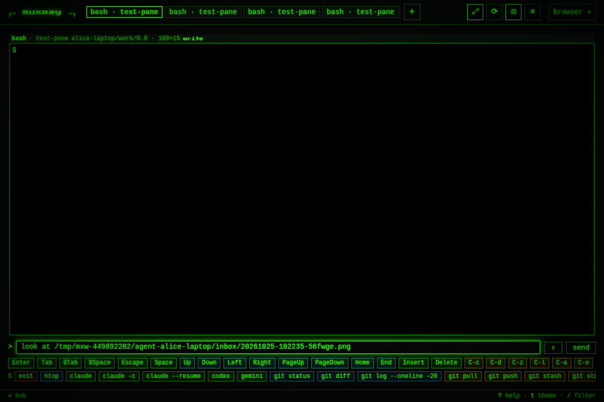
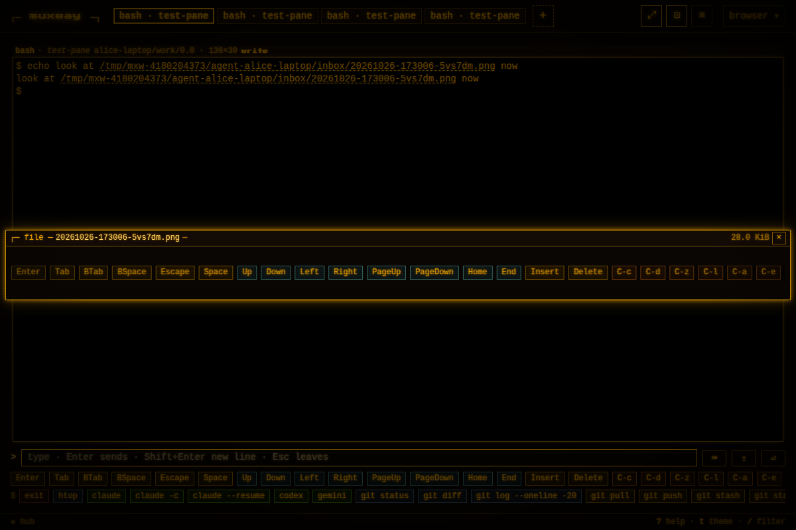
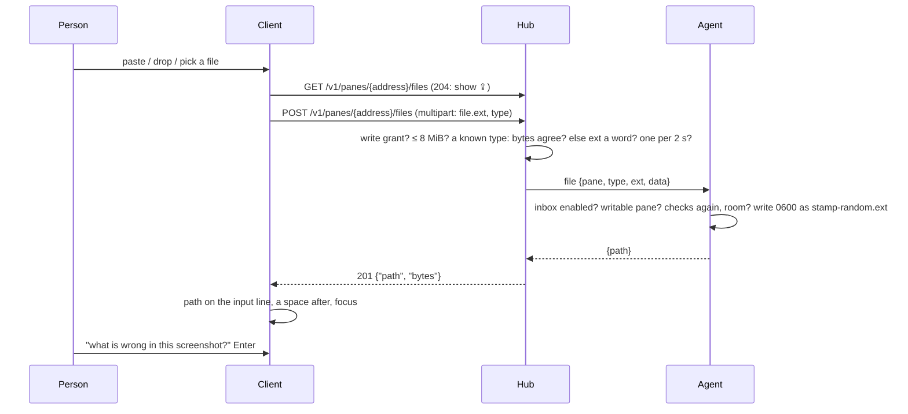
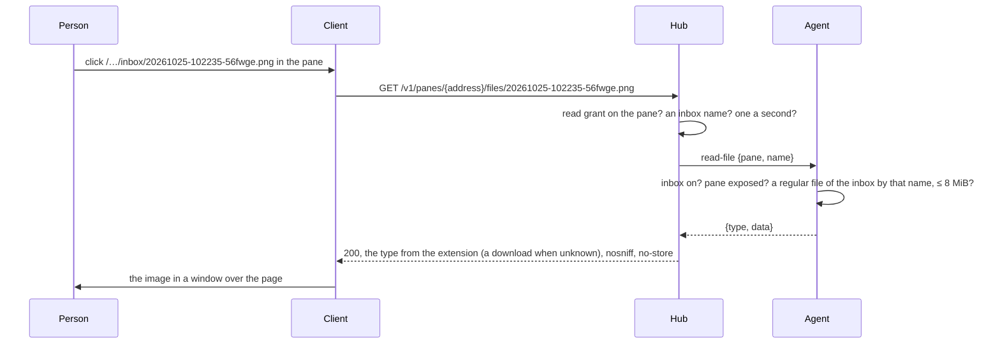

# Attachments: a file pasted or dropped into a pane lands on the host

An AI coding agent such as Claude Code reads an image or a file when its
path is in the prompt. In a local terminal a screenshot is pasted
straight in; through muxway only text travelled. Now a client can hand
the program in a pane a file: the host's agent writes it into an
**inbox** its owner enabled, and the client puts the file's path on the
input line for you to finish the sentence and send.

## Using it

On the host, once:

```sh
muxway agent run --inbox default     # inbox/ in the agent's directory; or --inbox <dir>
muxway agent run --inbox default --inbox-max-files 50   # a smaller cap than the 500 default
```

In the browser, on a writable pane of that host, the input line has `⇪`:

- **paste** a screenshot or a copied file (`Ctrl+V`), anywhere in the view;
- **drop** a file anywhere on the view;
- or **`⇪`** to pick one or several.

While a file goes, the line reads `⇪ shot.png · 2.1 KiB…`; then its path
lands on the line with a space after it, focused, and nothing is sent
until you press Enter: `what is wrong in /home/alice/.config/muxway/agent/inbox/20261025-102235-56fwge.png `.
Several files go one after another, each path appended.



## Seeing it again

Once the program has the path, so does everyone reading the pane: a
path of the inbox's shape printed in a pane is a link. In the browser a
click shows the file in a window over the page, an image as itself, a
PDF in a frame, a text as plain text, a kind it cannot show as its download only,
with its name, size and a `⤓` download in the bar; `Escape`, the bar's `×` or a click outside closes
it. A click on the link is not a click on the pane, mouse mode or not.
The link is the name only: the host serves a file of its inbox by that
name and nothing else, to a principal that may read the pane. Other
paths a pane prints open the same way where the host's owner allows it:
see [preview](preview.md).



Any file goes, up to 8 MiB. The host **knows** nine kinds, PNG, JPEG,
GIF and WebP images, PDF, plain text, Markdown, JSON and zip archives:
it checks that such a file is what it says and names it by its type,
`.png`, `.jpg`, `.gif`, `.webp`, `.pdf`, `.txt`, `.md`, `.json`, `.zip`;
an archive is kept as it came, never unpacked. Anything else, a `.pcap`,
a `.py`, a `.csv`, a spreadsheet, a binary, is kept as it came under the
extension its name ends in (one short word of letters and digits,
lowercased; `.bin` when there is none), so the program in the pane sees
what kind of file it got. A text with no extension, a `Makefile`, goes
as plain text and lands as `.txt`. Of the name you gave the file only
that extension is sent: the host names a file, never the client (decided
by the owner on 2026-11-04, see [the plan](../plans/2026-11-04-any-file-type.md)). Files are kept a day. On a host whose agent runs
without `--inbox` there is no `⇪`, and a paste or a drop answers with a
toast, `no inbox on alice-laptop: its agent needs --inbox`, and sends
nothing. On Android an image pasted into the line, a file picked with
`⇪` or one shared to muxway lands the same way; see [the Android
page](https://github.com/notmarkopadjen/muxway-android/blob/main/docs/features/attachments.md).

## How it works



The agent creates the inbox `0700` and each file `0600`, names it
`<yyyymmdd-hhmmss>-<6 random>.<ext>` with the extension from the type
it knows, else the word the client's name ended in, checked again, or `bin`,
refuses when the inbox holds 500 files (`--inbox-max-files` lowers that)
or 256 MiB, and removes files older than 24 hours at start and every
hour. Protocol: [`GET` and `POST
/v1/panes/{address}/files`](../protocol/v1.md) and the agent op `file`.

Reading one back:



Protocol: [`GET /v1/panes/{address}/files/{name}`](../protocol/v1.md)
and the agent op `read-file`.

## Security considerations

Until now a client could send a host text, named keys and clicks. This
adds bytes written to a directory on the host, kept narrow (decided by
the owner on 2026-10-24):

- **Off** unless the host's owner starts the agent with `--inbox`; the
  hub cannot turn it on.
- **One directory**, created by the agent, `0700`; names chosen by the
  agent; the extension from the type for a known one, which must agree
  with the bytes, else one short lowercase word of letters and digits
  taken from the end of the client's name and checked by hub and agent
  alike, else `bin`; no execute bit; nothing is ever run, unpacked or
  followed. Any file is taken since 2026-11-04 (the owner's decision,
  [plan](../plans/2026-11-04-any-file-type.md)): whoever may write a pane
  may already run anything in it, so an unchecked file on disk adds no
  right; what the inbox still guards is what it shows back, below.
- **Limits**: 8 MiB a file, 500 files or 256 MiB in the inbox, one file
  every two seconds per principal, a day's lifetime; a full inbox
  refuses rather than evicts.
- **The pane's write grant** is required, so a read-only token cannot
  fill the disk, and an audit line on hub and agent names who put what
  type and size where. Never the content.
- **Known text** types must be UTF-8 without control bytes but tab,
  newline and return, so a `.txt`, `.md` or `.json` cannot smuggle an
  escape sequence into whatever cats it; JSON must parse. The agent
  checks the type again itself. A file of any other kind is bytes, as a
  `.pcap` or a `.py` copied in by hand would be.
- **The client's own name** for the file is used for its toast and, for
  a kind the host does not know, for the extension only: one word of one
  to eight lowercase letters or digits, nothing else, so no `../`, dot,
  slash or shell character comes anywhere near a path, and the audit line
  names the extension, never the name.
- **The person types the path** into the prompt; the client never sends
  it to the pane on its own. A hostile image or PDF read by the program
  in the pane through its path is what pasting it locally does.
- The hub holds the bytes for the request only. The message that carries
  a file to the agent, or one back, may be up to 12 MiB; every other
  message stays under 1 MiB.
- **Reading back** needs the read grant on the pane, since the path is
  on the screen for every reader anyway. The client sends the name and
  the agent joins it to its inbox; a name of any other shape is refused
  by the hub before the host hears of it, and a symlink or a directory
  under a right-shaped name is not a file. The type is the extension's,
  never sniffed, texts as plain text, a kind the host does not show as
  a download; so an `.html` or an `.svg` comes back as plain text and a
  `.pcap` or an `.exe` as bytes; the browser shows an image from a blob
  of its own (`img-src 'self' blob:` in the policy) and never renders a
  file as a page. One read a second per principal; an audit
  line on hub and agent names who read which file and its size.
