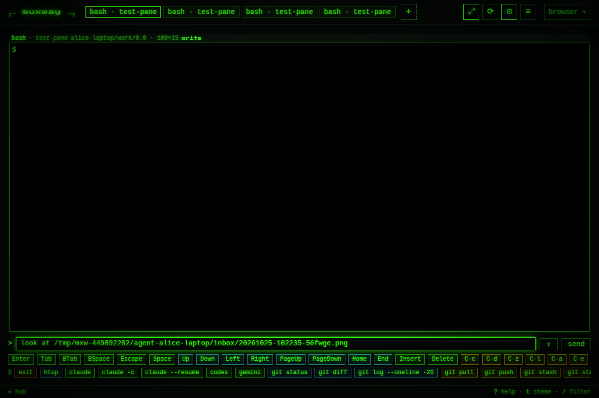
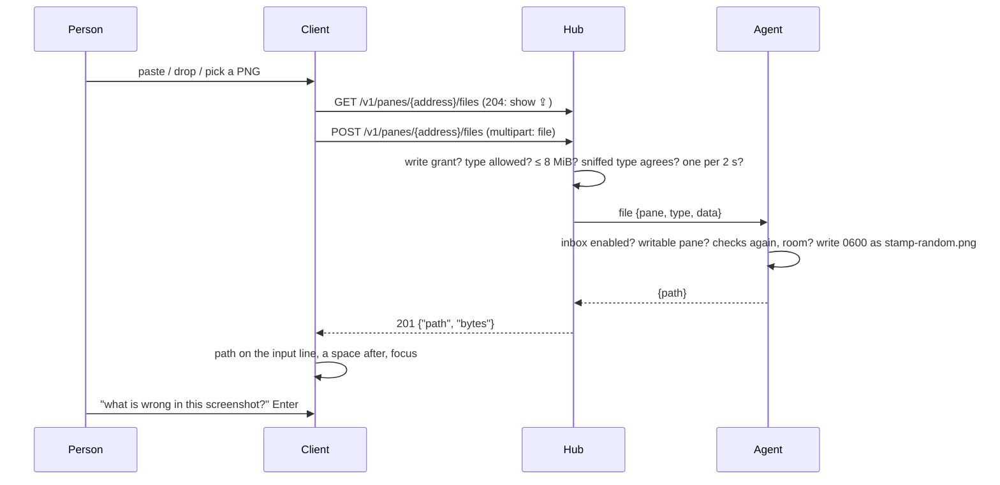

# Attachments: a file pasted or dropped into a pane lands on the host

Claude Code reads an image or a file when its path is in the prompt. In a
local terminal a screenshot is pasted straight in; through muxway only
text travelled. Now a client can hand the program in a pane a file: the
host's agent writes it into an **inbox** its owner enabled, and the
client puts the file's path on the input line for you to finish the
sentence and send.

## Using it

On the host, once:

```sh
muxway agent run --inbox default     # inbox/ in the agent's directory; or --inbox <dir>
muxway agent run --inbox default --inbox-max-files 50   # a smaller cap than the 500 default
```

In the browser, on a writable pane of that host, the input line has `⇪`:

- **paste** a screenshot or a copied file (`Ctrl+V`), anywhere in the view;
- **drop** a file anywhere on the view;
- or **`⇪`** to pick one or several.

While a file goes, the line reads `⇪ shot.png · 2.1 KiB…`; then its path
lands on the line with a space after it, focused, and nothing is sent
until you press Enter: `what is wrong in /home/alice/.config/muxway/agent/inbox/20261025-102235-56fwge.png `.
Several files go one after another, each path appended.



The types: PNG, JPEG, GIF and WebP images, PDF, plain text, Markdown and
JSON, up to 8 MiB each. Files are kept a day. On Android the same button
opens the system picker, and *share* sends an image, a text or a PDF to a
pane you pick ([muxway-android#11](https://github.com/notmarkopadjen/muxway-android/issues/11)).

## How it works



The agent creates the inbox `0700` and each file `0600`, names it
`<yyyymmdd-hhmmss>-<6 random>.<ext>` with the extension from the type,
refuses when the inbox holds 500 files (`--inbox-max-files` lowers that)
or 256 MiB, and removes files older than 24 hours at start and every
hour. Protocol: [`GET` and `POST
/v1/panes/{address}/files`](../protocol/v1.md) and the agent op `file`.

## Security considerations

Until now a client could send a host text, named keys and clicks. This
adds bytes written to a directory on the host, kept narrow (decided by
the owner on 2026-10-24):

- **Off** unless the host's owner starts the agent with `--inbox`; the
  hub cannot turn it on.
- **One directory**, created by the agent, `0700`; names chosen by the
  agent; the extension from an allow-list keyed by the type, which must
  agree with the bytes; no execute bit; nothing is ever run, unpacked or
  followed.
- **Limits**: 8 MiB a file, 500 files or 256 MiB in the inbox, one file
  every two seconds per principal, a day's lifetime; a full inbox
  refuses rather than evicts.
- **The pane's write grant** is required, so a read-only token cannot
  fill the disk, and an audit line on hub and agent names who put what
  type and size where. Never the content.
- **Text** types must be UTF-8 without control bytes but tab, newline and
  return, so a text cannot smuggle an escape sequence into whatever cats
  it; JSON must parse. The agent checks the type again itself.
- **The client's own name** for the file is used for its toast only and
  never sent, so no `../` or shell characters come anywhere near a path.
- **The person types the path** into the prompt; the client never sends
  it to the pane on its own. A hostile image or PDF read by Claude Code
  through its path is what pasting it locally does.
- The hub holds the bytes for the request only. The message that carries
  a file to the agent may be up to 12 MiB; every other message stays
  under 1 MiB.
