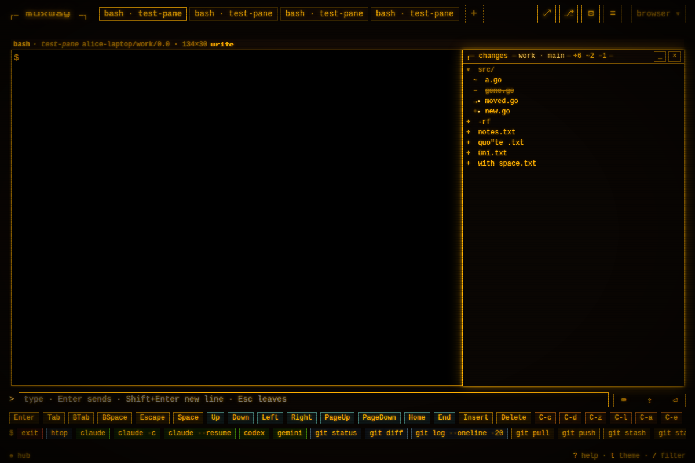
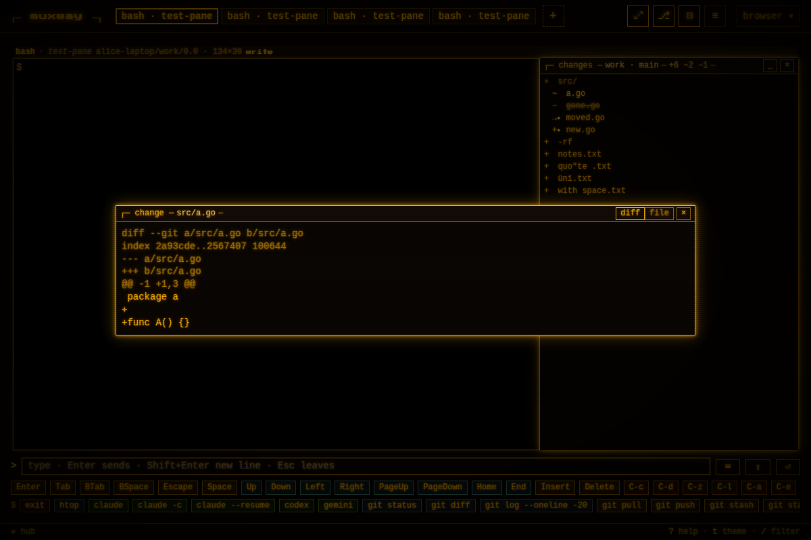
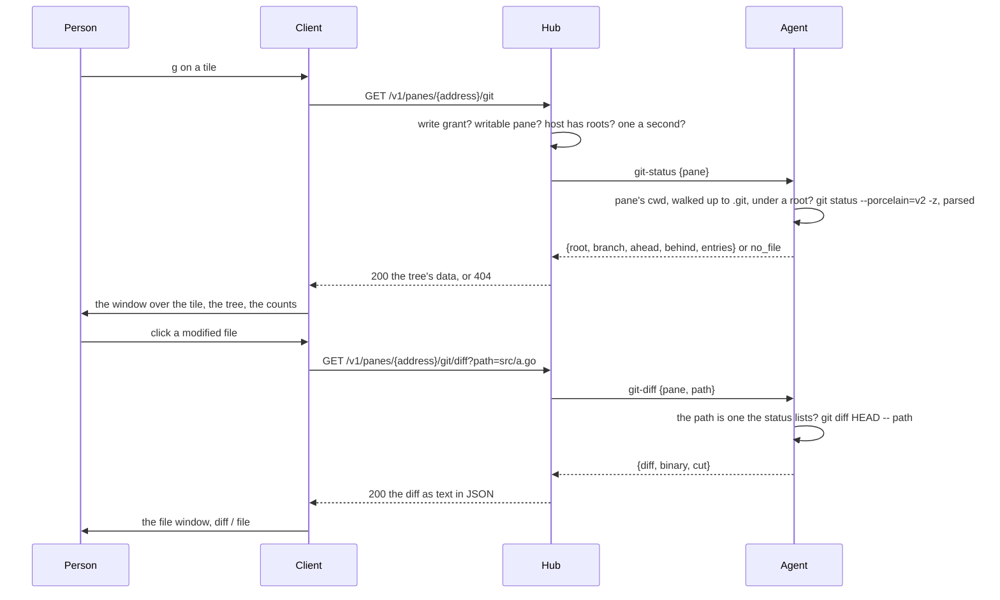

# Changes: git's view of the pane's repository, over the tile

A pane running an AI agent or a build leaves a trail of changed files.
Seeing them means `git status` in the pane, which interrupts the program
there, or another pane. On a host whose owner named **preview roots**
(see [preview](preview.md)), a writable pane has a **changes window**:
`⎇` in the header, or `g`, opens it over the tile, docked to its right
edge, with the repository's changes as a folder tree, the branch and the
counts in its bar. The tile keeps its size and its fit: the window lies
over the screen. A click on a file opens it in the file window, as its
diff against the last commit or as the file it is now.



## Using it

On the host, the roots named for the preview are enough:

```sh
muxway agent run --preview ~/work
```

In the browser, on a writable pane of that host, `⎇` or `g` opens the
window; `g` or `Esc` closes it, `×` too, and `_` folds it to its bar in
the tile's corner. The bar reads `┌─ changes ─ muxway · main ↑1 ─ +3 ~5
−1 ─ [_] [×]`: the repository's directory, its branch, how far it is
ahead of or behind its upstream, and the counts. The body is a tree,
directories first, folded or unfolded by a click, with a mark and a
colour per file:

| mark | kind | drawn |
|---|---|---|
| `+` | added, untracked | the ok colour |
| `~` | modified | the ink |
| `−` | deleted | dim, the name struck through |
| `→` | renamed (the old path in the row's title) | the ink |
| `!` | conflict | the warn colour, bold |

A `●` after the mark says the change is staged. The window asks the
host again every five seconds and once the pane's output settles, so a
program's trail shows as it is left. A pane whose directory is in no
repository under the roots says `not in a repository the host shows`.

A click on a file opens the file window (the one the preview opens, with
its `⤓` download) with a `diff` / `file` switch in its bar: the diff as
unified text, `+` rows in the ok colour, `−` rows dim and struck, hunk
and file headers dim; `file` shows the file as the preview does, a
Markdown file rendered, code with its colours. A deleted file has its
diff only; an untracked file is the file only, it has no diff yet. A
binary file's diff says so.



## How it works



The agent finds the repository itself, walking up from the pane's
current directory to the nearest `.git`, and runs git only when that
root lies under a preview root. Protocol: [`GET
/v1/panes/{address}/git` and `GET /v1/panes/{address}/git/diff`](../protocol/v1.md)
and the agent ops `git-status` and `git-diff`.

## Security considerations

This is the first time the agent runs a program other than tmux on the
host, by the owner's explicit decision (2026-10-27): two read-only git
commands, for repositories under the roots the owner already named, for
writers who could run both in the pane.

- **Off** without `--preview`; a host without `git` on its path answers
  as a host without roots. The hub asks nothing of a host without roots.
- **The write grant** is required, and a writable pane; a reader gains
  nothing. A writer can type `git status` and `git diff` into the pane
  already, so the window adds convenience, not reach.
- **Where git runs.** The agent walks up from the pane's directory to
  the nearest `.git` and runs git there only when that directory lies
  under a root once every symlink is followed, with no dot component
  below the root; git never runs to discover a repository. The root is
  named `safe.directory` for the one run, so a root the owner named is
  read whoever owns it.
- **What git runs.** A fixed argument list and no shell: `status
  --porcelain=v2 --branch --untracked-files=all -z` and `diff
  --no-color --no-ext-diff --no-textconv HEAD -- <path>`, both with
  `--no-optional-locks`, under a ten second timeout. The environment is
  the agent's `PATH` and nothing else of its own: no `GIT_DIR`, no
  pager, no prompt, and no system or global configuration
  (`GIT_CONFIG_NOSYSTEM`, `GIT_CONFIG_GLOBAL=/dev/null`), with the
  pager, the file monitor and the hooks path overridden on the command
  line, so no alias, external diff, text converter, file monitor or hook
  of anyone's runs, not from the repository's own configuration either.
  Nothing is written: the index is not refreshed, no lock is taken, the
  working tree is untouched.
- **Arguments.** The diff's path must be one the status just listed
  (an untracked path is never diffed), and goes after `--`, so a path
  that starts with a dash is a path. `-z` output is parsed, so a file
  name with a space, a quote, a newline or any character is a name in
  the tree; a path with a control character cannot be asked for (`400`).
- **Output** is capped (2000 entries, 1 MiB of diff) and reaches the
  browser as JSON, drawn as runs of text, never as HTML; file names in
  the tree are text.
- **One refusal** (`404 not_found`) for everything the host will not
  show, so the endpoint cannot be used to map the host; one status a
  second per principal with a burst of three, two diffs a second with a
  burst of five.
- **Audit** on hub and agent: who, pane, the root, the path, the number
  of entries, the size of the diff, the result. Never the content.
