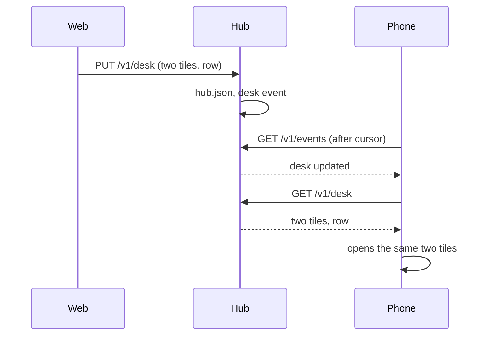

# The desk: one view, every client

Close the web client and open it again, or pick up the phone, and the
panes you had open are there, laid out as you left them, the parked and
minimised ones where they were. The **desk** is the hub's record of the
view: which panes are open as tiles, the focused one, the arrangement,
the minimised row and the tab order, or the window the window view
shows. Every client writes it as you change the view and opens it when
it starts; a client running follows the others within a second.

## What it holds

One document per hub, in `hub.json` beside the tokens (see
[`GET /v1/desk`](../protocol/v1.md#get-v1desk)): `view` (`panes`,
`window` or `list`), up to four `panes`, the `focused` one, the `arrangement` and,
for a custom one, the `tree` and `weights` the tiles are laid out by,
the `minimised` panes, the tab `order`, or the `window` the window view
shows; a `list` desk has nothing open and keeps the `minimised` row
and the `order`, written when the last tile is minimised while no other
pane is awake, and opens nothing; `updated`, `by`, the principal that wrote it last, and `rev`, the
hub's count of writes, by which clients order desks. Panes are named by
address, as everywhere.

## What the clients do

- **The web client** writes the desk, half a second after the last
  change, on every change of the tiles, the arrangement, the weights,
  the minimised row, the focus and the tab order (which leaves the
  browser's storage for the desk), and in the window view on a change
  of the window or the focus. The list has a `desk` row at the top (and
  `D`) that opens it; a client that was in a view when it was closed and
  is started on the list opens the desk at once when it holds panes,
  while a link to a view goes where it points and a client closed on
  the list starts on the list. An open client applies another client's
  `desk` event within a second: the panes, the arrangement and the
  minimised row; the focus is restored on opening only, so typing on
  the phone does not move the web's focus. A desk of a lower revision
  than the client's own last write is ignored, so a write in flight is
  not undone. **The minimised row is the desk's**: a view opened from
  the list or a link, which has no row of its own, takes the desk's
  row, less the tiles it opens, once the desk is read, and writes its
  own desk only then (before it follows any), so a view that opens never
  empties every client's row. A view opened from the desk's row, or
  within the view, carries its row as before. A page left within the
  half second of quiet (a reload, the tab closed) sends its last desk
  on `pagehide`, with `keepalive`, so a row minimised a moment before
  is not lost.
- **Android** reads and writes the desk the same way; the glasses and
  the phone open the desk's focused pane from their lists.

## Security considerations

- The desk names panes, never content. Reading it reveals which panes
  the owner has open, filtered to what the reader may read from the
  listing anyway. Writing it moves other clients' views: a write grant
  on any pane is required, an observer of a share never sees it, and
  the body is validated field by field (addresses by the grammar, one
  to four panes, the tree's leaves against the panes, weights in range)
  and capped at 8 KiB; a burst of five writes, then one a second per
  principal.
- Every pane a desk names must be one the writer may read; a pane the
  reader may not read is left out of the answer, the tree with it.
- The write is audited on the hub with the principal, the view and the
  count of panes, never the panes' names.
- A hub used by several people with write grants shares one desk: they
  move each other's views. Give guests read-only tokens.
