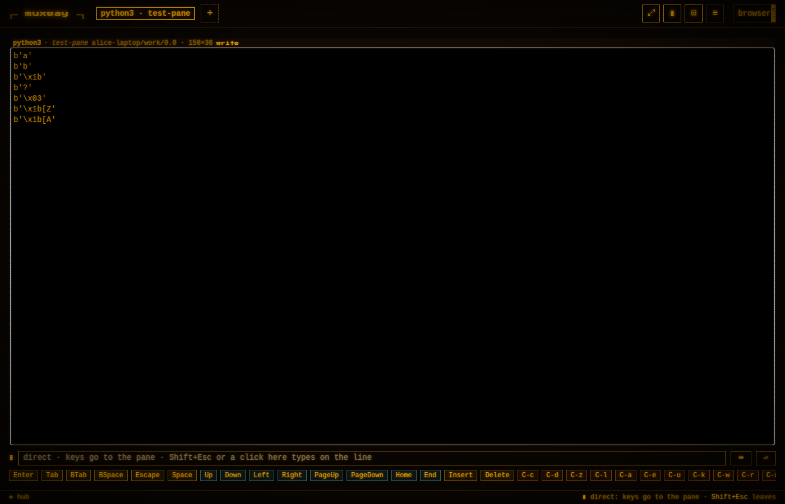
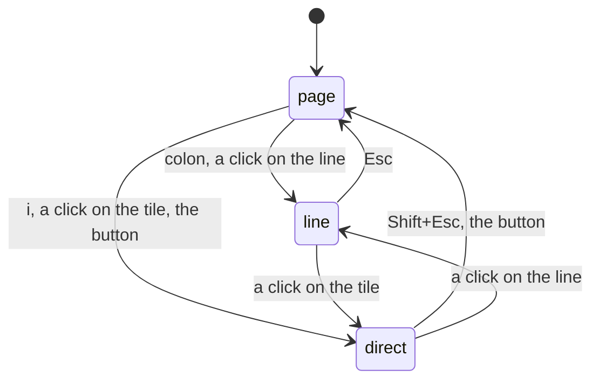
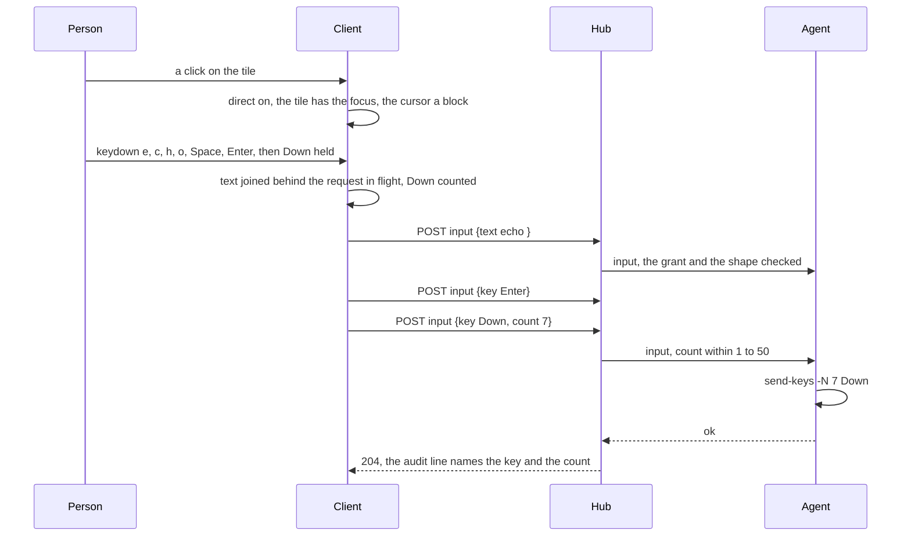

# Direct typing: keys go to the pane as they are pressed

The input line composes: a line is written, read over and sent whole,
which suits a prompt for an AI agent or a long command. It does not
suit a shell or an editor in the pane: every arrow, every `Ctrl+R`,
every character of a `vim` session, a `y` to a question. A terminal
takes keys as they come, and so does muxway's web client from a
keyboard: `i`, or a click on the focused tile's screen, and from then
on every key goes to the pane as it is pressed, the way a terminal
emulator sends it, until `Shift+Esc`, the `▮` button or a click on the
line brings the line back.

## Using it

The pane view is in one of three states, said in the input row:

| state | keys go to | the row shows | enter | leave |
|---|---|---|---|---|
| page | the view's shortcuts (`g`, `f`, `z`, `]` …) | `>` | `Esc` from the line, `Shift+Esc` from direct typing | |
| line | the input line | `>` with the caret in the line | `:`, a click on the line | `Esc` |
| direct | the focused pane, key by key | `▮`, `direct` in the placeholder and the status bar, the pane's cursor as a block | `i`, a click on a writable tile's screen, `▮` | `Shift+Esc`, `▮`, a click on the line |

`i` is vim's: it types into the text, which here is the pane. `:` is
vim's too: it takes the line. `Esc` stays the pane's while direct typing
is on, since the programs in it live on `Esc` (Claude Code interrupts,
vim leaves insert mode), so leaving is `Shift+Esc`, the mirror of the
line's `Shift+Esc` that sends `Escape` while typing: `Shift+Esc` is
always the other one. The view's single-letter shortcuts are keys for
the pane while it is on, so `g` types a `g`; the header buttons and the
mouse keep working, and the [changes window](changes.md) closes by `×`
or `⎇`. While the [file window](preview.md) is open its `Esc` closes it
and no key reaches the pane; the [keyboard window](keyboard.md)'s caps
send as they do.

What a key becomes:

| pressed | sent |
|---|---|
| a printable character, alone or with Shift, a dead key's result, an IME's composed text | the text |
| `Ctrl` + a char of the grammar (`a`–`z`, digits, `` ` - = [ ] \ ' , . / ``), `Alt` likewise | `C-x`, `M-x`, `C-M-x`; `Ctrl+C` with text selected on the page is the browser's copy instead |
| `Enter`, `Tab`, `Backspace`, `Escape`, the arrows, `PageUp` `PageDown` `Home` `End` `Insert` `Delete`, `F1`–`F10`, with `C-` `M-` `S-`; `Shift+Tab` | the key by its name, `BTab` for Shift+Tab |
| a paste | the text as one request, tabs as two spaces, control characters dropped; a file to the inbox, its path typed |
| `Ctrl+Shift` + a letter, `Ctrl+T` `W` `N` `Tab`, `F5` `F11` `F12`, the OS key, `CapsLock`, a key under composition | nothing: the browser's |

A held key is a few requests, not one per repeat: the client queues
what it sends to a pane and, while one request is in flight, joins text
to the text waiting and counts a key equal to the key waiting, up to 50
(`{"key": "Down", "count": 7}`), on a host whose agent takes a count;
an older host gets one request per press. A refused key is a toast and
is dropped, as the line's is. On a touch screen a tap keeps the line's
ways: the row the program waits on focuses the line, and `i` from a
hardware keyboard turns direct typing on. Focusing a read-only tile
ends it, as does leaving the view; it is not remembered between visits.

## How it works

Protocol: `count` with `key` under [`POST /v1/panes/{address}/input`](../protocol/v1.md),
and `"repeat": true` in the hosts listing for an agent that takes it.

## Security considerations

- **Nothing new reaches the host.** The same endpoint, the same write
  grant and writable pane, the same whitelist of key names and the same
  text rules. `count` repeats a key the whitelist admits, never text, at
  most 50 times, so one request types at most what 50 did.
- **The boundary is the browser's key event.** The mapper emits names
  of the grammar and printable text only; what it does not know is
  dropped on the client, and hub and agent validate as they do, so no
  escape sequence can be built from keys. Composed and pasted text go
  through the text rules; control characters are never text.
- **The wrong pane.** The mode is shown in the prompt, the placeholder,
  the status bar and the block cursor; keys go to the focused tile only;
  a read-only tile focused ends it.
- **Clipboard.** Nothing is read without a paste the person made.
- **Limits.** The per-principal rate stands as the backstop; the
  client's queue keeps a held key under it. Audit lines as before, with
  `count` on a key; never the text.
