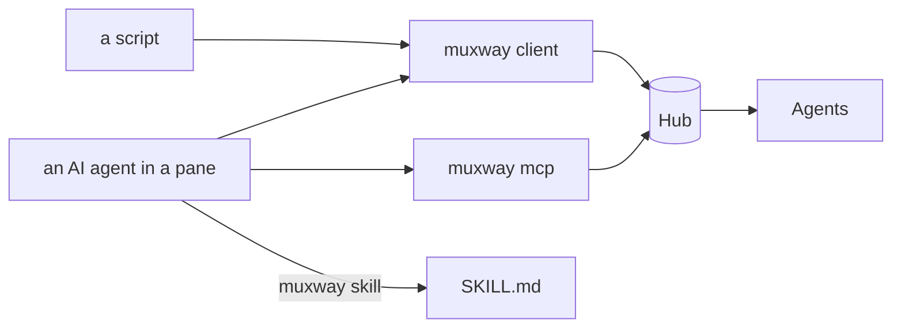

# Driving muxway: from a script, a shell, or an AI agent

Everything a client does is an HTTP request with a token, so `curl` has
always been a client. This gives the same to a shell script and to an AI
agent in a pane without the ceremony: a command-line client, the same as
an MCP server, and the guide an agent reads to use them.



## `muxway client`

```sh
muxway client connect --hub https://hub.example.com --token-file ./tok   # once
muxway client panes                      # every pane the token may read
muxway client inbox                      # what waits for its owner, oldest first
muxway client read alice-laptop/work/0.0 --lines 50
muxway client send alice-laptop/work/0.0 "make test" --enter
muxway client key alice-laptop/work/0.0 C-c
muxway client answer alice-laptop/work/0.0 yes
muxway client wait alice-laptop/work/0.0 --timeout 20m
muxway client wait                       # any pane
muxway client events --follow
```

`connect` checks the token against the hub (`GET /v1/me`) and keeps the
hub, an optional `--ca` file and the token in the client directory
(`muxway/client` under the configuration directory, or `MUXWAY_DIR`;
`--dir` picks another), the directory mode 700 and the token file 600.
`MUXWAY_HUB`, `MUXWAY_TOKEN` and `MUXWAY_CA` in the environment override
it, for a one-off or a service. The token is never printed.

Output is the hub's text mode for people (`panes`, `inbox`, `read`,
`events`), one line per thing; `--json` prints the hub's JSON as it is.
`wait` prints `<address><TAB><kind><TAB><text>[<TAB><choices joined by |>]`
for the first pane that needs its owner, what already waits in the inbox
first, then the event feed, and exits 2 when the time runs out. A
refusal is the hub's code on stderr and exit 1: `read_only` for a write
the token may not make, `not_found` for a pane it may not see,
`bad_input` for a key outside the grammar or a choice not offered.

## `muxway mcp`

The same seven operations as [MCP](https://modelcontextprotocol.io) tools
over stdio, for an AI agent's MCP configuration:

```sh
claude mcp add muxway -- muxway mcp            # Claude Code
# or in a configuration file:
{"mcpServers": {"muxway": {"command": "muxway", "args": ["mcp"]}}}
```

| Tool | Does |
|---|---|
| `list_panes` | the panes the token may read, text mode |
| `inbox` | what waits, oldest first, with a question's choices |
| `read_pane` | the last lines of a pane (`address`, `lines`) |
| `send_text` | type into a pane (`address`, `text`, `enter`) |
| `send_key` | press a named key (`address`, `key`, `count`) |
| `answer` | answer a question with one of its choices (`address`, `choice`) |
| `wait` | block until a pane, or any pane, needs its owner (`address`, `timeout_seconds`, at most 3600) |

Newline-delimited JSON-RPC 2.0, protocol `2025-06-18`, `initialize`,
`tools/list`, `tools/call` and `ping`; a refusal by the hub is a tool
result with `isError`, so the agent reads the code and goes on. It reads
the same client directory and environment as `muxway client`. No
dependency beyond the standard library.

## `muxway skill`

```sh
mkdir -p .claude/skills/muxway && muxway skill > .claude/skills/muxway/SKILL.md
```

prints the short guide an agent in a pane reads: how to notify its owner,
how to ask a question with fixed answers (`muxway ask`), and how to reach
other panes with `muxway client` or the MCP tools. The source is
[`internal/skill/SKILL.md`](../../internal/skill/SKILL.md).

## Security considerations

- The client and the MCP server hold a token the owner minted, with its
  grants; they can do nothing the token cannot. Mint a narrow one for an
  agent: read on what it may watch, write on the one pane it may drive.
- The token file is mode 600 in a mode 700 directory; a token from the
  environment is visible to processes of the same user, as any
  environment is. The token never appears in output, errors or logs.
- Plain `http` is accepted for `127.0.0.1` and `localhost` only; anything
  else must be `https`, with `--ca` for a private certificate.
- The MCP server speaks to one local process over its own stdin and
  stdout; it listens on nothing.
- Every write goes through the hub's audit log like any client's, with
  `X-Muxway-Client: cli`.
