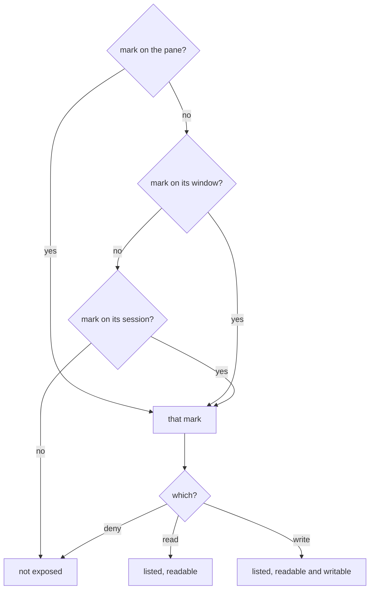
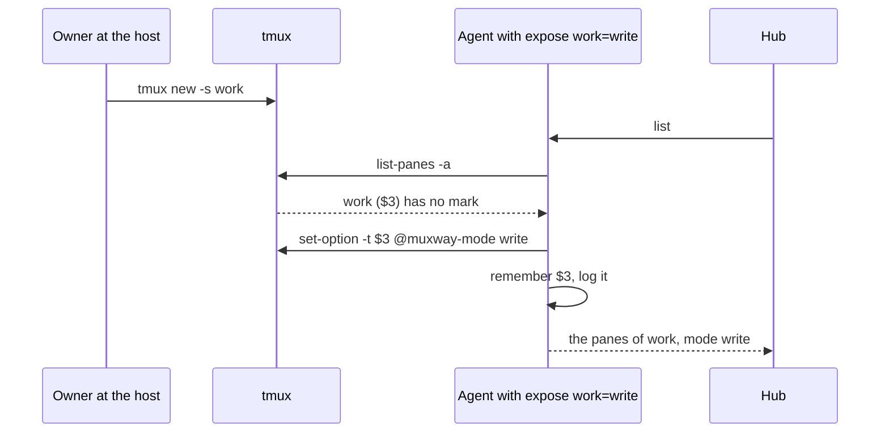
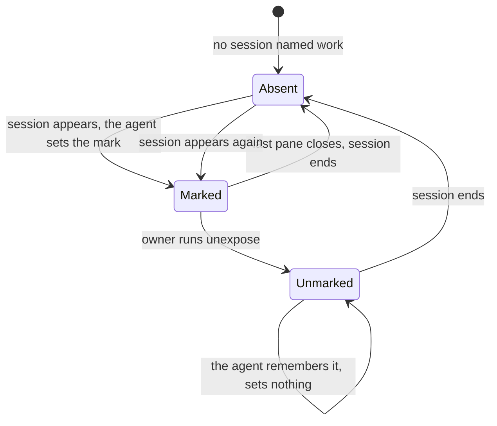

# Exposing panes

Nothing on a host is reachable through muxway until its owner says so.

## Commands

```sh
muxway expose -t work               # every pane of session "work", read-only
muxway expose -t work:1 --write     # every pane of window 1, readable and writable
muxway expose -t work:1.0 --write --name build   # one pane, with an alias
muxway expose -t work:1.2 --deny    # hide one pane inside an exposed window
muxway unexpose -t work:1           # remove the window's mark
muxway exposed                      # everything reachable right now, with its mode
```

Run them on the host, inside tmux or with `--tmux-socket` / `--tmux-name`.

## How marks work

A mark is a tmux user option, `@muxway-mode`, set on a session, a window or
a pane. tmux resolves it from pane to window to session, so:

- A mark on a session or window covers every pane in it, **including panes
  created later**. A new split in a writable window is writable at once.
- A pane a client splits off (see [new panes and
  sessions](new-panes.md)) gets a copy of a mark set on the pane it came
  from; a mark on the window or session covers it anyway.
- The most specific mark wins: `--deny` on a pane hides it inside an
  exposed window; `--write` on a pane makes it writable inside a read-only
  session.
- Marks live and die with what they are set on, and all of them vanish
  when the tmux server stops. A restarted server exposes nothing.
- Moving a window to another session keeps a mark set on the window and
  loses one inherited from the old session. Clients' grants are checked
  against the new address.



The agent re-reads the marks for every request. As a second guard it
refuses a pane whose process changed under the same pane id on the same
tmux server; a restarted server hands out the same ids with new
processes, and those are taken afresh.

## Standing marks

Marks die with their session, so closing a session's last pane, or
restarting tmux, leaves the next session of the same name unexposed until
`muxway expose` runs again. A standing mark names a session on the
agent's command line instead:

```sh
muxway agent run --expose work=write --expose notes=read
```

Whenever a session of that name exists, the agent sets the mark on it,
the same `@muxway-mode` option, so `muxway exposed` and
`tmux show-options` show it like one set by hand.

- The name is exact, `[A-Za-z0-9_.-]{1,32}`: no patterns. The mode is
  `read` or `write`. A bad value refuses to start.
- A session is marked once: `muxway unexpose -t work` holds for as long
  as that session lives, and a session of the name started later is
  marked again. (The agent tells sessions apart by the tmux server's
  pid, the session id and its creation time.)
- The mark is a session mark, so `--deny` or `--write` on a window or a
  pane inside it still wins, and an alias on a pane stays.
- Each application is logged on the host: the session's name, id and
  mode.





## Security considerations

- **Read** shows everything the pane shows, including secrets printed on
  screen and in scrollback (up to 2000 lines). Exposure also lets the
  pane's processes notify and ask through the agent, and the watcher read
  its screen when a known AI harness runs there; an unexposed pane gets
  none of it.
- **Write** is a shell. Anything typed runs as the host's user. Prefer
  exposing single panes for writing over whole sessions.
- **Write also allows resizing** the pane, or its window, from a client,
  as a terminal would. The window and its panes change size under you at
  the host, and the programs in them reflow; they go back to automatic
  sizing and their old layout when the client leaves. At most one resize
  per second per window, all audited.
- **A standing mark** is the owner's standing decision, made where the
  agent's other decisions are made (`--allow-sessions`, `--allow-close`):
  the same power as running `muxway expose` after every tmux start. No
  client can set, extend or ask for one, and only an exact name is
  taken, so it never exposes a session the owner did not name.
- **Write also allows splitting** a pane into two from a client, where the
  token's write grant covers the new pane as well. With `muxway agent run
  --allow-sessions`, a client with a write grant on the name may also
  **start a session**, which the agent marks writable in the open; the
  default is off. See [new panes and sessions](new-panes.md).
- **Files.** With `muxway agent run --inbox <dir>` (or `--inbox default`:
  `inbox/` in the agent's directory), a client with a write grant may
  hand a writable pane's program a file: an image, a PDF or a text, up
  to 8 MiB, written into that one directory under a name the agent
  chooses and kept a day. The default is off. See
  [attachments](attachments.md).
- `Escape` is among the keys a client may send, because AI command-line
  tools use it to interrupt. In editors it opens command mode, so a pane
  running an editor is as powerful as a shell.
- Do not expose a pane that is logged in elsewhere as a more privileged
  user (`ssh root@...`, `sudo -s`) unless that is exactly what you want.
- A program in a pane names itself (its `argv[0]`), and tmux prints that
  name raw in a listing. So the agent lists panes with a separator that is
  random for each listing and accepts only ids of tmux's own shape (`$1`,
  `@2`, `%3`). A name that happens to contain the separator makes its own
  pane unlistable for that listing and nothing else: no field of another
  pane can be forged.
