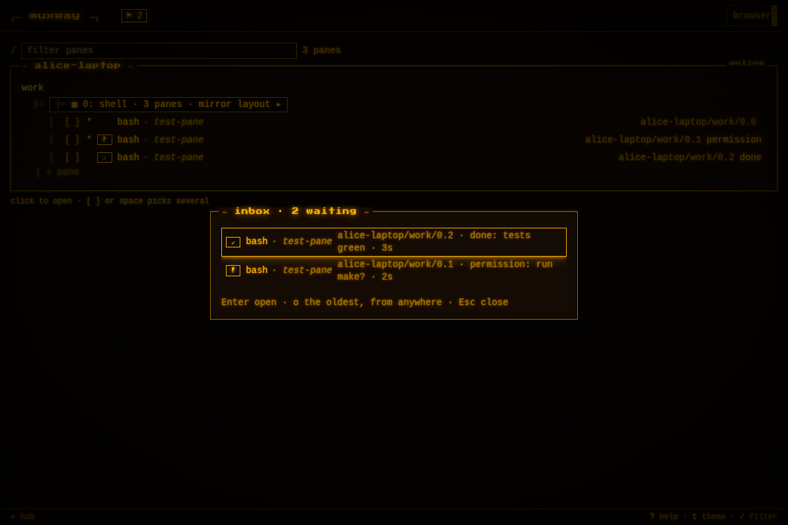

# The inbox: everything that waits for you, across hosts

A pane that [needs its owner](notifications.md) carries `attention` in
the listing. With a few agents on a few machines, the question is not
"does this pane wait" but "what waits, and which first". The inbox is
that list: every pane the principal may read that carries attention,
oldest first, on every host, and on the web on every hub of the hubs
box; after them, the panes the owner parked for
[later](notifications.md#later), oldest parking first, which count with
the rest.



## The endpoint

```http
GET /v1/inbox
```

```json
{"inbox": [
  {"host": "bob-desktop", "address": "bob-desktop/work/0.0", "mode": "write", "command": "codex", "title": "codex",
   "attention": {"kind": "done", "at": 1767225600, "text": "finished"}},
  {"host": "alice-laptop", "address": "alice-laptop/work/1.0", "mode": "write", "command": "claude", "title": "✳ deploy",
   "attention": {"kind": "question", "at": 1767225660, "text": "deploy to staging?", "choices": ["yes", "no"]}}
], "count": 2}
```

Each entry is a pane as `GET /v1/panes` lists it. Text mode, for a
feature phone or a script:

```
bob-desktop/work/0.0	done	1767225600	finished			%5
alice-laptop/work/1.0	question	1767225660	deploy to staging?	yes|no		%3
alice-laptop/work/2.0	later	1767225700	Claude needs your permission to use Bash		permission	%8
```

The last column is the pane's id, what a client knows the pane by, so a
phone that opens a pane from the inbox follows it when the host
renumbers (see [text mode](text-mode.md)).

one row per pane: address, kind, when (Unix seconds), the text, the
choices joined by `|` (a choice never contains one), and what waits
underneath; a parked pane's kind reads `later`, its time is the
attention's or the parking's, its text and choices are the attention's
or empty, and the last column is the attention's kind, so a keypad phone
draws `zz · !` (empty for an awake pane and for a parked one with
nothing underneath). `charset` works as
in every text-mode listing. A client that already lists panes can build
the same list itself; the endpoint saves a small client the sorting and
the filtering, and gives a script one call to poll.

## On the web

`I` opens the inbox window, from the list or a pane: one row per waiting
pane with its badge, the pane's name as its tab shows it, the address,
the kind and text, how long it has waited, and a question's choices as
buttons. `j` `k` or the arrows move, `Enter` or a click opens the pane,
`Esc` closes. `o` anywhere opens the oldest waiting pane without the
window. While anything waits the header shows `⚑ n` next to the brand; a
click on it opens the inbox. A read-only pane's choices are shown
disabled: you may see the question there but not answer it. A parked
pane's row comes last, with `☾` and the kind underneath; its *later*
button parks a row and *wake* wakes it (disabled on a read-only pane);
`Enter` or a click on a parked row opens the pane and wakes it, and `o`
skips the parked panes.


The native clients take the same list in their own way (the watch face
already counts the waiting panes); see their repositories.

## Driving it

`muxway client inbox` prints the text-mode list; `muxway client wait`
blocks until a pane needs someone; the MCP tool `inbox` answers an AI
agent the same. See [driving muxway](driving.md).

## Security considerations

- The inbox shows exactly what the principal's read grants show in
  `GET /v1/panes`, sorted; nothing more is revealed, and a pane it may
  not read is not counted.
- Answering a choice from the inbox is a write with the rules of
  [answers](notifications.md#questions-with-fixed-answers).
- The endpoint is under the same per-principal rate limit as every
  listing.
