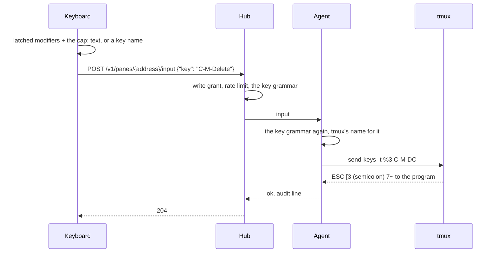

# The keyboard

Every key a terminal can carry, from a browser or a phone without a
hardware keyboard: `Ctrl+Alt+Delete` in an editor, `Alt+F5`, Shift and
the arrows to select, the keypad, F13 to F24. The key row and the command
row cover the common keys; the keyboard covers the rest.

## Using it

`⌨`, right of the input line, opens a window over the pane view (web:
also `K`). Its bar names the pane it types into, the focused one, and
follows the focus. A click on a cap sends that key at once.

```
┌─ keyboard ─ alice-laptop/work/0.0 ──────────────────────────────[♪][_][×]┐
│        [F13]…[F24]                                                       │
│  [Esc] [F1 ]…[F12]                                                       │
│[Attn][Clr ] [~`][!1]…[+=][ ⌫ ]   [Ins][Hom][PgU]  [Num][ / ][ * ][ - ]  │
│[EOF ][Susp] [Tab][Q]…[|\]        [Del][End][PgD]  [ 7 ][ 8 ][ 9 ][ + ]  │
│[Kill][Word] [Caps][A]…[Enter]                     [ 4 ][ 5 ][ 6 ][   ]  │
│[Home][End ] [⇧ Shift][Z]…[⇧ Shift]     [ ↑ ]      [ 1 ][ 2 ][ 3 ][Ent]  │
│[Rev ][Back] [Ctrl][Alt][  Space  ][Alt][Ctrl] [←][↓][→]  [  0  ][ . ][   ]│
└──────────────────────────────────────────────────────────────────────────┘
```

- **Shift, Ctrl, Alt** latch: a click lights one for the next key, which
  then lets go; a double click locks it until it is clicked again. Caps
  Lock and Num Lock stay in the browser.
- A **printable key** alone, or with Shift or Caps, is typed as text. With
  Ctrl or Alt it is a chord, `C-a`, `M-x`, `C-M-a`.
- **Named keys** take any modifier: `C-M-Delete`, `S-Up`, `M-S-F5`.
  Shift+Tab is `BTab`, which AI coding CLIs use to cycle their modes.
- **F13 to F24** are sent as Shift+F1 to Shift+F12, which is how
  terminals carry them.
- The **keypad** sends its digits and signs with Num Lock on and the keys
  printed under them (Home, ↑, PgUp, …) with it off.
- The **command keys** on the left are the old boards' keys with a
  terminal job: *Attn* interrupts (`C-c`), *Clr* clears (`C-l`), *EOF*
  ends input (`C-d`), *Susp* suspends (`C-z`), *Kill* and *Word* rub out
  the line and a word, *Home* and *End* go to the line's ends (`C-a`,
  `C-e`), *Rev* searches the history (`C-r`), *Back* is Shift+Tab.
- `_` folds the window to its bar, `×` or `Esc` closes it, `♪` turns a
  click sound on (off by default). The window drags by its bar; its place
  is kept by the browser. On a phone it takes the bottom of the screen
  and the board scrolls sideways.

A cap lights when it is pressed and shakes when the key is refused, with
the reason in a toast. While [direct typing](direct.md) is on, the caps
send as they do and the physical keyboard's keys go to the pane too; the
window then closes by `×`, since `Esc` is the pane's.

## What it sends



A key goes by name in the protocol's grammar (`[C-][M-][S-]` then a
named key, a keypad key, or a character with Ctrl or Alt; see
[the protocol](../protocol/v1.md#post-v1panesaddressinput)). Hosts whose
agent takes it list `"keys": 2`; on an older one the keys only the
grammar has are dimmed.

## Security considerations

- The keyboard is client code with no endpoint of its own. Every key is
  an `input` request: the write grant, the input rate limit, the audit
  line on the host.
- The grammar is a closed list, parsed by one function that hub and
  agent both call. Only names from it reach tmux, as one argument to
  `send-keys`. That matters: tmux types a name it does not know as
  text, and reads `;` as the end of a command, so `;` is not in the
  grammar and Ctrl or Alt with `;` cannot be sent. No raw escape
  sequence is ever taken from a client.
- Keys a terminal cannot carry through tmux are not drawn.
- The window's place, fold and sound setting are the only things stored,
  in the browser.
