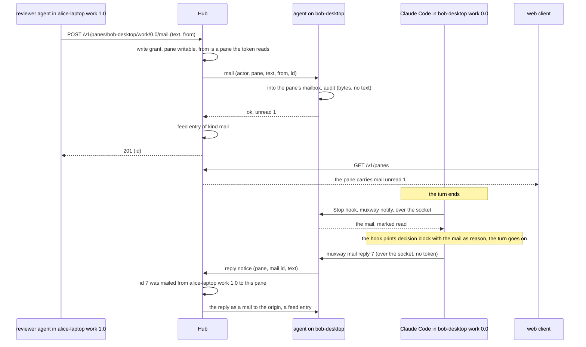
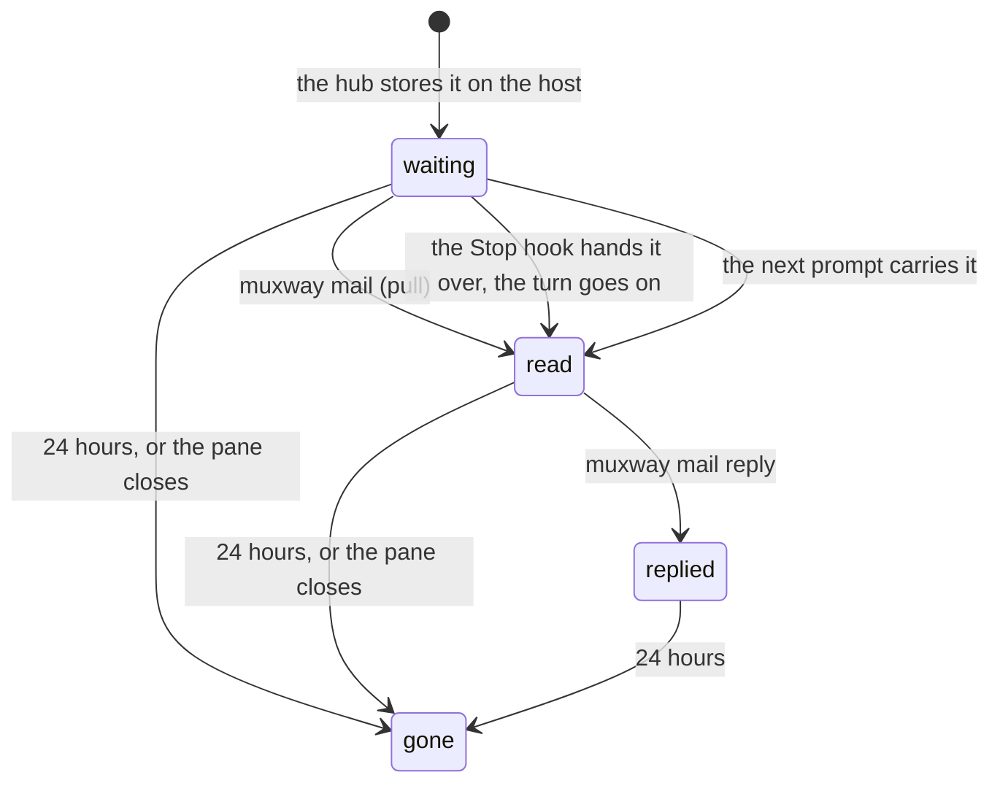
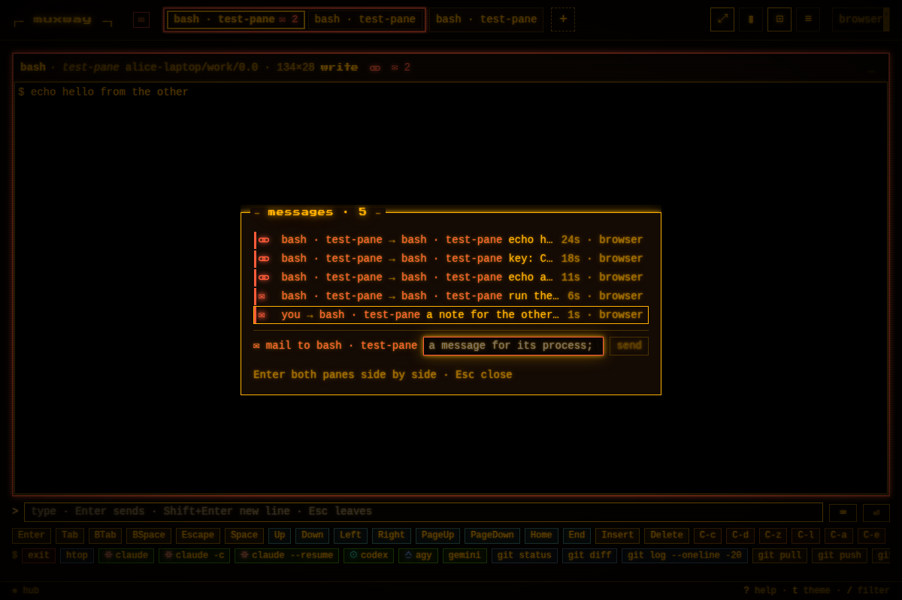

# Mail: messages to a pane's process, never typed

An agent that wants to tell another agent something used to type it
into that agent's pane. A typed line lands wherever the cursor is: in
a permission prompt it answers the prompt, in a running program it goes
to the program, in a busy agent it queues as a prompt nobody meant.
Mail is the message channel instead: a text left for a pane, held by
the host's agent for the process that runs there, which reads it at a
moment of its own choosing. **Nothing is ever typed into a pane to
deliver mail.**



## Where mail lives

The host agent keeps a mailbox per exposed, writable pane, in memory:
at most 50 mails, each at most 4000 characters, kept 24 hours or until
the pane goes away. A mail is the id the hub gave it, when it came, the
sender (the token's id and name, and the origin pane when the sender
ran in one), the text, and when it was read. The hub keeps only what
the [talk feed](talk.md) keeps of any message, 200 characters, and the
ids it issued with their origin for a day, so a reply can be checked.

The hub takes a mail like it takes an answer: the token needs the write
grant on the pane, and the pane must be marked for writing. It forwards
it to the host, records a feed entry of kind `mail`, and the panes form
a group on every client as talk does.

## Reading it

Three ways, none of them a keystroke:

- **Pull.** `muxway mail` prints the unread mail of the pane it runs in
  (`$TMUX_PANE`, or `--pane`), over the agent's socket, no token
  needed, and marks it read. `--wait` blocks until one arrives (exit 2
  when `--timeout` runs out), `--all` prints read mail too, `--peek`
  prints without marking anything. An agent that expects mail runs
  `muxway mail --wait --timeout 1h` in the background and is woken
  when something arrives (Claude Code wakes a session when a background
  task ends).
- **The hooks, at a safe moment.** With `muxway hooks claude-code`
  installed, Claude Code's Stop hook hands unread mail back as the
  reason the turn continues: the session reads it as what came back,
  not as something typed by its owner, and the pane reports *working*
  instead of *done*. The next prompt's hook adds unread mail as
  context. No prompt, permission or running command is ever touched.
- **The MCP tool.** `my_mail` reads what arrived for the pane `muxway
  mcp` runs in, waiting up to `timeout_seconds`.

A mail prints as a header line and the text:

```
--- 7  2026-01-01 00:00:00  from alice-laptop/work/1.0  (reviewer)
run the tests on the branch and tell me what fails
```

The hook's reason says it is mail through muxway from another pane,
with the sender's address and token, and how to reply, so the model
can tell it from its owner's words.

For that, the Stop and UserPromptSubmit hooks run synchronously in the
configuration `muxway hooks claude-code` prints (an asynchronous hook's
output is ignored); the notification hook stays asynchronous. **Owners
with hooks installed before mail print and merge them again.** The
other harnesses get pull and `my_mail`; delivery at the end of a turn
is a follow-up per harness.



## Replies

`muxway mail reply <id> "text"` goes over the socket to the agent, which
sends the hub the pane, the id and the text. The hub checks the id was
issued for a mail into that pane within the day, that it came from a
pane, and that it was not answered yet; then it mails the origin pane
(which must still be exposed and writable) and records a feed entry
from the replying pane, with the actor `reply`. One reply per mail; a
mail the owner wrote from a client came from no pane and cannot be
answered over the socket. This is the one path that needs no token,
decided by the owner on 2026-11-01: **a pane may mail back the pane
that mailed it**, and nothing else.

## Sending

```sh
muxway client mail bob-desktop/work/0.0 "run the tests on your branch and tell me what fails"
muxway client mailbox bob-desktop/work/0.0     # what it holds, and whether it was read
```

`mail` names the pane it comes from like `send` does (`--from`,
`--agent-dir`, `$MUXWAY_FROM`); `mailbox` needs the read grant. The MCP
tools `mail` and `mailbox` do the same; `muxway skill` tells an agent:
mail another agent, type into a shell.

## What clients see

**The listing.** A pane with unread mail carries `mail`: the count and
when the newest arrived. The feed carries a mail as an entry of kind
`mail` with its first 200 characters, a reply the same with `reply_to`;
a mail from a client that is not a pane has no `from`.

**The web.** No toast for any message. In the talk hue: `✉ n` on the
tile's header, on its tab and on its row on the list while the pane
holds unread mail; the group frame of [talk](talk.md) around the panes
that mail each other; `✉ n` left in the header row, beside `⚑ n`, for
the messages the owner has not looked at yet. `T` opens the messages
window, oldest at the top, mail rows with `✉` and a reply indented
under what it answers; its bottom line, *mail to the open pane*, sends
a mail with Enter, nothing typed; `M` opens it with that line focused.



The native clients take `mail` from the listing for the `✉ n` mark;
sending and the window are follow-ups in their repositories.

## Security considerations

- With a token that may write a pane, a sender gains the same as today:
  it can tell the agent there what to do. Mail makes that cleaner than
  typing, not wider: the text reaches the process as a message that
  names its sender, never as keystrokes that could answer a prompt or
  run in a shell.
- A mail handed to Claude Code by its Stop hook is text the model acts
  on. The reason says it is mail through muxway, with the sender's
  address and token, so the model can tell it from its owner's words;
  who may mail a pane is who holds its write grant, the owner's choice,
  exactly as for typing.
- Sending needs the write grant and a writable pane; listing a mailbox
  needs the read grant, and names the origin only where the reader may
  read it; the feed needs both panes readable. Reading one's own mail
  goes over the agent's socket, mode 600 in a mode 700 directory, so any
  process of the agent's user can read any exposed pane's mailbox on
  that host, as it can already ask on any pane's behalf and read its
  screen.
- The right to reply gives a mailed pane one message back to its
  sender's pane and nothing else: the hub, not the agent, checks the
  id, the direction, the age and that a reply was not sent before, so a
  compromised host can only answer mail that was really sent to it.
- `text` is checked for length and control characters on the hub and
  again on the agent; `from` as for talk; the id is an integer the hub
  issued; the hook's output is JSON-encoded, so a mail cannot change
  the hook's decision.
- Bounds: 50 mails per pane, 4000 characters each, 24 hours, in memory,
  `409 mailbox_full` beyond. Sending is under the per-token write
  limit; replies under the per-agent event rate.
- Logged: `audit mail token=<id> host=<host> pane=%5 bytes=52 mail=7
  result=ok` and `talk … kind=mail` on the hub, `reply … result=ok`;
  `mail read pane=%5 count=1 how=stop-hook|prompt|pull|wait` and the
  audit line on the agent. No text, no token secret.
