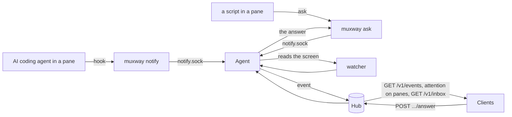
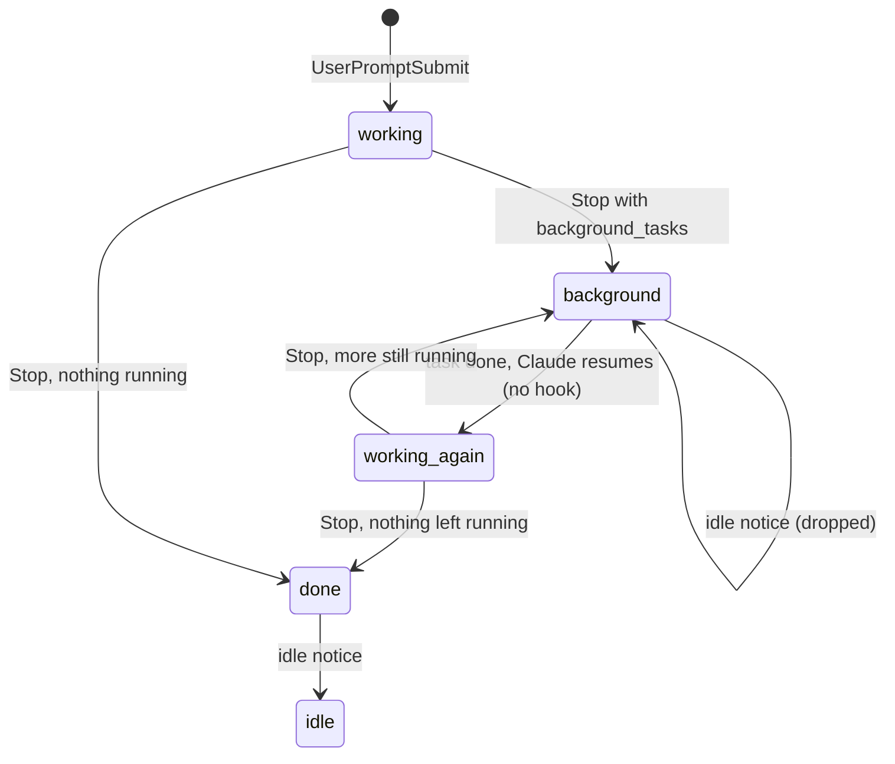
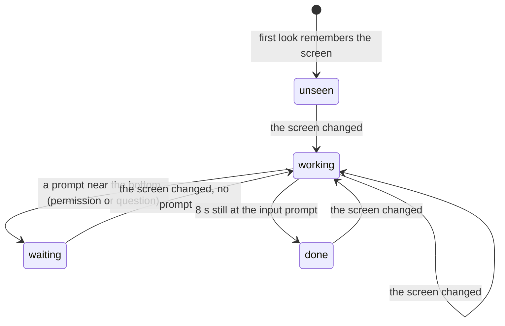
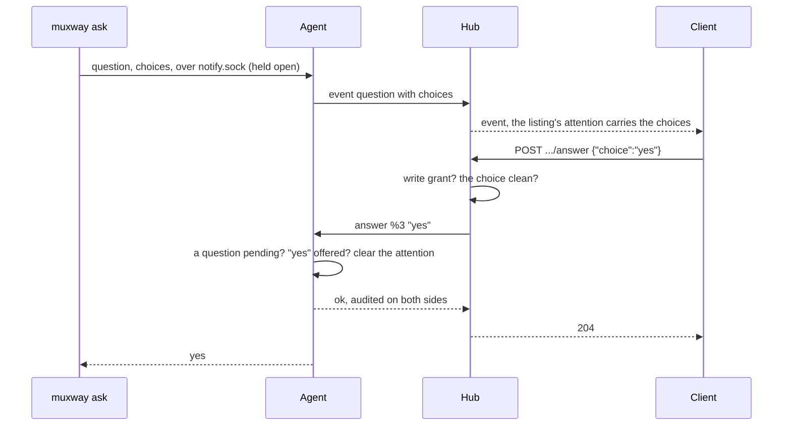
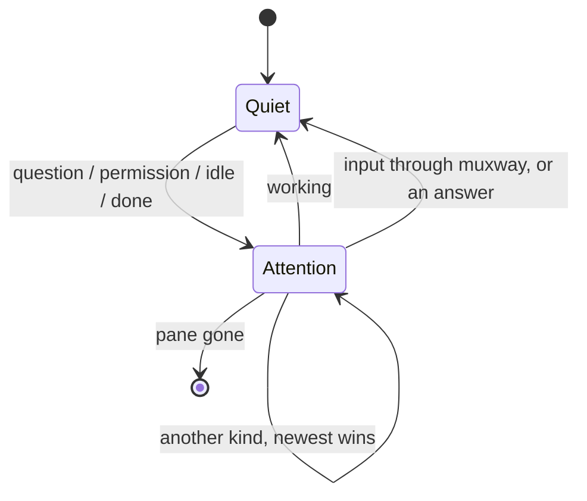

# Notifications

A process in an exposed pane can tell muxway that the pane needs its owner.
AI coding agents that run in tmux tell the hub, through their hooks, when
they ask a question, wait for a permission, have gone idle or have
finished, and which pane to open. For a harness without hooks the agent's
own [watcher](#the-watcher) reads the screen and says the same. A process
can also [ask a question with fixed answers](#questions-with-fixed-answers)
and get the answer back.

A notification carries the pane, the kind and a short text and nothing
else, so the hub and the clients do not learn which harness sent it;
`--from <harness>` only tells the command how to read that harness's
payload. Where a small client should reshape the agent's screen, it also
needs a lens of its own: what a lens is and shows is in the
[UI guideline](../ui-guideline.md#12-the-lens), the web client's in
[its page](web-client.md#the-lens).



## Hooks for every harness

On the host, with the agent paired and running:

```sh
muxway hooks claude-code     # ~/.claude/settings.json
muxway hooks codex           # ~/.codex/hooks.json
muxway hooks gemini          # ~/.gemini/settings.json
muxway hooks copilot         # ~/.copilot/hooks/muxway.json
muxway hooks opencode        # ~/.config/opencode/plugins/muxway.ts
muxway hooks agy             # ~/.gemini/config/hooks.json (Antigravity CLI)
```

prints the harness's own configuration shape (merge the `hooks` key with
what is there) with `muxway notify --from <harness> --dir <agent dir>` as
the command, run in the background with a short timeout, so the harness
never waits for it. The agent directory is spelled out because hooks run
in the harness's environment, which may resolve the default differently;
pass `--dir` to `hooks` if the agent uses another one.

| Harness | → working | → permission | → question | → done | → cleared |
|---|---|---|---|---|---|
| claude-code | `UserPromptSubmit` | `Notification` `permission_prompt` | `elicitation_dialog`, `agent_needs_input` | `Stop` | |
| codex | `UserPromptSubmit` | `PermissionRequest`, text `Codex wants to use <tool>` | | `Stop` | `SessionEnd` |
| gemini | `BeforeAgent` | `Notification` `ToolPermission`, its message | | `AfterAgent` | `SessionEnd` |
| copilot | `UserPromptSubmit` | `Notification` `permission_prompt`, its message | `elicitation_dialog` | `Stop` | `SessionEnd` |
| opencode | `message.updated`, a user message | `permission.asked` | | `session.idle` | |
| agy (Antigravity CLI) | `PreInvocation` | none: the [watcher](#the-watcher) sees the prompt | | `Stop` | |

"Cleared" is a `working` notification with no text: the attention goes
when the harness exits. Only a harness's own notice to its user travels
as text (Claude's, Gemini's and Copilot's `message`); a prompt, a tool's
input or a model's answer never does (Codex's `Stop` carries
`last_assistant_message`; the event carries nothing). Copilot's hooks are
registered under their PascalCase names so the payload names its event.
OpenCode has no hook command: its plugin calls `muxway notify --kind`
itself from the events it sees; Antigravity's payload does not name its
event, so each of its handlers carries the kind in the command the same
way. Claude Code is the harness tested daily;
the other parsers are built from the harnesses' documentation and
tested on payloads shaped as it describes.

### Claude Code's background work

Claude Code ends a turn with `Stop` even while a shell, a subagent, a
workflow or a monitor it started keeps running; it takes the turn up
again when that work finishes, and that next turn ends with its own
`Stop`. Since Claude Code 2.1, `Stop` lists that work in
`background_tasks` (and scheduled wake-ups in `session_crons`). While any
of it runs the pane is reported as **working** with counts only (`1
shell still running`, `2 shells, 1 agent still running`), and Claude
Code's `idle` notice for that pane is dropped until the pane's next
event. A long-lived background task (a dev server, a monitor) keeps the
pane working until a turn ends without it. A task's description, command
or a wake-up's prompt never leaves the host, since they can hold anything
typed into a shell. `Stop` with only wake-ups left is `done` with the
text `next wake scheduled`.



Other notification types are ignored. The hook finds its pane through the
`TMUX_PANE` variable tmux gives every pane, so the harness must run inside
tmux and the pane must be exposed; otherwise the agent refuses the
notification and nothing leaves the host. If the agent is not running the
hook says so on stderr and exits 0.

## From any script

```sh
make test; muxway notify --kind done --text "tests: $?"
muxway notify --kind question --text "deploy to staging?"
muxway notify --kind working        # clears a pending notification
```

`--kind` is one of `question`, `permission`, `idle`, `done` or `working`.
`--text` is a short line, cut to 200 characters with control characters
removed. `--pane` overrides `$TMUX_PANE`. An AI agent in a pane learns
these from `muxway skill` (see [driving muxway](driving.md)).

## The watcher

A harness without hooks, or whose hooks are not installed, still shows
up: every two seconds the agent reads the visible screen of each exposed
pane that runs a known harness and tells the hub when its state changes.
Known harnesses, by `pane_current_command`: `claude`, `codex`, `gemini`,
`agy` (Antigravity CLI), `opencode`, `copilot`, `aider`, `goose`, `amp`,
`cursor-agent`; Claude Code by the spark it leads its title with, and
Gemini, Antigravity and Copilot by their names in the title when they
run under `node`.



- A **permission** is the harness's wording ("Do you want to proceed?",
  "Allow execution", "Allow command") with numbered choices or a yes/no
  under it; a **question** is a line ending in `?` with numbered choices;
  the **input prompt** is a `❯`, `›` or `>` row at the bottom, hint lines
  (`? for shortcuts`, `Esc to cancel`) aside. Box frames are read through.
- The texts are fixed phrases: `asks for a permission`, `asks a question`,
  `finished`. A row of the screen never travels.
- **Hooks win** for working and done. A pane that has sent a
  notification over the socket since the agent started leaves those to
  its hooks: the watcher never says a hooked pane is working or
  finished. A **prompt** on such a pane is still reported while the
  hooks have said nothing about it (not every harness has a hook for a
  permission: Antigravity has none), and the watcher takes it back when
  the screen moves on; a prompt the hooks did report is left alone.
- A harness sitting quietly at its prompt when the agent starts has
  nothing to report; a prompt already on the screen is reported at once.
- `muxway agent run --watch=false` turns it off. On, it costs one
  `capture-pane` of the visible screen every two seconds per harness
  pane, and events only on a change.

## Questions with fixed answers

A process in a pane asks its owner something and gets the answer back,
without the owner typing into the pane:

```sh
muxway ask --text "deploy to staging?" --choice yes --choice no --timeout 10m
```

blocks until a client picks a choice, prints it on stdout and exits 0.
Exit 2 when nobody answered in time (the attention is cleared, the hub
hears a `working` event); 3 when the owner typed into the pane through
muxway or the harness said `working` (answered in the pane), or a second
ask on the same pane replaced it; 1 without an agent, for a hidden or
read-only pane, or bad choices. `--timeout 0` waits a day. Two to eight
distinct choices, each 1 to 40 characters without `|`. An AI agent runs
it from its shell tool and reads the answer as the tool's output.

The pane's attention carries the choices (`"choices": ["yes","no"]`), as
does the event, so every client can offer them; a client answers with
`POST /v1/panes/{address}/answer {"choice": "yes"}`, which needs a write
grant on the pane and the pane's write mark, like input. The agent checks
the choice against the list it gave: a client cannot inject text into the
asking process. The hub answers `409 no_question` when nothing waits and
`400 bad_input` for a choice not offered. On the web the choices are
buttons on the pane's header, in the toast and in the
[inbox](inbox.md).




## What clients see

Every pane in a listing carries `attention` while something is pending:

```json
{"address": "alice-laptop/work/1.0", "mode": "write", "command": "node",
 "attention": {"kind": "permission", "at": 1767225600, "text": "Claude needs your permission to use Bash"}}
```

The newest notification wins. Attention clears when a `working`
notification arrives (the hooks send one as soon as you submit a
prompt) and when anybody types into the pane through muxway. It vanishes
with the pane and with the agent process; it survives a hub restart.
`GET /v1/inbox` lists every pane with attention, oldest first (see
[the inbox](inbox.md)).



For a feed of what happened, poll `GET /v1/events`:

```sh
curl -H "Authorization: Bearer $TOKEN" -H "Accept: text/plain" \
  "https://hub.example.com/v1/events?after=$CURSOR&wait=30"
```

With `wait` the hub holds the request, up to 30 seconds, until an event
the token may see arrives, so a client can sit in a loop without hammering
the hub. The last line, `next<TAB><seq>`, is the cursor for the next call.
See [the protocol](../protocol/v1.md#get-v1events) for the JSON shape.

## Security considerations

- A notification reveals that a pane needs attention and a short line of
  text. It reaches only tokens with a read grant on that pane, which could
  read the pane anyway. Nothing here can type.
- The agent accepts notifications and questions on a socket in its
  directory, mode 600, from processes of its own user: the user who
  already owns the tmux server. Hidden panes are refused on the host; a
  question on a read-only pane too, since nobody could answer it.
- The hub trusts nothing in an event: the host is the connection's
  authenticated alias, kind and pane id are checked against fixed forms,
  text must be free of control characters and short, choices 2 to 8 of
  1 to 40 clean characters. A host may send 10 events a second with a
  burst of 30; the rest are dropped and logged. The buffer holds the last
  500 events in memory.
- The watcher reads screens the agent can read anyway and sends fixed
  phrases: a screen can make itself look like a prompt, which lights a
  badge and nothing else. Hooks win over it.
- An answer is a write: write grant and write mark are checked on the hub
  and on the agent, the choice is checked against the list the ask gave,
  and both sides audit-log it with the choice's length, not its text.
- Events raised while the agent cannot reach the hub are not delivered,
  but the pane's `attention` shows on the next listing.
- Logs carry kind and pane id, never the text or a choice.
- A hook never passes anything back to its harness and does not block it,
  whatever happens.
