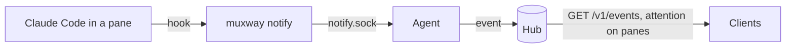
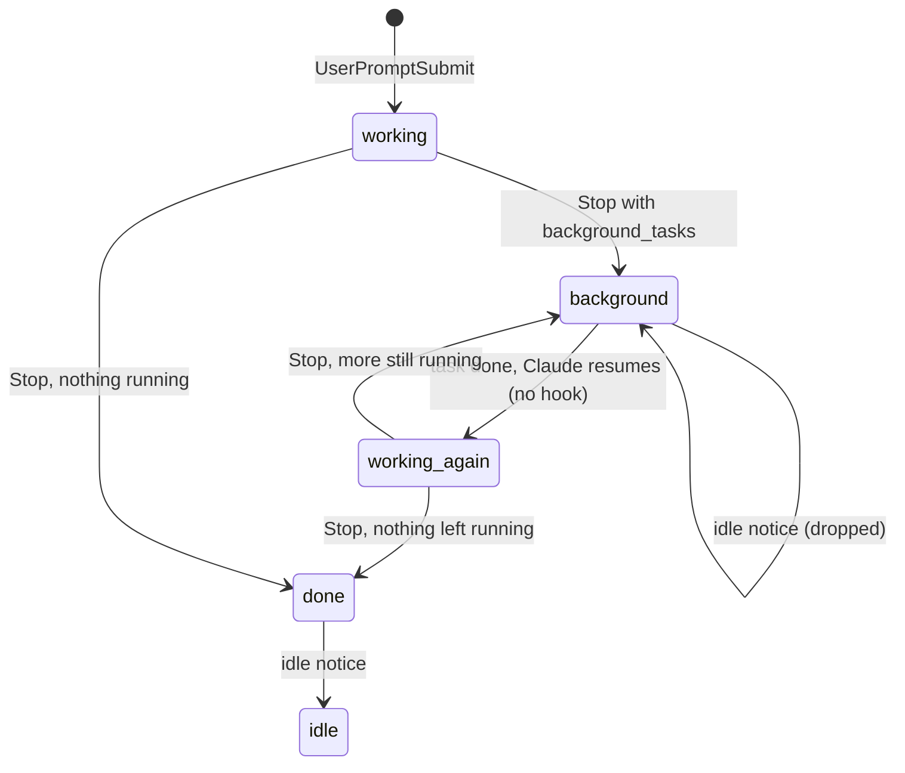
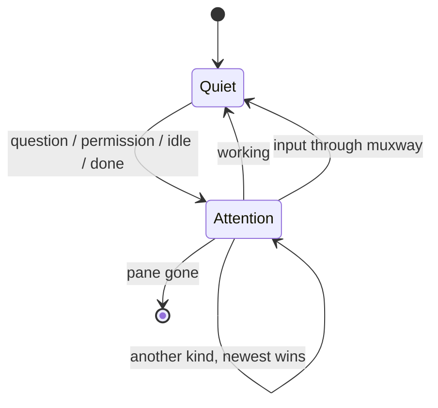

# Notifications

A process in an exposed pane can tell muxway that the pane needs its owner.
Claude Code does it through its hooks: a client is told when Claude asks a
question, waits for a permission, has gone idle or has finished, and which
pane to open.



## Setting up Claude Code

On the host, with the agent paired and running:

```sh
muxway hooks claude-code
```

prints a `hooks` section for `~/.claude/settings.json` (merge it with
what is there). It runs `muxway notify --from claude-code` for three
events, in the background with a short timeout, so Claude Code never waits
for it:

| Claude Code event | What muxway reports |
|---|---|
| `Notification`, type `permission_prompt` | `permission`: Claude wants to run a tool |
| `Notification`, type `elicitation_dialog` or `agent_needs_input` | `question`: Claude asks you something |
| `Notification`, type `idle_prompt` | `idle`: Claude has been waiting a while |
| `Stop` | `done`: Claude finished its turn; `done` with the text `next wake scheduled` when only scheduled wake-ups are left |
| `Stop` while background work runs | `working`, with counts only: `1 shell still running`, `2 shells, 1 agent still running` |
| `UserPromptSubmit` | `working`: you typed, nothing is needed |

**Background work.** Claude Code ends a turn with `Stop` even while a
shell, a subagent, a workflow or a monitor it started keeps running; it
takes the turn up again when that work finishes, and that next turn ends
with its own `Stop`. Since Claude Code 2.1, `Stop` lists that work in
`background_tasks` (and scheduled wake-ups in `session_crons`). While any
of it runs the pane is reported as **working**, and Claude Code's `idle`
notice for that pane is dropped until the pane's next event. A long-lived
background task (a dev server, a monitor) keeps the pane working until a
turn ends without it, as Claude Code's own status line says. The text is
built from counts by kind only: a task's description, command or a
wake-up's prompt never leaves the host, since they can hold anything
typed into a shell. An older Claude Code without these fields reports
`done` as before.



Other notification types are ignored. The hook finds its pane through the
`TMUX_PANE` variable tmux gives every pane, so Claude Code must run inside
tmux and the pane must be exposed; otherwise the agent refuses the
notification and nothing leaves the host. If the agent is not running the
hook says so on stderr and exits 0. The printed command names the agent
directory explicitly, so the hook does not depend on the environment Claude
Code runs in; pass `--dir` to `hooks` if the agent uses another one.

## From any script

```sh
make test; muxway notify --kind done --text "tests: $?"
muxway notify --kind question --text "deploy to staging?"
muxway notify --kind working        # clears a pending notification
```

`--kind` is one of `question`, `permission`, `idle`, `done` or `working`.
`--text` is a short line, cut to 200 characters with control characters
removed. `--pane` overrides `$TMUX_PANE`.

## What clients see

Every pane in a listing carries `attention` while something is pending:

```json
{"address": "alice-laptop/work/1.0", "mode": "write", "command": "node",
 "attention": {"kind": "permission", "at": 1767225600, "text": "Claude needs your permission to use Bash"}}
```

The newest notification wins. Attention clears when a `working`
notification arrives (Claude Code sends one as soon as you submit a
prompt) and when anybody types into the pane through muxway. It vanishes
with the pane and with the agent process; it survives a hub restart.



For a feed of what happened, poll `GET /v1/events`:

```sh
curl -H "Authorization: Bearer $TOKEN" -H "Accept: text/plain" \
  "https://hub.example.com/v1/events?after=$CURSOR&wait=30"
```

With `wait` the hub holds the request, up to 30 seconds, until an event
the token may see arrives, so a client can sit in a loop without hammering
the hub. The last line, `next<TAB><seq>`, is the cursor for the next call.
See [the protocol](../protocol/v1.md#get-v1events) for the JSON shape.

## Security considerations

- A notification reveals that a pane needs attention and a short line of
  text. It reaches only tokens with a read grant on that pane, which could
  read the pane anyway. Nothing here can type.
- The agent accepts notifications on a socket in its directory, mode 600,
  from processes of its own user: the user who already owns the tmux
  server. Hidden panes are refused on the host.
- The hub trusts nothing in an event: the host is the connection's
  authenticated alias, kind and pane id are checked against fixed forms,
  text must be free of control characters and short. A host may send 10
  events a second with a burst of 30; the rest are dropped and logged.
  The buffer holds the last 500 events in memory.
- Events raised while the agent cannot reach the hub are not delivered,
  but the pane's `attention` shows on the next listing.
- Logs carry kind and pane id, never the text.
- The Claude Code hook never passes anything back to Claude Code and does
  not block it, whatever happens.
