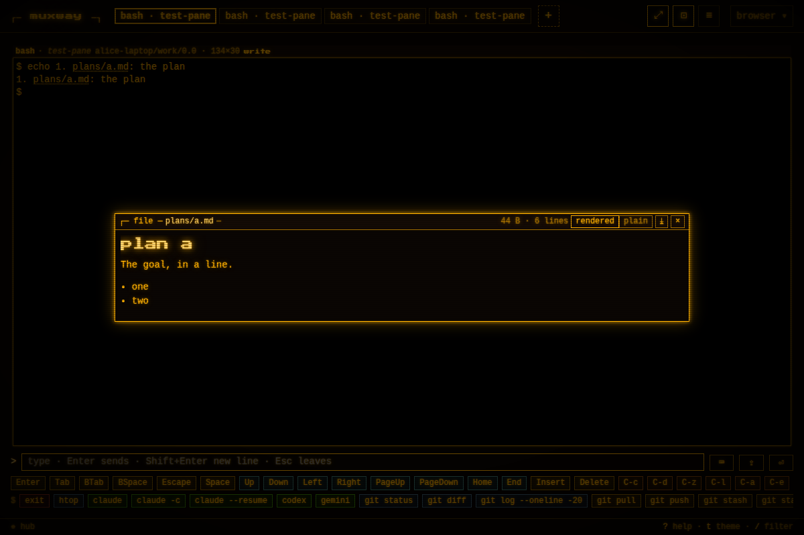
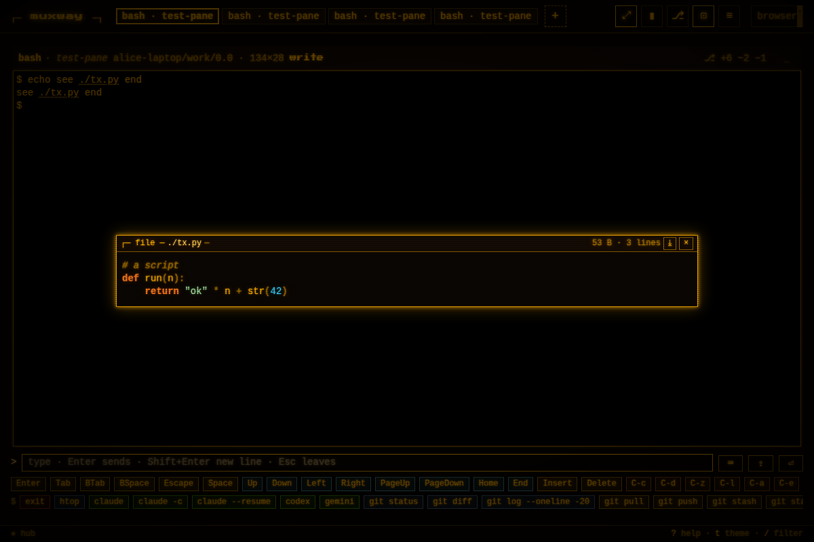
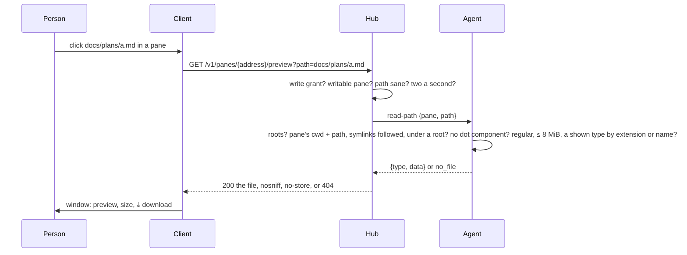

# Preview: a file a pane printed the path of, shown over the page

A pane is full of paths: `docs/plans/2026-10-26-fit-keeps-still.md`,
`~/notes/todo.txt`, `/var/log/app.log`, the CSV an agent just wrote. On
a host whose owner named **preview roots**, such a path printed in a
writable pane is a link: a click opens a window over the page with the
file, text as the text it is, an image as itself, a PDF in a frame, and
a `⤓` that downloads it. The window is the one inbox files open in (see
[attachments](attachments.md)), download included.

## Using it

On the host, once, naming the directories writers may read under:

```sh
muxway agent run --preview ~/work --preview ~/notes
```

In the browser, on a writable pane of that host, a run of text that
looks like a path, with a slash in it or from `~`, and ends in a type
the host shows, by extension or by name (the list is in [the
protocol](../protocol/v1.md#get-v1panesaddresspreviewpath): every
source, script, markup, data, config and template type a project holds,
`Makefile`, `Dockerfile`, `LICENSE` and such without one, images, PDF,
and archives and office files as a download only)
is underlined. A click opens the window: the bar has
the path, the size, for a text its line count, `⤓` and `×`; `Escape`,
`×` or a click outside closes it. A relative path is taken from the
directory the pane's shell is in, `~` from the agent's home. What the
host will not serve, a hidden file, a path outside the roots, a missing
file, says `the host does not preview this file`.

A Markdown file opens **rendered**: headings, lists, quotes, tables,
rules, emphasis, inline code, fenced code with its colours, web links
and the host's file paths as links; `plain` in the bar shows the source
instead, and the choice is remembered by the browser for every Markdown
file. The rendering builds elements from the parsed text and never from
HTML, so a tag or a script in a file is shown as the text it is. Code
files show with their colours, the one place a second hue carries
meaning (the owner's decision of 2026-10-30): comments dim and italic,
strings, numbers, keywords (bold too) and names (keys, tags, `$vars`)
each in a hue of its own per theme, punctuation dim, every run glowing
in its colour under the screen's scanlines and vignette. A small
scanner per language classifies the runs (JSON, YAML, TOML, INI,
JavaScript, TypeScript, C#, Go, Python, Ruby, PHP, Lua, Perl, R, Julia,
Swift, Dart, Scala, Groovy, Haskell, Elixir, Erlang, OCaml and F#,
Visual Basic, PowerShell, batch, Rust, Java, Kotlin, C and C++, Zig,
Nim, D, the Lisps, TeX, Fortran, assembly, shell, make, Dockerfile,
CMake, SQL, protobuf, GraphQL, HCL, Nix, `.http`, HTML, XML and the
templates, CSS); a language it does not know is shown plain. A `.diff`
or `.patch` opens in the diff view of [changes](changes.md): added rows
in the ok colour, removed rows dim and struck. A type with no preview,
an archive or an office file, says `no preview for this type; ⤓
downloads it`.


 A click on the link
is not a click on the pane, mouse mode or not. On a host without roots
nothing is underlined but inbox paths and web addresses. Text beyond
1 MiB is left to the download.


## How it works



Protocol: [`GET /v1/panes/{address}/preview`](../protocol/v1.md) and the
agent op `read-path`; `"preview": true` in the hosts listing says a host
has roots.

## Security considerations

This takes the rule that nothing is exposed unless the owner marked it
from panes to files, by the owner's explicit decision (2026-10-26):

- **Off** without `--preview`; the roots are named at start and printed
  in the agent's log, and nothing outside them is ever read. The hub
  cannot add a root.
- **The write grant** is required, and a writable pane. A writer can
  already read any such file by typing `cat` into the shell, so the
  roots add convenience, not reach; a reader gains nothing.
- **The agent reads with its own rights.** Where it runs with more rights
  than the pane's shell, a root is chosen with that in mind.
- **Resolution, not text.** The path is resolved from the pane's
  directory with every symlink followed, on it and on the roots, and the
  result must lie under a root; `..` and absolute paths are fine because
  the check is on the result. Any component starting with a dot below
  the root is refused, so `.env`, `.git`, `.ssh` are never served. The
  type list keeps keys, certificates, executables and databases out;
  every text type, scripts and markup included, is served as plain text
  with `nosniff`, so HTML, SVG or a Razor page never render as a page,
  and the browser shows the file from a blob of its own (the policy
  allows `img-src blob:` and `frame-src blob:`). An archive or an
  office file is `application/octet-stream`, shown only as its download.
- **One refusal** (`404 not_found`) for everything the host will not
  serve, so the endpoint cannot be used to map the host. Two a second
  per principal.
- **Audit** on hub and agent: who, pane, the path as asked and as
  resolved, the size, the result. Never the content.
- **Rendering** is the only surface in the browser: the Markdown
  renderer emits elements from its own parse, never raw HTML, and the
  only links it makes are web addresses and the host's paths under the
  rules above, with `rel="noopener noreferrer"`; the code scanner only
  classifies runs of text. Scripts among the previewed types are read
  and shown, never run.
