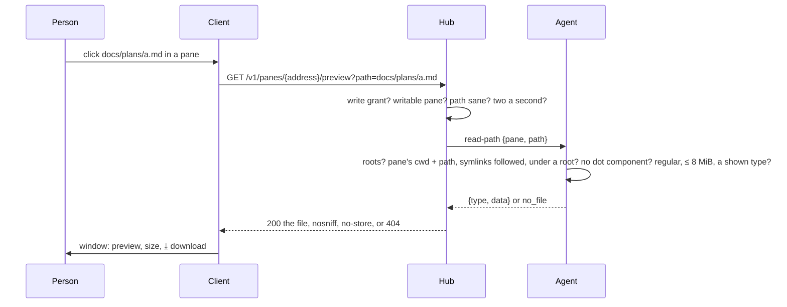

# Preview: a file a pane printed the path of, shown over the page

A pane is full of paths: `docs/plans/2026-10-26-fit-keeps-still.md`,
`~/notes/todo.txt`, `/var/log/app.log`, the CSV an agent just wrote. On
a host whose owner named **preview roots**, such a path printed in a
writable pane is a link: a click opens a window over the page with the
file, text as the text it is, an image as itself, a PDF in a frame, and
a `⤓` that downloads it. The window is the one inbox files open in (see
[attachments](attachments.md)), download included.

## Using it

On the host, once, naming the directories writers may read under:

```sh
muxway agent run --preview ~/work --preview ~/notes
```

In the browser, on a writable pane of that host, a run of text that
looks like a path, with a slash in it or from `~`, and ends in one of
`txt md markdown csv tsv json log yaml yml toml ini xml html png jpg
jpeg gif webp pdf`, is underlined. A click opens the window: the bar has
the path, the size, for a text its line count, `⤓` and `×`; `Escape`,
`×` or a click outside closes it. A relative path is taken from the
directory the pane's shell is in, `~` from the agent's home. What the
host will not serve, a hidden file, a path outside the roots, a missing
file, says `the host does not preview this file`. A click on the link
is not a click on the pane, mouse mode or not. On a host without roots
nothing is underlined but inbox paths and web addresses. Text beyond
1 MiB is left to the download.


## How it works



Protocol: [`GET /v1/panes/{address}/preview`](../protocol/v1.md) and the
agent op `read-path`; `"preview": true` in the hosts listing says a host
has roots.

## Security considerations

This takes the rule that nothing is exposed unless the owner marked it
from panes to files, by the owner's explicit decision (2026-10-26):

- **Off** without `--preview`; the roots are named at start and printed
  in the agent's log, and nothing outside them is ever read. The hub
  cannot add a root.
- **The write grant** is required, and a writable pane. A writer can
  already read any such file by typing `cat` into the shell, so the
  roots add convenience, not reach; a reader gains nothing.
- **The agent reads with its own rights.** Where it runs with more rights
  than the pane's shell, a root is chosen with that in mind.
- **Resolution, not text.** The path is resolved from the pane's
  directory with every symlink followed, on it and on the roots, and the
  result must lie under a root; `..` and absolute paths are fine because
  the check is on the result. Any component starting with a dot below
  the root is refused, so `.env`, `.git`, `.ssh` are never served. The
  extension list keeps keys, binaries and scripts out; every text type
  is served as plain text with `nosniff`, so HTML or SVG never render as
  a page, and the browser shows the file from a blob of its own (the
  policy allows `img-src blob:` and `frame-src blob:`).
- **One refusal** (`404 not_found`) for everything the host will not
  serve, so the endpoint cannot be used to map the host. Two a second
  per principal.
- **Audit** on hub and agent: who, pane, the path as asked and as
  resolved, the size, the result. Never the content.
