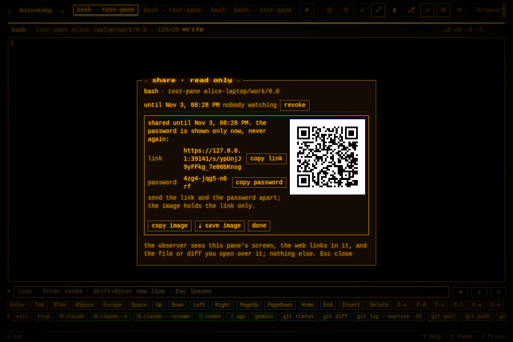
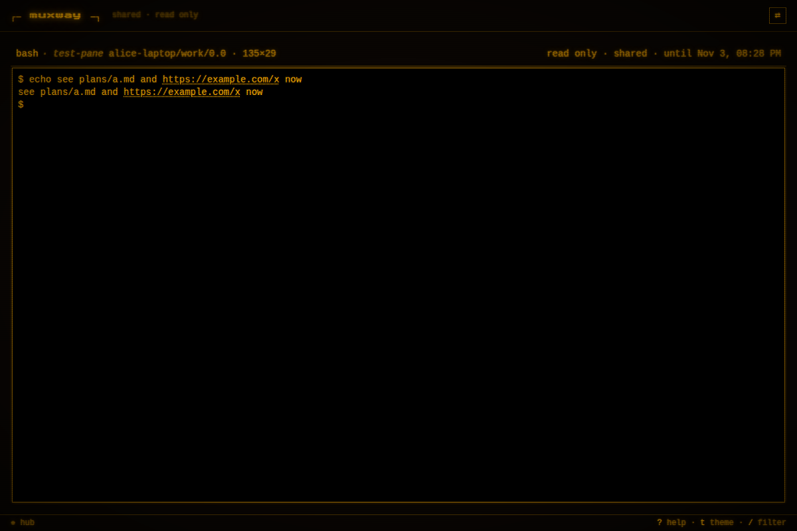
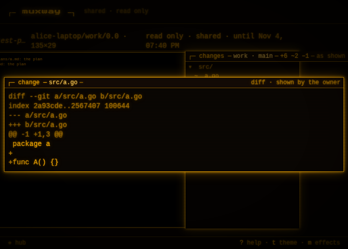
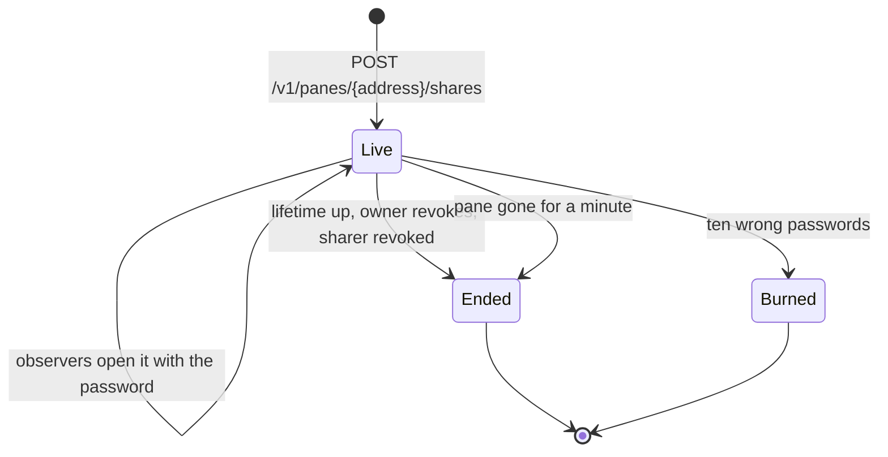

# Share: one pane, read only, by a link and a password

Someone should see what an agent is doing in a pane, for a while, without
a token: a reviewer, a colleague on a call, a friend watching a build. A
**share** is a link and a password, sent apart, that open one pane's
screen in a browser, read only, at the size the owner's clients gave it,
with the web addresses in it live and the file or diff the owner opens
over it shown too. Nothing else of the hub is reachable through it.



## Using it

In the browser, on a writable pane, `s` or `⇗` opens the **share
window**: the pane's live shares, each with when it ends, how many are
watching and *revoke*, and the form: a password (filled with one the
page made, `xxxx-xxxx-xxxx`, editable, 8 to 64 characters) and a
lifetime (`1 h`, `24 h`, `7 d`). *create* shows, once: the link, the
password, the link as a QR code, and *copy link*, *copy password*,
*copy image* (the code as a PNG on the clipboard), `⤓ save image` and
*done*. Send the link and the password apart: the image holds the link
alone, so a photo of it opens nothing by itself. After *done* the
password is gone from the page and the hub keeps only its hash.

The tile's header then carries `⇗ 1`, dim, so the owner knows the pane
is watched; a click on it opens the window. The admin overview lists
every live share with *revoke*.

The observer opens the link, `https://hub.example.com/s/<id>`, gives
the password, and sees the **observer's view**: the brand, one header
row naming the pane as the owner's tab does with `read only · shared ·
until <time>`, and the screen under it, with the page's look. No tab
strip, no pane buttons, no profile, no input line, no key bar: `t` and
`m` are the only keys. The screen is drawn at the size the host has,
which is the size the owner's fit gave it, scaled to the observer's
window, so the observer sees exactly the owner's columns and rows. A
web address in the text, and an OSC 8 link to `http` or `https`, is a
link as in the pane view; a path of the inbox or of the host's preview
roots is text. When the owner opens a file or a diff over the pane, the
observer's page opens the same window: the path, the size, the content
as the owner sees it (Markdown rendered or plain, code with its
colours, a diff with its rows, an image, a PDF), with no download, no
switch and no close; it closes when the owner's does. When the share
ends the page says `this share has ended` over the last screen.




A share ends when its lifetime is up (never past the sharer's own
expiry), when the owner or an admin revokes it, when the sharer's token
or user is revoked or expires, when the pane has been gone from its
host's listing for a minute, or after ten wrong passwords: the link may
have leaked, so the share is burned and the hub's log says so.



## How it works

A share is a hub record kept in `hub.json` beside the tokens: a random
id (128 bits, in the link), the password's hash, the pane it shows as
its host and tmux pane id (so it follows the pane when it moves), who
made it and when it ends. It is made by a principal with a **write
grant** on a writable pane. The observer's cookie is a separate one,
`muxway_share`, with a `Path` of that share's API prefix, so the browser
sends it under `/v1/share/<id>/` and nowhere else, and opening one's
own link does not sign the owner out. The observer is never a
principal: the grant code never sees a share session, and every other
endpoint answers it as it answers a request with no credential.

```mermaid
sequenceDiagram
    participant O as Owner (web)
    participant H as Hub
    participant V as Observer (web)
    participant A as Agent
    O->>H: POST /v1/panes/alice-laptop/work/0.0/shares {ttl}
    H->>H: write grant? writable pane? hash the password, store
    H-->>O: 201 {id, url, password (once), expires}
    O->>O: the window, link, password, code
    O-->>V: the link, and the password by another way
    V->>H: GET /s/<id>, then POST /v1/share/<id>/open {password}
    H->>H: lockout? constant time check; wrong counts, ten burn
    H-->>V: 204, Set-Cookie muxway_share, Path=/v1/share/<id>
    loop every second
        V->>H: GET /v1/share/<id>/pane?ansi=1
        H->>A: read the pane (the hub's 1 s cache)
        H-->>V: the screen, the pane's size, ETag
    end
    V->>H: GET /v1/share/<id>/showing?after=0&wait=25
    O->>H: PUT /v1/share/<id>/showing (the diff the owner opened)
    H-->>V: {rev 1, showing {kind diff, path, view, type, bytes}}
    V->>H: GET /v1/share/<id>/showing/file
    O->>H: DELETE /v1/share/<id>/showing
    H-->>V: {rev 2, showing null}
```

The owner's page relays what its file window shows: the kind (`file`
or `diff`), the path, the view and the bytes it already holds, up to 8
MiB, to each live share of the pane; a change of the view alone sends
the meta; the window's closing clears it; and the page says again every
five minutes that the window is open, since the hub drops a showing
that has not been refreshed for ten. The hub reads nothing from the
host for the observer: the bytes come from the owner's browser, which
had them under the owner's write grant.

Protocol: [the share section](../protocol/v1.md#shares) of the
protocol page.

## Security considerations

- **What an attacker gains.** With the link and the password: one
  pane's screen, read only, for the share's life, and the files the
  owner chooses to open over it. With the link alone: the knowledge
  that a share exists, and ten guesses before it burns, each counted
  toward the address lockout. With the password alone: nothing. With a
  share cookie: the same as the password, until the share ends; the
  cookie's path keeps it off every other endpoint.
- **Grants.** Creating, listing, revoking and showing need the sharer's
  write grant on a writable pane, checked on every call against the
  pane's current address. A share ends with its sharer's access. The
  observer has no grant: the share's handlers read one pane by id,
  through the hub's ordinary read of an exposed pane, and the agent's
  own enforcement stands.
- **Nothing beyond the pane.** The observer's endpoints are six: the
  probe, open, the pane, the showing, its file, close. No hosts,
  listings, events, inbox, talk, mail, files, preview, git, resize,
  input, answer, windows, transcribe or admin: each answers a share
  session as it answers no credential, and the suite proves it for
  every one.
- **The password** is hashed with PBKDF2-HMAC-SHA256 (the standard
  library's, 210 000 rounds, a 16-byte salt per share) and compared in
  constant time; the hub keeps the hash only, shows the password once
  in the create answer, and never logs it. Generated passwords are 60
  bits; a typed one is the owner's choice, 8 characters at least.
- **Guessing.** A wrong password counts toward the address lockout (ten
  in ten minutes) and toward the share's own ten, after which the share
  is deleted and logged `share burned`. The id is 128 random bits and
  is not guessed; a wrong id is `404`.
- **The id in the URL.** The protocol says tokens never go in URLs. The
  id is not a token: it opens nothing without the password, and a link
  is how an invite reaches a browser. The page sends no referrer, so
  the id does not leak from a link the observer follows.
- **The showing.** The bytes come from the owner's browser; the hub
  holds them in memory for the share and serves them to its observers
  alone, `nosniff`, `no-store`. One slot per share, replaced or cleared
  by the owner, dropped ten minutes after the last `PUT` and with the
  share. A text must be UTF-8 without control bytes, an image or a PDF
  must sniff as itself, HTML is refused; the observer's page builds
  elements from its own parse, never from HTML.
- **The cookie.** `muxway_share`, `HttpOnly`, `Secure`,
  `SameSite=Strict`, `Path=/v1/share/<id>`, honoured only with the
  client header; the share's endpoints are not in the CORS list, so no
  other origin can call them with it.
- **Logging.** The hub logs a share's creation (sharer, host, pane id,
  expiry, the share's handle: a separate random name, never the id),
  each open and each failure (handle, address), a burn, a revoke, an
  expiry, the pane gone, each showing (handle, kind, view, bytes, the
  path's length) and its clearing. Never the password, the id, the
  cookie, the screen or the file. The agent is asked to read with the
  sharer's name and the share's handle as the actor.
- **Limits.** Twenty live shares per principal, two hundred per hub, a
  burst of twenty creations then one every ten seconds; five password
  attempts a second per address; an observer is rate limited as a
  principal is.
- **No dependencies** were added: `crypto/pbkdf2` is in Go's standard
  library, the QR encoder is the project's own, the PNG comes from the
  browser's canvas.
