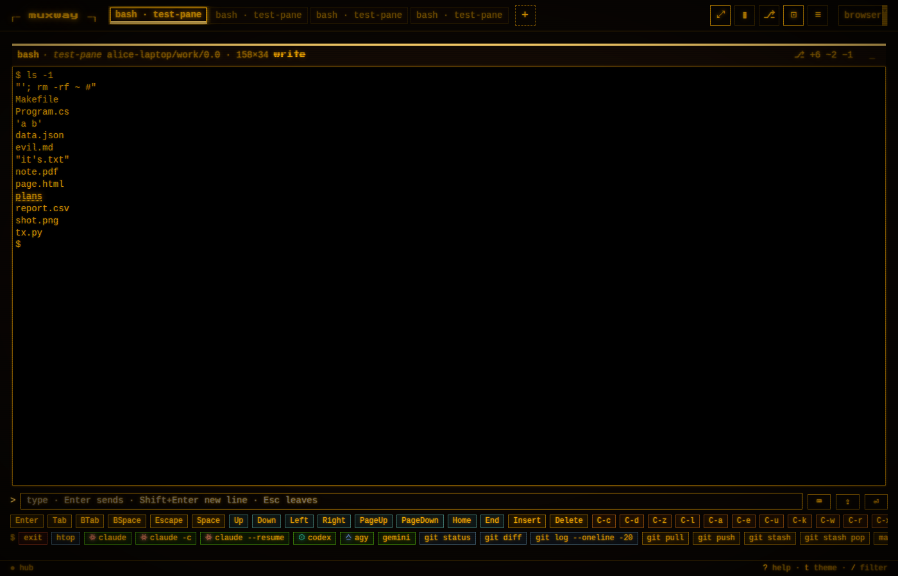
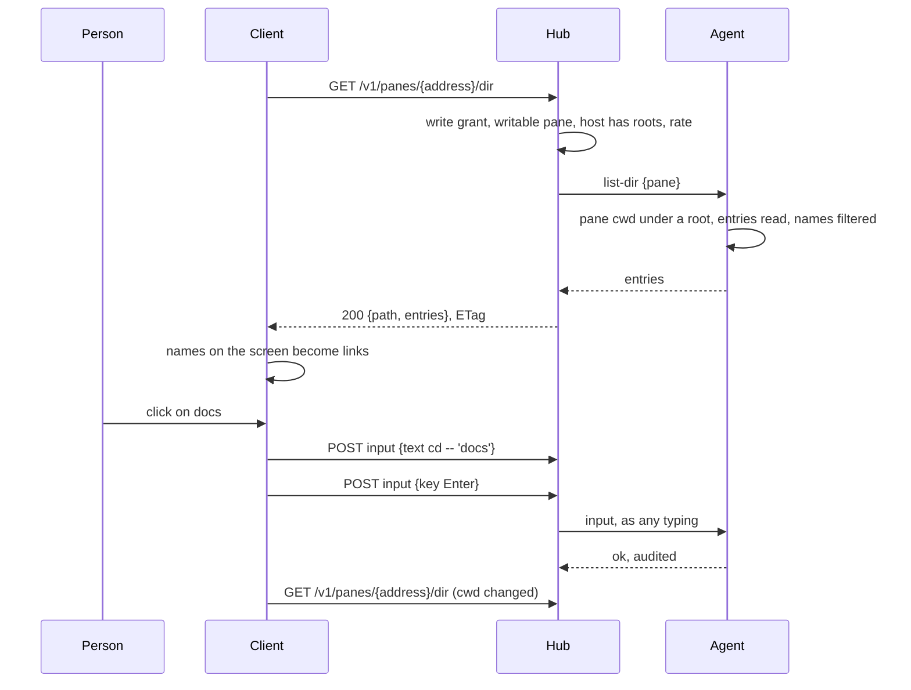

# Shell helper: the names a shell pane prints are links

A shell pane is read with the eyes and driven with keys. On a desktop
terminal with shell integration the names a listing prints can be
clicked; here they can too. In a writable shell pane on a host whose
owner named preview roots, every name of an entry of the pane's current
directory that appears on the screen, after `ls`, `tree`, `git status`,
`find`, in a program's output or in prose, is a link. A click on a
directory enters it; a click on a file opens it the way the person set:
the [preview window](preview.md), `cat`, or their own command.
Shift+click only puts the quoted name on the pane's line, for a `cp` or
`mv` in progress.

## Using it

The host's agent runs with `--preview <dir>` (see [preview](preview.md)):
the same roots, the same rules. Nothing is listed without them, and a
reader sees nothing either: whoever may type into the pane may see what
`ls` would show them.

| on | click | Shift+click | the link's title |
|---|---|---|---|
| a directory | types `cd -- 'name'` and Enter | types `'name' ` | `cd name` |
| a file, *a file opens with: preview* | the preview window, nothing typed | the same | `preview name` |
| a file, *a file opens with: cat* | types `cat -- 'name'` and Enter | the same | `cat name` |
| a file, *a file opens with: command* | types the command with `{}` replaced by `'name'` (or the name after it), and Enter | the same | the command with the name |

A name underlines under the pointer only: a listing is all names, and
a screen of underlines reads badly. The hand and the title say what a
click types. A name the host lists as neither a directory nor a file (a
socket, a device) stays text, as does every word the host did not list.
Nothing links while the pane runs something other than a shell: a click
in `vim` or an AI agent must not type `cd`. The pane's shell is known by
its program (`bash`, `zsh`, `fish`, `sh`, `dash`, `ash`, `ksh`, `tcsh`,
`csh`); its directory is what tmux reports for it.

The settings sit in the help overlay (`?`), per browser: *names* on or
off, and *a file opens with*, which cycles preview, cat and command,
with a field for the command when that is picked (`vim {}`, `less {}`,
`bat {}`; `{}` stands for the quoted name, and without it the name
follows the command).

## How it works

The client sees cells. It cannot tell `docs` the directory from `docs`
the word, so it asks the host. The agent already resolves a pane's
current directory for the preview and the changes window; now it also
lists one, with a new op `list-dir`, under the preview's rules: the
path, or the pane's own directory, is resolved from the pane's
directory (`~` from the agent's home), every symlink followed, and must
lie under a root, a root itself included; a hidden component needs
`--preview-hidden`, and `.git`, `.ssh` and their kind are never
entered. The answer is the entries by name and kind, `dir`, `file` or
`other` (a symlink gets the kind of what it points to, `other` when
that leaves the roots), sorted, at most 2000, with the hidden ones left
out as the preview leaves them, the secret ones by name too, and any
name a client could not type whole: longer than 255 bytes or holding a
control character.

The hub serves it at `GET /v1/panes/{address}/dir?path=…` to a
principal with the write grant on a writable pane, two a second with a
burst of five (the preview's bucket), with one `404` for everything the
host will not list, and an `ETag`. The pane listing carries `cwd` on a
shell pane whose directory lies under a root, for its writers, so a
client knows when to list again. The web client lists while a tile
shows such a pane (every two seconds for the focused tile, five for the
others; an unchanged listing is a round trip and no body), and again at
once when the pane's directory changes.

On the screen, a run of a row equal to a listed name, set off by the
row's edge, blank space, a bar, a quote or a bracket, with the mark
`ls -F` adds or a sentence's punctuation after it allowed, becomes a
link where no other mark is: a link a program named, a web address, an
inbox file and a path with a slash come first. The click types through
the pane's queue, behind whatever direct typing has in flight, as one
text and one Enter.

Protocol: `dir` in the hosts listing, `cwd` on a pane, the endpoint and
the op in [the protocol](../protocol/v1.md).

## Security considerations

- **What an attacker gains.** A stolen write token lists directories
  under the roots. It could already list them by typing `ls` into the
  shell, so the op adds no reach to a writer; a reader gains nothing;
  without roots nothing is served. `cwd` is a path of the host and
  reaches writers only, and only when it lies under a root.
- **A click types into a shell.** The text is built by the client from
  a name the host listed, never from screen text: a run of the screen is
  a link only where it equals a listed name, so a program in the pane
  cannot invent one. It can print a real name to lure a click; the
  click then does the person's own action on that real entry, which is
  what they would have typed. The name is single-quoted with `'`
  escaped, `--` precedes it, names with control characters are never
  listed, and the command template is the person's own. Only a shell
  pane links, by its program.
- **Input that crosses a boundary.** The path as the preview's,
  validated on the hub and resolved on the agent after symlinks; entry
  names filtered on the agent and set as text by the client, never as
  markup.
- **Enumeration.** One `404` for outside a root, hidden, missing, not a
  directory, no roots; the preview's rate bucket; the `ETag` is a hash
  of the answer.
- **Logs.** Hub and agent audit the principal, the pane, the path as
  asked and as resolved, the count of entries and the result, never a
  name. A click is an ordinary input audit line: who, when, which pane,
  how many bytes.
- **Dependencies.** None new.
