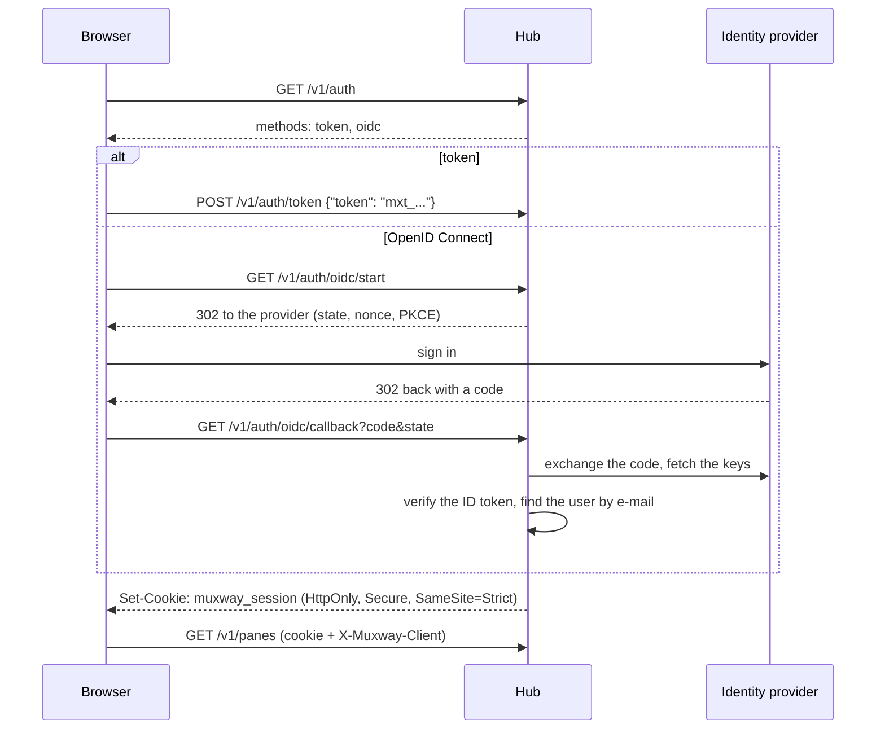

# Signing in

A client can authenticate two ways: with a bearer token on every request,
as native clients do, or by **signing in once** and holding a **session
cookie**, as a browser does. Signing in works with a pasted token on every
hub, and with an OpenID Connect provider where the owner configured one.



## Sessions

- A session stands for a **principal**: the token that was pasted, or the
  user the identity provider vouched for. Its grants are the principal's,
  looked up afresh on every request, so revoking the token or removing the
  user ends the session at once.
- Sessions live in the hub's memory for `--session-ttl` (default 12 h) and
  end with a hub restart.
- The cookie is sent only on same-site requests, and the hub honours it
  only when the request also carries the `X-Muxway-Client` header. Native
  clients keep using `Authorization: Bearer`.
- `POST /v1/auth/logout` ends a session; `GET /v1/me` says who you are.

## Signing in with a token

Any hub, no configuration: post a token once and keep the cookie.

```sh
curl -c jar -H 'Content-Type: application/json' -d '{"token":"mxt_..."}' https://hub.example.com/v1/auth/token
curl -b jar -H 'X-Muxway-Client: curl' https://hub.example.com/v1/me
```

## Signing in with OpenID Connect

Register the hub at your provider as a confidential web application with
the redirect URI `<public url>/v1/auth/oidc/callback`, then start the hub
with the issuer, the client id and the secret in a file only the hub's
user can read:

```sh
muxway hub serve --public-url https://hub.example.com ... \
  --oidc-issuer https://login.example.com/tenant/v2.0 \
  --oidc-client-id 00000000-0000-0000-0000-000000000000 \
  --oidc-client-secret-file /etc/muxway/oidc.secret \
  --oidc-label "Sign in with Example"
```

Then say who may come in and what they may reach. Nobody else can, even
with a valid account at the provider:

```sh
muxway hub user create --email alice@example.com --read 'alice-laptop/*' --write 'alice-laptop/@build'
muxway hub user list
muxway hub user remove alice@example.com
```

The hub matches the ID token's `email` claim (`--oidc-claim` picks
another) and requires `email_verified` when the provider sends it. Users
have the same grant patterns as tokens, last a year by default (`--ttl`),
and are named in logs by an id derived from the address, never the
address itself.

Provider notes:

- **Microsoft Entra ID**: issuer `https://login.microsoftonline.com/<tenant id>/v2.0`.
  Work accounts carry `email` when the app registration adds it as an
  optional claim; otherwise use `--oidc-claim preferred_username`.
- **Google**: issuer `https://accounts.google.com`; `email` and
  `email_verified` are always present.
- **Keycloak**: issuer `https://<host>/realms/<realm>`; make sure the
  client has `email` in its scopes.

What the hub checks: discovery names the same issuer; the ID token is
signed with RS256 or ES256 by a key from the provider's JWKS; `iss`,
`aud`, `exp`, `iat` (five minutes of skew) and `nonce` match; the code
exchange carries the PKCE verifier and the client secret; the `state`
matches a sealed cookie set at start. `alg: none` and HMAC algorithms are
refused.

## Adding a provider

Sign-in methods implement one interface in `internal/auth`:

```go
type Provider interface {
    Name() string   // path segment: /v1/auth/<name>/start and /callback
    Label() string  // text for the button
    Start(w http.ResponseWriter, r *http.Request) error
    Finish(w http.ResponseWriter, r *http.Request) (Identity, error)
}
```

`Finish` returns an `Identity` with a verified e-mail; the hub does the
rest: the user lookup, the session, the cookie, the lockout on failure.
A natural next provider is a forward authentication header from a reverse
proxy such as Authelia, trusted only from loopback with `--trust-proxy`.

## Security considerations

- A session is the principal's grants for up to the session lifetime.
  The cookie cannot be read by scripts, travels only over TLS and only on
  same-site requests, and is useless without the client header, which a
  cross-origin page cannot add.
- Failed token sign-ins and failed or unknown identities count toward the
  address lockout (ten in ten minutes), so neither tokens nor the
  provider's directory can be probed through the hub.
- The client secret is read from a file that must be mode 600 and never
  appears in flags, logs or responses. Session ids, codes and ID tokens
  are never logged; the suite searches the logs for them.
- An identity provider is trusted exactly as far as the owner configures
  it: it vouches for an e-mail, and only e-mails the owner created users
  for get in.
