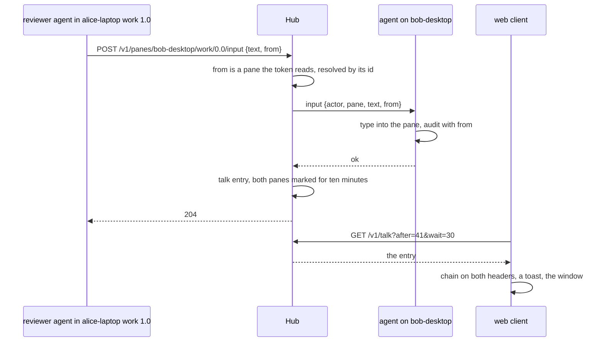
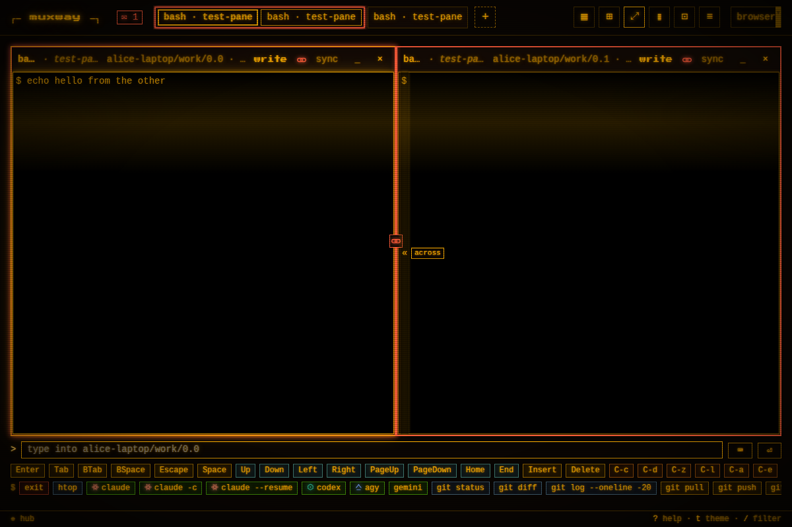
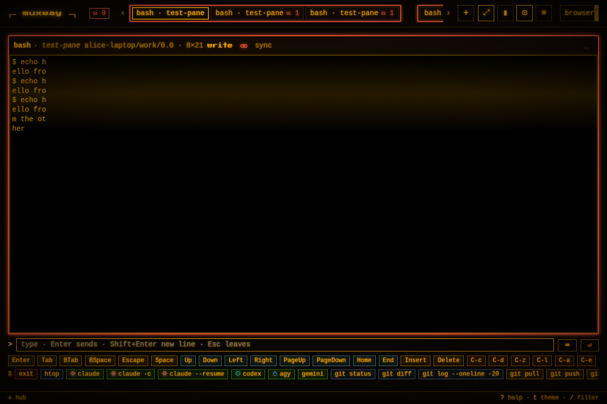

# Talk: panes writing to panes, and the owner seeing it

An agent in a pane can type into another exposed pane with `muxway
client send` or the MCP tool `send_text`, under its own token and
grants, audited on both sides. Talk makes that visible: the write
carries the pane it came **from**, the hub records who said what to
whom, and every client that reads both panes can see the exchange and
draw the two panes chained.

For a message to another agent there is [mail](mail.md): held for the
pane's process and never typed. Talk is the record of both, the typed
writes and the mail, and the group they draw.



## The origin of a write

`POST /v1/panes/{address}/input` and `POST /v1/panes/{address}/answer`
take an optional `from`: the host and the tmux pane id of the pane the
sender runs in (`{"host": "alice-laptop", "pane_id": "%3"}`). Pane ids
are stable while a pane lives, where an address shifts when panes are
split or closed, and a process knows its own id from `$TMUX_PANE`.

The hub takes an origin only among the panes the token may read, on a
host that is online; anything else is refused like a pane the token may
not see, and nothing is typed. A click never comes from a pane. The
origin travels to the destination's agent, so the host's audit log says
where the write came from, and the hub keeps one **talk entry**: when,
the token, from, to, the kind of write (`text`, `key`, `answer`), how
many bytes, and the first 200 characters of a text, the key's name,
the choice or the mail. A mail's entry carries its `id`, a reply's the
mail it answers as `reply_to`; a mail from a client that is not a pane
has no `from`, and such an entry is visible where the destination is.

Nothing changes for a write without `from`: a person at a browser is
not a pane.

## From the command line and MCP

`muxway client send`, `key`, `answer` and `mail` name the pane they come from
without being told: `$TMUX_PANE` for the pane, and the host's name from
the agent directory on the same machine (`--agent-dir` points
elsewhere). Without a pane, or without a readable agent directory,
there is no origin. `--from HOST/%ID` names one outright, `$MUXWAY_FROM`
the same for a process that knows better, and `--from none` sends as
nobody.

`muxway mcp` runs in the pane of the agent that started it, so
`send_text`, `send_key`, `answer` and `mail` carry the same default, and take
the same flags. `muxway client talk` prints the feed, `--follow` keeps
printing it, and the MCP tool `talk` reads it, so an agent can follow
what the others say. `muxway skill` tells an agent that what it types
into another pane is shown to its owner as a conversation between the
two panes.

```sh
muxway client send bob-desktop/work/0.0 "run the tests" --enter   # from the pane this runs in
muxway client talk --follow
```

```
42	1767225600	alice-laptop/work/1.0	bob-desktop/work/0.0	text	run the tests
43	1767225601	alice-laptop/work/1.0	bob-desktop/work/0.0	key	Enter
```

## What clients see

**The listing.** A pane that talked, or was talked to, in the last ten
minutes carries `talk`: its partners among the panes the principal may
read, each with its pane id, its current address, when, and the way
(`to`, `from`, `both`). That one field is enough for a small client to
draw the chain.

**The feed.** `GET /v1/talk` lists the entries, oldest first, polled
like `/v1/events` (`after`, `wait`, `limit`), with a text mode, and
visible only where the principal may read *both* panes. See
[the protocol](../protocol/v1.md#get-v1talk).

**The web: groups.** Panes that talked to each other in the last ten
minutes, partners of partners included, form a **group**, drawn in the
talk hue, a red that leans toward each theme's ink and stays apart from
the alert red, like a browser's tab group:

- *The strip.* The tabs of a group sit side by side inside one frame.
  When a group forms, or a pane joins one, its tab is pulled next to
  the group's earliest tab and the owner's order of everything else
  holds; the pull is kept in the owner's order, so the tabs stay where
  they are when the group ends. A tab dragged out of its frame is let
  go until the next message of its group. Two groups next to each
  other keep air between their frames.
- *The tiles.* Every open tile of a group is framed; two of them beside
  each other have the divider between them painted with the chain at
  its middle, so the pair reads as one block. Tiles never move by
  themselves: `L`, or the chain on the header, lays the partner beside
  the focused tile (an open partner swapped next to it, a closed one
  opened there, with four open in the place of the tile focused
  longest ago among the others).
- *The list.* The rows of a group are kept together and carry the
  frame's edge.
- *No toasts.* Nothing pops up for a message. The messages the owner
  has not looked at are counted as `✉ n` left in the header row,
  beside `⚑ n`; the count clears when the window opens.
- *The messages window.* `T`, or a click on the count, opens it over
  the view: one row per entry, oldest at the top, mail with `✉`, typed
  writes with the chain, who said it to whom as their tabs name them
  (`you` for a mail from a client), the text on one line, how long ago
  and the token's name, a reply indented under what it answers. `j`
  `k` and the arrows move, `Enter` or a click lays the two panes side
  by side, `Esc` closes. The line at its bottom mails the open pane
  (see [mail](mail.md)); `M` opens the window with that line focused.





The native clients take the listing's `talk` for the chain on their
lists; the feed and the lay-beside gesture are follow-ups in their
repositories.

## Security considerations

- Talk adds no write: a write still needs the destination's write
  grant, and the origin must be a pane the token may read. A token can
  claim an origin among those; every entry names the token, and both
  audit logs record the token id with the origin, so a false claim is
  attributed to its token.
- The feed and the listing's `talk` show an entry only to a principal
  that may read both of its panes; a pane the principal may not see is
  not named, not counted and not hinted at.
- The feed is the one place where typed content lives outside a pane:
  200 characters per entry, 500 entries in memory, never on disk, never
  in a log. The same characters are on the destination's screen, which
  the same principal may read. This is the owner's decision; a feed
  without text is a one-line change.
- `from` is validated like any address (a host name, a pane id `%` and
  digits); the feed's text is text `/input` already accepted (no control
  characters), shown as text by every client, never as terminal output.
- Writes are under the per-token rate limit; the feed under the
  per-principal one; the ring is bounded; `wait` is capped at 30 s.
- Logged: `talk from=<host>/%3 to=<host>/%5 token=<id> kind=text
  bytes=13` on the hub and the origin on the agent's audit line; no
  token secret, no text.
