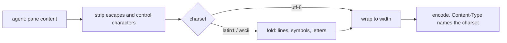

# Text mode

Text mode is the hub's answer for clients too small for JSON and colour: a
feature phone, a pair of glasses, a script with `curl`. Ask for it with
`Accept: text/plain`; these answer in it:

| Endpoint | One line per | Columns, tab-separated |
|---|---|---|
| `GET /v1/hosts` | host | name, `online` or `offline`, the flags that are on joined by `\|` (`sessions`, `close`, `preview`, `repeat`, `ask`, `mail`, `later`, `dir`, `rename`, `keys2`) |
| `GET /v1/panes` | pane | address, mode, command, title, kind, unread mail, talk partners joined by `\|`, alias, folder, pending (what waits under a parked pane) |
| `GET /v1/panes/{address}` | row of the screen | the text, see below |
| `GET /v1/inbox` | waiting pane, oldest first, parked last | address, kind, when, the text, choices joined by `\|`, pending |
| `GET /v1/events` | event | seq, when, address, kind, text; then `next` and the cursor |
| `GET /v1/panes/{address}/mail` | mail | id, when, from, actor, read at (or 0), the text |
| `GET /v1/talk` | message | seq, when, from, to, kind, the text |
| `POST /v1/panes/{address}/alias` | the answer | address, alias |
| `POST /v1/transcribe` | the answer | the text heard, one line |

The details and the examples are in the [protocol](../protocol/v1.md).

## What it does

- Pane listings come one pane per line, tab-separated: address, mode,
  command, title, pending attention, unread mail, talk partners, alias,
  the folder the pane works in (for a writer, under a preview root), and
  for a parked pane what waits underneath, so the row can say `zz · !`.
  Columns were added at the end over time, so a client reads the ones it
  knows and ignores the rest; that holds for every text-mode row, the
  hosts' too.
- Hosts come one per line with their state and the features the host's
  agent takes, so a small client offers `+ session`, close, mail or a
  name only where the host allows it, without a probe.
- The inbox comes one waiting pane per line, oldest first: address, kind,
  when, the text, a question's choices joined by `|`, so a feature
  phone can offer them as a numbered menu (see [the inbox](inbox.md)),
  and what waits under a parked one. There is no count row: a client
  counts the rows, or the listing's non-empty `kind` column, which counts
  parked panes with the rest as the inbox does.
- Pane content comes as the last `lines` rows, escape sequences and
  control characters removed, tabs expanded, trailing blanks trimmed,
  rewrapped to `width` columns, one row per line.
- Responses carry an `ETag`; `If-None-Match` gets a `304` when the pane
  has not changed, so polling costs a few bytes.

## Charsets

The smallest phones cannot show Unicode: a 2002 Nokia has no glyph for
`─` and decodes bytes as Latin-1 unless told otherwise, so a rule drawn
by Claude Code arrives as rows of odd glyphs, three bytes per character.
`charset=latin1` or `charset=ascii` makes the hub rewrite the content
before wrapping (and, on the pane list, each pane's command and title), and the answer's `Content-Type` says what was sent:
`text/plain; charset=iso-8859-1` or `charset=us-ascii`. Without the
parameter, or with `charset=utf-8`, nothing changes.

| Characters | Become |
|---|---|
| horizontal lines `─ ━` and dashed variants | `-`; the double line `═` becomes `=` |
| vertical lines `│ ┃ ║` and dashed variants | `\|` |
| corners, tees and crosses | `+` |
| diagonals `╱ ╲ ╳` | `/ \ X` |
| block elements `▀ ▄ █ ░ ▒ ▓` | `#` |
| `❯ › » ▶ ▸ ⏵ ➜ →` | `>`; `‹ « ◀ ←` `<`; `↑` `^`; `↓` `v` |
| bullets `● • ○ ◦ ■ □ ▪ ◆ ★ ☆`, braille spinners, Claude Code's marks `✳ ✻ ✽ ✶ ✢ ✦ ✧` | `*`; its tool-result connector `⎿` `+` |
| `·` | `.`; `…` `...`; `— – ‐ −` `-`; `×` `x`; `✓ ✔` `v`; `✗ ✘ ✖` `x`; `⚠` `!` |
| curly quotes, no-break space | `'`, `"`, a space |
| letters with marks (Latin-1 Supplement, Latin Extended-A) | the base letter; `ß` `ss`, `æ` `ae`, `œ` `oe`, `þ` `th`, `ij` `ij` |
| anything else the charset lacks | `?` |

In `latin1` the characters Latin-1 has (`ä`, `é`, `ñ`, `»`, `·`) stay as
they are; only those beyond it are folded. `…` becomes three characters
and `─` one, so folding runs before wrapping and rows still fit `width`.

## Security considerations

The parameter changes how content the token may already read is encoded.
It is matched against three fixed values and refused otherwise with
`400 bad_parameter`, before the agent is asked. Folding maps each
character to a fixed short string, at most three bytes, so a body cannot
grow past three times the agent's cap. Nothing about it is logged.
