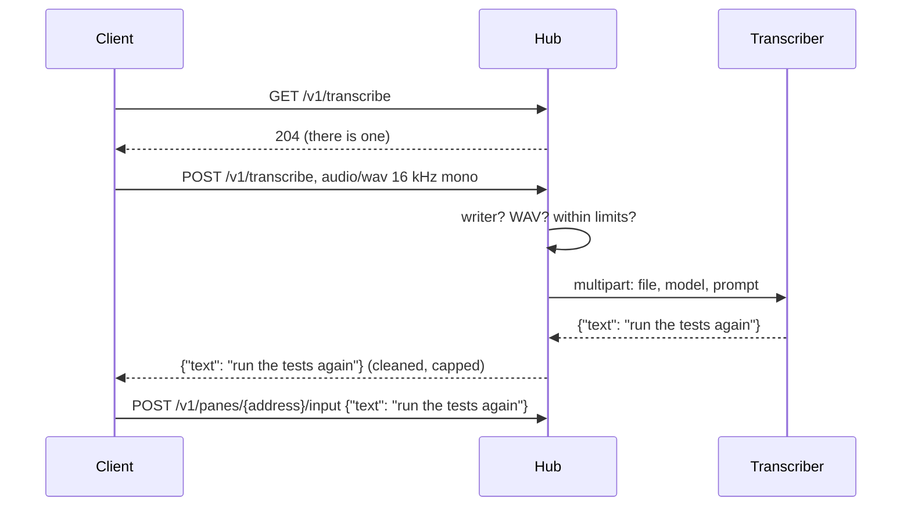

# Transcription

A client with a microphone lets its user say a reply: a pair of glasses
with no keyboard, the browser, the phone. No client talks to a
speech-to-text service itself: it sends the clip to the hub, and the hub
forwards it to the transcriber its owner chose. Without one, the hub has
no such endpoint and clients do not offer the action.



## Configuring a transcriber

```sh
muxway hub serve ... \
  --stt-url http://127.0.0.1:8910/v1/audio/transcriptions \
  --stt-model whisper-base.en \
  --stt-prompt "alice-laptop, muxway, tmux"
```

| Flag | Meaning |
|---|---|
| `--stt-url` | an OpenAI-compatible `/v1/audio/transcriptions`: whisper.cpp's `whisper-server` with `--inference-path /v1/audio/transcriptions`, a faster-whisper server, or the OpenAI endpoint itself |
| `--stt-key-file` | a file (mode 600) with the bearer key, when the service needs one |
| `--stt-model` | the model name sent along, default `whisper-1` |
| `--stt-prompt` | words the transcriber would otherwise guess at: host names, project names, the commands you say most. Both OpenAI and whisper.cpp read it |

A local whisper.cpp on the hub's own machine or its private network is
the option that keeps audio at home; the `base.en` model transcribes a
ten-second clip in about two seconds on a small server.

## What the hub does with a clip

- Only a principal with at least one **write grant** may send one: the
  text exists to be typed, and a read-only token should not spend the
  owner's transcriber.
- The body must be a 16 kHz mono 16-bit PCM WAV, at least half a second
  and at most 4 MiB (about two minutes). The header is checked before
  anything is forwarded.
- One clip per five seconds per principal, on top of the general rate
  limit. The transcriber gets 90 s; its answer is read up to 64 KiB.
- The text comes back cleaned (control characters become spaces, blanks
  collapse) and cut to 4096 bytes, the most input takes. A client still
  shows it to the wearer before sending it, and the input endpoint
  applies its own checks as to anything typed.
- Nothing is stored. The audit log has one line per clip: who, the
  method, bytes, seconds, how long the transcriber took, and the result,
  never the text.

## In the browser

With a transcriber on the hub and a writable pane in focus, the input
line has a `◉` button between the field and *send* (`v` from outside the
line). It opens the microphone, after the browser's own permission
prompt, and the field's place shows a level meter in block characters
and the seconds; `■`, a click on the meter, `v` again or sixty seconds
stops the clip, *cancel* or `Esc` drops it. Held instead of tapped, the
button or `v` records until released, for a quick reply.

```
> ______________________________________ ◉ [send]       idle
● ▁▃▅▇▅▃▁ 4 s · click to stop          ■ [cancel]      recording
> ⟳ hearing…                                             sent
> run the tests again                     ◉ [send]       heard: edit or send
```

The clip is 16 kHz mono 16-bit PCM, gathered by an `AudioWorklet` served
from the client's own files and kept in memory; where the browser
cannot run the graph at 16 kHz the frames are resampled on stop. The
hub's answer lands on the line, after a space when something was typed
already, with the caret at its end and the line focused: the words are
read before Enter sends them. The microphone is closed the moment
recording stops, so the browser's recording indicator is honest.
Refusals are toasts: `microphone refused`, `no microphone`, `too short`
(under half a second), `one clip every five seconds`, `transcriber
unavailable`.

The hub without a transcriber is asked once per sign-in and never again;
the button is not there, and `v` does nothing.

## On the phone

The same button in the text row of the pane view, shown under the same
two conditions. The first tap asks for the microphone permission;
`AudioRecord` fills a buffer at 16 kHz mono up to sixty seconds, the
meter and the seconds take the field's place, a second tap stops and
sends, back drops the clip. See the Android client's pane view page.

## Security considerations

- Audio leaves the client only for the hub, over HTTPS with the bearer
  token (the browser: the session cookie and the client header), and
  leaves the hub only for the transcriber the owner set. A remote
  provider is the owner's choice, made in the hub's flags. No client
  stores or logs a clip; the browser keeps it in memory for the request.
- A page never records without a click or a key pressed on it, behind
  the browser's own permission prompt; the worklet is a file of the
  client's own under the existing `script-src 'self'`, so the content
  security policy gains nothing.
- A hostile transcriber cannot type: its text is cleaned, capped, shown
  to the wearer first, and then goes through the input endpoint, which
  refuses control characters and unknown keys.
- A hostile client cannot exhaust the transcriber: the write-grant
  requirement, the WAV check, the size cap and the per-principal clip
  rate stand in front of it, and a failed or slow transcriber answers
  `502` without taking the hub down.
- The key is read from a file that only its owner can read, like the
  sign-in secret, and never appears in a log.
