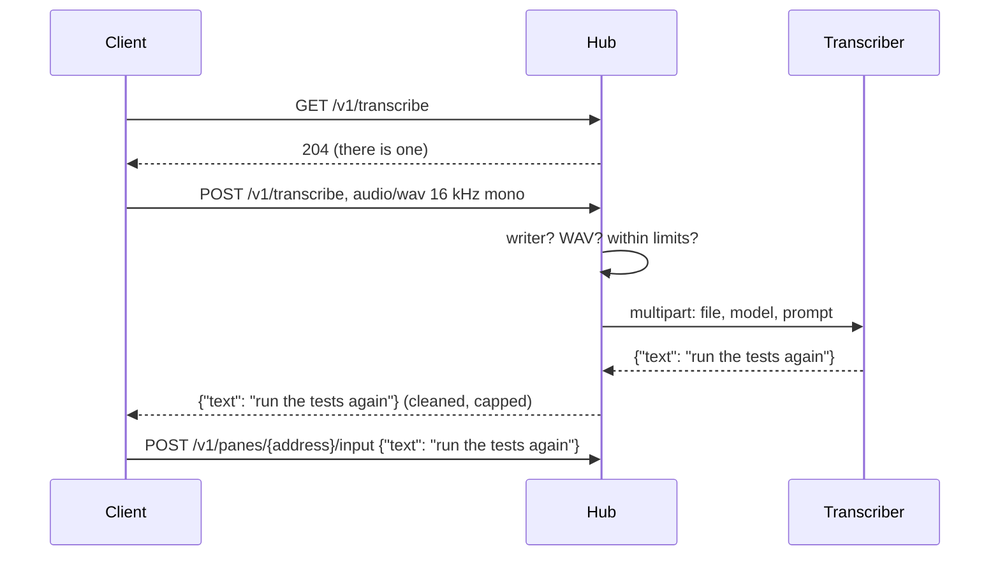

# Transcription

A client with a microphone and no keyboard, a pair of glasses, lets its
wearer say a reply. The glasses never talk to a speech-to-text service
themselves: they send the clip to the hub, and the hub forwards it to
the transcriber its owner chose. Without one, the hub has no such
endpoint and clients do not offer the action.



## Configuring a transcriber

```sh
muxway hub serve ... \
  --stt-url http://127.0.0.1:8910/v1/audio/transcriptions \
  --stt-model whisper-base.en \
  --stt-prompt "alice-laptop, muxway, tmux"
```

| Flag | Meaning |
|---|---|
| `--stt-url` | an OpenAI-compatible `/v1/audio/transcriptions`: whisper.cpp's `whisper-server` with `--inference-path /v1/audio/transcriptions`, a faster-whisper server, or the OpenAI endpoint itself |
| `--stt-key-file` | a file (mode 600) with the bearer key, when the service needs one |
| `--stt-model` | the model name sent along, default `whisper-1` |
| `--stt-prompt` | words the transcriber would otherwise guess at: host names, project names, the commands you say most. Both OpenAI and whisper.cpp read it |

A local whisper.cpp on the hub's own machine or its private network is
the option that keeps audio at home; the `base.en` model transcribes a
ten-second clip in about two seconds on a small server.

## What the hub does with a clip

- Only a principal with at least one **write grant** may send one: the
  text exists to be typed, and a read-only token should not spend the
  owner's transcriber.
- The body must be a 16 kHz mono 16-bit PCM WAV, at least half a second
  and at most 4 MiB (about two minutes). The header is checked before
  anything is forwarded.
- One clip per five seconds per principal, on top of the general rate
  limit. The transcriber gets 90 s; its answer is read up to 64 KiB.
- The text comes back cleaned (control characters become spaces, blanks
  collapse) and cut to 4096 bytes, the most input takes. A client still
  shows it to the wearer before sending it, and the input endpoint
  applies its own checks as to anything typed.
- Nothing is stored. The audit log has one line per clip: who, the
  method, bytes, seconds, how long the transcriber took, and the result,
  never the text.

## Security considerations

- Audio leaves the client only for the hub, over HTTPS with the bearer
  token, and leaves the hub only for the transcriber the owner set. A
  remote provider is the owner's choice, made in the hub's flags.
- A hostile transcriber cannot type: its text is cleaned, capped, shown
  to the wearer first, and then goes through the input endpoint, which
  refuses control characters and unknown keys.
- A hostile client cannot exhaust the transcriber: the write-grant
  requirement, the WAV check, the size cap and the per-principal clip
  rate stand in front of it, and a failed or slow transcriber answers
  `502` without taking the hub down.
- The key is read from a file that only its owner can read, like the
  sign-in secret, and never appears in a log.
