# Web client

Open the hub's address in a browser. The hub serves the client itself,
from files embedded in its binary, so there is nothing to install and
nothing but the hub to talk to.

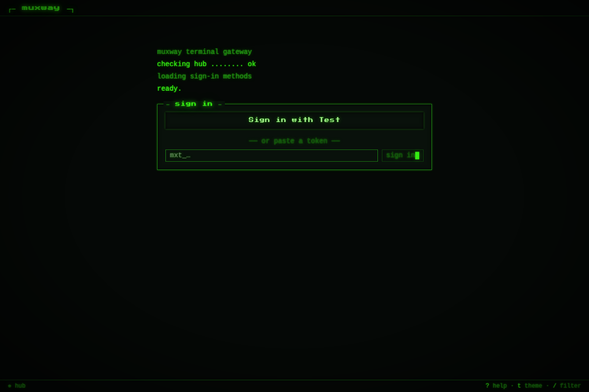

## Using it

1. **Sign in**: with the identity provider the hub owner configured, or by
   pasting a token once. The token is sent to the hub and forgotten; a
   session cookie takes its place. See [signing in](sign-in.md).
2. **Panes**: every host you may reach, with its sessions, windows and
   panes, laid out as the Android client lays them out. A row has a pick
   box, `*` when you may type there, what runs in the pane with its
   state, and the address; offline hosts are dimmed. A badge marks a pane
   that needs you: `?` question, `!` permission, `…` idle, `✓` done, and
   the word follows (`! permission`); a Claude Code pane that is busy
   shows `⟳ working` (see [the lens](#the-lens)). A click opens the pane.
   The pick box, `space` on the highlighted row, or a click while
   something is picked gathers up to four panes; a bar under the list
   then offers **open N side by side**. Each window has a button, `▦ 0:
   main · 2 panes · mirror layout ▸`, that opens the
   [window view](#the-window-view). Type `/` to filter.
3. **Tiles**: one to four panes on one screen, with a strip of every pane
   above them; see [tiles](#tiles-the-android-view). Each pane's content
   comes with its colours, refreshed every second, and one input line
   serves the focused tile. The screen opens at its bottom and follows
   new output; scroll up to read back, and it stays put until you scroll
   down again. The input line is a small editor: text wraps, `Enter`
   sends, `Shift+Enter` starts a new line, and the field grows upward to
   six rows before it scrolls inside. A text with several lines is
   pasted into the pane as one block (bracketed, when the program asked
   for it), so Claude Code takes it as one message and a shell as one
   editable block; then `Enter` is sent. While the first word is typed a
   list opens above the line: Claude Code's slash commands, or a shell's
   starters and the lines sent before from this browser; `↑` `↓` pick,
   `Tab` or a click takes one, `Esc` closes it, and `Enter` always sends
   what is typed, never the pick. From an empty line the console keys
   (`↑` `↓` `←` `→`, `PageUp` `PageDown` `Home` `End`, `Tab`) go to the
   pane, so a menu in it is driven without leaving the line; with text
   they move the caret. `i` focuses the line, `Esc` is the pane's
   Escape, as the key bar's button is (an open completion list closes
   first), and `Shift+Esc` leaves the line. The key
   bar sends the named keys the protocol allows. A click on the screen of
   a pane whose program asked for the mouse, Claude Code among them, is a
   click at that cell on the host, so an option shown can be chosen by
   clicking it; in a pane that did not ask, a click only focuses. The
   wheel follows the same rule. In a shell it scrolls the browser's box
   through what the hub sent: the screen and up to a few hundred lines of
   history. A program that asked for the mouse scrolls itself: Claude
   Code, `htop` and `vim` run on the terminal's alternate screen, which
   has no history of its own, so the wheel over such a pane goes to the
   host as wheel notches at the cell under the pointer, one per row of
   travel, and the program moves its own view. Any shell history above it
   is still there, reachable by the box's scrollbar. The tab strip keeps
   its tabs at their width and scrolls sideways: the wheel over it moves
   it, `‹ ›` at its ends appear when there is more than fits, and
   `Ctrl+→` `Ctrl+←` show the next and previous pane in the focused tile.
   A web address in the pane's text, `http` or `https`, is a link with a
   dotted underline: a click opens it in a new tab, and the pane hears
   nothing of it, even when its program has the mouse. The punctuation
   after an address stays text, a bracket the address opened stays in,
   and an address wrapped onto a second row opens up to the row's end.
   When the hub has a transcriber (see [transcription](transcription.md))
   and the pane is writable, a `◉` button sits between the field and
   *send*: a click or `v` records a clip, a level meter and the seconds
   take the field's place, `■` or `v` again stops it, and the words the
   hub heard land on the line, focused, for you to read and send with
   `Enter`; `Esc` or *cancel* drops the clip. Without a transcriber there
   is no button. Read-only panes say so.

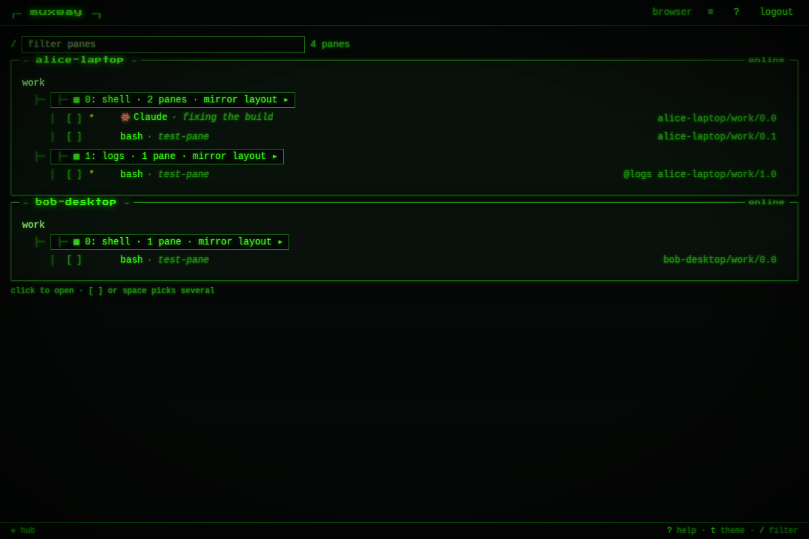

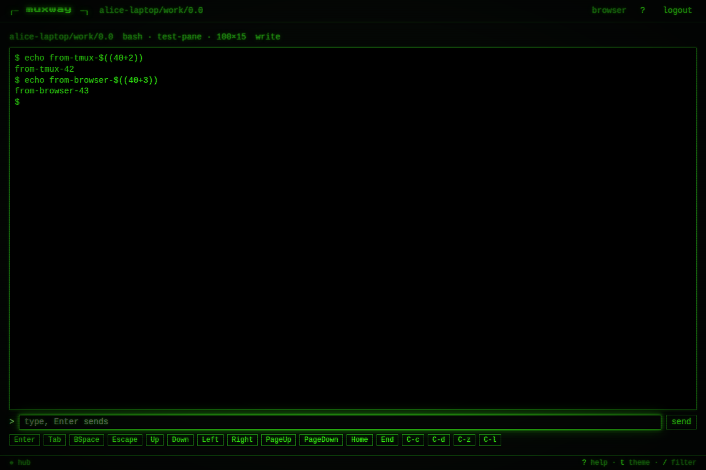

Amber and paper, and the phone layout:

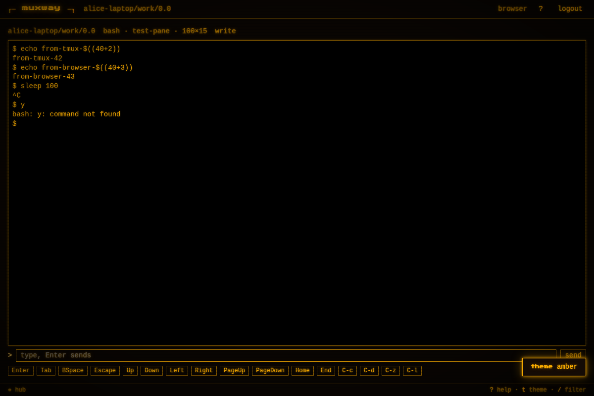

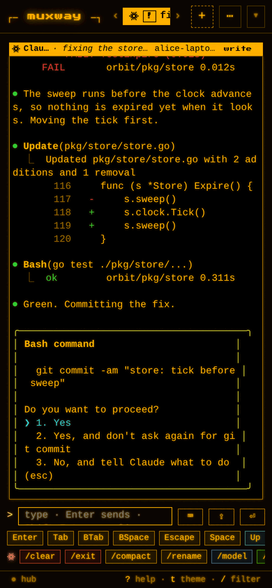

## What a pane is called

Everywhere a pane is named, in the list, the pane header, the tab title,
the window view, boards and the selector, it is named by what runs in
it, not by tmux: the command, and after it what the program says about
itself in the pane title when that adds something (`vim · notes.md`).
The header names the pane a view is about, the focused one where several
are shown, and a notification names the pane the same way: the mark,
the name upright, what the program says about itself in italics, and
the place dimmed after it, all on one line.
A pane running **Claude Code** is named *Claude*, with its mark, and the
status Claude writes into the title follows (`Claude · fixing the
build`); it is recognised by its command, or by the spark Claude Code
puts first in its title when it runs under another command. The tmux
address, session and window names come second, dimmed, so you can still
tell panes apart.

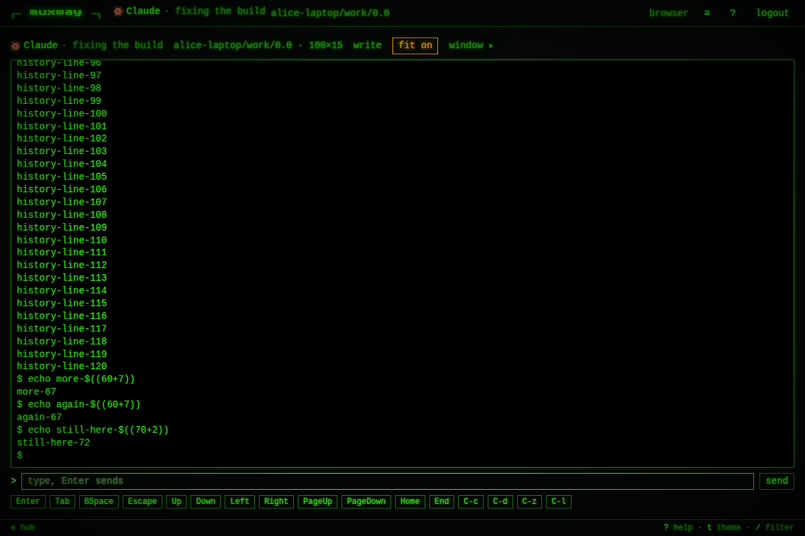

When an AI CLI in a pane calls for you (see
[notifications](notifications.md)) the badge appears, a toast slides in,
the tab title flashes until you come back, and, if you turned them on, a
browser notification names the pane while the tab is hidden. Typing into
the pane clears it.

## Fit: the host follows the browser

A terminal tells tmux its size; the browser does the same when **fit** is
on (`f`, or the button in the header). In the pane view the *pane* on the
host becomes the columns and rows that fit the box: where it spans its
window, the window is sized; where it shares the window with neighbours,
they give or take the difference, and the window grows before any pane
of it would go under 20 columns or 5 rows. In the window view, fit sizes the whole
*window* to the area and lays it out as the browser shows it: the panes
keep their proportions until you drag a divider, and then the host's
split follows the divider; a pane zoomed here is zoomed on the host too,
with tmux's own zoom, so it gets the whole window. With fit on a pane is
read at the font you chose (the help overlay, `?`, cycles it from 11 to
20 px, remembered by the browser) and the host is sized by that cell, so
every pane is shown one to one. Fit is on by default wherever you may
write: in the pane view and the window view; on a board it is off,
because several host windows changing at once is a decision for you.
Leaving a fitted view gives the window back to tmux's automatic sizing,
unzoomed, and the panes back to the layout they had. With fit off, the
pane keeps the host's size and is scaled to the box instead.

Several clients can fit the same window, and the last one to send a size
wins; a client sends its size only when it changes, so after a phone has
sized the window the browser shows it small. The `⟳` button next to
fit, or `r`, sends this client's size once more.

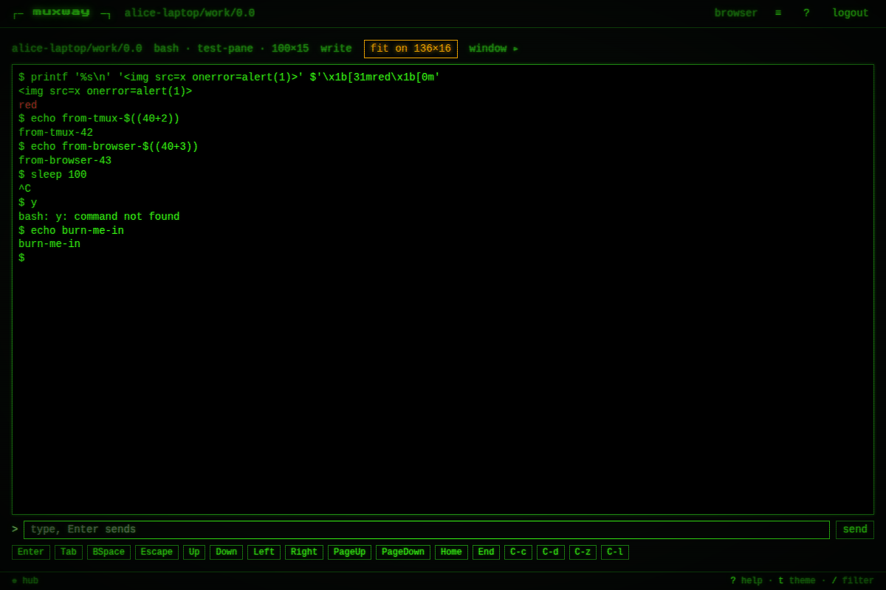
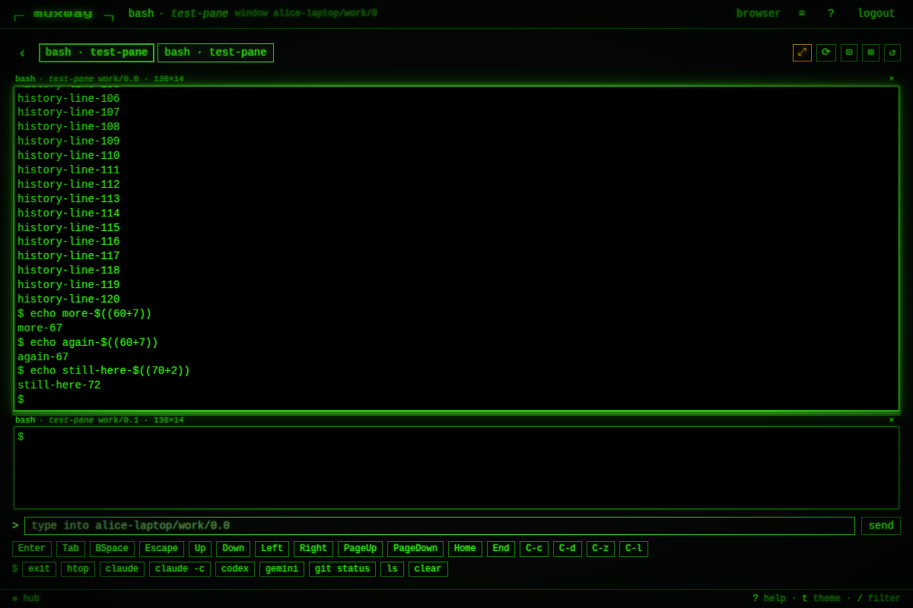

## Tiles: the Android view

`/p/<address>` opens one pane; `/p/<a>,<b>,<c>` opens up to four, side
by side. The page is the Android client's pane view:

```
[‹] [⟳ fixing the build][! review][bash][tail · build.log]      [▦] window ▸
┌─ ✳ Claude · fixing the build · work/0.0 · 96×28 · write · ⟳ working ─ fit on ─┐
│ $ make test                                                                   │
│ ok                                                                            │
└───────────────────────────────────────────────────────────────────────────────┘
> ________________________________________________________________________ [send]
[Enter][Tab][BSpace][Escape]…
✳ [/clear][/compact][/rename][/model][/resume][/usage][/context][/help]
```

- `‹` goes back to the list.
- The **tab strip** lists every pane you may read, in listing order,
  named by what Claude wrote into the title or by what runs there. Each
  tab is **painted with its state** from the lens: the attention colour
  when the pane waits for you (`!` `?` `z` `✓`, pulsing), dim when it
  works (`⟳`), plain when quiet. Open panes have a border, the focused
  one a thick border and its name in bold; selection never changes the
  colour, so the state shows on the pane you are looking at. A click on
  an open tab focuses its tile; a click on a closed tab swaps it into
  the focused tile. The strip scrolls and keeps the focused tab in view.
- **Tiles** share the area in one of the Android arrangements: two panes
  have a `row` and a `column`; three add `main-left` (a main pane with
  the others stacked beside it) and `main-top`; four add a `grid`. `▦`,
  or `l`, cycles the ones that make sense for the count. A wide window
  starts with the row, a tall one with the column. The bar between two
  tiles drags, and no tile goes under fifteen percent. Drag a tile's
  header onto another to swap the two; `×` in a header, or `x`, closes a
  tile. The arrangement is the browser's own and never reaches the host.
- A tile's **header** is painted like its tab and names the pane, its
  address, its size, its mode and the lens's word; the focused tile has
  the thick border and the bold name, and carries the `fit` button.
- **Fit** is per tile, with the pane's own scope (see
  [fit](#fit-the-host-follows-the-browser)). Every writable tile opens
  with fit on, one or several. `f` toggles the focused tile, `F` every
  tile, `r` sends the size once more.
- `]` and `[` focus the next or previous tile, `1` to `4` a tile by
  number; `Ctrl+→` and `Ctrl+←`, from the input line too, show the next
  or previous pane of the strip in the focused tile (the phone's swipe);
  `w` opens the focused pane's window
  view, `b` puts it on the board, `Enter` opens it alone.
- The **command row** under the key bar is for the program in the
  focused pane, one row that scrolls sideways. When the pane is Claude
  Code's it carries the slash commands typed most: `/clear`, `/compact`,
  `/rename`, `/model`, `/resume`, `/usage`, `/context`, `/help`, behind
  Claude's spark. When it is a shell it carries starters, `exit`,
  `htop`, `claude`, `claude -c`, `codex`, `gemini`, `git status`, `ls`,
  `clear`, behind a `$`, and after a bar the last eight lines sent to a
  shell from this browser, newest first, kept by the browser. A button
  sends its command and `Enter`, as the input line does; `/rename` fills
  the input line and leaves the name to you. Any other program gets no
  row. The window view and the board have the same row for their
  focused pane.

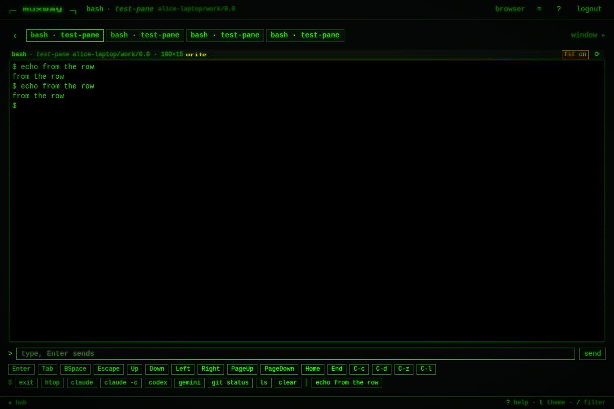
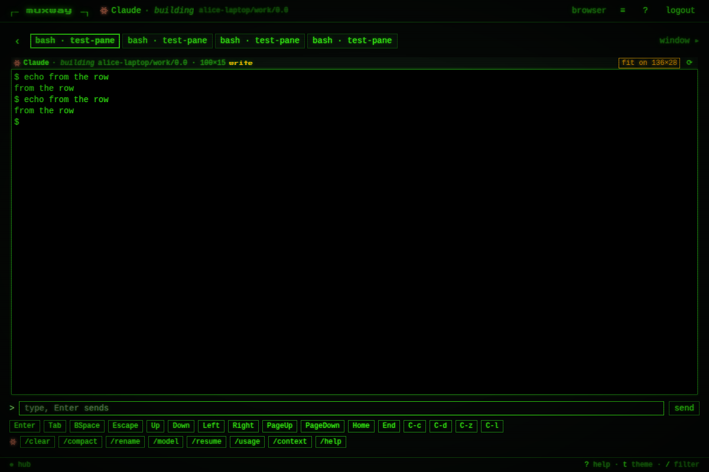

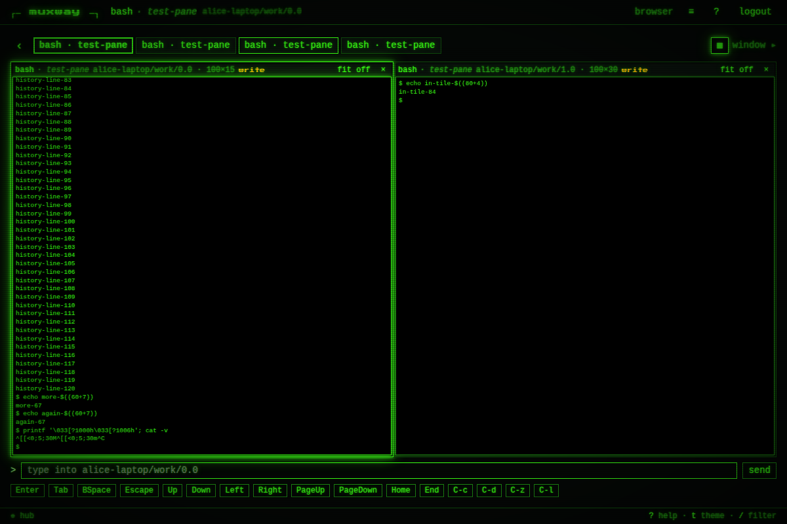
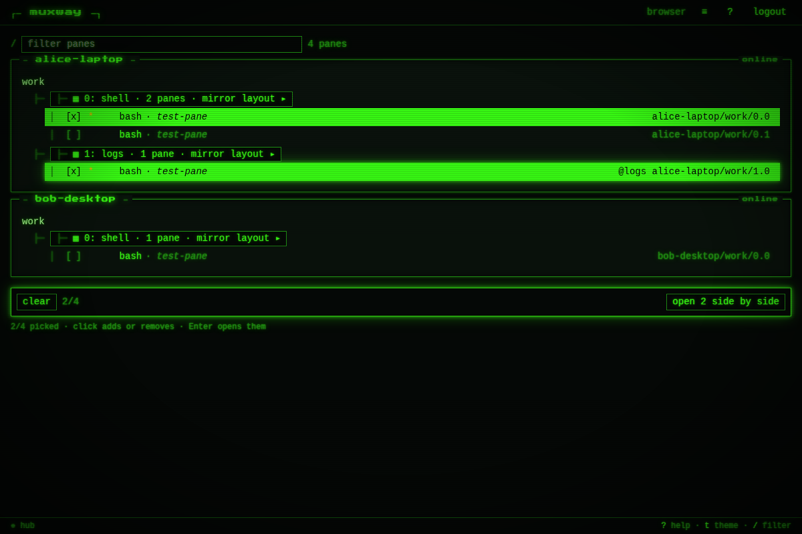

## The lens

A lens knows one program and tells the rest of the client what its pane
is up to. The first is for Claude Code, recognised as [above](#what-a-
pane-is-called). A pane is **waiting for you** when the listing carries a
notification; **working** when the last event the hub sent for it was
`working` (the hook on a submitted prompt) or, while a tile reads it, its
screen changed in the last ten seconds; **quiet** otherwise. A change
this client caused does not count: the first read of a tile, the reflow
after its own resize, the echo of its own input. On load the client
reads the hub's recent events, so a pane that was working before the
page opened shows so at once. Panes that are not Claude's show
notifications the same way and never show "working". tmux's own
activity flag is not used: it is the window's, shared by every pane in
it.

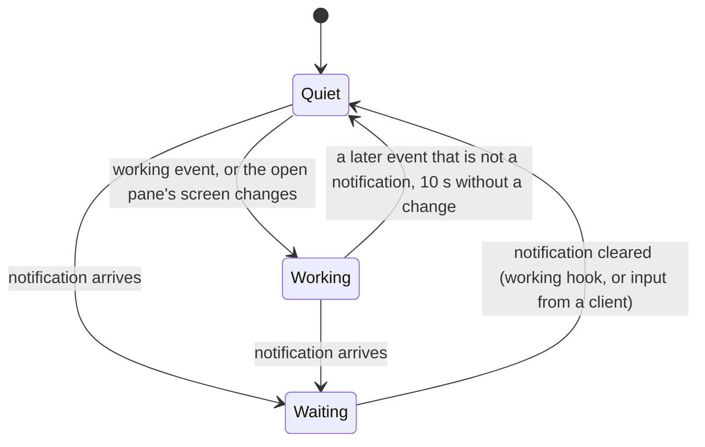

The lens reads three fields the client already renders as text (title,
command, notification kind) and one number. A pane can at most make
itself look like Claude Code or look busy.

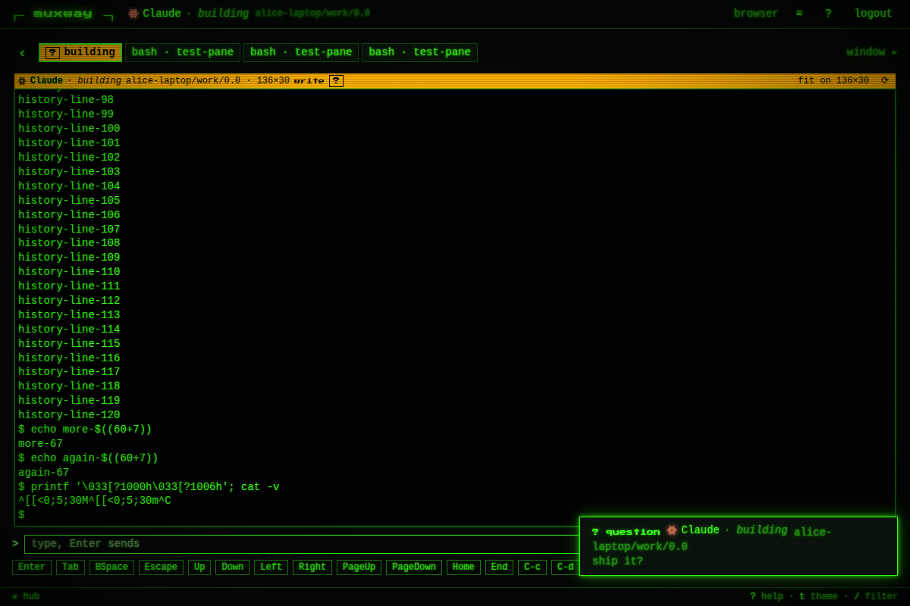

## The window view

A window's `▦ … mirror layout ▸` button in the list, the `▦` entries in
the selector, or `window ▸` above the tiles open the **window view**: every pane of the window you
may read, in tmux's own layout, each scaled to its box. The row above
is the pane view's: `‹` back to the list, then a **tab per pane of the
window** in layout order, painted with its state, the focused one with
the thick border and its name in bold; a click focuses that pane. The
controls sit at the right as icons, the tooltip naming each with its
key:

```
[‹] [✳ Claude · fixing the build][bash][! review][ logs ]      [⤢][⟳][⊡][⊞][↺]
┌ ✳ Claude · fixing the build · work/0.0 · 98×40 · ⟳ working              × ┐
```

| Icon | Does | Key |
|---|---|---|
| `⤢` | fit: the host window follows the box (selected when on) | `f` |
| `⟳` | fit again, after another client sized the window | `r` |
| `⊡` | the focused pane alone, and the whole window again (selected while zoomed) | `z`, double-click |
| `⊞` | equal shares in every split (with fit on, the host follows: the way to put a squeezed window right) | `=` |
| `↺` | the host's own layout again | `0` |

One pane is focused (its tab, a click on its header, or `]` and `[`);
the input line and key bar go to it, `Enter` opens it alone. `]` and `[`
move the zoom with the focus; with fit on the host zooms the pane too.
Then, in the browser only (with fit on, a dragged divider reaches the
host, see above):

- drag a divider to change the split,
- `+` and `-` to make the focused pane's text bigger or smaller,
- `x`, or the header's `×`, to hide the focused pane: its tab stays,
  dimmed with a dashed border, and a click on it brings the pane back.

Each cell's header is painted with the pane's state as a tab is, with
the lens word after the size (`⟳ working`, `! permission: run it?`), and
a pane that waits for you glows in the attention colour, a shadow around
its cell that moves nothing else. Boards do the same.

The arrangement is remembered per window in your browser, and dropped
whenever tmux's own layout changes, so the view never shows a stale
picture; with fit on, a change of sizes alone is the browser's own
doing and keeps the arrangement. A pane you may not read shows as a
gap.

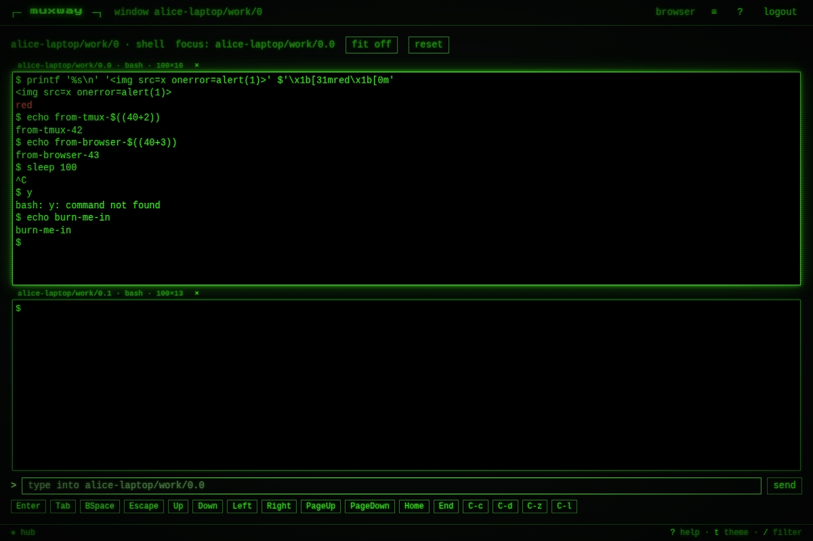
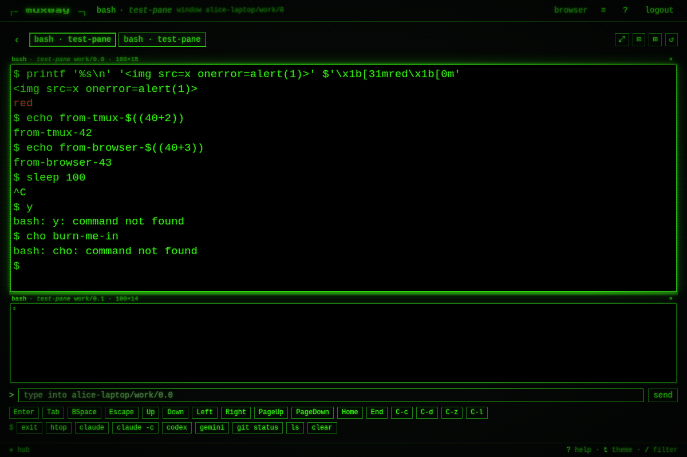

## The selector

`p`, or `≡` in the header, opens the selector over any view: type part
of an address, alias, command or title; panes that need you come first;
`Enter` jumps. Windows with more than one pane are listed too.

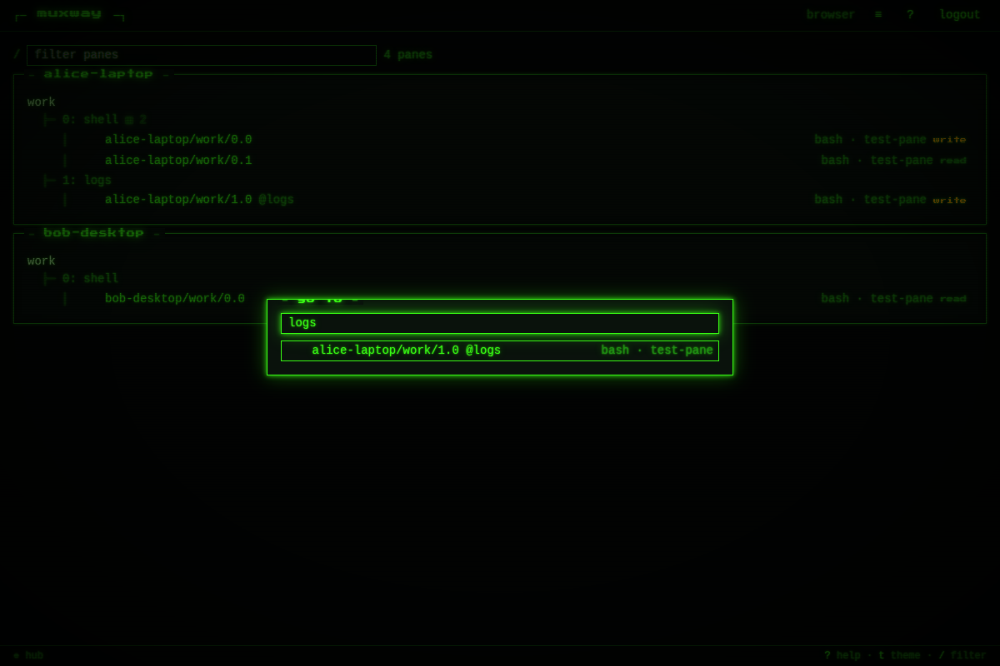

## Boards: your own arrangement of panes from anywhere

The window view is the host's arrangement. A **board** is yours: panes
from any window, session or host, side by side as you like, kept in this
browser only. `b` opens the main board (`/b/main`); from a pane, `b` puts
that pane on it first. The selector lists every board with `▤`, and
`board <name>` typed there makes a new one.

On a board, `a` adds a pane beside the focused one and `A` below it,
through the selector, which offers only panes not yet on the board. `x`
takes the focused pane off (the pane itself goes on), `s` swaps it with
the next, and dragging a cell's header onto another cell swaps the two.
Dividers drag, `+` and `-` scale the focused pane, `=` gives every split
equal shares, `z` or a double-click shows a pane alone and back, `Enter`
opens the focused one on its own, `w` opens its window view. `]` and `[` move focus; the input
line and the key bar go to the focused pane. A pane that is gone, or not
yours to see, shows a gap with a `remove` button.

Fit on a board is per pane: `f` sizes the focused host pane to its cell,
`F` turns fit on or off for every writable pane. It is off by default,
because several host windows changing at once is a decision for you.

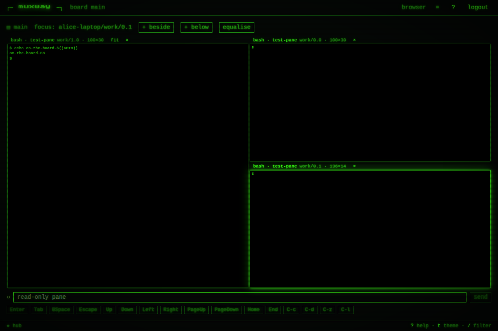
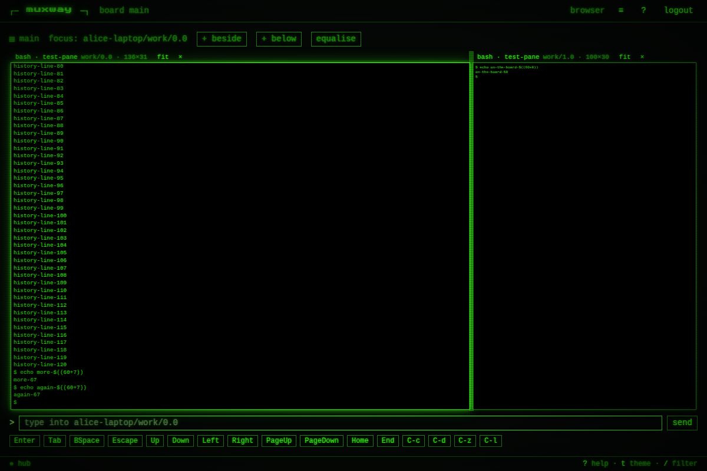

## Keyboard

| Key | Does |
|---|---|
| `j` / `k` | move the selection down / up |
| `space` | pick the selected pane, up to four |
| `Enter` | open the selected pane, or the picked ones side by side |
| `Esc` | back to the panes; in the input line it is the pane's Escape, as the key bar's button is (an open completion list closes first) |
| `/` | filter panes |
| `i` | focus the input line |
| `Enter` / `Shift+Enter` | input line: send / a new line |
| `Tab` | input line: take the highlighted completion; from an empty line, `Tab` goes to the pane |
| `↑` `↓` | input line: pick a completion; from an empty line, the key goes to the pane, as do `←` `→` `PageUp` `PageDown` `Home` `End` |
| `Shift+Esc` | input line: leave the line |
| `v` | speak: record a clip for the hub's transcriber, onto the input line; `v` again stops, `Esc` drops it |
| `p` | selector: go to a pane or window |
| `f` | fit: the host pane (window view: the window) follows the box |
| `r` | fit again: this client's size, after another client sized the window |
| `b` | the main board; from a pane: put it on the board first |
| `a` / `A` | board: add a pane beside / below the focused one |
| `x` / `s` / `z` / `=` / `F` / `w` | board: remove, swap, zoom, equal shares, fit all, the pane's window |
| `]` / `[` | next / previous tile (window view: pane) |
| `Ctrl+→` / `Ctrl+←` | the next / previous pane, from the input line too: tiles show the strip's neighbour in the focused tile; the window view and a board move the focus, and the zoom with it |
| `1`–`4`, `l`, `x`, `F`, `w` | tiles: focus one, next arrangement, close, fit all, the pane's window |
| `x`, `z`, `0`, `=`, `+`, `-` | window view: hide, zoom (or double-click), host layout, equal shares, bigger, smaller |
| `g` then a letter | jump to the first host starting with it |
| `t` | next theme: green, amber, paper |
| `?` then `font` | screen font: 11 to 20 px, the cell fit sizes the host by |
| `m` | effects on / off |
| `n` | browser notifications on / off (in the help overlay) |
| `?` | help |

Everything is reachable by touch too; on a phone the list and the pane
stack and the key bar wraps.

## Look and motion

Three themes, chosen with `t` and remembered by the browser: phosphor
green, amber, and paper for daylight. The page powers on like a tube,
scanlines and a faint vignette stay, glow sits on borders, headings and
anything focused, new lines in a pane burn in, badges for questions and
permissions pulse, and a theme switch re-syncs the picture. All of it is
CSS driven by tokens in `web/src/styles/tokens.css` and `motion.css`.
`m` turns the effects off, and the operating system's reduced-motion
preference does the same.

## Running without it

`muxway hub serve --no-web` leaves `/` to native clients: with a sign-in
provider configured it still sends a browser to sign in, otherwise it is a
404.

## Building it

The client lives in `web/` (React, TypeScript, Vite; see
`web/package.json`). `make web` rebuilds `web/dist`, which is committed
and embedded by `go build`, so `go install` needs no Node. CI rebuilds it
and fails if the committed output differs from the sources.

## Security considerations

- The client is a consumer of the API with the session cookie; it adds no
  endpoint. Its own risks are in the browser, and the hub's headers close
  them: a content security policy that allows only the client's own
  scripts, styles and fonts, no inline code and no other origin;
  `frame-ancestors 'none'`; `Referrer-Policy: no-referrer`;
  `X-Content-Type-Options: nosniff`.
- A click is sent as a button and a cell, never as bytes; the hub checks
  the cell against the pane's size and the agent refuses a pane whose
  program did not ask for the mouse, so nothing is typed by accident.
- Pane content, titles, session and window names and event text are
  rendered as text. The colour renderer turns escape sequences into class
  names and drops everything else. Lint forbids injecting markup.
- A resize is a write on the host: it needs the write grant and the write
  mark, is audited with its size, and is limited to one per second per
  window. A browser arrangement reaches the host only with fit on, as the
  proportions and the zoom of a window resize; the hub parses the layout
  and the agent accepts one that names exactly the window's panes,
  nothing else.
- The cookie is `SameSite=Strict` and useless without the client header,
  so a page on another origin can neither read nor use the session. The
  suite proves it from a second origin.
- No request ever leaves the hub's origin: no fonts, scripts or analytics
  from elsewhere. Browser notifications carry kind and address only.
- A text with newlines is the one new thing the line sends. The hub
  admits the newline and no other control character; the agent delivers
  it through a tmux buffer, never a shell, and the bracketed-paste marks
  around it are written by tmux when the program asked for them, never
  accepted from a client (`ESC` stays refused). A shell without bracketed
  paste runs each line at its newline, as a local paste would.
- Completion is a list in the client plus your own recent shell lines;
  nothing from a pane, a title or the hub enters it, and it never sends by
  itself: `Enter` sends what is typed.
- The command row sends what you could type: a fixed string from the
  client's own list, or a line you sent before, and `Enter`, to the
  focused pane, under the same write grant and audit as the input line.
  Nothing from a pane, a title or the hub reaches the list; a pane that
  dresses as Claude Code or a shell only chooses which row shows. The
  last eight lines sent to a shell are kept in the browser's storage,
  like boards: do not send a secret as a shell line on a shared
  browser, or clear the site's data afterwards.
- A link's target is pane content, so it is untrusted. Only `http://` and
  `https://` runs become links; `javascript:`, `data:` and every other
  scheme stay text. The address is set as an attribute from the match,
  never built as markup, and the anchor opens with `noopener noreferrer`,
  so the page it opens gets neither this window nor its address. A click
  on a link sends nothing to the host, so a program cannot use one to
  provoke a click at a cell. A pane can print a misleading address, as any
  terminal can; the browser's own address bar shows where it went.
- A spoken clip goes to the hub only, over the session the page has, and
  the hub's checks stand in front of the transcriber: the write grant,
  the WAV header, the size, one clip per five seconds. The clip is kept
  in memory for the request and dropped; the microphone is closed the
  moment recording stops. The transcript is shown on the line before
  anything is sent, so a hostile transcriber gets words on a line you
  read, nothing more, and the input endpoint's own checks apply when
  they go. Recording starts only from a click or a key on the page,
  behind the browser's permission prompt, and the worklet is a file of
  the client's own: the content security policy is unchanged.
- Node dependencies are pinned exactly with a committed lockfile and
  installed with `npm ci`. They are a build-time concern: the hub binary
  carries only the built files.
