# Web client

Open the hub's address in a browser. The hub serves the client itself,
from files embedded in its binary, so there is nothing to install and
nothing but the hub to talk to.


## Using it

1. **Sign in**: with the identity provider the hub owner configured, or by
   pasting a token once. The token is sent to the hub and forgotten; a
   session cookie takes its place. See [signing in](sign-in.md).
2. **Panes**: every host you may reach, with its sessions, windows and
   panes, laid out as the Android client lays them out. A row has a pick
   box, `*` when you may type there, what runs in the pane with its
   state, and the address; offline hosts are dimmed. A badge marks a pane
   that needs you: `?` question, `!` permission, `…` idle, `✓` done, and
   the word follows (`! permission`); an AI agent's pane that is busy
   shows `⟳ working` (see [the lens](#the-lens)). A click opens the pane.
   `I` opens the [inbox](inbox.md), every waiting pane oldest first, and
   `o` the oldest of them; `⚑ n` beside the brand counts them.
   The pick box, `space` on the highlighted row, or a click while
   something is picked gathers up to four panes; a bar under the list
   then offers **open N side by side**. Each window has a button, `▦ 0:
   main · 2 panes · mirror layout ▸`, that opens the
   [window view](#the-window-view). Under a window where you may type, a
   dim `+ pane` row splits it (beside on a wide pane, below on a tall
   one) and opens the new pane; at the right of a host's line,
   `+ session` asks for a name and opens the new session's pane, on hosts
   whose agent allows it (see [new panes and sessions](new-panes.md)).
   Type `/` to filter.
3. **Tiles**: one to four panes on one screen, with a strip of every pane
   above them; see [tiles](#tiles-the-android-view). Each pane's content
   comes with its colours, refreshed every second, and one input line
   serves the focused tile. The screen opens at its bottom and follows
   new output; scroll up to read back, and it stays put until you scroll
   down again. The input line is a small editor: text wraps, `Enter`
   sends, `Shift+Enter` starts a new line, and the field grows upward to
   six rows before it scrolls inside. The rows it takes are not a
   resize: with fit on, the pane keeps its size while you write and the
   screen scrolls under the line instead. What the line sends to one
   pane goes one request after another, so keys pressed in a burst
   arrive in the order pressed. A text with several lines is
   pasted into the pane as one block (bracketed, when the program asked
   for it), so Claude Code takes it as one message and a shell as one
   editable block; then `Enter` is sent. While the first word is typed a
   list opens above the line: Claude Code's slash commands, or a shell's
   starters and the lines sent before from this browser; `↑` `↓` pick,
   `Tab` or a click takes one, `Esc` closes it, and `Enter` sends the
   highlighted one, so the pane's own menu never gets a half-typed word.
   Any word, two letters in, is also completed from the words on the
   pane's screen, a path a program printed, a name from an `ls`, newest
   first, after the commands and marked `⇥`: `Tab` or a click takes
   one, and `Enter` sends the line as typed. Nothing from another pane
   or from the hub is ever offered.
   From an empty line the console keys
   (`↑` `↓` `←` `→`, `PageUp` `PageDown` `Home` `End`, `Tab`) go to the
   pane, so a menu in it is driven without leaving the line; with text
   they move the caret. `i` focuses the line, `Esc` leaves it, and
   `Shift+Esc` sends `Escape` to the pane while typing goes on. The key
   bar sends the named keys the protocol allows. A click on the screen of
   a pane whose program asked for the mouse, Claude Code among them, is a
   click at that cell on the host, so an option shown can be chosen by
   clicking it; in a pane that did not ask, a click only focuses. The
   wheel follows the same rule. In a shell it scrolls the browser's box
   through what the hub sent: the screen and up to a few hundred lines of
   history. A program that asked for the mouse scrolls itself: Claude
   Code, `htop` and `vim` run on the terminal's alternate screen, which
   has no history of its own, so the wheel over such a pane goes to the
   host as wheel notches at the cell under the pointer, one per row of
   travel, the notches of a movement gathered into one request while the
   last one is answered, and the program moves its own view. Any shell history above it
   is still there, reachable by the box's scrollbar. The tab strip keeps
   its tabs at their width and scrolls sideways: the wheel over it moves
   it, `‹ ›` at its ends appear when there is more than fits, and
   with one tile open `]` `[` show the next and previous pane in it.
   A web address in the pane's text, `http` or `https`, is a link with a
   dotted underline: a click opens it in a new tab, and the pane hears
   nothing of it, even when its program has the mouse. The punctuation
   after an address stays text, a bracket the address opened stays in,
   and an address wrapped onto a second row opens up to the row's end.
   A program may name the address itself, the way Claude Code marks a
   work item or a file (the OSC 8 sequence, which tmux 3.6 keeps): the
   label is the link, in its own colours, and the address shows when
   you hover it, since the label may say anything; the same two schemes
   and nothing else.
   In a pane whose program has the mouse, a numbered choice (Claude
   Code's `❯ 1. Yes`, `2. No`) shows the hand, since a click picks it.
   Where the host's agent has an inbox and the pane is writable, `⇪` sits
   on the line too: a file picked with it, pasted (a screenshot, a
   text file) or dropped anywhere on the view goes to the host, and its path lands on
   the line, focused and unsent (see [attachments](attachments.md)).
   A path of the inbox printed in the pane is a link as well, and on a
   host with preview roots any path of a file the host shows: a click
   opens a window over the page with the file, text, image or PDF, its
   size and a `⤓` download (`Escape`, `×` or a click outside closes it;
   see [preview](preview.md)).
   When the hub has a transcriber (see [transcription](transcription.md))
   and the pane is writable, a `◉` button sits between the field and
   *send*: a click or `v` records a clip, a level meter and the seconds
   take the field's place, `■` or `v` again stops it, and the words the
   hub heard land on the line, focused, for you to read and send with
   `Enter`; `Esc` or *cancel* drops the clip. Without a transcriber there
   is no button. Read-only panes say so.


Green and paper, and the phone layout:

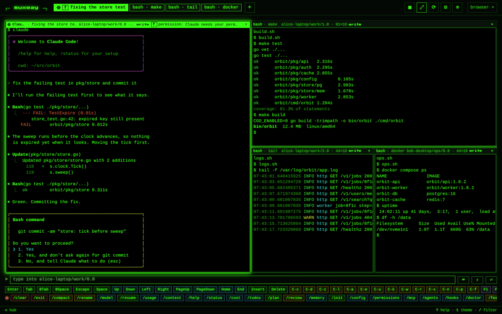


## What a pane is called

Everywhere a pane is named, in the list, the pane header, the tab title,
the window view and the selector, it is named by what runs in
it, not by tmux: the command, and after it what the program says about
itself in the pane title when that adds something (`vim · notes.md`).
A tile's header names its pane, and a notification names the pane the same way: the mark,
the name upright, what the program says about itself in italics, and
the place dimmed after it, all on one line.
A pane running **Claude Code** is named *Claude*, with its mark, and the
status Claude writes into the title follows (`Claude · fixing the
build`); it is recognised by its command, or by the spark Claude Code
puts first in its title when it runs under another command. The tmux
address, session and window names come second, dimmed, so you can still
tell panes apart. The other AI CLIs are named too (Codex, Gemini,
Antigravity, OpenCode, Copilot, aider, goose, Amp, Cursor), and Codex
and Antigravity carry marks of their own, a hexagon and a lifted
chevron, in the list, the tabs, the headers and the add menu, as
Claude's spark does.


When an AI CLI in a pane calls for you (see
[notifications](notifications.md)) the badge appears, a toast slides in,
the tab title flashes until you come back, and, if you turned them on, a
browser notification names the pane while the tab is hidden. Typing into
the pane clears it.

## Fit: the host follows the browser

A terminal tells tmux its size; the browser does the same when **fit** is
on (`f`, or the button in the header). A pane alone in the pane view
sizes its *window* to the box and is zoomed in it with tmux's own zoom,
so its neighbours are not squeezed; a pane that is alone in its window
sizes the window without a zoom. With several tiles, each *pane* on the
host becomes the columns and rows that fit its tile: where it spans its
window, the window is sized; where it shares the window with neighbours,
the window grows by what the pane lacks and the pane's own cell takes
it, so no neighbour is squeezed, or the neighbours take what it gives
up, and a pane left under 20 columns or 5 rows is grown the same way;
the host remembers the size
each pane of the window was given and gives it again when a sibling is
fitted, so the second fit does not take the first one's size. Tiles that are every pane of
one window fit the window as one, laid out as the tiles are, the way the
window view does, so each pane is exactly its tile and a divider dragged
moves the host's split. The layout sent is exact: each pane gets as many
cells as its tile's screen holds, so no pane has rows its tile cannot
show; the tiles of a stack lose a header each, and a tile across from
them keeps that much spare at its bottom. Where only some of a window's panes are open as
tiles, each fits its own pane and the host sorts the neighbours out,
as above. A size the host would not give, because another tile's fit
shares the axis (two tiles whose panes are stacked ask for different
widths: the later one sets both), leaves that tile saying *held* in its
header, drawn scaled to its box, until its box changes. While a tile
waits for the host to give the size it asked (after a zoom, say) it
keeps its last picture and says *sync* in its header, the picture a
little dim with a soft band rolling down it; the live picture snaps
back when the pane is at size. The focus plays
no part in any of this: moving it between tiles sends nothing. Every
fitted pane is released when the view is left. In the
window view, fit sizes the whole
*window* to the area and lays it out as the browser shows it: the panes
keep their proportions until you drag a divider, and then the host's
split follows the divider (the window is fitted through one writable
pane of it, the same one while it is shown, so moving the focus between
the cells sends nothing); a pane zoomed here is zoomed on the host too,
with tmux's own zoom, so it gets the whole window. With fit on a pane is
read at the font you chose (the help overlay, `?`, cycles it from 11 to
20 px, remembered by the browser) and the host is sized by that cell, so
every pane is shown one to one. Fit is on by default wherever you may
write: in the pane view and the window view.
Leaving a fitted view gives the window back to tmux's automatic sizing,
unzoomed, and the panes back to the proportions they had, unless they
were moved since: an arrangement stays. Moving between
panes inside the pane view (`]` `[`, a tab, a swap) is not leaving: a
pane shown in a tile stays at the size it was given, and when it comes
back at that size nothing is sent, so switching back and forth does not
resize the host; the tile shows the last frame it had of the pane until
the host's next one. With fit off, the pane keeps the host's size and is
scaled to the box instead.

Several clients can fit the same window, and the last one to send a size
wins; a client sends its size only when it changes, so after a phone has
sized the window the browser shows it small. `r` sends this client's
size once more, as does switching fit off and on.


## Tiles: the Android view

`/p/<address>` opens one pane; `/p/<a>,<b>,<c>` opens up to four, side
by side, **from any hosts, sessions and windows**: the build on your
workstation, the logs on a server and an AI agent on your laptop in one
view, each live and typable. The page is the Android client's pane view:

```
┌─ muxway ─┐ [⟳ fixing the build][! review][bash][tail · build.log] [+]   [▦][⤢][⎇][⊡][≡]  [alice ▾]
┌─ ✳ Claude · fixing the build · work/0.0 · 96×28 · write · ⟳ working ─ _ × ┐
│ $ make test                                                                   │
│ ok                                                                            │
└───────────────────────────────────────────────────────────────────────────────┘
[? deploy][hub.log]                                          ← the minimised row
> ________________________________________________________________________ [send]
[Enter][Tab][BSpace][Escape]…
✳ [/clear][/exit][/compact][/rename][/model][/resume][/usage][/context][/help]…
```

- The **header** is one row. The brand at its left goes back to the
  list. After it the tab strip, and right after the last tab `+`, which
  opens the [add menu](#the-add-menu) (the `+` key opens it too). At
  the right the pane buttons, 32 px squares with a label under
  the pointer: `▦` arrangement, `⤢` fit, `⎇` changes, `⊡` zoom, `≡` go
  to a pane; on a narrow screen (640 px and under) they fold into one
  `⋯` button that opens a menu with the same entries. Last, the profile
  button with who you are, holding *hubs*, *help*, *admin* (for an
  admin) and *logout*; on a narrow screen it shows only its caret. The
  browser tab's icon is drawn in the theme's colours.
- The **tab strip** lists every pane you may read, in listing order,
  named by what Claude wrote into the title or by what runs there. Each
  tab is **painted with its state** from the lens: the theme's ink,
  inverted, when the pane waits for you (`!` `?` `z` `✓`, pulsing), dim when it
  works (`⟳`), plain when quiet. Open panes have a border, the focused
  one a thick border and its name in bold; selection never changes the
  colour, so the state shows on the pane you are looking at. A click on
  an open tab focuses its tile; a click on a closed tab swaps it into
  the focused tile, and a Shift+click opens it beside the others, up to
  four, so a second pane and the `▦` arrangements are one click away.
  The strip scrolls and keeps the focused tab in view. **Drag a tab**
  along the strip to put it where you want it: a mark on the nearer
  edge of the tab under the pointer shows where it lands, and `}` `{`
  move the focused pane's tab one place. The order is kept in the
  browser: the dragged tabs come first in that order, every other pane
  follows in listing order, a new pane comes last, and a pane that goes
  away takes its place back when the same address returns. The window
  view keeps the host's order.
- **Tiles** share the area in one of the Android arrangements: two panes
  have a `row` and a `column`; three add `main-left` (a main pane with
  the others stacked beside it) and `main-top`; four add a `grid`. `▦`,
  or `l`, cycles the ones that make sense for the count. A wide window
  starts with the row, a tall one with the column. The bar between two
  tiles drags, and no tile goes under fifteen percent. Drag a tile's
  header onto another tile: its middle swaps the two; its upper, lower,
  left or right part splits that tile's place that way, the dragged pane
  on that side, and the half it will take lights up while you hover. The
  dragged pane's old place closes up, every share is equal again, and
  `▦` goes back to the presets. Dropped on a **divider** instead, the
  pane goes across that divider's split: a divider between columns lays
  it across the split's whole width, as a row on top or at the bottom by
  the divider's half you drop on; one between rows, down its whole
  height, left or right. While a header is dragged the dividers widen
  and the half the pane will span lights up with *across* or *full
  height*. Along each **inner edge** of a tile, just inside the divider's
  grip, is a strip: under the pointer it shows `»` (`«` `˄` `˅`), the
  pointer becomes a one-way arrow and a label says what a click does,
  which is laying the tile across the whole view, its width from a side
  edge, its height from a top or bottom one, on the side its middle is;
  `e` and `E` do the same for the focused tile. A tile already across has
  no strips on that axis; `×` in a header, or `x`, closes
  the pane on its host after asking `y` / `n` on the header, where the
  agent allows it and the pane is writable (see
  [new panes and sessions](new-panes.md#closing-a-pane)), and otherwise
  closes the tile. The arrangement is the browser's own, except for one
  window's panes (below).
- **One window's panes stay in step with it.** When the tiles are every
  pane of one window, they open as the host has the window, and a change
  there (a split resized at the host, another client's arrangement)
  shows here within a few seconds. What you change here goes to the host
  as the window's layout: a divider dragged, a swap, a drop, `▦`. The
  agent swaps the panes into the order you made, because tmux fills a
  layout's places in its own pane order, and lays the window out; with
  fit on it is also sized to the view, with fit off it keeps its size.
  Moving panes changes their indexes, so their addresses: the view
  follows its panes by id and rewrites its address. Moving them needs a
  write grant on every pane of the window; with a read-only one among
  them the tiles follow the host, `▦` is off and a drop says why.

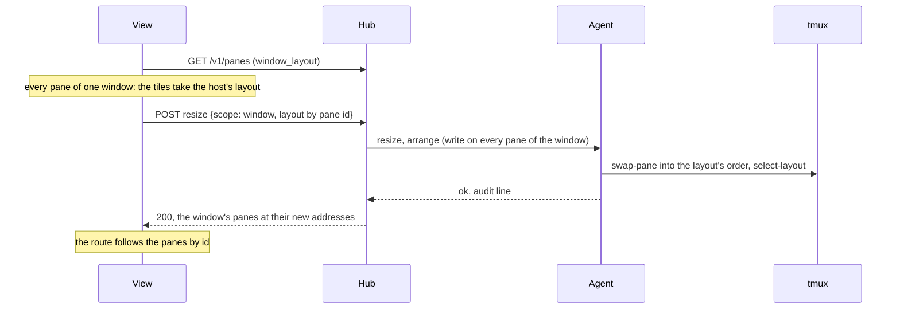
- A tile's **header** is painted like its tab and names the pane, its
  address, its size, its mode and the lens's word; the focused tile has
  the thick border and the bold name. At its right, before `_` and `×`,
  a writable tile on a host with preview roots counts the repository's
  changes (`⎇ +3 ~5 −1`, `⎇ ✓` when clean, nothing outside a
  repository); a click on the count opens the changes window (see
  [changes](changes.md)). `_` minimises the tile (below); it is off on
  the last tile. The controls sit in the top row,
  at the right, as icons: `▦` the next arrangement (with several tiles),
  `⤢` fit for the focused tile (selected when on), `⎇` the changes
  window over the tile on a host with preview roots (see
  [changes](changes.md)), `⊡` zoom.
- **Fit** is per tile, with the pane's own scope (see
  [fit](#fit-the-host-follows-the-browser)). Every writable tile opens
  with fit on, one or several. `⤢` or `f` toggles the focused tile, `F`
  every tile, `r` sends the size once more. The header shows the
  pane's size, which with fit on is the tile's. `⊞` or `=` gives every
  split equal shares; with the tiles every pane of one window and fit
  on, the host follows.
- A click on a cell the pane no longer has, right of or below its size
  on a frame the host has since shrunk, is not sent; a wheel notch there
  turns at the nearest cell the pane has.
- A click on the row the program waits on, the cursor's row as the
  listing reports it (or the last row with text, from an older agent),
  focuses the input line, after whatever the click did in a pane that
  has the mouse: so clicking Claude Code's `❯` box or a shell's prompt
  means *type here*.
- **Copy a block.** The screen is made of blocks, as Claude Code prints
  them: the rows down one bar (`│`, `┃`, `|`, `>`), a `●` or `❯` row with
  the rows indented under it, a `⎿` result with its rows. Under the
  pointer a block shows `⧉` over its first row's marker; a click on it
  puts the block's text on the clipboard, without the bar, the marker
  and the indent, and a toast says how many rows. The click reaches the
  pane as nothing, mouse mode or not.

  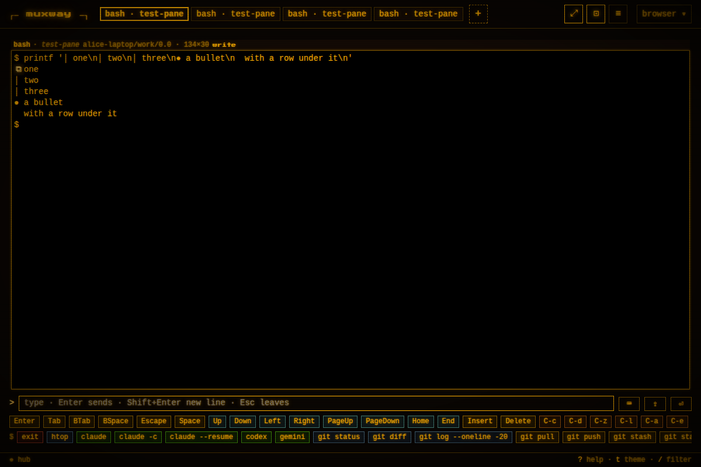
- <a id="the-add-menu"></a>The **add menu**, `+` after the last tab or
  the `+` key, is built from the listing the page already holds and
  offers, in this order: **+ pane**, one more pane beside the focused
  one on its host, where you may type there; **+ session** on the
  focused pane's host, where its agent starts sessions; a rule; the
  **minimised** panes; a rule; every other readable pane the view is not
  showing, grouped by host and session in the listing's order, each as
  its glyph and name with the place dimmed after it. The focused pane
  and the open tiles are not listed. An entry the token or the host does
  not allow is dimmed with the reason, *read only* or *no sessions
  here*. `+ pane` and `+ session` ask the hub and open the new pane
  beside the others; a pick asks nothing and becomes one more tile,
  focused. With four tiles open the menu's heading says *four open: a
  pick replaces <the focused pane>* and the pick swaps into the focused
  tile, as a tab does. `Esc` closes the menu.

  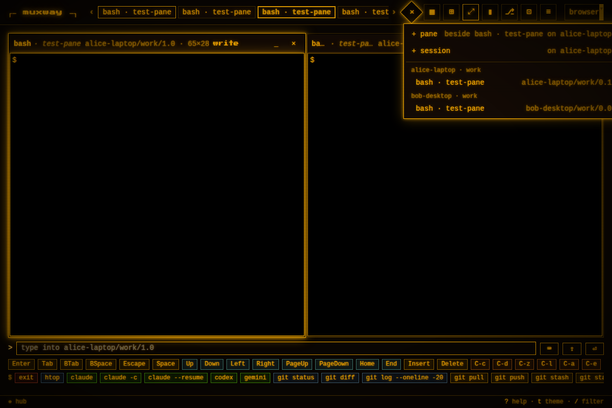
- The **minimised row**. `_` on a tile's header, or `-` on the focused
  tile, takes the tile out of the arrangement and puts its tab in a row
  right above the key row, painted like a tab with its glyph and the
  state's colours, and still read every two seconds, so the glyph keeps
  moving; its tab leaves the strip while it is below. A click on the
  tab brings the tile back, focused, as does its entry in the add menu;
  with four tiles open it takes the focused tile's place. The last tile
  cannot be minimised; closing the last tile brings a minimised pane
  back instead of leaving the view. The row is not drawn while it is
  empty. Minimised panes belong to the view's arrangement and are
  forgotten with it, on leaving the view or a reload; the fit of a
  minimised pane is kept and released like a closed tile's, when the
  view is left.

  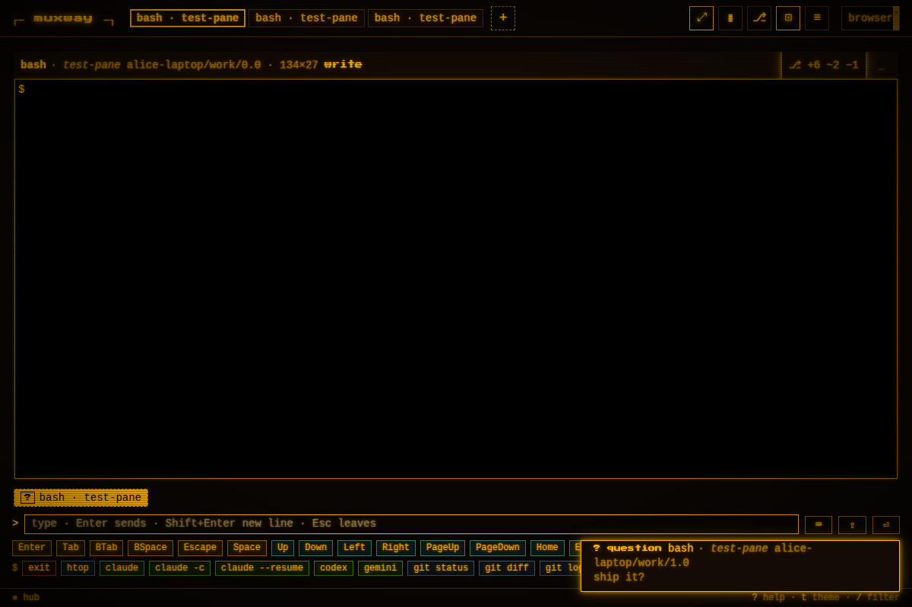
- **Zoom** is one view at two distances, not two views: `⊡`, `z` or a
  double-click on a tile, its header or its tab open that pane alone,
  and the same again bring back the tiles it came from, in their places,
  arrangement and shares, focused on it. A pane opened alone brings the
  window's panes side by side in the window's order, up to four (a
  window of one pane shows its mirror layout instead). `w` opens the
  window's mirror layout. The zoom is drawn like a channel change: the
  tile switches off to a bright line that travels to its new place and
  opens there (see *Look and motion*).
- A pane that exits (`exit` in its shell, say) leaves the view by
  itself within a second, with a toast saying which: among tiles the
  others close up, alone it takes you back to the list, or to the first
  minimised pane.
- While a fit is on its way to the host, a tile keeps the last frame it
  had instead of the host's answers at the old size, for three seconds
  at most, so switching panes does not flash a smaller screen.
- `]` and `[` go to the next or previous pane: the next tile, or with
  one tile open the strip's neighbour shown in it (the phone's swipe),
  coming round at either end;
  `1` to `4` focus a tile by number, `Enter` opens it alone.
- The **command row** under the key bar is for the program in the
  focused pane, one row that scrolls sideways. When the pane is Claude
  Code's it carries the slash commands typed most: `/clear`, `/compact`,
  `/rename`, `/model`, `/resume`, `/usage`, `/context`, `/help`, behind
  Claude's spark. When it is a shell it carries starters, `exit`,
  `htop`, `claude`, `claude -c`, `codex`, `gemini`, `git status`, `ls`,
  `clear`, behind a `$`, and after a bar the last eight lines sent to a
  shell from this browser, newest first, kept by the browser. A button
  sends its command and `Enter`, as the input line does; `/rename` fills
  the input line and leaves the name to you. Any other program gets no
  row. The window view has the same row for its focused pane.


## The lens

An `idle` notice while the pane's screen still moves, in the last ten
seconds, counts as working: Claude is at its prompt but its background
tasks still print, so the pane is not waiting on you and no toast is
shown for it. The working mark is a turning ring, drawn rather than
typed, the same in every font. A toast names the pane as its tab does,
with the place after it, and sits level with the key row while an input
line is on the page.

A lens knows one AI coding agent's screen and tells the rest of the
client what its pane is up to. The client names Claude Code as
[above](#what-a-pane-is-called) and the other harnesses by their command
(Codex, Gemini, Antigravity, OpenCode, Copilot, aider, goose, Amp,
Cursor; Gemini, Antigravity and Copilot by their names in the title when
they run under `node`); the
Claude Code lens, which reshapes the screen, is the one there is. A pane
of any named agent is **waiting for you** when the listing carries a
notification; **working** when the last event the hub sent for it was
`working` (the hook on a submitted prompt, or the host's watcher seeing
the screen move) or, while a tile reads it, its screen changed in the
last ten seconds; **quiet** otherwise. A change this client caused does not count: the first read of
a tile, the reflow after its own resize, the echo of its own input. On
load the client reads the hub's recent events, so a pane that was
working before the page opened shows so at once. Panes that are not
an agent's show notifications the same way and never show "working".
tmux's own activity flag is not used: it is the window's, shared by
every pane in it.

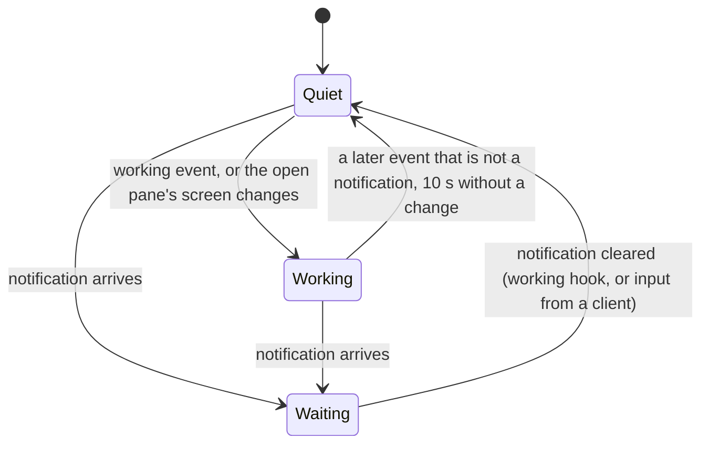

The lens reads three fields the client already renders as text (title,
command, notification kind) and one number. A pane can at most make
itself look like an agent or look busy.


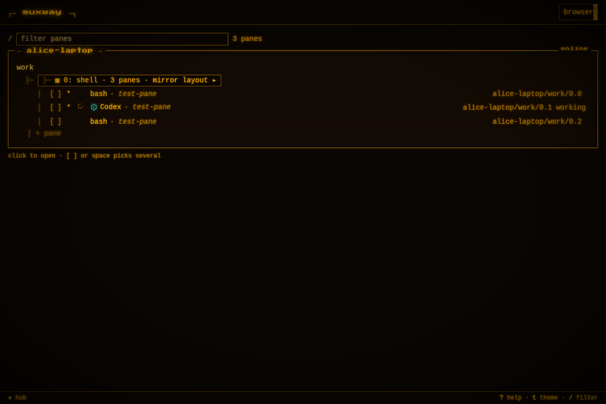

A question asked with fixed answers (`muxway ask`, see
[notifications](notifications.md#questions-with-fixed-answers)) shows
its choices as buttons: on the pane's header after the kind and text, in
the toast that announces it, and in the inbox row. A click sends the
choice to the asking process through `POST .../answer`; nothing is typed
into the pane, and the attention goes. On a pane you may not write to the
buttons are disabled.

## The window view

A window's `▦ … mirror layout ▸` button in the list, the `▦` entries in
the selector, or `window ▸` above the tiles open the **window view**: every pane of the window you
may read, in tmux's own layout, each scaled to its box. The row above
is the pane view's: `‹` back to the list, then a **tab per pane of the
window** in layout order, painted with its state, the focused one with
the thick border and its name in bold; a click focuses that pane. The
controls sit at the right as icons, the tooltip naming each with its
key:

```
[‹] [✳ Claude · fixing the build][bash][! review][ logs ]      [⤢][⊡][▦][⊞][↺]
┌ ✳ Claude · fixing the build · work/0.0 · 98×40 · ⟳ working              × ┐
```

| Icon | Does | Key |
|---|---|---|
| `+` | one more pane: split here, or a new session on a host that starts them (as in the pane view) | `+` |
| `⤢` | fit: the host window follows the box (selected when on) | `f` |
| `⊡` | the focused pane alone, in the pane view with everything it has | `z`, `Enter`, double-click |
| `▦` | the next arrangement of the window's panes, on the host: row, column, then main-left, main-top and grid by count, over the shown panes, the hidden ones kept in a thin stack at the right; off while any pane of the window is read-only, since the host's panes move only with the write grant on all of them, and above four panes | `l` |
| `⊞` | equal shares in every split (with fit on, the host follows: the way to put a squeezed window right) | `=` |
| `↺` | the host's own layout again | `0` |

One pane is focused (its tab, a click on its header, or `]` and `[`);
the input line and key bar go to it. **Zoom is the pane view**: `⊡`,
`z`, `Enter` or a double-click on a cell, its header included, open the
focused pane alone there, with the strip, the input line, the
completions and the command row; from the pane view `⊡`, `z` or a
double-click bring the window's panes back side by side as tiles, and
`w` returns to this mirror layout. Then, in the browser only (with fit
on, a dragged divider reaches the host, see above):

- drag a divider to change the split,
- `+` and `-` to make the focused pane's text bigger or smaller,
- `x`, or the header's `×`, to hide the focused pane: its tab stays,
  dimmed with a dashed border, and a click on it brings the pane back.

Each cell's header is painted with the pane's state as a tab is, with
the lens word after the size (`⟳ working`, `! permission: run it?`), and
a pane that waits for you glows in the theme's ink, a shadow around
its cell that moves nothing else.

The arrangement is remembered per window in your browser, and dropped
whenever tmux's own layout changes, so the view never shows a stale
picture; with fit on, a change of sizes alone is the browser's own
doing and keeps the arrangement. A pane you may not read shows as a
gap.


## The selector

`p`, or `≡` in the header, opens the selector over any view: type part
of an address, alias, command or title; panes that need you come first;
`Enter` jumps. Windows with more than one pane are listed too.


## One view, no boards

Until 2026-10-25 a **board** (`/b/…`) kept a free arrangement of panes
in the browser. The owner chose one view: the tiles took the board's
free arrangement (drag a header onto a tile's edge) and the board went.
A bookmark of a board opens its panes as tiles once, up to four, and the
board kept in the browser is forgotten with it.

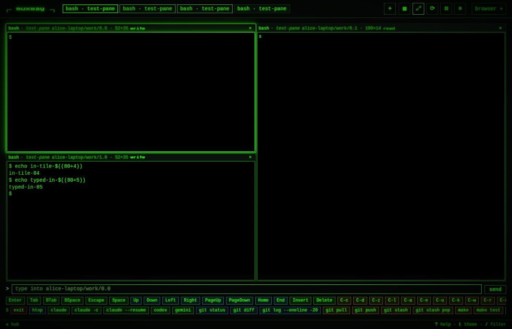

## Several hubs

A hub gathers hosts; a person with a hub at home and one at work has two
addresses and two sign-ins. The browser remembers the other hubs in the
**hubs** box (`H`, or *hubs* in the profile menu), signs in on each
hub's own page once, and from then on **this page lists and opens the
panes of every hub it is signed in on**: the list groups them by hub,
and a pane of another hub opens as a tile beside this hub's, is read
from, typed into, resized and watched on its own hub.

```
┌ hubs ────────────────────────────────────┐
│ ▸ home   https://hub.example.com   here   │
│   work   https://work.example.com  [go] × │
│ name: ______  url: https://______  [add]  │
└──────────────────────────────────────────┘
```

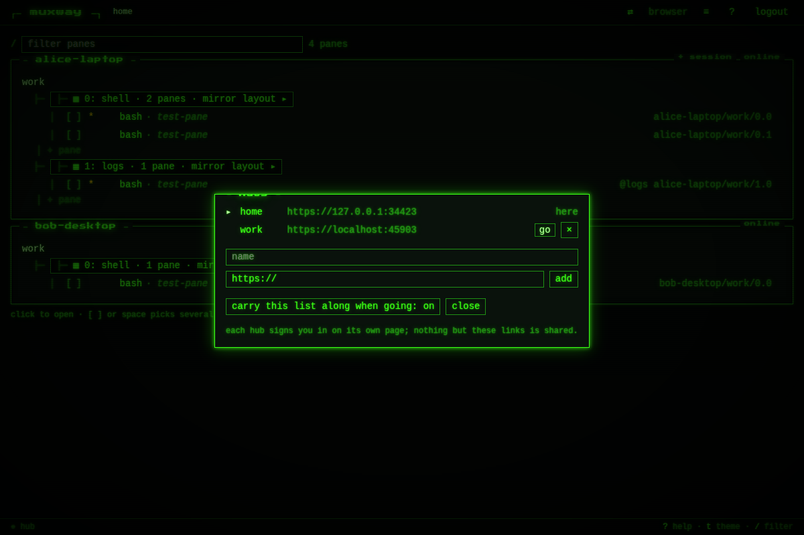

The hub serving the page is the first entry, shown by its host until you
name it (click the name to rename; `Enter` keeps it). **add** takes a
name (`a-z`, `0-9`, `-`, up to 32) and an address, which must be an
`https://` origin, or `http://` to this machine, with nothing after the
host and no credentials in it; nothing is fetched to check it. **go** is a
plain navigation to that hub's own page, where that hub signs you in
itself and sets its own session cookie; with more than one hub known, the
header shows the current one's name beside the brand. **×** removes a
link.

**The list with several hubs.** Each hub has its line, `═══ work ═══`,
above its hosts; with one hub the line is not drawn. A hub the page is
not signed in on says *not signed in* beside its name, with a **sign
in** link to that hub's own page, and nothing under it; one that cannot
be reached says *unreachable*. Once signed in there, come back: its
hosts, sessions, windows and panes are listed under its line, refreshed
like this hub's, with `+ pane` and `+ session` where that hub's grants
allow them. The window view (mirror layout) is this hub's own: a pane of
another hub has no window button and `w` does nothing for it.

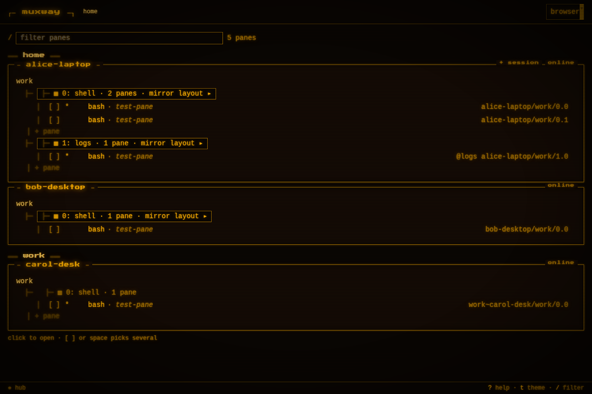

**Naming a pane of another hub.** Everywhere the page keys panes by
address (the route, the tiles, the strip, the selector, the add menu) a
pane of another hub is `<hub name>~<address>`: `/p/alice-laptop/work/0.0,work~bob-server/ops/0.0`
opens one pane of each side by side. This hub's panes keep their bare
addresses, so every bookmark stands. Renaming a hub in the box renames
its panes' addresses in your bookmarks too.

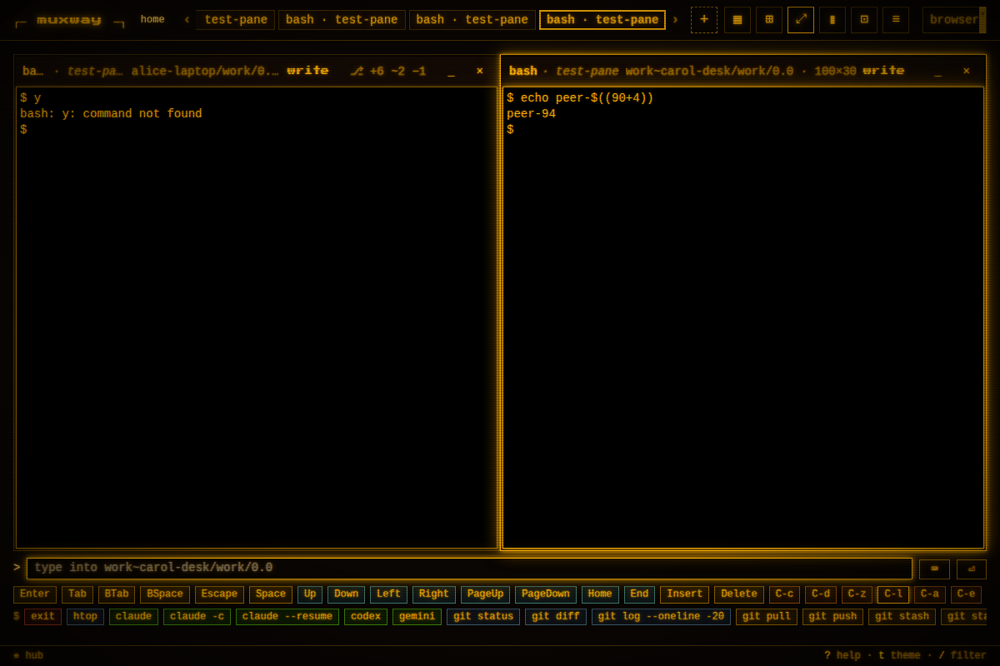

**How it works: peers.** A browser keeps a session cookie per origin and
the hub's cookie stays on its site, so a page on hub A could not call hub
B. The hub owner names the other hub as a **peer**: `muxway hub serve
--peer https://work.example.com` on each, naming the other. A hub with
peers sets its cookie `SameSite=None` (still `Secure`, `HttpOnly`), so
the browser sends it from a peer's page, and answers a peer's preflight
with that origin echoed, credentials allowed and `X-Muxway-Client` among
the allowed headers; its web page's content security policy lets it
connect to the peers. The page asks every hub of the box for `/v1/hosts`
and `/v1/panes` with the browser's cookie for each, keeps one event long
poll per hub, and sends every call for a pane to the hub it belongs to.
Nothing is relayed: no hub ever holds another's credential.

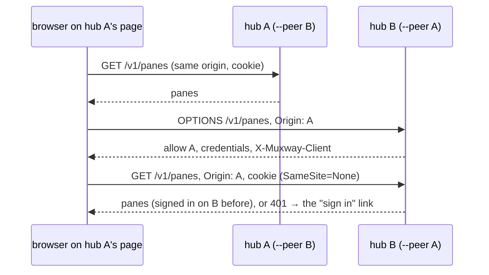

The list lives in the browser's storage under the origin of the hub
whose page you added it on, so each hub's page has the hubs added
there. To have the same list on both, leave *carry this list along when
going* on: **go** then puts the names and addresses in the address's
fragment (`#hubs=…`). The other hub's page reads it once, strips it from
the address bar, and keeps what is well shaped and new to it **apart
from the list**, in the tab, until you decide: once signed in there,
the hubs box shows each carried entry with **add** and **ignore**, and
nothing is a link until you add it. Before sign-in the box only says how
many wait. That is all that ever travels: no token, no cookie, no
referrer.

```
┌ hubs ────────────────────────────────────────────┐
│ ▸ work   https://work.example.com   here          │
│ ┄┄┄┄┄┄┄┄┄┄┄┄┄┄┄┄┄┄┄┄┄┄┄┄┄┄┄┄┄┄┄┄┄┄┄┄┄┄┄┄┄┄┄┄┄┄┄┄┄ │
│ carried in the link you opened, not in your list  │
│ until you add them:                               │
│ ? home   https://hub.example.com   [add] [ignore] │
│ name: ______  url: https://______  [add]          │
└──────────────────────────────────────────────────┘
```

**The decision.** On 2026-10-24 the owner had hubs stay separate: one
hub per page, one sign-in each, no page talking to two hubs. On
2026-10-27 he reversed it ("I mean all the hubs on all servers. Go and
implement all of that"), with the consequence in front of him: a peer's
page that is compromised can act on this hub as the signed-in person,
because the browser sends the cookie there and the hub lets that page
add the header. So peers are hubs the same owner runs, named one by one
on the command line; a hub with no `--peer` behaves exactly as before,
and a page on any other origin still gets nothing (see
[security](#security-considerations)). On Android the app holds a token
per hub in its keystore and lists every hub's panes together; see
[muxway-android/docs/features/connect.md](https://github.com/notmarkopadjen/muxway-android/blob/main/docs/features/connect.md).

## Admin

For a principal with the admin grant, **admin** in the header opens
`/admin`: the hub's log tailing live, tokens and users with *create* and
*revoke*, connected clients with *end*, and the address lists. Anyone
else sees no entry, and `/admin` says *not yours to see*. See
[the admin overview](admin.md).

## Keyboard

The pane view has three states, one at a time, said in the input row:
the **page**, where a key is one of the shortcuts below; the **line**,
where keys write the input line (`:` or a click on it); and **direct
typing**, where every key goes to the focused pane as pressed (`i` or a
click on the tile; the prompt shows `▮`, the status bar says so and the
pane's cursor is a block). See [direct typing](direct.md).

| Key | Does |
|---|---|
| `j` / `k` | move the selection down / up |
| `space` | pick the selected pane, up to four |
| `Enter` | open the selected pane, or the picked ones side by side |
| `Esc` | back to the panes; or leave the input line (first closing its completion list) |
| `/` | filter panes |
| `i` | direct typing: every key goes to the focused pane as pressed, `Esc` included; `Shift+Esc`, a click on the line or the `▮` button leaves; a click on the tile turns it on too (see [direct typing](direct.md)) |
| `:` | focus the input line |
| `Enter` / `Shift+Enter` | input line: send / a new line |
| `Tab` | input line: take the highlighted completion; from an empty line, `Tab` goes to the pane |
| `↑` `↓` | input line: pick a completion; from an empty line, the key goes to the pane, as do `←` `→` `PageUp` `PageDown` `Home` `End` |
| `Shift+Esc` | input line: send `Escape` to the pane and keep typing; direct typing: leave it |
| `K` | the keyboard: a window with a full terminal board for the focused pane (see [the keyboard](keyboard.md)); `Esc` closes it |
| `v` | speak: record a clip for the hub's transcriber, onto the input line; held, it records until released; tapped, `v` again stops; `Esc` drops it |
| `p` | selector: go to a pane or window, or start a session on a host |
| `I` / `o` | the [inbox](inbox.md): every pane that waits for you, oldest first; `Enter` opens the selected one / open the oldest waiting pane |
| `+` | the list: one more pane in the selected row's window; it opens. Tiles: the add menu |
| `-` | tiles: minimise the focused tile to the row above the keys; a click on its tab there, or its entry in the add menu, brings it back |
| `S` | a new session on the selected row's host (or the first that allows it): a one-line form, `Enter` starts, `Esc` cancels |
| `f` | fit: the host pane (window view: the window) follows the box |
| `r` | fit again: this client's size, after another client sized the window |
| `]` / `[` | next / previous pane: the tile, or with one tile open the strip's neighbour shown in it (window view: pane), coming round at either end |
| `}` / `{` | move the focused pane's tab one place right / left along the strip (or drag it); the order is kept in the browser |
| `1`–`4`, `l`, `x`, `F`, `z`, `w` | tiles: focus one, next arrangement, close (the pane on its host, asking, where allowed), fit all, zoom (one pane alone, or the window's panes side by side; or double-click), the mirror layout |
| `e` / `E` | tiles: lay the focused tile across the whole view's width / height, on the side its middle is |
| `g` | tiles: the changes window over the focused tile, git's view of its repository, on a writable pane of a host with preview roots; `g`, `Esc` or `×` closes it, `_` folds it to its bar (see [changes](changes.md)) |
| `x`, `z`, `0`, `=`, `+`, `-` | window view: hide, this pane alone (or `Enter`, double-click), host layout, equal shares, bigger, smaller |
| `g` then a letter | jump to the first host starting with it |
| `t` | next theme: amber, green, paper |
| `H` | hubs: the other hubs this browser knows; `go` is that hub's own page and sign-in, once; the list then shows every hub's panes |
| `?` then `font` | screen font: 11 to 20 px, the cell fit sizes the host by |
| `m` | effects on / off |
| `n` | browser notifications on / off (in the help overlay) |
| `?` | help |

Everything is reachable by touch too; on a phone the list and the pane
stack and the key bar wraps.

## Look and motion

Three themes, chosen with `t` and remembered by the browser: amber, the
default, phosphor green, and paper for daylight. The page powers on like
a tube, and so does every window over it (help, the hubs, go to a pane,
the keyboard), which powers off the same way backwards; scanlines and a faint vignette stay, glow sits on borders,
headings and anything focused, new lines in a pane burn in, badges for
questions and permissions pulse, and a theme switch re-syncs the
picture. Every move of the tiles is drawn as the browser's view
transition (`web/src/term/drawn.ts`): while a move is on each tile, or
each cell of the window view, carries a `view-transition-name` (the
zoomed tile `mx-zoom`), and the stylesheet animates the snapshots: a
tile that moves slides to its place with a brightness retrace, one that
leaves switches off to a line, one that comes powers on, and the zoomed
tile switches off, travels as a line and opens where it lands. That
covers the zoom, a header dropped on a tile or a divider, `l`, `=`,
`e` / `E`, a tile minimised or restored, and in the window view `=`,
`↺`, a pane hidden or brought back and `▦` (the host's new layout is
drawn when it arrives). Divider drags follow the pointer and are not
drawn. A tile waiting for its size says *sync* with a band rolling down
its picture. All of it is CSS driven by tokens in `web/src/styles/tokens.css`
and `motion.css`.
`m` turns the effects off, and the operating system's reduced-motion
preference does the same: moves then cut, and *sync* is the word alone.

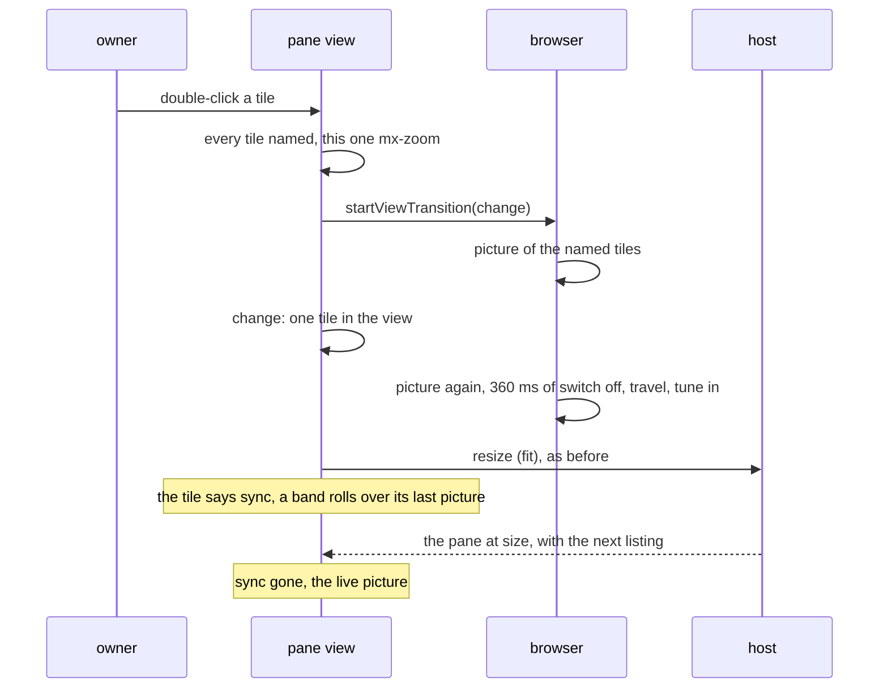

## Running without it

`muxway hub serve --no-web` leaves `/` to native clients: with a sign-in
provider configured it still sends a browser to sign in, otherwise it is a
404.

## Building it

The client lives in `web/` (React, TypeScript, Vite; see
`web/package.json`). `make web` rebuilds `web/dist`, which is committed
and embedded by `go build`, so `go install` needs no Node. CI rebuilds it
and fails if the committed output differs from the sources.

## Security considerations

- The client is a consumer of the API with the session cookie; it adds no
  endpoint. Its own risks are in the browser, and the hub's headers close
  them: a content security policy that allows only the client's own
  scripts, styles and fonts, no inline code and no other origin;
  `frame-ancestors 'none'`; `Referrer-Policy: no-referrer`;
  `X-Content-Type-Options: nosniff`.
- Another hub is a link: a name and an `https://` origin (or `http://` to
  this machine) with no path, query, fragment or credentials, checked
  before it is stored and again when a list arrives in a fragment, so a
  `javascript:` or `data:` entry never becomes a link. Going there is a
  navigation the browser makes with no cookie of this hub (a cookie is per
  origin), no referrer (`Referrer-Policy: no-referrer`) and no token (the
  page never has one). The content security policy is unchanged: the
  page still connects to its own origin alone.
- A list carried in a link is a list anyone can write: a crafted link
  could plant a lookalike hub that you later **go** to and hand a token.
  So a carried entry never enters the list by itself. It waits in the
  tab (session storage, gone with the tab), is offered only to a
  signed-in person, and becomes a link only through its own **add**,
  under the same checks as a typed one; **ignore** drops it. Until then
  it is not shown as a hub and has no **go**.
- A click is sent as a button and a cell, never as bytes; the hub checks
  the cell against the pane's size and the agent refuses a pane whose
  program did not ask for the mouse, so nothing is typed by accident.
- Pane content, titles, session and window names and event text are
  rendered as text. The colour renderer turns escape sequences into class
  names and drops everything else. Lint forbids injecting markup.
- A resize is a write on the host: it needs the write grant and the write
  mark, is audited with its size, and is limited to one per second per
  window. A browser arrangement reaches the host as a window's layout:
  with fit on, as the proportions and the zoom of a window resize, and
  for tiles that are every pane of one window also with fit off. The hub
  parses the layout and the agent accepts one that names exactly the
  window's panes, nothing else. A layout that moves panes, not only
  sizes them, needs the write grant on every pane of the window, checked
  by the hub and, against the live window, by the agent; both audit it
  with `arrange=true`.
- The cookie is `SameSite=Strict` and useless without the client header,
  so a page on another origin can neither read nor use the session. The
  suite proves it from a second origin. On a hub with peers the cookie is
  `SameSite=None`: the browser then sends it to this hub from a peer's
  page, and the hub lets a peer's page add the client header, through the
  preflight it answers for peer origins alone; every other origin keeps
  the credential-less wildcard and the same refusal, which the suite
  proves from the second origin on a hub with peers (specs 41 and 94,
  tests 170 to 172). A peer is therefore trusted with the session: a
  peer's page that is compromised can act here as the signed-in person.
  Peers are hubs the same owner runs, named on the command line; without
  `--peer` nothing changes.
- No request leaves the hub's origin but to the hubs of the hubs box, each
  asked with the browser's cookie for it and nothing of this hub's: no
  fonts, scripts or analytics from elsewhere, and the content security
  policy names the peers and nothing else. A hub that answers 401 is shown
  as not signed in; its refusal moves nothing on this page. Browser
  notifications carry kind and address only.
- A text with newlines is the one new thing the line sends. The hub
  admits the newline and no other control character; the agent delivers
  it through a tmux buffer, never a shell, and the bracketed-paste marks
  around it are written by tmux when the program asked for them, never
  accepted from a client (`ESC` stays refused). A shell without bracketed
  paste runs each line at its newline, as a local paste would.
- Completion is a list in the client plus your own recent shell lines;
  nothing from a pane, a title or the hub enters it, and it never sends by
  itself: `Enter` sends what is typed.
- The command row sends what you could type: a fixed string from the
  client's own list, or a line you sent before, and `Enter`, to the
  focused pane, under the same write grant and audit as the input line.
  Nothing from a pane, a title or the hub reaches the list; a pane that
  dresses as Claude Code or a shell only chooses which row shows. The
  last eight lines sent to a shell are kept in the browser's storage,
  like boards: do not send a secret as a shell line on a shared
  browser, or clear the site's data afterwards.
- A link's target is pane content, so it is untrusted. Only `http://` and
  `https://` runs become links; `javascript:`, `data:` and every other
  scheme stay text. The address is set as an attribute from the match,
  never built as markup, and the anchor opens with `noopener noreferrer`,
  so the page it opens gets neither this window nor its address. A click
  on a link sends nothing to the host, so a program cannot use one to
  provoke a click at a cell. A pane can print a misleading address, as any
  terminal can; the browser's own address bar shows where it went.
- A spoken clip goes to the hub only, over the session the page has, and
  the hub's checks stand in front of the transcriber: the write grant,
  the WAV header, the size, one clip per five seconds. The clip is kept
  in memory for the request and dropped; the microphone is closed the
  moment recording stops. The transcript is shown on the line before
  anything is sent, so a hostile transcriber gets words on a line you
  read, nothing more, and the input endpoint's own checks apply when
  they go. Recording starts only from a click or a key on the page,
  behind the browser's permission prompt, and the worklet is a file of
  the client's own: the content security policy is unchanged.
- A new pane or session is a shell started on the host, under the write
  grant the hub checks (and, for a split, re-checks on the new pane's
  address); the client sends a direction or a name it validated, nothing
  else, and shows the rows only where the account has a write grant on
  the host and the host allows it. The hub's answer, not the click,
  decides. See [new panes and sessions](new-panes.md).
- Node dependencies are pinned exactly with a committed lockfile and
  installed with `npm ci`. They are a build-time concern: the hub binary
  carries only the built files.

## The key bar and the command row

Under the input line, one row of named keys and one row of commands for
the program in the focused pane. Each is a single row that scrolls
sideways, with no scrollbar to take the room; the wheel over it moves
it. The keys are tinted by group, discreetly, on the border and the
ground only: editing keys (`Enter` `Tab` `BTab` `BSpace` `Escape`
`Space` `Insert` `Delete`), the directions (`Up` `Down` `Left` `Right`
`PageUp` `PageDown` `Home` `End`), the control keys (`C-c` to `C-f`)
and `F1` to `F12`. Commands are tinted by tone the same way: red for
what throws work away (`/clear`, `/exit`, `exit`), green for what
begins something (`/init`, `/resume`, `/plan`, `claude`, `codex`,
`gemini`), blue for what only tells (`/help`, `/status`, `git status`,
`ls`, …), amber for the rest. A starter that launches an AI CLI
(`claude`, `codex`, `agy`) carries that CLI's mark, on the row and in the
completion list above the line; a Codex or an Antigravity pane gets its
slash commands as a Claude pane does, with the mark at the row's head,
and the completion list offers them while the first word is typed. The tints are theme tokens
(`--mx-tint-*` in `web/src/styles/themes.css`), one set per theme.

The microphone button `◉` on the input line works two ways: hold it and
release to stop, or click it and click again. It and the *send* button,
which reads *cancel* while a clip records, keep their width, so nothing
under the pointer moves while recording.
