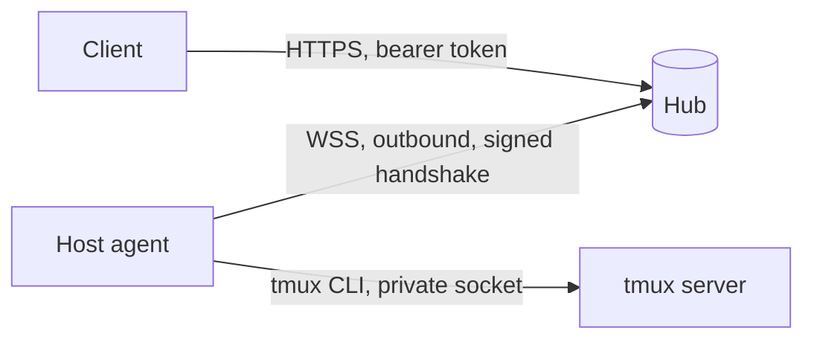
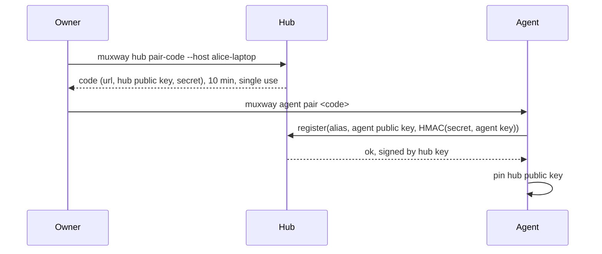
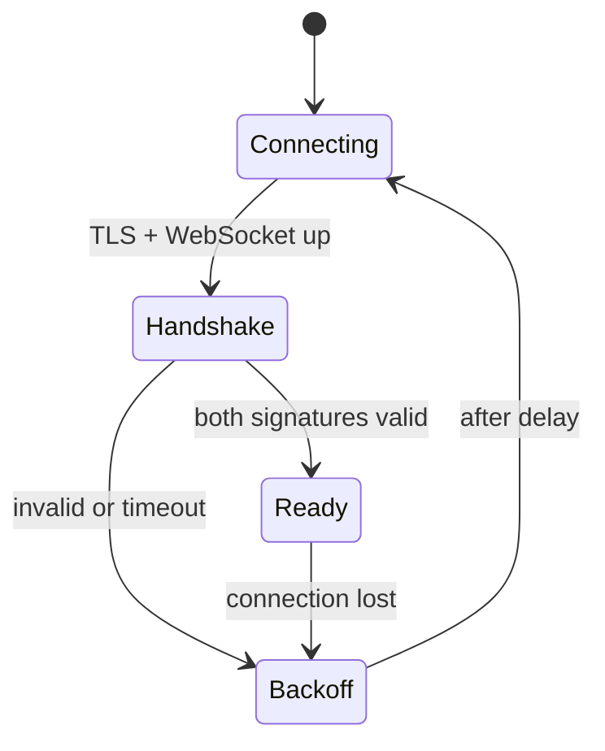

# Feature: hub and host agent

> Status: approved 2026-10-23.

## 1. Goal

The foundation every client needs: a **hub** that clients talk to, and a
**host agent** next to tmux that the hub reaches through an outbound
connection from the host. With it a client can list the sessions, windows
and panes its owner exposed, read a pane as plain text or with colours, and
type text or a few named keys into it. One binary, `muxway`, plays both
roles.

Out of scope here, each its own feature later: agent events and
notifications (AI CLI hooks), the web client, live streaming through tmux
control mode, second-factor confirmation for writes, the relay for clients
without TLS.

## 2. Design

**Identities.** The hub and every agent have an Ed25519 key pair, created on
first start and kept in a 0600 file. Clients use bearer tokens.

**Pairing.** On the hub, `muxway hub pair-code --host <alias>` prints a
one-time code (valid 10 minutes, single use) carrying the hub URL, the hub's
public key and a 128-bit secret. On the host, `muxway agent pair <code>`
creates the agent's key, proves knowledge of the secret, and registers its
public key under the alias. The agent stores the hub's public key: from then
on it only talks to a hub that can sign with it.

**Agent connection.** The agent opens a WebSocket over TLS to the hub. Both
sides then authenticate at the application layer, independent of any TLS
terminator in front of the hub: each sends a fresh 32-byte nonce, each signs
the other's nonce together with the connection's purpose and its own nonce,
each verifies with the pinned key. Replays fail because nonces are fresh on
both sides. After that the channel carries JSON request/response messages
with ids; the hub may only send the three requests below, the agent answers
nothing else. On loss the agent reconnects with backoff (1 s doubling to
60 s, with jitter).

**The tmux model.** tmux has sessions, which hold windows (used by most
people as tabs), which hold panes (splits of a window). muxway keeps that
model:

- The **pane** is the unit of access: reading and typing always target one
  pane, and grants and the agent's checks are per pane.
- **Listings carry the hierarchy**: for each pane its session (id, name),
  window (id, index, name, layout, active), pane (id, index, active, size,
  title, current command) and exposure. Clients group them like tmux, show
  them flat, or mirror the window's own split from its layout string.
- **Addresses** are `<host>/<session>/<window>.<pane>`, for example
  `alice-laptop/work/2.1`; a window may be given by index or name. An
  optional short alias from `expose --name` addresses one pane for small
  screens.

**Exposing.** Nothing is visible by default. On the host,
`muxway expose -t <target> [--write] [--name <alias>]` marks a session
(`-t work`), a window (`-t work:2`) or a pane (`-t work:2.1`) with tmux user
options (`@muxway-mode`, and on panes `@muxway-alias`). tmux resolves user
options from pane to window to session, so a mark on a window or session
covers every pane in it, including panes created later; the most specific
mark wins, and `--deny` on a pane carves it out of an exposed window. Marks
die with what they are set on and with the tmux server. `muxway unexpose`
removes a mark and `muxway exposed` lists everything currently reachable
with its mode.

tmux never reuses session, window or pane ids within a running server, and
marks vanish with the server, so a recycled id cannot inherit access. As a
second guard the agent records each exposed pane's process id when it first
lists it and refuses a pane whose process changed underneath the same id.

**Requests the hub can send an agent**

| Request | tmux underneath | Agent checks |
|---|---|---|
| `list` | `list-panes -a -F ...` | only panes whose resolved mark is read or write |
| `read {pane id, lines, ansi}` | `capture-pane -p -J [-e] -S -<lines>` | resolved mark, same process, lines ≤ 2000 |
| `input {pane id, text \| key}` | `send-keys -l -- <text>` or `send-keys <key>` | resolved mark **write**, same process, text rules below |

The agent enforces these itself, so a compromised hub still cannot reach an
unexposed pane or write to a read-only one. The agent resolves addresses to
pane ids itself.

**Input rules.** Text is UTF-8, at most 4 KiB, with no control characters
(C0, DEL, C1): it goes through `send-keys -l`, so it is typed literally and
cannot inject escape sequences. Anything else is a named key from a fixed
list: `Enter`, `Tab`, `BSpace`, `Escape`, `Up`, `Down`, `Left`, `Right`,
`PageUp`, `PageDown`, `Home`, `End`, `C-c`, `C-d`, `C-z`, `C-l`.
`Escape` stays in on purpose: AI CLIs use it to interrupt. It also reaches
editor command modes, which the feature page on exposing points out.

**Client tokens.** `muxway hub token create --name <n> --read <patterns>
[--write <patterns>] [--ttl 30d]` prints a 256-bit token once. The hub
stores only its SHA-256 hash, its grants and its expiry. Patterns follow
addresses, `<host>/<session>/<window>.<pane>`, with `*` globs per segment:
`alice-laptop/*` is a whole host, `alice-laptop/work/*` a session,
`alice-laptop/work/2.*` a window. Grants are checked on the session and
window *names* and indexes as they are at request time. A pane outside a token's read grants is
neither listed nor readable; writing needs a write grant too. `token list`
and `token revoke` complete the set.

**Text mode.** For small clients: `Accept: text/plain` returns the pane
without colours, trailing blanks trimmed, rewrapped to the `width` the
client asks for (8 to 400 columns), last `lines` lines. Lists come back as
one tab-separated row per pane, sorted by session, window and pane.

**Hub state** is a single JSON file (0600, atomic replace): hub key path,
agents (alias, public key, paired at), tokens (id, name, hash, grants,
expiry). Pairing codes live in memory only.

**Transport.** The hub serves TLS itself (certificate files) or plain HTTP
on loopback only, for running behind a reverse proxy. It refuses to start
plain on any other address. Agents require `wss://`, except to loopback.

**Logging and audit.** Hub and agent log to stderr in structured lines.
Every input is audited on both sides: time, token id, pane, key name or
text length; never the text. Tokens, codes, secrets and keys are never
logged; token ids are the first 8 hex digits of the hash.

**Dependencies.** Go standard library plus one WebSocket library,
`github.com/coder/websocket` (maintained, no further dependencies). No cgo.

## 3. Protocol and API

Version `v1`, specified in `docs/protocol/v1.md`.

| Method and path | Purpose |
|---|---|
| `GET /v1/hosts` | hosts the token can see, online or not |
| `GET /v1/panes` | panes the token can read, with session, window and pane details, mode and last activity |
| `GET /v1/hosts/{host}/tree` | one host's sessions, windows (with layout) and readable panes, nested |
| `GET /v1/panes/{host}/{session}/{window}.{pane}?lines=&width=&ansi=` | pane content (JSON, or text mode) with an ETag; `{host}/@{alias}` also works |
| `POST /v1/panes/{host}/{session}/{window}.{pane}/input` | `{"text": "..."}` or `{"key": "Enter"}` |
| `GET /v1/agent` | WebSocket upgrade for agents |
| `POST /v1/pair` | agent registration with a pairing code |

Errors are JSON `{"error": "<code>"}` with 400, 401, 403, 404, 413, 429 or
503 (host offline). 404 is used for anything the token may not see, so a
token cannot probe for hosts or panes it has no grant on.

## 4. Security analysis

- **Impact if abused**: a writable pane is a shell on its host. Hence
  default-deny exposure, separate read and write grants, agent-side
  enforcement and the narrow input interface.
- **Hub compromise**: the attacker gets what the exposed panes give, no
  more: the agent refuses unmarked panes and writes to read-only ones and
  has no other commands. Owners should expose writable panes sparingly.
- **Man in the middle, including a hostile TLS terminator**: defeated by the
  signed handshake with pinned keys.
- **Stolen token**: limited by grants and expiry; revocable; stored hashed.
- **Brute force**: 10 failed authentications from one address in 10 minutes
  lock that address out for 10 minutes; pairing allows 3 attempts per code.
- **Injection**: text cannot carry control characters; keys come from a
  fixed list; host aliases are `[a-z0-9-]{1,32}`; session and window names
  from tmux are matched, never interpreted, and requests may only name them
  with `[A-Za-z0-9._-]{1,64}`; tmux is called with argument vectors, never
  a shell, and always with an id it resolved itself as the target.
- **Inherited exposure**: a split made in an exposed window is reachable at
  once with the window's mode. Documented, shown by `muxway exposed`, and
  narrowed with `--deny`.
- **Resource abuse**: bodies capped at 16 KiB, reads at 2000 lines, per
  token 20 requests per second.
- **Information leaks**: identical 404 for missing and forbidden; constant
  time token comparison; no secrets in logs (tested).
- **New dependency**: `coder/websocket`, widely used, pinned by version and
  checksum.

## 5. Privacy check

All examples, fixtures and docs use placeholder names (`alice-laptop`,
`hub.example.com`, RFC 5737 addresses). Test panes run synthetic commands.

## 6. Test plan

End-to-end, against throwaway tmux servers on private sockets, a hub on
loopback with a test CA, and agents paired for the run.

| # | Test | Kind | Expected |
|---|------|------|----------|
| 1 | Every client endpoint without a token, with a wrong, expired or revoked token | e2e-security | 401, nothing else in the body |
| 2 | Token with read on host A only: list and read on host B | e2e-security | B absent from lists, 404 on its panes |
| 3 | Read-only token sends input | e2e-security | 403, pane unchanged |
| 4 | Pane not exposed, token grants everything | e2e-security | not listed, 404 |
| 5 | Pane exposed read-only, token grants write | e2e-security | refused by the agent, pane unchanged |
| 6 | Malicious hub (test double) asks the agent for an unmarked pane, a write to a read-only one, an unknown request | e2e-security | all refused, audited |
| 7 | Text with ESC, other C0, DEL, C1 characters; unknown key names | e2e-security | 400, pane unchanged |
| 8 | Oversized body, malformed JSON, bad host or pane names, path traversal | e2e-security | 413 or 400 |
| 9 | Agent with a wrong key; replayed handshake; unpaired agent | e2e-security | connection refused |
| 10 | Agent connects to a hub with a different key behind the same address | e2e-security | agent refuses, does not send anything |
| 11 | Pairing code reused, expired, guessed 4 times | e2e-security | refused, code burnt |
| 12 | 10 failed logins from one address | e2e-security | 429 for that address, others unaffected |
| 13 | Exposed pane killed, a new pane gets the same pane id | e2e-security | no access to the new pane |
| 14 | Hub configured plain on a non-loopback address | e2e-security | refuses to start |
| 14a | Window exposed read-only: a new split in it | e2e-security | readable, not writable; a pane marked `--deny` in it is neither |
| 14b | Exposed window moved to an unexposed session; unexposed window moved into an exposed session | e2e-security | access follows the marks, grants re-checked on the new names |
| 14c | Session or window names with glob characters, slashes, dots, unicode | e2e-security | rejected or matched literally, never widening a grant |
| 15 | All logs of the run searched for tokens, codes, secrets and key material | e2e-security | no match |
| 16 | Pair, list (flat and tree), read in JSON and text mode at width 15 and 80, by address and by alias | e2e | content matches, hierarchy and layout correct, wrapped as asked |
| 17 | Type `echo hi` + Enter; `sleep 100` then C-c | e2e | output appears; sleep interrupted |
| 18 | Two agents on two hosts | e2e | both listed, routed correctly |
| 19 | Hub restart; agent killed | e2e | agent reconnects; host shown offline, 503 on its panes |

No UI in this feature, so no screenshots. Run output and recording follow
`docs/testing.md`; JUnit XML is written by a small converter in the
repository from `go test -json`, with no extra dependency.

## 7. Documentation

- `docs/ARCHITECTURE.md`: components, identities, trust boundaries.
- `docs/protocol/v1.md`: client API and agent channel, with examples.
- `docs/features/hub-and-agent.md`: install, pair, run, tokens.
- `docs/features/exposing-panes.md`: sessions, windows and panes; expose,
  modes, inheritance, `--deny`, what is safe to expose.
- Diagrams: components, pairing, handshake, read, input, agent state.

## 8. Implementation steps

1. Module layout, `muxway` CLI skeleton, config and state file.
2. Keys, pairing codes, signed handshake (with unit tests).
3. tmux layer: hierarchy listing, address resolution, capture, send-keys,
   expose marks with inheritance, process check.
4. Agent: connection loop, the three requests, enforcement, audit.
5. Hub: TLS or loopback, tokens and grants, client API, routing to agents,
   rate limits and lockout.
6. Text mode rendering.
7. End-to-end harness: test CA, tmux sockets, process supervision, run
   directory, JUnit converter, `scripts/e2e.sh`.
8. Security tests, then functional tests.
9. Docs and diagrams.

## Decisions

- 2026-10-23: the first deployment runs the hub behind an existing reverse
  proxy that terminates TLS (the hub plain on loopback).
- 2026-10-23: writes need only a token for now; a second factor for writes
  is a later feature.
- 2026-10-23: `Escape` is in the key list.
- 2026-10-23: windows and sessions are part of the model; the pane stays
  the unit of access.
