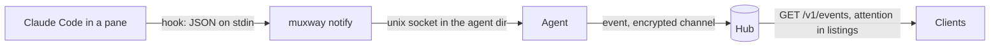
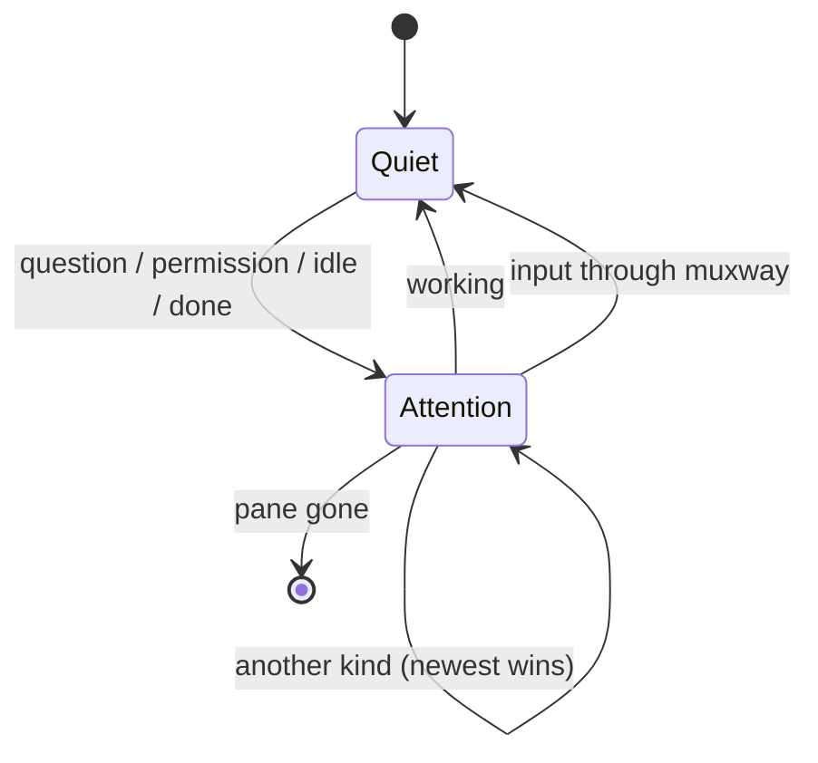
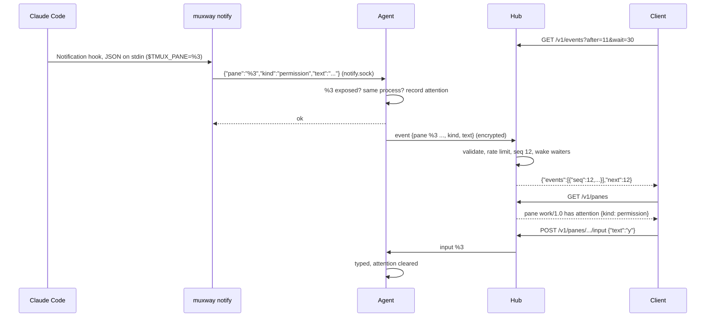

# Feature: notifications

> Status: implemented 2026-10-23.

## 1. Goal

An AI coding CLI running in an exposed pane, Claude Code first, tells the
owner's clients when it needs them: it asks a question, waits for a
permission, has gone idle, or has finished. Today a client has to poll the
pane's content and guess. With this feature a phone, a pair of glasses or a
feature phone can show "work/1.0: Claude asks a question" and the owner
opens exactly that pane.

Three pieces:

- `muxway notify`, a command run **on the host, inside the pane**, by a
  Claude Code hook or by any script. It hands the event to the local agent.
- The agent attaches an **attention** state to the pane and sends an
  **event** to the hub over the existing encrypted channel.
- Clients read `attention` in pane listings and poll `GET /v1/events`,
  with an optional long wait so richer clients need no tight loop.

Out of scope, each its own feature later: push to phones (FCM, APNs, web
push), WebSocket or SSE streaming to clients, and hooks for CLIs other than
Claude Code (the generic `muxway notify --kind ...` already lets a user wire
them by hand).

## 2. Design



**On the host.** Claude Code runs hook commands with its own environment,
which inside tmux includes `TMUX_PANE`, the id of the pane it runs in
(`%3`). The owner adds to `~/.claude/settings.json` what
`muxway hooks claude-code` prints: a `command` hook for `Notification`,
`Stop` and `UserPromptSubmit` that runs `muxway notify --from claude-code`,
asynchronously and with a short timeout, so Claude Code never waits on it.
The command reads the hook's JSON from stdin and maps it to a kind:

| Hook event | Field | Kind |
|---|---|---|
| `Notification` | `notification_type: permission_prompt` | `permission` |
| `Notification` | `notification_type: elicitation_dialog` or `agent_needs_input` | `question` |
| `Notification` | `notification_type: idle_prompt` | `idle` |
| `Notification` | anything else | ignored |
| `Stop` | | `done` |
| `UserPromptSubmit` | | `working` |

`working` is the clearing kind: the owner typed, Claude is busy, nothing is
needed. The other four are **attention** kinds. The hook's `message` goes
along as the event's `text`, sanitised: control characters dropped, at most
200 characters. Any script can do the same without Claude Code:
`muxway notify --kind done --text "build finished"`.

`muxway notify` sends one JSON line, `{"pane": "%3", "kind": "...",
"text": "..."}`, to `notify.sock` in the agent's directory (mode 600, in the
0700 directory the agent already owns) and reads one answer. It always
exits 0 when run as a hook, so a stopped agent never disturbs the coding
session; what went wrong goes to stderr.

**In the agent.** The agent listens on `notify.sock`. For each line it
lists tmux, finds the pane by id and applies the same checks as a request
from the hub: exposed, same process. An unexposed pane is answered
`not_exposed` and nothing leaves the host. For an exposed pane it records
`attention {kind, at, text}` for the pane id (`working` deletes it) and
sends the hub an event. The attention map is in memory, keyed by pane id,
and an entry is dropped as soon as its pane is no longer listed. Attention
also clears when input reaches the pane through muxway: the agent's `input`
handler deletes the entry on success, whichever client typed.

Each listed pane now carries `attention` when it has one, so every pane
listing, flat or tree, shows what needs the owner. The hub keeps no per
pane state: the agent, which enforces exposure, is the one source.



**On the channel.** Until now the agent only answered. It may now also send
one unsolicited message, an event: `{"event": {"pane": {...}, "kind":
"question", "text": "..."}}` with no `id`. The pane is the full listing
entry, so the hub can check grants without a round trip. The hub's read
loop routes messages with an `id` to the waiting request and messages with
an `event` to the event buffer. The hub validates every event: kind from
the fixed list, text printable and at most 200 characters, pane id
`%[0-9]+`, session and window names within the same limits as a listing.
The host is the connection's authenticated alias, never a field of the
message. An agent may send 10 events per second with a burst of 30; beyond
that events are dropped and one warning is logged per minute.

**In the hub.** A ring of the last 500 events, each stamped with a hub wide
sequence number and the hub's clock, and a broadcast that wakes waiting
long polls. `GET /v1/events` returns, newest last, the events after the
client's cursor **whose pane the token may read**, checked with the grant
rules of a listing against the pane snapshot in the event. With `wait`, the
request blocks until an event the token may see arrives or the wait ends.
The buffer lives in memory: a hub restart starts the cursor over, and an
`after` beyond the current cursor is treated as absent.



**Dependencies.** None new.

## 3. Protocol and API changes

Compatible additions to v1; old clients ignore them.

### `attention` on panes

Every pane object in `GET /v1/panes`, `GET /v1/hosts/{host}/tree` and
`GET /v1/panes/{address}` gains an optional field:

```json
"attention": {"kind": "question", "at": 1767225600, "text": "Claude is waiting for your input"}
```

`kind` is one of `question`, `permission`, `idle`, `done`. Absent when
nothing is pending. Text mode listings gain a fifth column, the kind, empty
when nothing is pending: `<address><TAB><mode><TAB><command><TAB><title><TAB><kind>`.

### `GET /v1/events`

Query: `after` (sequence number, default none), `wait` (seconds, 0 to 30,
default 0), `limit` (1 to 100, default 50).

```json
{"events": [{
  "seq": 12, "at": 1767225600,
  "host": "alice-laptop", "address": "alice-laptop/work/1.0",
  "pane_id": "%3", "alias": "build",
  "kind": "permission", "text": "Claude needs your permission to use Bash"
}], "next": 12}
```

- Only events for panes the token may read, in the order they happened.
- `next` is the cursor to pass as `after` next time; it is the hub's
  current cursor even when `events` is empty.
- Without `after` the most recent `limit` visible events are returned.
- With `wait`, the hub answers as soon as an event the token may see
  arrives, or with an empty list when the wait ends.
- `kind` here also includes `working`, so a client can clear its own badge.
- Text mode: `<seq><TAB><at><TAB><address><TAB><kind><TAB><text>` per line,
  and the cursor on a last line `next<TAB><seq>`.

Errors: `400 bad_parameter` for values out of range; the usual 401 and 429.

### Agent channel

The agent may send `{"event": {"pane": <pane as in list>, "kind": "...",
"text": "..."}}` at any time. A message with an `id` is still a response.

### `muxway notify` and the hooks

```sh
muxway notify --kind done --text "tests passed"       # from any script in a pane
echo '{"hook_event_name":"Stop"}' | muxway notify --from claude-code
muxway hooks claude-code                               # prints the settings.json snippet
```

Flags: `--kind`, `--text`, `--pane` (default `$TMUX_PANE`), `--from
claude-code`, `--dir` (agent directory, as `agent run`).

## 4. Security analysis

- **What an attacker gains.** Events reveal that an exposed pane needs
  attention and a short line of text about it. They are delivered only to
  tokens with a read grant on that pane, which could read the whole pane
  anyway. There is no new way to type.
- **Local socket.** Any process of the host's user can send a notification;
  that is already the user who owns the tmux server and the agent. The
  socket is 600 in a 700 directory. An unexposed pane is refused by the
  agent, so a notification cannot leak the existence of a hidden pane.
- **Agent to hub.** Same encrypted, authenticated channel as before. The
  hub binds every event to the connection's host; the message carries no
  host. Every field is validated by the hub, not trusted from the agent,
  and a flooding agent is rate limited and cannot evict other hosts'
  events beyond its own share of a bounded buffer. A compromised agent can
  describe its own panes as it likes, which it already could through
  `list`; it reaches only tokens granted on its own host.
- **Hub to client.** Grants are checked per event at delivery, with the
  same rules as a listing, so a token sees exactly the events of panes it
  could list. Long polls hold a goroutine for at most 30 s and count
  against the token's rate limit like any request.
- **Injection.** Text is sanitised by `muxway notify` and re-validated by
  the hub: no control characters, so it cannot break text mode lines or
  carry escape sequences; capped at 200 characters. Kinds are a fixed
  list. Pane ids are matched against `%[0-9]+`.
- **Hook payload.** Comes from Claude Code on the owner's machine over
  stdin. Only `hook_event_name`, `notification_type` and `message` are
  read; `message` is sanitised. The command never writes to the pane and
  never passes anything back to Claude Code.
- **Logging.** The agent logs kind, pane id and result; the hub logs kind,
  host and pane id. The text is not logged on either side, and the
  end-to-end suite searches the logs for it.
- **Dependencies.** None.

## 5. Privacy check

Examples use `alice-laptop`, `hub.example.com` and synthetic hook messages.
Test fixtures are hook payloads written by the tests, with `session_id`
and `cwd` set to placeholders.

## 6. Test plan

| # | Test | Kind | Expected |
|---|------|------|----------|
| 20 | `GET /v1/events` without, with a wrong, expired or revoked token | e2e-security | 401, body says only `unauthorized` |
| 21 | Token for host A only, token for one pane only: events from host B and from other panes | e2e-security | absent; `next` still advances |
| 22 | `muxway notify` for an unexposed pane, for a pane id that does not exist, for a killed pane | e2e-security | refused by the agent, nothing at the hub, no `attention` |
| 23 | Agent double sends events with bad pane ids, control characters, 10 KiB text, unknown kinds, no pane; then 300 events in a burst | e2e-security | all invalid ones dropped, a valid one after the burst is rate limited, hub answers other hosts normally |
| 24 | `after=-1`, `wait=31`, `limit=0`, `limit=abc` | e2e-security | 400 `bad_parameter` |
| 25 | `muxway notify` with an unknown kind, no `TMUX_PANE`, text with escape sequences | e2e-security | refused or sanitised; hub shows printable text only |
| 15 | Logs searched for the event text of this run | e2e-security | no match (extends the existing log search) |
| 26 | Hook payloads piped to `muxway notify --from claude-code` typed into the pane itself: `Notification` permission, `Stop`, `UserPromptSubmit` | e2e | events arrive with kind, address and text; `attention` on the pane follows and clears |
| 27 | Long poll: `wait=10`, event raised after 1 s | e2e | answer within 2 s with that one event; `after` excludes older events; text mode format |
| 28 | Input through the API clears attention; a second kind replaces the first | e2e | `attention` gone after input; newest kind wins |
| 29 | Hub restart with pending attention; pane killed with pending attention | e2e | attention still listed after reconnect; gone with the pane |
| u1 | Hook payload to kind mapping, text sanitising, event ring cursor | unit | as specified |

No UI in this feature, so no screenshots.

## 7. Documentation

- `docs/features/notifications.md`: setting up Claude Code hooks, the
  generic command, what clients see, security considerations.
- `docs/protocol/v1.md`: `attention`, `GET /v1/events`, the agent event
  message.
- `docs/ARCHITECTURE.md`: the notification flow and the attention state
  diagram.
- `README.md`: one line in the quick start.

## 8. Implementation steps

1. `wire`: event message, kinds, text sanitising, with unit tests.
2. `tmux.Pane.Attention`; agent: attention map, notify socket, event send,
   clearing on input and on vanished panes.
3. `muxway notify` and `muxway hooks claude-code`, with unit tests for the
   hook mapping.
4. Hub: event ring and broadcast, read loop dispatch, validation and rate
   limit, `GET /v1/events` in JSON and text mode, attention column in text
   listings.
5. End-to-end tests: security first (20 to 25, 15 extended), then 26 to 29.
6. Docs and diagrams; record the run.

## Decisions

- 2026-10-23: the hub keeps no per pane attention state; the agent does,
  and it is lost with the agent process (not with the hub).
- 2026-10-23: events raised while the agent is disconnected from the hub
  are not queued; the attention state still shows on reconnect.
- 2026-10-23: `muxway hooks claude-code` prints the snippet; it does not
  edit the owner's Claude Code settings.

---

## Review

Done against the plan, the security rules and the privacy rules.

- [x] Diff matches the plan, deviations explained here
- [x] Security rules (AGENTS.md section 2) hold
- [x] Privacy check passed: `scripts/prepush-check.sh` clean and diff read
- [x] Docs and diagrams updated

Deviations:

- Test 20 is folded into security test 1, which sweeps every endpoint
  with missing, wrong, expired and revoked tokens; `GET /v1/events` joined
  that list.
- `muxway notify` without `--from claude-code` exits non-zero on a refused
  notification, so scripts can tell. Only the hook mode always exits 0.
- The hub also drops events whose pane snapshot is not exposed, has a
  negative index, an alias outside `[a-z0-9-]`, or names with control
  characters, beyond the checks the plan listed.

Found and fixed in review: a long poll kept looping until its deadline
after the client had gone; it now stops with the request. The agent's
notification socket reads at most 64 KiB per request.

## Test run

43 tests (33 end-to-end, 10 unit), all passing locally; the new ones are
security tests 21 to 25, 15 extended with the hook text, and flows 26 to
29. The long poll answered 1 s after the notification in flow 27. In CI
the first run (test run #5) failed in the older test 13 on a tmux
shutdown race, fixed in the test; run #6 is green.
