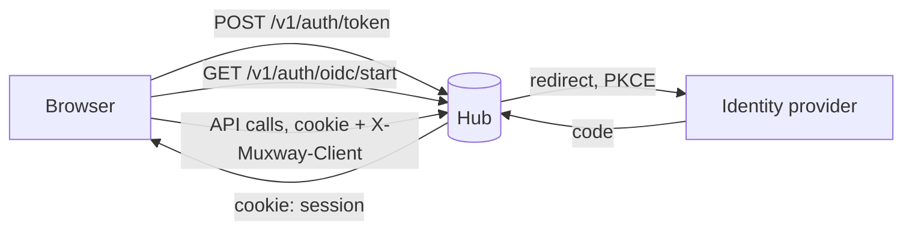
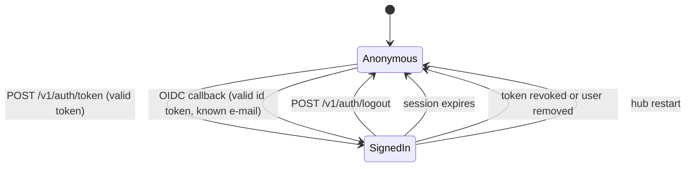

# Feature: browser sessions and pluggable sign-in

> Status: approved 2026-10-23.

## 1. Goal

A browser cannot hold a bearer token safely, and a person should not have
to paste one on every device. This feature gives the hub **sessions**: a
person signs in once, the hub sets a cookie, and the web client calls the
API with it. Signing in works two ways out of the box:

- **Token**: paste a client token once; the session carries that token's
  grants. Works on every hub, no configuration.
- **OpenID Connect**: sign in with an identity provider the hub owner
  configured, such as Microsoft Entra ID, Google, Keycloak or Authelia.
  The hub maps the verified e-mail to a **user** the owner created with
  grants, exactly like a token's.

Sign-in is **pluggable**: providers implement one small Go interface and
register with the hub. OpenID Connect is the one shipped here; a forward
authentication header from a reverse proxy is the documented next one.

Out of scope: the web client itself (next plan), passkeys, a second factor
for writes, more than one OpenID Connect provider at a time, and groups or
roles from the identity provider (grants stay per user, set by the owner).

## 2. Design



**Principals.** Today a request's grants come from a token. A **user**
is the same thing authenticated by an identity provider: `{id, email,
name, read, write, created, expires}` in `hub.json`, created with
`muxway hub user create --email alice@example.com --read 'alice-laptop/*'
[--write ...] [--ttl 365d]`, listed and removed like tokens. The id is the
first 8 hex digits of SHA-256 over the e-mail, so logs name the user
without spelling the address. Inside the hub a token or a user becomes the
same `Principal` value, and every grant check stays as it is.

**Sessions.** A session is `{id, principal kind and id, created, expires,
last seen}` in the hub's memory. The id is 32 random bytes, base64url, sent
as the cookie `muxway_session`: `HttpOnly`, `Secure` (except on plain
loopback), `SameSite=Strict`, `Path=/`. Default lifetime 12 hours
(`--session-ttl`), absolute. On every request the hub resolves the session
to its principal **afresh** from the store, so revoking a token or
removing a user ends its sessions at once. A hub restart ends all sessions;
people sign in again.

A request may authenticate with the bearer header as before, or with the
cookie. A cookie is honoured only when the request also carries the
header `X-Muxway-Client` (any value): a browser cannot add a custom header
cross-origin without a CORS preflight, and the hub answers no preflight, so
with `SameSite=Strict` this is a second lock against cross-site requests.



**Providers.** Package `internal/auth`:

```go
type Identity struct{ Issuer, Subject, Email, Name string }

type Provider interface {
    Name() string                                   // "oidc": its path segment
    Label() string                                  // "Sign in with Example"
    Start(w http.ResponseWriter, r *http.Request)   // redirect to the identity provider
    Finish(w http.ResponseWriter, r *http.Request) (Identity, error)
}
```

The hub mounts each provider at `/v1/auth/{name}/start` and
`/v1/auth/{name}/callback`, and `GET /v1/auth` tells clients which methods
exist. Adding a provider means implementing the interface and a hub flag;
the feature page shows how with the forward authentication example.

**OpenID Connect.** Standard library only: discovery from the issuer,
authorization code flow with PKCE (S256), `state` and `nonce` in a
short-lived signed cookie, token exchange with the client secret, ID token
verified against the issuer's JWKS (RS256 and ES256, keys cached and
refreshed on an unknown `kid`), then `iss`, `aud`, `exp`, `iat` (5 minutes
of skew), `nonce` and the e-mail claim (`--oidc-claim`, default `email`,
with `email_verified` honoured when present). Configuration:

```sh
muxway hub serve ... \
  --oidc-issuer https://login.example.com/tenant/v2.0 \
  --oidc-client-id <client id> --oidc-client-secret-file /etc/muxway/oidc.secret \
  --oidc-label "Sign in with Example" [--oidc-claim email] [--session-ttl 12h]
```

The redirect URI registered at the provider is
`<public url>/v1/auth/oidc/callback`. The client secret lives in a 0600
file, never in flags. The instance-specific values of any real deployment
belong in that deployment's private notes, not here.

**Who may sign in.** Only an e-mail with a user record. Everyone else gets
`403 no_account` and the attempt counts toward the address's lockout, so
the provider's whole directory cannot be used to probe the hub.

## 3. Protocol and API changes

Compatible additions to v1.

| Method and path | Purpose |
|---|---|
| `GET /v1/auth` | `{"methods": ["token", "oidc"], "oidc": {"label": "Sign in with Example"}}`; no authentication |
| `POST /v1/auth/token` | body `{"token": "mxt_..."}`; sets the session cookie; `204`, or `401` counting toward lockout |
| `GET /v1/auth/oidc/start` | redirects to the provider |
| `GET /v1/auth/oidc/callback` | finishes; sets the cookie; redirects to `/`; `401 sign_in_failed` or `403 no_account` |
| `POST /v1/auth/logout` | ends the session, clears the cookie; `204` |
| `GET /v1/me` | `{"id", "name", "method": "token" \| "oidc", "read": [...], "write": [...], "expires"}` |

Every existing endpoint accepts the cookie plus `X-Muxway-Client` as an
alternative to `Authorization: Bearer`. Audit lines carry the principal id
as before; sessions add `method=oidc` or `method=token`.

Admin: `muxway hub user create | list | remove`.

## 4. Security analysis

- **What an attacker gains**: a session is a principal's grants for up to
  12 hours. Hence HttpOnly, Secure, SameSite=Strict, the custom header,
  fresh principal resolution on every request, and no session survival
  across restarts.
- **Cross-site request forgery**: `SameSite=Strict` keeps the cookie off
  every cross-site request; the custom header is a second lock; there is
  no CORS. Tested from a second origin in the web client's UI suite.
- **Cross-site scripting**: out of this plan's reach but assumed hostile:
  the cookie is unreadable to scripts, and the web client plan sets a
  strict content security policy.
- **Session fixation and prediction**: ids are fresh 256-bit random values
  issued only by the hub after authentication; a presented unknown id is
  simply anonymous.
- **OpenID Connect**: `state` defeats login CSRF, `nonce` defeats ID token
  replay, PKCE defeats code interception, the exact registered redirect
  URI defeats open redirects. Signature, issuer, audience, expiry and
  e-mail verification are all checked; `alg: none` and HS256 are refused.
  The JWKS is fetched over TLS from the discovered URL only.
- **Account mapping**: e-mail is the key because it is what the owner
  knows; the provider must verify it, and only providers the owner trusts
  are configured. A user record is required: default deny.
- **Brute force**: wrong tokens and failed callbacks count toward the
  10-per-10-minutes lockout like any failed authentication.
- **Secrets in logs**: never the token, the cookie, the code, the ID token
  or the client secret. Logs name principals by id, not e-mail. Tested.
- **Dependencies**: none new; the OpenID Connect client is standard
  library (`crypto/rsa`, `crypto/ecdsa`, `encoding/json`, `net/http`).

## 5. Privacy check

Examples use `alice@example.com`, `login.example.com` and
`hub.example.com`. The test identity provider is a Go test double with
synthetic keys and accounts. No real tenant, client id or address appears
in the repository.

## 6. Test plan

| # | Test | Kind | Expected |
|---|------|------|----------|
| 30 | Cookie without `X-Muxway-Client`; header without cookie; unknown, expired and logged-out session ids; cookie on `POST /v1/auth/token` with a wrong token | e2e-security | 401 everywhere, each counting toward lockout where authentication was attempted |
| 31 | Token revoked and user removed while sessions are live | e2e-security | next request 401 |
| 32 | OIDC: wrong `state`, wrong `nonce`, tampered signature, `alg: none`, HS256, wrong `aud`, wrong `iss`, expired, unverified e-mail, e-mail without a user | e2e-security | 401 or 403, no session, lockout counted |
| 33 | OIDC: callback replayed; `start` twice then the first callback | e2e-security | one session at most, replay refused |
| 34 | Session grants equal the principal's: a session of a read-only token writes | e2e-security | 403, same as the token |
| 15 | Logs searched for tokens, session ids, codes, ID tokens, the client secret | e2e-security | no match (extends the existing search) |
| 35 | Token sign-in, `/v1/me`, list, read, input, logout | e2e | works with the cookie; 401 after logout |
| 36 | OIDC sign-in against the test provider, `/v1/me` shows method `oidc` and the user's grants | e2e | works; user id in the audit log, not the e-mail |
| 37 | `GET /v1/auth` with and without a provider configured | e2e | methods match the configuration |
| 38 | `--session-ttl 2s` | e2e | 401 after expiry |
| u2 | ID token verification, claim checks, PKCE and state cookie | unit | as specified |

No UI in this feature; the web client's suite covers the browser side.

## 7. Documentation

- `docs/features/sign-in.md`: token sign-in, configuring OpenID Connect
  (with notes for Entra ID, Google and Keycloak), users and grants,
  sessions, how to add a provider.
- `docs/protocol/v1.md`: the auth endpoints, the cookie and header rule,
  `/v1/me`.
- `docs/ARCHITECTURE.md`: sessions in the trust boundary section and the
  sign-in sequence diagram.

## 8. Implementation steps

1. `Principal` in the hub; users in the store and the admin socket;
   `muxway hub user` commands.
2. Sessions: store, cookie, header rule, `withToken` becomes
   `withPrincipal`; `POST /v1/auth/token`, logout, `/v1/me`, `GET /v1/auth`.
3. `internal/auth`: the interface, the OpenID Connect provider with unit
   tests, hub flags and routes.
4. Test identity provider in the e2e harness; security tests 30 to 34 and
   15; flows 35 to 38.
5. Docs; record the run.

## Decisions

- 2026-10-23: sessions live in memory and end with a hub restart.
- 2026-10-23: users are keyed by verified e-mail; no groups or roles from
  the provider.
- 2026-10-23: the OpenID Connect client is written on the standard
  library rather than adding `go-oidc` and `x/oauth2`.

---

## Review (after implementation)

- [ ] Diff matches the plan, deviations explained here
- [ ] Security rules (AGENTS.md section 2) hold
- [ ] Privacy check passed: `scripts/prepush-check.sh` clean and diff read
- [ ] Docs and diagrams updated

## Test run

To be linked.
