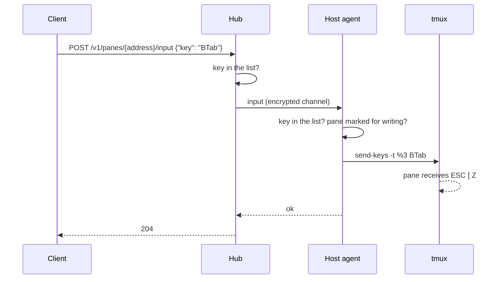

# Feature: Shift-Tab as a named key

> Status: implemented 2026-10-23.

## 1. Goal

Claude Code cycles its permission mode with Shift-Tab, and other terminal
programs use it to move focus backwards. A muxway client cannot send it:
the protocol's key list has `Tab` but no Shift-Tab, and clients may not
send raw escape sequences. This adds one named key, `BTab`, tmux's own
name for it. Nothing else changes.

## 2. Design

The key list is one map in `internal/tmux`, read by the hub when it
validates a request and by the agent before it calls `send-keys`. `BTab`
is added to the map. tmux turns it into `ESC [ Z`, the sequence terminals
send for Shift-Tab, and Claude Code recognises it.

## 3. Protocol and API changes

`key` in `POST /v1/panes/{address}/input` accepts `BTab` as well. A
compatible addition: old clients never send it, old hubs refuse it with
`400 bad_input` as they refuse any unknown key. Stays in v1.

## 4. Security analysis

- Abuse gains nothing new: a token that may write to a pane can already
  type anything and send `Tab`, `Escape` and the control keys. Shift-Tab is
  one more key the shell or program interprets, with no meaning to tmux
  itself and no way to escape the pane.
- Same grant as every input: write grant on the token and a pane marked for
  writing; the hub checks, the agent checks again.
- The key name crosses the trust boundary as before: it must match a map
  entry exactly, and the value passed to tmux comes from the map, never from
  the request. `S-Tab`, `btab` and `BTab Enter` are refused.
- Audit log unchanged: time, token id, pane and the key's name.
- No new dependencies.

## 5. Privacy check

No real host, person, service or secret anywhere in this change; the test
pane runs `cat`.

## 6. Test plan

| # | Test | Kind | Expected |
|---|------|------|----------|
| 1 | Sec07: `S-Tab`, `btab`, `BTab Enter` as `key` | e2e-security | 400, pane unchanged |
| 2 | Flow17: `BTab` on a pane running `cat` | e2e | 204; the pane shows `^[[Z` |

## 7. Documentation

`docs/protocol/v1.md`: `BTab` in the key list with what it is.

## 8. Implementation steps

1. Add `BTab` to the map, the protocol page and the tests, one commit.
2. Run the suite, record the run.

---

## Review (after implementation)

- [x] Diff matches the plan
- [x] Security rules (AGENTS.md section 2) hold: the key list stays a fixed
      whitelist, grants unchanged
- [x] Privacy check passed: `scripts/prepush-check.sh` clean and diff read
- [x] Docs updated

Approved by the owner in the console on 2026-10-23, after the MIDP client's
lens for Claude Code left Shift-Tab open.

## Test run

(filled in below)
