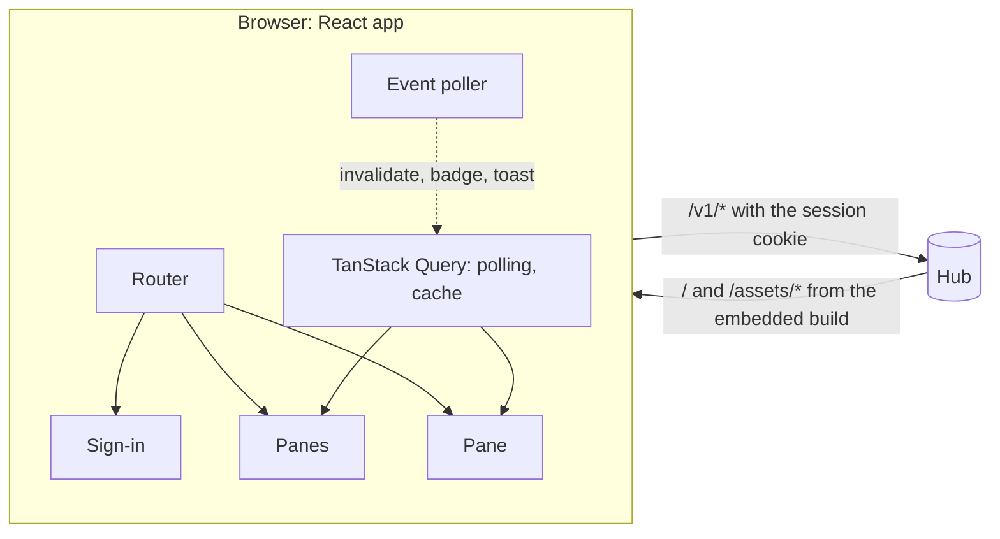
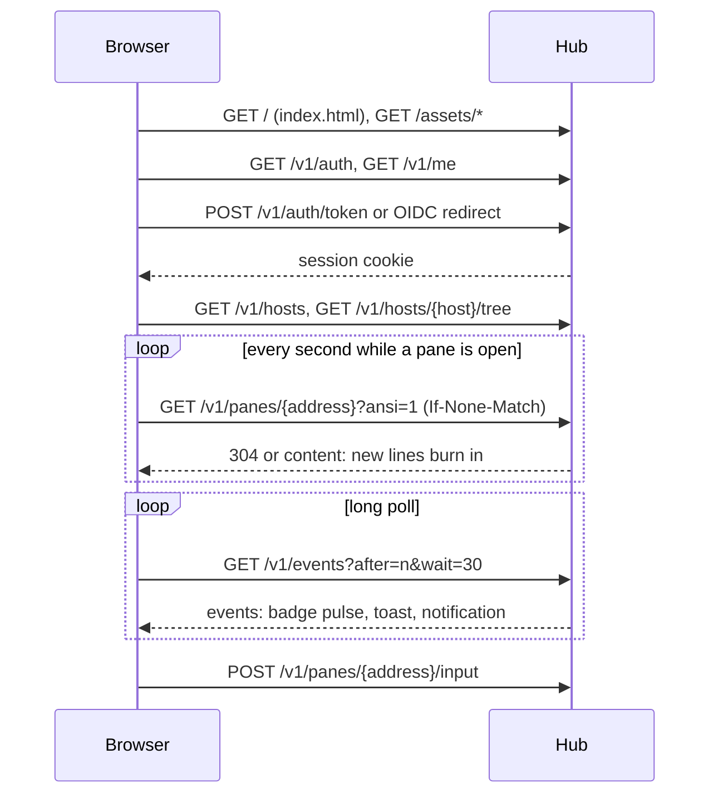

# Feature: web client

> Status: approved 2026-10-23. Builds on
> [browser sessions and pluggable sign-in](2026-10-23-sessions-and-sso.md).

## 1. Goal

The first client, served by the hub itself: open the hub's address in any
browser, sign in, see every host and pane you may reach, read a pane with
its colours, type into it, and be told when an AI CLI in a pane needs you.
Phone browsers included. The look is a CRT terminal that is alive: phosphor
glow on everything that matters, scanlines, a power-on sequence, content
that burns in as it arrives, badges that pulse when a pane wants you. Retro
in the sense of AGENTS.md section 4, with motion as a first-class part of
the design rather than an afterthought.

Out of scope: live streaming (polling with ETags for now), server-sent
events (long polling for now), browser push when the tab is closed, and
split layouts mirroring tmux (panes are listed under their window, the
layout string kept for later).

## 2. Design



**Stack.** The same one as the owner's other front ends: React 19 and
TypeScript (strict), Vite, TanStack Query for every API call and its
polling, TanStack Router with browser history, plain CSS on design tokens,
Vitest for unit tests, Playwright for the UI suite, ESLint (flat config,
`typescript-eslint`) and Prettier (`singleQuote`, `trailingComma: all`,
`printWidth: 100`). No UI kit, no CSS framework, no animation library:
motion is CSS keyframes and transitions driven by tokens.

**Layout of `web/`.**

```
web/
  package.json, package-lock.json, vite.config.ts, tsconfig.json,
  eslint.config.js, .prettierrc, playwright.config.ts
  index.html
  src/
    main.tsx, router.tsx
    api/        client.ts (fetch with the cookie and X-Muxway-Client), queries.ts, types.ts
    auth/       session.tsx (GET /v1/me, sign-in methods, logout)
    shell/      Shell.tsx (frame, status line, toaster, help), Crt.tsx (scanlines, power-on)
    pages/      SignIn.tsx, Panes.tsx, Pane.tsx
    components/ Box.tsx (box-drawn panel), Badge.tsx, KeyBar.tsx, Toast.tsx, Glow.tsx
    term/       sgr.ts (SGR parser), Screen.tsx (renderer)
    styles/     tokens.css, motion.css, themes.css, shell.css, pages.css
  e2e/          Playwright specs and __screenshots__/
  dist/         the built app, embedded by the hub (see Decisions)
```

**Serving.** `internal/web` embeds `web/dist`. `GET /` and every `GET`
outside `/v1/` and `/assets/` answer `index.html`, so router paths like
`/p/alice-laptop/work/1.0` reload. `/assets/*` are Vite's content-hashed
files with a one-year cache lifetime; `assetsInlineLimit: 0` keeps fonts
and the icon as files, so no `data:` URLs. Headers on the page and assets:
`Content-Security-Policy: default-src 'none'; script-src 'self';
style-src 'self'; font-src 'self'; img-src 'self'; connect-src 'self';
base-uri 'none'; form-action 'self'; frame-ancestors 'none'` plus the
existing `X-Content-Type-Options`, `Referrer-Policy` and, for the page,
`Cache-Control: no-store`. No inline script or style, no third-party
request of any kind. `--no-web` turns the client off.

**Tokens.** `tokens.css` defines `--mx-*` variables and components use
only those: colours per theme (`--mx-bg`, `--mx-ink`, `--mx-ink-dim`,
`--mx-glow`, `--mx-accent`, `--mx-warn`, `--mx-bad`), the glow recipe
(`--mx-glow-text: 0 0 2px var(--mx-glow), 0 0 8px var(--mx-glow-soft)`,
`--mx-glow-box` likewise, `--mx-glow-strong` for focus and attention),
motion (`--mx-motion-fast: 120ms`, `--mx-motion-medium: 260ms`,
`--mx-motion-slow: 600ms`, `--mx-ease-out`, `--mx-ease-crt` with a sharp
overshoot), type (`--mx-mono`, `--mx-pixel` for headings, one open-licence
pixel font with its licence next to it), and spacing. Three themes set the
colour tokens: **green** (default), **amber**, **paper** (dark ink on a
pale canvas, soft shadow instead of glow). `t` cycles them; the choice
lives in `localStorage`.

**Motion.** All in `motion.css`, all tokenised, all collapsing to plain
fades under `prefers-reduced-motion` and when the person turns effects
off with `m` (also remembered):

| Moment | Effect |
|---|---|
| Page load | CRT power-on: a horizontal line that opens vertically, a brightness overshoot, then the sign-in box types itself out line by line with a blinking block cursor |
| Always | Scanline overlay and a faint vignette; a slow, very slight phosphor flicker on the glow |
| Route change | The leaving panel collapses to a line, the arriving one opens (the power-on curve, fast) |
| Focus and hover | Box borders and text step up from `--mx-glow` to `--mx-glow-strong` |
| New pane content | Lines that were not there before flash bright and settle over `--mx-motion-slow`, a burn-in |
| Typing | The input's block cursor blinks; each sent key flashes its KeyBar button |
| Attention | The badge gets a pulsing ring; the toast slides in from the right with a glow bloom; the title flashes `[!] muxway` |
| Hub offline | The status line dims and shows a static-noise shimmer until polling succeeds again |
| Theme switch | A short crossfade with a one-frame bright flash, like a monitor re-syncing |

Glow is cheap where it matters: on chrome, borders, headings, badges and
the input, and a single soft `text-shadow` on pane text, so large panes
stay smooth on a phone.

**Views.**

- *Sign-in*: the methods `GET /v1/auth` reports, a button per identity
  provider and a token field. The token is posted once and never kept.
- *Panes*: hosts as sections, sessions and windows as box-drawn groups,
  one row per pane with address, mode, command, title, and the attention
  badge (`?` question, `!` permission, `…` idle, `✓` done). Offline hosts
  dimmed. A filter line narrows the list.
- *Pane*: content from `ansi=1` reads through the SGR renderer (colours,
  bold, dim, inverse, underline; everything else dropped) in a scrolling
  area at the pane's width, the input line below, and the KeyBar with
  every named key the protocol allows. Read-only panes show the input
  disabled with the reason.
- *Help*: `?` lists the shortcuts.

**Data.** TanStack Query owns the polling: the open pane every second
(`If-None-Match`, five seconds while hidden), the pane list every five
seconds, and one long-poll query for `GET /v1/events?after=<cursor>&wait=30`
that refetches itself on completion with backoff on error. An event
invalidates the pane list, updates the badge, and for an attention kind
raises the toast, the title flash and, when the person opted in, a browser
notification through the Notification API carrying only kind and address.

**Keyboard.** `j`/`k` move, `Enter` opens, `Esc` goes back, `/` filters,
`i` focuses the input, `g` then a letter jumps to a host, `t` cycles the
theme, `m` toggles effects, `?` shows help. Everything is reachable by
touch; narrow screens stack list and pane and the KeyBar wraps.



## 3. Protocol and API changes

None to the API. New hub routes outside `/v1`: `GET /`, `GET /assets/*`
and the `index.html` fallback. A hub started with `--no-web` answers 404
on them as today.

## 4. Security analysis

- **What an attacker gains**: nothing new at the API; the client consumes
  the existing endpoints with the session cookie. The risks live in the
  browser: script injection, cross-site requests, and the supply chain of
  the build.
- **Script injection**: pane content, titles, session and window names,
  event text and e-mails are untrusted. React escapes text by default and
  `dangerouslySetInnerHTML` is forbidden by lint; the SGR renderer emits
  elements with class names, never markup or styles. The content security
  policy allows only same-origin scripts and styles and no inline code.
  Tested with hostile pane content and names.
- **Cross-site requests**: `SameSite=Strict` cookie, `X-Muxway-Client` on
  every call, no CORS headers. A test page on a second origin tries fetch
  with credentials, a form post and fetch with the header; all fail.
- **Clickjacking**: `frame-ancestors 'none'`.
- **Leaks**: `Referrer-Policy: no-referrer`; no third-party request, so no
  address or pane name leaves the hub; the token is posted once; browser
  notifications carry kind and address only; the title flash shows no
  pane name.
- **Supply chain**: this feature adds Node dependencies, which AGENTS.md
  asks to keep few and reviewed. Run time: `react`, `react-dom`,
  `@tanstack/react-query`, `@tanstack/react-router`. Development:
  `vite`, `@vitejs/plugin-react`, `typescript`, `vitest`,
  `@playwright/test`, `eslint`, `@eslint/js`, `typescript-eslint`,
  `prettier`. All pinned exactly in `package.json` with a committed
  lockfile, installed with `npm ci`, upgraded deliberately. The committed
  `dist/` is rebuilt in CI and compared byte for byte, so the bundle the
  hub embeds is always the one the committed sources produce.
- **Logs**: unchanged; the client adds no logging.

## 5. Privacy check

Fixture panes run synthetic commands; screenshots come from the test
environment with `alice-laptop` and `bob-desktop`. The pixel font is an
open-licence file with its licence committed. No analytics of any kind.

## 6. Test plan

The UI suite is Playwright specs in `web/e2e/`, run by a Go test that
starts hub, agent and tmux as today, serves the test identity provider,
and runs `npx playwright test` with the JSON reporter, reporting each
spec as a subtest so `results.xml` stays one file. Screenshots are taken
with animations disabled for stability, into `screens/<test>/`, and a
trace is kept per spec. Unit tests run with Vitest; lint and format
checks run in CI and locally through `scripts/e2e.sh`.

| # | Test | Kind | Expected |
|---|------|------|----------|
| 40 | Pane content, title, window and session names containing `<script>`, ``, escape sequences; an event text with markup | UI-security | rendered as text, no script runs, no CSP violation; `40-hostile.png` |
| 41 | Page on a second origin: fetch with credentials, form POST, fetch with the header | UI-security | all fail, no 2xx |
| 42 | Every hub response carries the CSP and the other headers; no request leaves the origin during a full session | UI-security | asserted on the request log |
| 43 | Token sign-in with a wrong token, then the right one; reload keeps the session; logout | UI | message, then the panes view; `43-signin.png`, `43-panes.png` |
| 44 | OIDC sign-in against the test provider | UI | panes view with the user's grants |
| 45 | Open a pane, see output appear, type `echo hi` and Enter, press C-c on a sleep | UI | content within 2 s; `45-pane.png` |
| 46 | Read-only pane | UI | input disabled, write refused |
| 47 | `muxway notify` in a pane while the list is open | UI | badge, toast, title flash; `47-attention.png`; cleared after input |
| 48 | Keyboard: `j`, `k`, `Enter`, `Esc`, `/`, `i`, `t`, `m`, `?` | UI | as specified; `48-help.png` |
| 49 | Themes and a phone viewport 360×780 | UI | `49-green.png`, `49-amber.png`, `49-paper.png`, `49-phone.png` |
| 50 | Hub offline during a session, then back | UI | status line shows the outage, polling resumes |
| 51 | Motion: power-on class present on load and gone after; burn-in class on new lines; `prefers-reduced-motion` and `m` leave only fades | UI | class assertions, `51-poweron.png` mid-sequence with animations enabled |
| u3 | SGR parser: colours, resets, unknown and split sequences; cursor math for new-line detection | unit (Vitest) | as specified |
| u4 | Lint, format check, type check, `dist/` freshness | CI | clean |

## 7. Documentation

- `docs/features/web-client.md`: using it, shortcuts, themes, effects,
  notifications, `--no-web`, security considerations, screenshots from
  the test run.
- `docs/ARCHITECTURE.md`: the web client in the components diagram.
- `docs/testing.md`: how the UI suite runs locally and in CI, Node and
  Chromium requirements.
- `README.md`: the quick start opens the browser.

## 8. Implementation steps

1. `web/` scaffold: Vite, React, TypeScript, lint and format configs,
   tokens and themes, the CRT shell with power-on and scanlines.
2. `internal/web`: embedding `dist/`, fallback route, headers, `--no-web`;
   `make web` to rebuild; CI step with pinned Node and Chromium and the
   `dist/` freshness check.
3. API client, session handling, sign-in page.
4. Panes page with tree, badges, filter and route transitions.
5. Pane page: SGR parser and renderer with burn-in, input line, KeyBar.
6. Event poller, toasts, browser notifications, title flash, offline
   state.
7. Keyboard shortcuts, help, theme and effects toggles, phone layout.
8. Playwright harness in Go, security specs 40 to 42, then 43 to 51,
   Vitest units.
9. Docs with screenshots; record the run.

## Decisions

- 2026-10-23: React, TypeScript, Vite, TanStack Query and Router, Vitest,
  Playwright, ESLint and Prettier, matching the owner's other front ends.
- 2026-10-23: `web/dist` is committed so `go build` and `go install` work
  from a clean checkout; CI rebuilds it and fails on any difference.
- 2026-10-23: polling with ETags and long polling, streaming later.
- 2026-10-23: effects are on by default, reduced under
  `prefers-reduced-motion`, and switchable with `m`.

---

## Review (after implementation)

- [ ] Diff matches the plan, deviations explained here
- [ ] Security rules (AGENTS.md section 2) hold
- [ ] Privacy check passed: `scripts/prepush-check.sh` clean and diff read
- [ ] Docs and diagrams updated

## Test run

To be linked.
