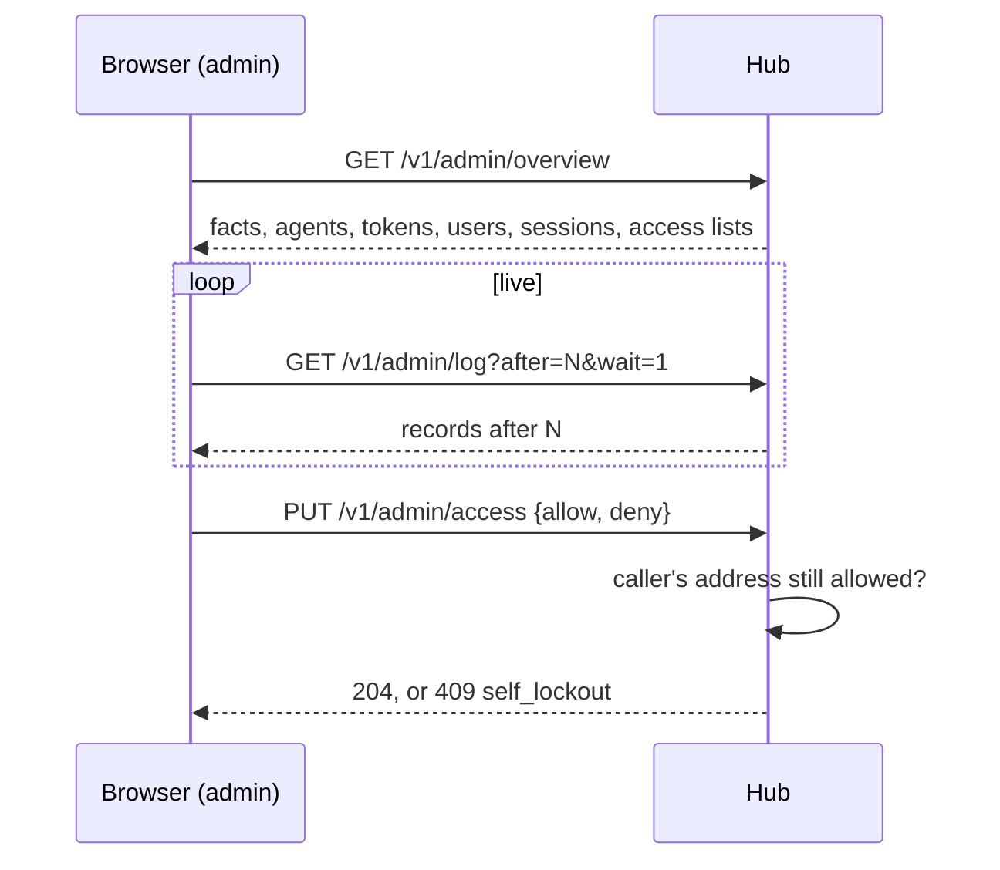

# Feature: the admin overview: access log, principals, clients, address lists

> Status: approved by the owner on 2026-10-24. Asked for
> as "an admin overview, on web in the header next to settings, on
> Android similar, showing the log (important for access), settings and
> an overview of tokens and clients and their types, with whitelisting /
> blacklisting of IPs".

## 1. Goal

Everything about who may reach a hub is done today on the hub's machine,
over the admin socket, and read in the hub's log on that machine. The
owner, away from it, cannot see who signed in, from where, with which
client, nor revoke a token or shut an address out. This adds an **admin
grant** to tokens and users, admin endpoints under it, and an *admin*
page in the web client (an entry on the phone) with four panels: the
access log, tokens and users, connected clients, and address lists.

Out of scope: editing agents' exposure (that is the host owner's, on the
host); changing hub flags at run time; a log kept across restarts (the
host's journal has it); metrics.

## 2. Design

```
┌ muxway ─┐  alice-laptop/work/0.0            alice  ≡  ?  admin  logout
┌ log ───────────────────────────────────────────────────────┐
│ 14:02:11  signed in       token phone      198.51.100.7     │
│ 14:02:40  audit input     phone  alice-laptop %3  12 bytes  │
│ 14:03:02 !authentication failed             203.0.113.9     │
│ 14:03:02 !locked out                        203.0.113.9     │
└ filter: ____________  ● live ───────────────────────────────┘
┌ tokens & users ──────┐┌ clients ─────────────┐┌ access ──────────────┐
│ phone  r:alice-* w:… ││ web      alice 1m    ││ allow: 198.51.100.0/24│
│ glasses r:… expires… ││ android  phone 12s   ││ deny:  203.0.113.0/24 │
│ [create] [revoke]    ││ midp     nokia 2h    ││ locked: 203.0.113.9   │
└──────────────────────┘└ [end]  ───────────────┘└ [save] ───────────────┘
```

**Hub.**

- `Token.Admin` and `User.Admin` (`"admin": true` in `hub.json`),
  `Principal.Admin`; `muxway hub token create --admin`, `user create
  --admin`; `/v1/me` answers `"admin": true`. A token created with
  `--admin` defaults to a 24 h TTL unless one is given.
- An **access log**: a `slog.Handler` that wraps the hub's handler and
  keeps every record at Info and above in a ring of 2000 as `{seq, at,
  level, msg, attrs}`. It holds what the log holds now, which is already
  free of secrets and content: principal ids, host aliases, pane ids,
  byte counts, addresses, results.
- **Address lists** in `hub.json`: `access: {allow: [], deny: []}` of
  CIDRs (a bare address is a `/32` or `/128`), at most 256 each. A
  middleware ahead of every route, including sign-in, pairing and the
  agent channel, takes the client address (as `clientAddr` does, proxy
  aware) and refuses with `403 forbidden` when it matches `deny`, or
  when `allow` is not empty and it matches nothing there. Refusals are
  logged (address, path) and rate-limited in the log to one line per
  address per minute. The admin socket is not subject to the lists.
- **Sessions** gain the client type (`X-Muxway-Client`, or the first word
  of `User-Agent` for bearer clients: `muxway-android`, `muxway-midp`),
  the address, and a last-seen time; the hub's own agents are listed from
  the connections it holds.
- Endpoints (admin principal only; the usual cookie-plus-header or
  bearer; not in the CORS list):

| Method and path | Does |
|---|---|
| `GET /v1/admin/overview` | hub facts (TLS, proxy trust, providers, transcriber, web served, version), agents with state and pairing time, tokens and users without hashes, live sessions, locked addresses, the address lists |
| `GET /v1/admin/log?after=N&limit=200&wait=1` | log records after N, long-polled like events |
| `POST /v1/admin/tokens` | `{name, read, write, ttl, admin}` → the secret, once |
| `DELETE /v1/admin/tokens/{id}` | revoke; its sessions end |
| `POST /v1/admin/users`, `DELETE /v1/admin/users/{id}` | likewise |
| `DELETE /v1/admin/sessions/{id}` | end one session |
| `PUT /v1/admin/access` | `{allow, deny}`; refused with `409 self_lockout` when the caller's own address would be shut out, unless `?force=1` |
| `POST /v1/admin/unlock` | `{addr}` clears a lockout |

  The CLI gains `muxway hub access list|allow|deny|clear` over the
  socket, the way back in when a list goes wrong.

- Every admin action is logged with the acting principal.

**Web.** `admin` in the header when `me.admin`; route `/admin` (added to
the hub's `appRoute`); `pages/Admin.tsx` with the four boxes. The log
tails live through the long poll, newest at the bottom, warnings in the
alert colour, a filter box; a row's address can be put on the deny list
with one click (`deny`). Tokens: a create form (name, read, write, TTL,
admin) that shows the secret once with a copy button and the warning
that it is not shown again; revoke with a confirmation. Clients: the live
sessions with type, principal, address, age, last seen; *end*. Access:
two textareas of CIDRs, the locked addresses with *unlock*, *save*.

**Android.** An **admin** section in Settings when `/v1/me` says so: the
log tail (last 200, pull to refresh) and the client list with *end*.
Creating tokens and editing CIDR lists stays on the web and the CLI: a
phone keyboard is wrong for grant patterns, and a wrong list locks the
owner out. Said in §3 of the guideline.



## 3. Protocol and API changes

The endpoints above, `"admin"` on `/v1/me`, `--admin` on token and user
creation, `muxway hub access`. Compatible additions; `docs/protocol/v1.md`
gets an *Admin* section with examples, marked as not for ordinary
clients.

## 4. Security analysis

- **What the grant is.** An admin principal can mint a token with any
  grants, so admin is control of the whole hub. It is a separate flag,
  off by default, never implied by write grants; the docs say to give it
  to a short-lived token or to the owner's own user and to nothing that
  lives on a device left around. Every admin action is logged with the
  acting id. The flag cannot be set through the API by a non-admin, and
  an admin creating an admin token is logged as such.
- **Authentication.** The same `withPrincipal`, rate limit and lockout;
  then `Admin` or `403 forbidden`. The admin paths are not in the CORS
  list, so no page on another origin can call them, and the cookie needs
  the client header as everywhere.
- **Address lists.** CIDRs parsed with `net/netip`, at most 256 each,
  persisted atomically. The deny list wins. The self-lockout check uses
  the caller's address as the hub sees it (proxy aware), so an owner
  behind the proxy is protected too; `force` is for the case where that
  address is meant to go. The CLI over the socket is the recovery path
  and is documented next to the feature. Agents are subject to the lists
  as well; the docs say to allow the agents' addresses when an allow
  list is set.
- **The log.** It carries what the host journal carries: addresses,
  principal ids, host aliases, pane ids, byte counts, kinds, results.
  Never a token, a cookie, a pane's content, a text typed or
  transcribed. A test creates a token through the API and greps the log
  and the overview for its secret. The ring is memory, 2000 records,
  gone with the hub.
- **Secrets shown once.** A created token's secret is in the response
  only; the page shows it until dismissed and never stores it.
- **Sessions listed** carry an id prefix (8 characters) for ending them,
  not the cookie value.
- No new dependencies.

## 5. Privacy check

Fixtures: `alice`, `phone`, `198.51.100.0/24`, `203.0.113.9`,
`hub.example.com`. Screenshots from the run.

## 6. Test plan

| # | Test | Kind | Expected |
|---|------|------|----------|
| 1 | every admin endpoint with a non-admin token, a user without the flag, no credential | e2e-security | `403 forbidden` / `401`; nothing changes |
| 2 | admin endpoints from another origin | e2e-security | no CORS headers; a preflight is `404` |
| 3 | create a token through the API; read the log and the overview | e2e-security | the secret appears in neither; the hash appears nowhere |
| 4 | `PUT access` denying the caller's own address | e2e-security | `409 self_lockout`; unchanged; with `force=1` applied and the next request `403` |
| 5 | deny a `/24`; sign in from it | e2e-security | `403 forbidden` before any credential is checked; logged once per minute |
| 6 | allow list set without the agent's address | e2e-security | the agent is refused on reconnect; `muxway hub access clear` lets it back |
| 7 | 257 entries, a bad CIDR, `0.0.0.0/0` in allow | e2e-security | `400 bad_input`, `400`, accepted (it is a valid choice) |
| 8 | revoke through the API | e2e | its sessions end at once; the client is sent to sign-in |
| 9 | end a session | e2e | that cookie is stale on its next request; others live |
| 10 | the log long-poll | e2e | a sign-in appears within a second; `after` skips what was seen |
| 11 | admin page as admin | UI | four boxes; a failed sign-in shows in alert colour; screenshot `95-admin` |
| 12 | non-admin signed in | UI | no `admin` in the header; `/admin` says `not yours to see` |
| 13 | create token in the page | UI | the secret shown once, copy works, revoke removes it; screenshot `95-token-once` |
| 14 | deny from a log row, save | UI | the list updated; the self-lockout refusal shown when it is our own address |
| 15 | Android: admin section | instrumented | shown only when `me.admin`; the log tail renders |

## 7. Documentation

- `docs/features/admin.md`: the page, the grant, the lists, the recovery
  path, the security considerations above, both diagrams.
- `docs/protocol/v1.md` *Admin*; `docs/features/sign-in.md` the flag;
  `docs/features/hub-and-agent.md` the CLI; `docs/ui-guideline.md` §2
  and §3 (what the phone has and why less).
- Android: `docs/features/admin.md` (short).

## 8. Implementation steps

1. Hub: the flag end to end; the log ring handler; sessions' client type
   and last seen; the address lists and middleware; the CLI; endpoints;
   tests (security first).
2. Protocol doc and feature page.
3. Web: route, page, header entry; spec 95; `web/dist`.
4. Android: the section; tests; docs; version.
5. Run, record, push.
