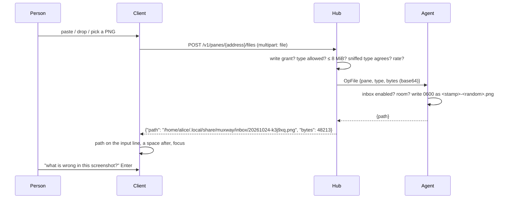

# Feature: attachments: a file pasted or dropped into a pane lands on the host

> Status: approved by the owner on 2026-10-24. Asked for
> as "rich pasting (from image or file upload) should be possible in both
> web and Android clients".

## 1. Goal

Claude Code reads an image or a file when its path is in the prompt. In
a local terminal a screenshot is pasted straight in; through muxway only
text travels, so a screenshot on the phone or in the browser cannot reach
the agent running on the host. This lets a client send a file to the
host: the agent writes it into an **inbox** directory the host owner
enabled, and the client puts the file's path on the input line for the
person to finish the sentence and send. Paste, drop or pick in the
browser; pick or share on the phone.

Out of scope: files from the host to the client; files larger than
8 MiB; any type beyond the list below; keeping files longer than a day.

## 2. Design

**Agent.** `muxway agent serve --inbox <dir>` (default off; `--inbox
default` puts it under the agent's state directory). The agent creates
the directory `0700`, writes files `0600` with names it chooses
(`<yyyymmdd-hhmmss>-<6 random>.<ext>`, the extension from the type, never
from the client), refuses when the inbox holds more than 256 MiB or 500
files, and sweeps files older than 24 h every hour and at start.

**Hub.** `POST /v1/panes/{address}/files`, multipart with one `file`
part; the pane must be writable for the principal (the file is for the
program in that pane); `Content-Type` of the part must be one of
`image/png`, `image/jpeg`, `image/gif`, `image/webp`, `text/plain`,
`text/markdown`, `application/pdf`, `application/json`, and
`http.DetectContentType` of the first bytes must agree for the binary
types (text types must be valid UTF-8 without C0 bytes other than tab,
newline and return); at most 8 MiB; one file per two seconds per
principal. The hub forwards the bytes to the agent in one message
(base64 in the JSON frame; the agent's read limit rises from 1 MiB to
12 MiB for this op) and keeps nothing. Answers: `404 not_found` when the
agent has no inbox (as the transcriber probe does), `413 too_large`,
`415 unsupported`, `429 rate_limited`, `507 inbox_full`. Audit line:
who, method, host, pane, type, bytes, result, and the path; never the
content. `GET /v1/panes/{address}/files` answers `204` when the host
takes files, so a client can show the button or not.

**Web.** On a writable pane whose host takes files: a `⇪` button on the
input line opens the file picker; a paste with files in it (`Ctrl+V` of
a screenshot) and a drop onto the screen or the input line send the
first file. While sending, the input line reads `⇪ shot.png · 2.1 MiB…`
and *send* is disabled; then the path is put on the line (appended after
a space when the line has text) and the line gets focus. Errors are
toasts naming the code. Several files: one after another, each path
appended.

**Android.** The same button opens the system picker (`OpenDocument` for
the listed types); the share sheet gains muxway for images, text and
PDFs: sharing opens the pane list to pick a writable pane, then sends.
The path lands in the field as on the web.

## 3. Protocol and API changes

The two endpoints above and the agent op `file` on the agent channel;
`docs/protocol/v1.md` gets both with examples. Compatible additions: an
older agent answers the op with `bad_input`, which the hub maps to `404
not_found`.

## 4. Security analysis

**The decision the owner is asked to make.** Until now a client could
send a host text, named keys and clicks. This adds *bytes written to a
directory on the host*. It is kept narrow:

- off unless the host owner starts the agent with `--inbox`; the hub
  cannot turn it on;
- one directory, created by the agent, `0700`; names chosen by the agent;
  the extension from an allow-list keyed by the sniffed type; no execute
  bit; nothing is ever run, unpacked or followed;
- size 8 MiB, inbox 256 MiB and 500 files, one file per two seconds per
  principal, 24 h lifetime; a full inbox refuses rather than evicts;
- the pane's write grant is required, so a read-only token cannot fill
  the disk, and the audit line names who put what size where;
- a hostile file is bytes nobody executes; Claude Code reading a hostile
  image or PDF by its path is what pasting it locally does. The person
  types the path into the prompt themselves; the client never sends the
  path on its own;
- the hub holds the bytes in memory for the request only; nothing is
  logged but the audit line;
- the client's own name for the file is used for the toast only, never
  sent to the agent (so no `../`, no shell characters anywhere near a
  path);
- the base64 frame raises the agent's read limit for this op only; other
  ops keep 1 MiB.

Other points: text types are checked for UTF-8 and control bytes, so a
`text/plain` file cannot smuggle an escape sequence into something that
cats it; `application/json` must parse. No new dependencies.

## 5. Privacy check

Test files: a generated 2×2 PNG, `hello.txt`, a one-page PDF made in
the test. The inbox is in the throwaway agent's directory.

## 6. Test plan

| # | Test | Kind | Expected |
|---|------|------|----------|
| 1 | read-only token | e2e-security | `403 read_only`; no file on the host |
| 2 | agent without `--inbox` | e2e-security | `404 not_found`; the probe `404`; no button |
| 3 | `image/png` part holding an ELF header; `text/plain` with `\x1b`; `application/json` that does not parse | e2e-security | `415 unsupported` each; nothing written |
| 4 | 8 MiB + 1 byte | e2e-security | `413 too_large` |
| 5 | filename `../../etc/passwd`, `a;rm -rf x.png` | e2e-security | the written name is the agent's pattern; the inbox holds exactly one new file, mode `0600`, no execute bit |
| 6 | two files within two seconds | e2e-security | the second `429 rate_limited` |
| 7 | inbox at the cap (test cap lowered by a hidden flag) | e2e-security | `507 inbox_full` |
| 8 | the hub and agent logs after a PNG | e2e-security | the audit line has bytes and path, not the content's bytes |
| 9 | a file older than 24 h in the inbox | e2e | swept at start |
| 10 | paste a PNG in the browser | UI | the path on the line, focus; the file on the host; screenshot `97-pasted` |
| 11 | drop a text file on the screen | UI | same |
| 12 | `⇪` pick | UI | same; two files → two paths |
| 13 | Android: pick and share | instrumented | the path in the field |

## 7. Documentation

- `docs/features/attachments.md`: the flow, the inbox, the limits, the
  decision above, the diagram.
- `docs/protocol/v1.md`: the endpoints and the agent op;
  `docs/features/exposing-panes.md`: the `--inbox` flag;
  `docs/ui-guideline.md` §1.4 *input* row and §1.6 (`⇪`, paste, drop,
  share); `web-client.md`; Android `pane-view.md`.

## 8. Implementation steps

1. Wire op, agent inbox and sweep, hub endpoint and probe, CLI flag;
   tests (security first); protocol and feature docs.
2. Web: button, paste, drop, progress, toasts; spec 97; `web/dist`.
3. Android: picker, share target, field; tests; docs; version.
4. Run, record, push.
