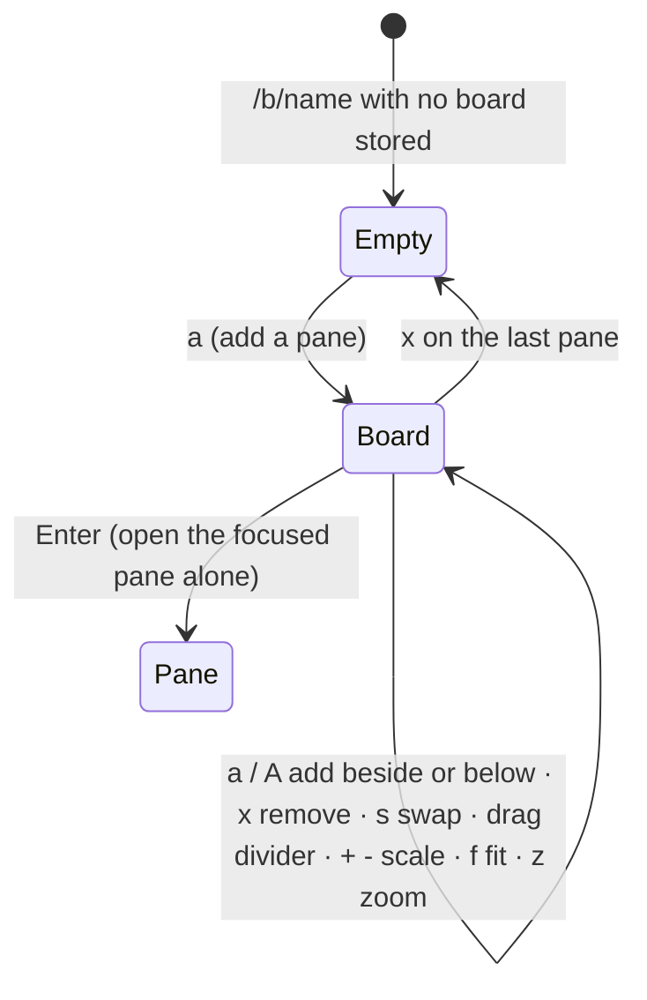

# Feature: boards, your own arrangement of panes from anywhere

> Status: approved 2026-10-24, implemented the same day.

## 1. Goal

The window view shows one tmux window the way the host has it. A person
following several AI agents wants something else: **their** panes, from
any window, session or host, side by side on one screen, arranged as they
like, with the layout kept in the browser and the host untouched. A
**board** is that: a named arrangement of readable panes, built and
rearranged in the browser, remembered per browser, with the input line
and the key bar going to the focused pane and, pane by pane, the host
following the box when fit is on.

Out of scope: sharing a board between devices or people (the hub stores
nothing), a batch read endpoint (each cell reads its pane as the pane
view does; a board of ten panes is ten reads a second, which the hub and
agent already allow), and touch drag on phones (keys and buttons do the
same there).

## 2. Design

**Model.** A board is a tree of splits whose leaves are pane addresses,
with the fraction each child takes, plus per-pane scale and fit:

```ts
type Board = {
  layout: Node;                       // 'h' | 'v' splits, leaves are addresses
  fractions: Record<string, number[]>; // split path -> children's shares
  scale: Record<string, number>;      // address -> font scale
  fit: Record<string, boolean>;       // address -> fit on
  zoom?: string;                      // address shown alone, if any
};
```

The tree type is the window view's `Node` with addresses as leaf ids, so
the divider, fraction and scale code is shared. Boards live in
`localStorage` under `mx-board:<name>`; names are `[a-z0-9-]{1,32}`. The
route is `/b/<name>`; `/b/main` is the default board, reachable as `b`
from anywhere and from the selector, which lists every board with `▤`.



**Building.** `a` opens the selector in add mode: the chosen pane is put
to the right of the focused one in a new horizontal split; `A` puts it
below. The selector lists only panes not yet on the board. `x` removes
the focused pane from the board (the pane itself goes on), and the split
it leaves collapses. `s` swaps the focused pane with the next one; a cell
header can also be dragged onto another cell to swap the two. `=`
equalises every split. `z` shows the focused pane alone and back.

**Cells.** A cell is the window view's: a header with the address, the
command, the attention badge and the mode, and a screen scaled to the
box by the pane's size (`+` and `-`). The focused cell is marked; `]` and
`[` move focus, a click focuses. The input line and key bar address the
focused pane, with the same refusals as the pane view. A pane that is
gone or not readable any more shows `gone` or `not yours to see` in its
cell and can be removed; the board is not changed by itself.

**Fit, pane by pane.** `f` turns fit on for the focused cell: the host
pane is sized to that cell's cells with `scope: pane`, exactly as the
pane view does, and released when the cell goes, fit goes off or the
board is left. `F` turns fit on or off for every writable pane on the
board. Fit is off by default on a board: several host windows changing
at once is a decision for the person. A cell with fit on resends its
size when its box changes, so a divider drag reflows that pane on the
host, one resize per second as before.

**Polling.** Each cell reads its pane with the existing conditional
request; the focused cell every second, the others every two seconds,
every five when the tab is hidden, as today.

**Boards and the window view.** The window view stays: it is the host's
arrangement. A board is the person's. `w` on a board opens the focused
pane's window view; `b` on a pane or a window view adds that pane to
`main` and opens it.

## 3. Protocol and API changes

None. Boards use `GET /v1/panes`, `GET /v1/panes/{address}`,
`POST .../input` and `POST .../resize` with `scope: pane` as they are.

## 4. Security analysis

- **What an attacker gains**: nothing new. A board is a list of addresses
  in one browser; content is read under the session's grants exactly as
  the pane view reads it, and input and fit go through the same checks.
- **Grants**: a pane the session may not read shows an empty cell with
  the refusal; the address alone is already known to the person who typed
  it. A fit on a pane without a write grant is refused by the hub as
  today, and the cell says so.
- **Stored data**: `localStorage` holds addresses, fractions, scales and
  flags, never content or credentials. It is per origin and the content
  security policy is unchanged.
- **Input across a boundary**: board names from the URL are validated
  before they become a storage key or are shown; stored boards are
  checked on load (shape, numbers in range, addresses well formed) and
  dropped if malformed. Drag-and-drop carries an address through React
  state, not through `dataTransfer`.
- **Logging**: nothing new; resizes and input are audited as before.
- **Dependencies**: none new.

## 5. Privacy check

Specs run against the harness (`alice-laptop`, `work`, synthetic pane
titles); screenshots come from the run. The docs use the same names.

## 6. Test plan

| # | Test | Kind | Expected |
|---|------|------|----------|
| 73 | A board naming a pane the session may not read (read-only token, a pane outside its grant) and a pane that does not exist | UI-security | the cells say `not yours to see` and `gone`, no content, no request leaks the other panes; a fit on a read-only pane is refused with the toast |
| 68 | Build a board: `a` adds a second pane from another window, `A` a third below | UI | three cells with their own content, from two windows; `68-board.png` |
| 69 | Rearrange: drag a divider, `s` swap, `+`, `x`; reload | UI | the board survives the reload as arranged; both host windows' layout strings unchanged throughout; `69-board-arranged.png` |
| 70 | Fit on one cell | UI | only that pane changes size on the host, to the cell's cells; its neighbour's window is untouched; leaving the board releases it |
| 71 | Keys: `]` `[` focus, typing goes to the focused pane only, `z` zoom and back, `Enter` opens the pane alone | UI | as specified |
| 72 | A pane on the board is killed on the host | UI | its cell says `gone`, the others keep updating, `x` removes it |
| u6 | Board tree operations: add beside and below, remove with collapse, swap, equalise, validation of stored boards | unit (Vitest) | as specified |

## 7. Documentation

- `docs/features/web-client.md`: a "Boards" section with the two
  screenshots, the keys, and how boards differ from the window view.
- `docs/ARCHITECTURE.md`: a line in the client section that boards are
  client-side state.

## 8. Implementation steps

1. The board model and its operations in `web/src/term/board.ts`, with
   unit tests.
2. The route, the cells, the selector's add mode and the board list.
3. Dividers, swap by key and by drag, scale, zoom, remove, equalise.
4. Fit per cell with `scope: pane`, `F` for all, releases.
5. Specs 73 and 68 to 72; harness control as needed.
6. Docs; record the run.

## Decisions

- 2026-10-24: boards never reach the hub; they are per browser.
- 2026-10-24: fit is off by default on a board.

---

## Review

Done against the plan, the security rules and the privacy rules.

- [x] Diff matches the plan, deviations explained here
- [x] Security rules (AGENTS.md section 2) hold
- [x] Privacy check passed: `scripts/prepush-check.sh` clean and diff read
- [x] Docs and diagrams updated

Deviations:

- Shares live inside each split of the board's tree rather than in a map
  by path, so adding, removing and swapping panes keep the sizes the
  person set without any re-keying. The window view keeps its map, since
  its tree comes from the host.
- The hub cannot tell a pane that is gone from one the session may not
  read (`404` either way), so a gap says `gone, or not yours to see`.
- The window view's divider moved to `components/Divider.tsx`, shared by
  both views.
- Specs click a cell's command text rather than the header's centre: on a
  narrow cell the centre is the fit button.
- A new board is made from the selector with `board <name>`, not from any
  word that happens to look like a name: spec 65 found that every filter
  offered a new board.
- The sign-in fixture waits for the CRT power-on animation to end before
  it clicks; a click during the transform landed on a squashed page and
  made the first spec of a run fail now and then.

## Test run

Recorded with the run that carried this feature: Go end-to-end tests with
the UI harness carrying specs 68 to 73 (73 first, as the security spec),
and the board unit tests in Vitest.
