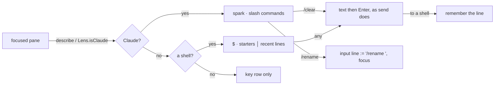

# Feature: the command row: Claude's slash commands, a shell's starters

> Status: asked for by the owner on 2026-10-24 ("the second row, which
> shows only if the system detects that we are in a Claude session";
> then, for a console, "the most common calls of commands like exit,
> then htop, claude, other agents and a couple more … you may also
> check command history, but keep it all in one row, if it doesn't fit
> we can scroll"), implemented the same day in the web and Android
> clients.

## 1. Goal

The key row sends the named keys a terminal program needs. Claude Code
is driven by slash commands as well: `/clear`, `/compact`, `/rename`,
and a few more that are typed many times a day. From a phone, or from
the browser on a laptop, each of them is a line to type and send. This
adds a **second row** under the key row for the program in the focused
pane: while the pane is Claude Code's (as the lens already decides for
the tab strip), one button per common slash command; while it is a
plain shell, the commands a person starts things with, `exit` first,
then `htop`, `claude` and the other agents, and after them the lines
sent to a shell lately from this client, which stands in for the shell's
history (a client cannot read the host's). One row, scrolling sideways
like the tab strip, never wrapping. A button sends the command and
`Enter`; a command that takes an argument fills the input line instead
and waits for the rest. Any other program gets no row.

Out of scope: any change to the hub, the agent or the protocol (a
command is text and `Enter`, which the protocol already carries); a row
for other programs; a way to configure the lists; reading the host's
shell history.

## 2. Design

The row is a small, shared thing: two lists of commands, a rule for
which pane gets which, a short memory of lines sent, and a button bar.
It lives next to the lens in each client, because the lens is where a
client already recognises Claude.

| Pane | Mark | Commands |
|---|---|---|
| Claude Code (the lens says so) | Claude's spark | `/clear` `/compact` `/rename` (fills) `/model` `/resume` `/usage` `/context` `/help` |
| a shell: `bash` `zsh` `fish` `sh` `dash` `ash` `ksh` `tcsh` `csh` | `$` | `exit` `htop` `claude` `claude -c` `codex` `gemini` `git status` `ls` `clear`, then a bar, then the recent lines |
| anything else | | no row |

`/usage` rather than `/cost`: Claude Code 2.1 answers `/cost` with the
usage screen, and the probe run for this plan showed the typed text
and `Enter` run a slash command as a keyboard would.

A command that *fills* puts its text, with a trailing space, into the
client's own input line and focuses it; nothing is sent until the person
presses send. That keeps the half-typed line on the client, where it can
be edited, rather than in the pane.

**Recent lines.** Every line sent with `Enter` to a shell pane from the
client is remembered: trimmed, once, newest first, at most eight, none
over 200 characters. The row shows the ones not already among the fixed
commands, labels cut at 24 characters. The web client keeps them in the
browser's storage under `mx-recent` as it keeps boards; Android in the
app's private preferences with the settings. Nothing is read from the
host.

**Web.** `web/src/term/commands.ts` holds the lists, the shell test, the
recent store and `commandsFor`; `components/CommandBar.tsx` the row,
`data-kind` saying whose it is. The input line, the key bar and the row
move into one `components/InputPanel.tsx`, which the tiles, the window
view and the board all use (they had three copies of the form), so each
gets the row and the memory. The row is a flex row with `overflow-x:
auto` and `white-space: nowrap`. Disabled with the key bar on a
read-only pane.

**Android.** `protocol/Commands.kt`: the lists, `isShell`, `forPane`,
`remembered`; `SettingsStore.recent` and `saveRecent`; `AppModel.recent`
fed by `type(…, enter = true)` on a shell pane; `ui/ViewScreen.kt` draws
a `LazyRow` of `Btn`s between the key row and the text line with the
mark first and a bar before the recent lines. A sending command calls
`model.type(address, text, enter = true)`, the same path as *send*; a
filling command sets the text field and requests its focus. The palette
gains the Claude colour the web client already has.

## 3. Protocol and API changes

None. `POST /v1/panes/{address}/input` with `{"text": "/clear"}` then
`{"key": "Enter"}`: both exist and are unchanged.

## 4. Security analysis

- An attacker gains nothing new: a button sends exactly what a person
  could type on the input line, to the same pane, through the same
  endpoint, under the same write grant, audit-logged the same way
  (bytes, not content). The fixed commands are lists in the client; the
  recent lines are what the person sent from this client. No input from
  the pane, the title or the hub reaches either.
- The row shows for a pane the lens calls Claude's, or whose command is
  a shell's; a pane can dress as either by its title or its command.
  That only chooses which row shows; sending is still the person's
  tap, and the text sent is a fixed command or one of their own. Same
  exposure as the lens's own marks.
- `exit` ends the shell and so the pane. That is what a person pressing
  it asks for; it stands first because the owner put it first.
- Read-only panes: the row is disabled on the web, absent on Android (no
  input bar); the hub would refuse with `403` anyway.
- The recent lines are kept where boards are kept, per browser, and in
  the app's private preferences on Android. A line typed into a shell
  may carry a secret; the docs say so, and the list is short and bounded.
- Nothing is logged by the clients. No new dependencies.

## 5. Privacy check

Synthetic fixtures only (`alice-laptop`, `work:0.0`, a title of
`✳ building`); screenshots from the test runs.

## 6. Test plan

| # | Test | Kind | Expected |
|---|------|------|----------|
| 1 | read-only token on a shell pane | e2e-security (UI) | the row is shown but every button disabled; nothing reaches the pane |
| 2 | a shell pane | UI | the row, `exit` first, `htop` and `claude` present, one row that does not wrap; screenshot `87-shell-row` |
| 3 | a line sent to the shell | UI | joins the row after the bar; clicking it sends it again; survives a reload |
| 4 | title set to `✳ building` | UI | the row becomes Claude's, `/clear` first, with the spark; screenshot `87-claude-row` |
| 5 | `/usage` clicked | UI | the pane receives `/usage` and `Enter` (the shell echoes the attempt) |
| 6 | `/rename` clicked | UI | the input line reads `/rename ` and has focus; nothing sent |
| 7 | title put back; `cat` run in the pane | UI | the shell row again; then no row; `C-c` brings it back |
| 8 | the window view and the board | UI | carry the row for the focused pane |
| 9 | the lists and the memory | unit | slash commands start with `/`, sending ones without a trailing space, filling ones with one; `exit` first for a shell; recent lines deduplicated, newest first, at most eight, long labels cut, over-long lines dropped |
| 10 | Android: `Commands` | unit | same as 9 |

## 7. Documentation

- `docs/ui-guideline.md` §1.4: the sketch and a `command row` line; §1.6
  an action row.
- `docs/features/web-client.md`: the tiles section, the sketch, two
  screenshots, security considerations.
- Android: `docs/features/pane-view.md` (Typing, security), `lenses.md`.

## 8. Implementation steps

1. Core: the guideline, the plan.
2. Web: the lists, the memory and their unit test; the row; the shared
   input panel in the three views; styles.
3. Web: spec `87-commands.spec.ts`; build `web/dist`.
4. Android: the palette colour, `Commands` and its test, the store, the
   model, the row.
5. Docs in both repositories; Android version 0.7.1 (13).
6. Run the suites, record the runs, push.

---

## Review (after implementation)

- [x] Diff matches the plan. The three views lost their own copies of
  the input form to `InputPanel`, as the design says; nothing else moved.
- [x] Security rules (AGENTS.md section 2) hold: no new endpoint, no new
  input shape, the write grant and the host's audit apply as before.
- [x] Privacy check passed: `scripts/prepush-check.sh` clean and diff read.
- [x] Docs and diagrams updated; screenshots from the run.

## Test run

[Run 20261024-154329-ef0fe84](https://github.com/notmarkopadjen/muxway/issues/54): passed, 72 tests, at
`ef0fe84`, the same tree before it was rebased onto the transcription
commit as `0ab55ba` (hub-side only, no shared files), with spec 87 and its screenshots `87-shell-row` and
`87-claude-row`. Android: muxway-android#4.
