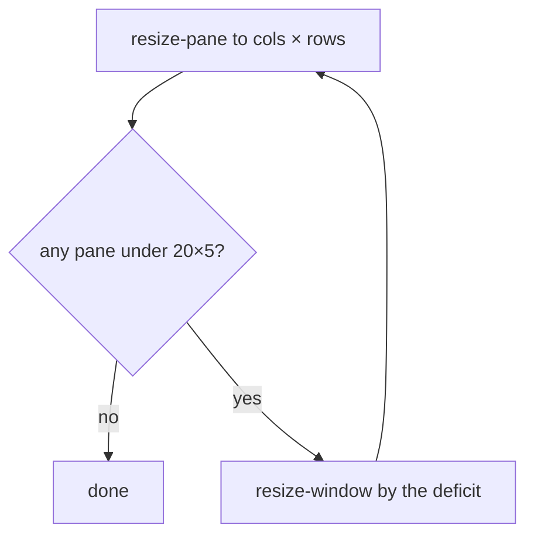

# Feature: a floor under a pane fit, and equalise in the window view

> Status: asked for by the owner on 2026-10-24 after a pane in a shared
> row was squeezed to two columns; implemented the same day.

## 1. Goal

A pane fit (`POST .../resize` without a scope) sizes one pane and lets
its neighbours give or take. tmux takes a neighbour down to one column,
so two phones or tiles fitting two panes of a four-pane row leave the
other two as slivers, and the window view, mirroring the host with fit
on, sends those proportions back. The protocol page already promised
that the window grows before a neighbour has nothing left; the agent did
not keep the promise.

Two changes: the agent keeps a **floor** under every pane of the window
when it fits one, growing the window instead of starving a neighbour;
and the window view gets **equalise** (`=`), as boards have, so a
squeezed window is put right from the browser.

Out of scope here, written into the guideline for both clients: with
several open tiles that are panes of one window, only the focused tile's
pane fits and the others say *held*.

## 2. Design

**Floor.** `ResizePane` sizes the pane as before, then reads every pane
of the window. Any pane under 20 columns or 5 rows is a deficit; the
window grows by the largest deficit on that axis and the pane is sized
again, up to four rounds. The floor is the protocol's own minimum for a
resize, so a client can never ask for less than it leaves.

**Equalise.** `=` in the window view sets every split's fractions equal
in the browser's arrangement. With fit on, the arrangement is what the
host is sent, so the host follows; with fit off, only the view changes.
`+` alone makes the text bigger from now on, as on a board.

## 3. Protocol and API changes

None to messages. `docs/protocol/v1.md` states the floor where it
describes the pane scope.

## 4. Security analysis

- The floor only ever grows a window the client could already size; the
  bounds on `cols` and `rows` are unchanged, and the window is still
  never shrunk below what it has.
- Four rounds at most: a hostile layout cannot make the agent loop.
- Equalise is browser state until fit sends it as a layout the hub and
  agent already validate.

## 5. Privacy check

Tests run in the harness with synthetic panes; no screenshots change.

## 6. Test plan

| # | Test | Kind | Expected |
|---|------|------|----------|
| 59 | Four panes in a row of a 100-column window; fit the second to 60 columns | e2e | it is 60; every other pane has at least 20 columns; the window grew |
| 63 | `=` in the window view after a drag | UI (updated) | equal fractions in the browser; with fit on, the host's layout has equal widths |

## 7. Documentation

`docs/protocol/v1.md`, `docs/features/web-client.md`, `docs/ui-guideline.md`.

## 8. Implementation steps

1. The floor in `internal/tmux`, test 59.
2. Equalise in the window view, spec 63, help and docs.
3. Guideline: the floor, equalise, and the one-fit-per-window rule for
   both clients with tracking issues.

---

## Review

- [x] Diff matches the plan, deviations explained here
- [x] Security rules (AGENTS.md section 2) hold
- [x] Privacy check passed: `scripts/prepush-check.sh` clean and diff read
- [x] Docs and diagrams updated

Deviation: growing the window by the bare deficit converged too slowly,
since tmux scales every pane alike and the re-fit hands the surplus to
one neighbour; the window is grown by the factor that lifts the smallest
pane to the floor instead, which takes one round, two with rounding.
The one-fit-per-window rule is tracked as muxway#48 and
muxway-android#3.

## Test run

Run `20261024-123450-a320f24`: the full suite, all passed, [test run #49](https://github.com/notmarkopadjen/muxway/issues/49).
