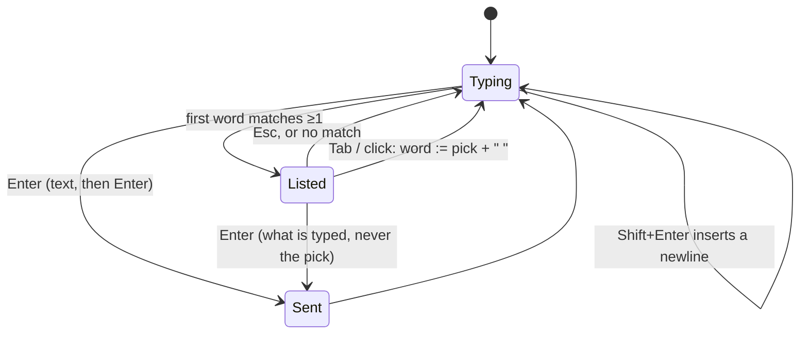

# Feature: the input line: lines, wrapping, completion

> Status: approved by the owner on 2026-10-24. Asked for
> as: Shift+Enter makes a new row while Enter still sends; too long text
> wraps and pushes the first row up (web and Android); auto-complete when
> typing commands (web now, Android later); a key to focus the line.

## 1. Goal

The input line is one `<input>`: a long line scrolls out of sight, a
message with several paragraphs cannot be written, and the commands the
command row knows are not offered while typing. This turns it into a
small editor that grows upward from the bottom edge (the view is bottom
aligned): text wraps, **Enter sends**, **Shift+Enter** starts a new line,
and a list of completions opens above it while the first word is typed.
A text with several lines reaches the pane as one paste, so Claude Code
takes it as one message and a shell as one editable block.

The key to focus the line exists: `i`, vim's insert. It stays; the help
says so already and the docs get a line. Leaving the line is `Esc`, as
today; it is said in the placeholder and the help so it is known, and
while typing the directional keys behave as in a console (below).

Out of scope: completion on Android (a follow-up issue; the phone's own
keyboard suggests words); a history of sent lines beyond the command
row's eight; editing the pane's own line.

## 2. Design

```
┌ pane ──────────────────────────────────────────────┐
│ …                                                  │
└────────────────────────────────────────────────────┘
      ┌ ▸ /compact                      ┐
      │   /config                       │   completions, upward
      │   /context                      │
> fix the build, then run the tests ag  ┘
  ain and tell me what changed             [send]
```

**The field.** `InputPanel` swaps the `<input>` for a `<textarea>` with
`rows=1` that grows to the height of its content up to six rows, then
scrolls inside; the panel is pinned to the bottom so growth pushes the
first row up. `Enter` submits; `Shift+Enter` inserts `\n`; `Esc` blurs
as today. Android: `Field` becomes multi-line (`maxLines = 6`) with the
send action kept on the keyboard's send key and a hardware `Shift+Enter`
inserting a newline; the column grows upward because the bar sits at the
bottom of the view.

**Keys while typing.** With the field **empty**, `↑` `↓` `←` `→`,
`PageUp` `PageDown` `Home` `End` go to the pane as the named keys the key
bar sends, so a menu Claude Code shows, or a shell's history, is driven
from the line without leaving it. With text in the field they move the
caret as an editor does, except that `↑` `↓` pick in the completion list
while it is open. `Esc` leaves the field (focus goes to the view, where
the ordinary shortcuts work again, and a second `Esc` goes back to the
list); `Shift+Esc` sends `Escape` to the pane without leaving the field,
for interrupting Claude Code mid-sentence. `Tab` with no list open sends
`Tab` to the pane when the field is empty, else it completes.

**Sending.** *send* posts the whole text, newlines included, then
`Enter`; *type* posts the text alone. The hub's text check admits `\n`
(and only `\n`: `\r` and every other control character stay refused).
The agent delivers a text containing `\n` as a **paste**: `tmux
load-buffer -b muxway-<id> -` from stdin, then `paste-buffer -p -d -b
muxway-<id> -t <pane>`. With `-p` tmux wraps the text in the bracketed
paste marks when the program asked for them, so Claude Code and a
readline shell take the lines as one block and wait for Enter; a program
that did not ask gets the bytes as typed. A text without a newline keeps
today's `send-keys -l`.

**Completion (web).** `term/complete.ts` answers `completions(pane,
text, recent)` for the *first word* of the text (the caret is in it and
nothing precedes it but blanks): for Claude Code's pane, the slash
commands that start with the typed text from a full list (`/add-dir`,
`/agents`, `/bug`, `/clear`, `/compact`, `/config`, `/context`, `/cost`,
`/doctor`, `/exit`, `/export`, `/help`, `/hooks`, `/ide`, `/init`,
`/login`, `/logout`, `/mcp`, `/memory`, `/model`, `/permissions`,
`/pr-comments`, `/release-notes`, `/rename`, `/resume`, `/review`,
`/sandbox`, `/security-review`, `/stats`, `/status`, `/terminal-setup`,
`/usage`, `/vim`), the command row's eight first; for a shell, the
starters and the recent lines that start with the text. At most eight
rows, in a box above the line, `▸` on the highlighted one. `↑` `↓` move,
`Tab` takes the highlighted one into the line (with a trailing space),
`Esc` closes, a click takes one. **Enter never completes**: it sends what
is typed, so the rule *Enter sends* has no exception. The list is only
offered for a writable pane the lens knows (Claude or a shell).



## 3. Protocol and API changes

`POST /v1/panes/{address}/input` with `{"text": "..."}`: the text may
contain `\n`. Delivery: a text with a newline is pasted (bracketed when
the program asked), a text without is typed. `MaxTextBytes` stays 4096.
Compatible: an older hub answers `bad_input` to a newline, which the
clients show as before. `docs/protocol/v1.md` says so under input.

## 4. Security analysis

- The newline is the one new byte admitted. It is delivered through a
  tmux buffer, never a shell, and the paste marks come from tmux, not
  the client; a client cannot send `\e[200~` itself (ESC stays refused).
- A shell older than bash 5.1 or without bracketed paste runs each line
  on its newline. That is what pasting into such a shell does locally;
  the docs say so, and *send* still appends one `Enter`.
- Completion is a list in the client plus the person's own recent lines;
  nothing from the pane or the hub enters it. It never sends by itself.
- Audit unchanged: bytes, not content. Read-only panes: the field is
  disabled; the hub refuses anyway. No new dependencies.

## 5. Privacy check

Synthetic fixtures. The bracketed-paste test uses `printf '\e[?2004h';
cat -v` on the throwaway host.

## 6. Test plan

| # | Test | Kind | Expected |
|---|------|------|----------|
| 1 | text with `\r`, `\x1b`, `\x7f`, a C1 byte | e2e-security | `400 bad_input`, nothing typed |
| 2 | text of 4097 bytes with newlines | e2e-security | `400 bad_input` |
| 3 | read-only token sends a two-line text | e2e-security | `403 read_only` |
| 4 | agent: a two-line text | e2e | the buffer is pasted and deleted; with `\e[?2004h` on, `cat -v` shows `^[[200~a` … `b^[[201~`; without, the bytes as typed |
| 5 | Shift+Enter in the field | UI | a second row, nothing sent; the field grows and the screen above shrinks; screenshot `92-two-rows` |
| 6 | Enter after two rows | UI | both lines reach the pane, then Enter; the field is empty and one row high |
| 7 | 300 characters typed | UI | the text wraps to several rows, none hidden; at seven rows the field scrolls inside |
| 8 | `/co` typed in a Claude pane | UI | the list shows `/compact`, `/config`, `/context`, `/cost`; `↓` `Tab` puts `/config ` in the line; screenshot `92-complete` |
| 9 | `/co` then Enter | UI | `/co` and Enter reach the pane, not a completion |
| 10 | `g` typed in a shell after `git status` was sent | UI | `git status` listed; Esc closes the list |
| 11 | `i` | UI | the field has focus; `Esc` leaves it (the view's keys work again); a second `Esc` goes to the list |
| 11a | empty field, `↑` `PageUp` `Home` | UI | the pane receives `Up`, `PageUp`, `Home` (`cat -v` shows them); with `abc` typed, `←` moves the caret and nothing is sent |
| 11b | `Shift+Esc` while typing | UI | the pane receives `Escape`; the field keeps focus and its text |
| 12 | `completions()` | unit | prefix match, order (row commands first), at most eight, nothing for a second word or an unknown program |
| 13 | Android: two lines, send | instrumented | the field grows upward; the text reaches the pane with its newline |

## 7. Documentation

- `docs/ui-guideline.md` §1.4 *input* row (lines, wrapping, completion
  web-only for now with the Android issue named), §1.6 rows: `Shift+Enter`,
  `Tab` (completion), `i`, `Esc` (leave the line), `Shift+Esc`, and the
  directional keys from an empty line.
- `docs/protocol/v1.md`: input text and the newline.
- `docs/features/web-client.md`: Using it (3), Keyboard; Android
  `pane-view.md` Typing.

## 8. Implementation steps

1. Hub and agent: `ValidText` admits `\n`; the agent's paste path and its
   test; protocol doc.
2. Web: the textarea, grow-upward styles, Shift+Enter; `complete.ts` and
   its test; the list component; the three views unchanged (they use
   `InputPanel`).
3. Web: spec 92; `web/dist`; docs.
4. Android: multi-line field, hardware Shift+Enter; an issue for
   completion; docs; version bump.
5. Run both suites, record, push.

---

## Review (after implementation)

- [x] Diff matches the plan. Deviations: a text with several lines is not
  kept as a recent shell line (the command row and the completion list
  show one-line commands); the completion list orders the row's commands
  first and then the full list, so `/co` lists `/compact`, `/context`,
  `/config`, `/cost`; Android gives the input line its own `typed`
  filter and keeps the general `printable` strict for titles, event text
  and connect codes.
- [x] Security rules (AGENTS.md section 2) hold: the newline is the one
  new byte, admitted by the hub and the agent alike, delivered through a
  tmux buffer; `\r`, `\t`, `ESC` and the C1 range stay refused and the
  Go suite proves it; the paste marks come from tmux; audit unchanged.
- [x] Privacy check passed: `scripts/prepush-check.sh` clean and the diff
  read; fixtures synthetic.
- [x] Docs updated: protocol, guideline §1.4 and §1.6, web-client,
  Android pane-view; muxway-android#12 opened for completion on the phone.

## Test run

[Run 20261024-175903-1861266](https://github.com/notmarkopadjen/muxway/issues/69): passed, 81 tests, at
`1861266`, with `TestSec92`, `TestFlow92` and spec 92's four tests and
its screenshots `92-two-rows` and `92-complete`. Android:
[Run 20261024-180436-658bca5](https://github.com/notmarkopadjen/muxway-android/issues/13): passed, 87 tests,
commit `658bca5` (0.7.3 (15)) against core `1861266`, with the JVM
two-line paste; no device attached, so the flow test's two lines wait
for the next device run.
