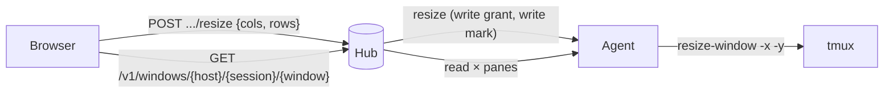
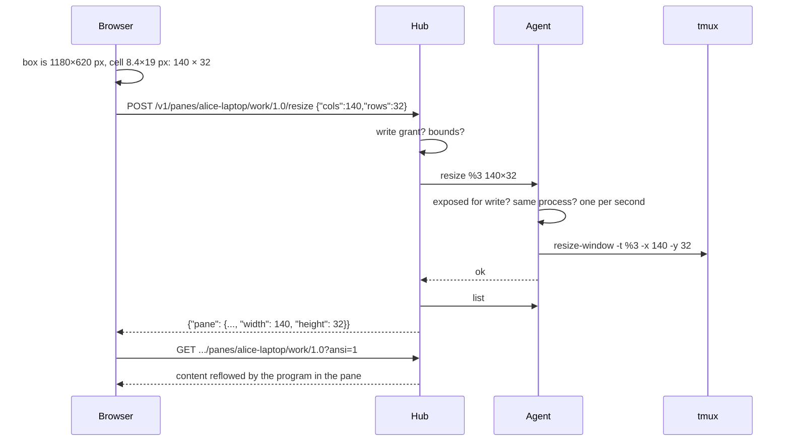
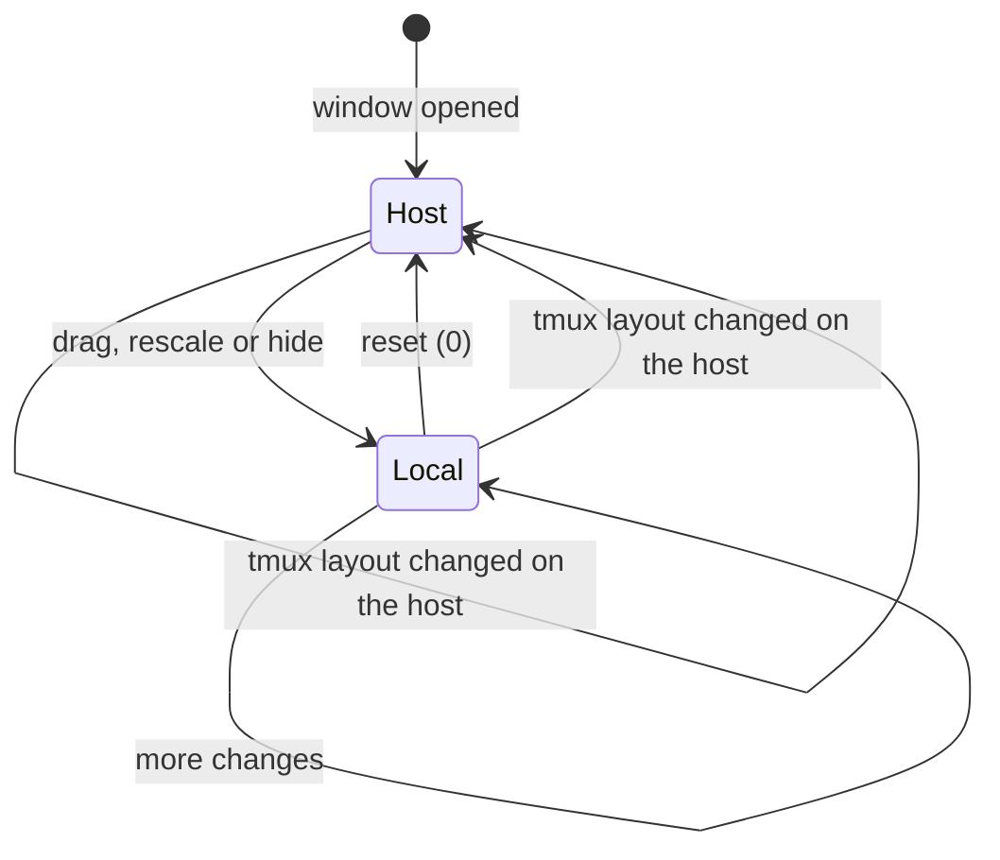

# Feature: windows in the browser: layout, resize and a pane selector

> Status: implemented 2026-10-24. Extends the
> [web client](2026-10-23-web-client.md).

## 1. Goal

Three things the first web client lacks:

1. **Reflow.** A pane keeps the size the terminal on the host gave it, so a
   browser window that is wider or narrower shows a pane that does not
   fit. A terminal client would tell tmux its size; so should the browser.
2. **A pane selector.** Switching panes means going back to the list.
   A palette, `p`, jumps straight to another pane.
3. **A window view.** tmux shows a window's panes side by side; the
   browser shows one at a time. The window view shows every readable pane
   of a window in tmux's own layout by default, and lets the person
   rescale, resize and hide panes **in the browser only**, without
   touching the layout on the host.

Out of scope: moving or splitting panes on the host from the browser,
synchronising the browser layout back to tmux, and streaming.

## 2. Design



### Reflow: the window follows the browser

tmux sizes a window, not a pane: panes split the window. So the browser
asks for the **window** to be resized to what fits, and tmux lays the
panes out inside it as the host's own layout says. New agent request
`resize {pane, cols, rows}` runs `resize-window -t <pane> -x cols -y rows`
on the pane's window, and `resize {pane, fit: "auto"}` gives the window
back to tmux's automatic sizing (`set-option -w -u window-size`,
`resize-window -A`).

> Amended 2026-10-24 after use: in a window of several panes this left
> the fitted pane at its share of the browser's size. The pane view now
> sizes the **pane** (`scope: pane`, the default): on an axis the pane
> spans its window the window is sized as before; on an axis it shares,
> `resize-pane -x -y` takes the difference from the neighbours, after
> growing the window when they would have nothing left. The window view
> keeps sizing the window (`scope: window`). The agent remembers each
> window's layout string before its first resize, and a release puts it
> back with `select-layout` after the window returns to automatic sizing. The agent treats a resize as a **write**: the pane
must be marked for writing and the same-process check holds, because a
resize changes what the person at the host sees. Bounds: 20 to 500
columns, 5 to 300 rows. At most one resize per second per window is
applied; more are coalesced to the latest. Every resize is audited with
its size.

The hub exposes it as `POST /v1/panes/{address}/resize` with the write
grant required, and answers with the pane's new size after re-listing.

In the browser, **fit** is a toggle, `f`, shown in the pane header. With
fit on, the client measures the screen area in cells (its monospace cell
size times the box) and sends a debounced resize on every change; with
fit off, or without a write grant, the pane keeps the host's size and is
scaled to the box instead. Fit is **on by default** for a single pane the
person may write to, as a terminal would behave, and **off by default**
in the window view. Leaving a view with fit on sends `fit: auto`, so the
host's window returns to its own size.



### Scaling in the browser

A pane's content is rendered at its host size (columns × rows) in a box
of some pixel size; the client picks the font size that makes those
columns and rows fill the box (`min(boxWidth / cols / 0.6,
boxHeight / rows / 1.35)`, with the monospace glyph ratio measured once),
down to a floor of 6 px. Nothing is sent to the host; this is how the
window view fits several panes on one screen and how a read-only pane fits
a phone.

### The window view

`GET /v1/windows/{host}/{session}/{window}?lines=&ansi=1` returns the
window's layout string and every pane of it the principal may read, each
with its content, in one request: the hub fans the reads out to the agent
and answers with one ETag. A pane the principal may not read is absent,
and the layout is still returned, so the view shows a gap where a hidden
pane sits.

The client parses tmux's layout string into a tree of horizontal and
vertical splits with sizes and pane ids, and renders it as nested boxes,
each with the pane's content scaled as above. Then, in the browser only:

- **Resize**: drag a divider; the fractions of that split change.
- **Rescale**: `+`/`-` or the wheel with Ctrl on a pane change its font
  floor and ceiling.
- **Hide**: `x` on the focused pane removes it from the view; a bar lists
  hidden panes to bring back.
- **Reset**: `0` returns to the host's layout.

The arrangement is kept per window in `localStorage`, keyed by host,
session and window id, and the host's layout string is checked on every
refresh: when tmux's own layout changes (a new split, a closed pane), the
view resets to it, so the browser never shows a stale arrangement.

One pane is **focused** (click, or `]` and `[` to cycle). The input line
and the key bar address the focused pane; its box glows. `Enter` on a
focused pane opens it alone; `Esc` returns to the window view.



### The pane selector

`p` opens a palette over any view: a filter line and the list of every
pane the person may reach, newest attention first, then by address, with
the badge, command and title. Typing narrows by address, alias, command
and title; `j`/`k` and `Enter` jump; `Enter` on a window row opens the
window view. The same list is reachable from a `≡` button in the header
for touch.

### Routes

- `/p/<address>`: one pane, as today, with fit and the selector.
- `/w/<host>/<session>/<window>`: the window view.
- The panes page gains a row per window that opens the window view.

## 3. Protocol and API changes

Compatible additions to v1.

### `POST /v1/panes/{address}/resize`

Body, exactly one of:

```json
{"cols": 140, "rows": 32}
{"cols": 140, "rows": 32, "scope": "window"}
{"fit": "auto"}
```

`scope` is `pane` (default) or `window`; see the amendment above.

Needs the write grant and a pane marked for writing, like input. Answers
`200` with `{"pane": {...}}` as a listing shows the pane after the
resize, or `400 bad_parameter` out of bounds, `403 read_only`, `404`,
`429 rate_limited` beyond one per second per window, `503`.

### `GET /v1/windows/{host}/{session}/{window}`

Query `lines` (1 to 2000, default 100), `ansi=1`. Answers:

```json
{"host": "alice-laptop", "session": "work", "window": {"index": 1, "name": "logs",
  "layout": "b25d,100x30,0,0{50x30,0,0,3,49x30,51,0,4}", "active": true},
 "panes": [{"pane": {...}, "content": "..."}]}
```

with an `ETag`; `304` on `If-None-Match`. Text mode is not offered: small
clients read one pane at a time.

### Agent channel

New op `resize {pane, cols, rows}` and `resize {pane, fit}`, answered
like `input`, with the error `rate_limited` added for the per-window
limit.

## 4. Security analysis

- **What an attacker gains.** A resize changes the host's window size,
  which the person at the host sees at once. It is therefore gated like
  typing: write grant on the hub, write mark on the host, same process,
  audited with its size, and limited to one per second per window so a
  stolen write token cannot make a window flicker. Bounds keep tmux's own
  limits, and the window only; sessions and other windows are untouched.
- **Window reads.** The window endpoint applies the same grant check per
  pane as a listing; a pane outside the grants is neither read nor
  described, only its position is implied by the layout string, which
  the listing already exposes.
- **Browser state.** Layout preferences in `localStorage` are per
  browser, carry no content, and are overridden by the host's layout
  whenever it changes.
- **Input routing.** The input line sends to the focused pane's address;
  the focus is visible, and the key bar names the pane, so a keystroke
  cannot go to a pane the person did not pick.
- **Logs**: resizes log principal id, pane and size; no content.
- **Dependencies**: none.

## 5. Privacy check

Examples use `alice-laptop`; screenshots are taken in the test
environment, with every pane titled by the harness.

## 6. Test plan

| # | Test | Kind | Expected |
|---|------|------|----------|
| 52 | Resize with a read-only token; with a write token on a read-only pane; on an unexposed pane | e2e-security | 403, 403 (refused by the agent), 404; window size unchanged |
| 53 | Resize out of bounds, malformed, both fields, neither; 30 resizes in a burst | e2e-security | 400s; the first applied, the rest `rate_limited`; window size changes at most once per second |
| 54 | Window endpoint with a token that may read one pane of a two-pane window | e2e-security | one pane in `panes`, the layout present; the other pane's content absent |
| 55 | Hostile hub (test double) sends `resize` for an unexposed and a read-only pane | e2e-security | refused, audited |
| 56 | Resize a window to 140×32 and back to auto; sizes read from tmux | e2e | `window_width`/`window_height` follow, then return to the terminal's size |
| 57 | Window endpoint: layout string, two panes with content, ETag and 304 | e2e | as specified |
| 58 | Split window: pane to 60×10, then 120×40, then the window scope to 90×25, then release | e2e | pane exactly as asked, window 60×30 then 120×60, then 90×25; release restores size and layout string |
| 60 | Browser: fit on, viewport 1200 then 800 px wide, pane in a split window | UI | the pane has the browser's size each time, the window its width; leaving restores size and layout; `60-fit.png` |
| 61 | Fit off: resize the viewport | UI | no resize request leaves the browser; the pane is scaled |
| 62 | Window view of a two-pane window | UI | boxes match the layout string's fractions within 2 %; `62-window.png` |
| 63 | Drag the divider, hide a pane, reset | UI | only the browser changes; the host layout string is unchanged; `63-local.png`; reset restores |
| 64 | tmux splits the window while the view is open | UI | the view resets to the new layout |
| 65 | Selector: `p`, filter, `Enter` | UI | lands on the pane; `65-selector.png` |
| 66 | Focus: `]`, `[`, typing goes to the focused pane | UI | text appears in the right pane only |
| u5 | Layout string parser: nested splits, sizes, pane ids, malformed strings | unit (Vitest) | as specified |

## 7. Documentation

- `docs/features/web-client.md`: fit, the window view, the selector,
  the keys.
- `docs/protocol/v1.md`: the resize and window endpoints, the agent op.
- `docs/features/exposing-panes.md`: a resize is a write; what the
  person at the host sees.

## 8. Implementation steps

1. tmux layer: `ResizeWindow`, `ReleaseWindow`; agent op `resize` with
   the write check and the per-window limiter; hub endpoint; tests 52,
   53, 55, 56.
2. Hub window endpoint with fan-out and ETag; tests 54, 57.
3. Client: cell measurement, scaling, the fit toggle; UI 60, 61.
4. Client: layout parser (u5), window view, local arrangement, focus;
   UI 62 to 64, 66.
5. Client: pane selector; UI 65.
6. Docs; record the run.

## Decisions

- 2026-10-24: a resize is a write: write grant and write mark required.
- 2026-10-24: fit defaults on for a single writable pane, off in the
  window view; leaving a fitted view releases the window to tmux.
- 2026-10-24: browser arrangements never reach the host.
- 2026-10-24: the pane view fits the pane, the window view the window;
  a release restores the layout the window had before the first resize.

---

## Review

Done against the plan, the security rules and the privacy rules.

- [x] Diff matches the plan, deviations explained here
- [x] Security rules (AGENTS.md section 2) hold
- [x] Privacy check passed: `scripts/prepush-check.sh` clean and diff read
- [x] Docs and diagrams updated

Deviations:

- The agent refuses a second resize within the second instead of queuing
  the latest size; the client retries after the second. A **release**
  (`fit: auto`) is always accepted, so a client that leaves right after a
  resize can still hand the window back; the suite found that a refused
  release left the host window at the browser's size.
- The release is sent with `keepalive` and also on `pagehide`, because a
  full page navigation runs no React cleanup.
- `tmux resize-window -A` must run before the manual mark is removed, not
  after: the command sets the mark itself.
- The hub's page fallback had to learn the new `/w/` route; flow 37
  checks it.
- Boxes are measured with `clientWidth` and `clientHeight`, not the
  bounding rectangle: during the CRT power-on the page is scaled with a
  transform, the rectangle reported one pixel of height, and a
  ResizeObserver never fires for a transform, so every pane sat at the
  6 px floor. Spec 62 now asserts the font.
- The dist freshness gate in `scripts/e2e.sh` now builds into a temporary
  directory and diffs it against `web/dist`, so it also works on an
  uncommitted tree.
- After the first day of use: fit in the pane view sizes the pane, not
  its window (`scope`), and a release restores the saved layout. Flow 58
  covers a split window: a pane sized within the window, one grown
  beyond it, the window scope, and the release putting the layout string
  back. Spec 60 now asserts that the pane, not only the window, has the
  browser's size. Boxes are measured by their computed padding instead
  of a fixed 18 px.

## Test run

All passing locally through `scripts/e2e.sh`: 64 Go tests in the run
directory (security 52 to 55, flows 56 and 57, and the UI harness with 19
specs, 60 to 66 new), 9 Vitest units including the layout parser, lint,
format and type checks, and the dist gate. Screenshots from the run are
in `docs/features/images/`.

Amendment run, 2026-10-24: 65 Go tests (flow 58 new, spec 60 rewritten),
all passing through `scripts/e2e.sh`.
