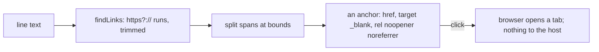

# Feature: links in a pane open in the browser

> Status: approved by the owner on 2026-10-24. Asked for
> as "web and Android clients should have clickable links, like Warp does
> with tmux output".

## 1. Goal

A URL printed in a pane, a pull request, a build log, a docs page Claude
Code names, is text in a `<pre>`. It should open with a click (a tap on
the phone), in a new tab, without typing it over. Like Warp, the client
finds URLs in the text it shows; the host sends nothing new.

Out of scope: OSC 8 hyperlinks (tmux's `capture-pane -e` does not emit
them); file paths and `file:line` references (a later feature: they need
the host to open them); URLs broken across two rows (they are not
joined; a wrapped URL opens up to the row's end).

## 2. Design

- `term/links.ts`: `findLinks(line)` returns `[start, end, href]` for
  each `https?://` run of non-blank characters in a line's plain text,
  trailing `.,;:!?)]}>'"` trimmed, and a `)` kept when the URL has a
  matching `(`. Only `http` and `https`; nothing else is a link.
- `Screen` splits a line's spans at link bounds and wraps the link's
  spans in `<a href target="_blank" rel="noopener noreferrer"
  class="mx-link">`, keeping the spans' colours. Dotted underline, solid
  on hover, the pointer cursor; in a pane that has the mouse a click on a
  link opens the link and does **not** send a click to the host
  (`stopPropagation`). Middle click and Ctrl-click behave as the browser
  does.
- Android: `PaneTile`'s rows build an `AnnotatedString` with
  `LinkAnnotation.Url` over the same matches, opened through the system's
  `UriHandler`; a tap on a link is not a tap on the pane.

## 3. Protocol and API changes

None.

## 4. Security analysis

- The link's target is pane content, which is untrusted. The regex admits
  `http` and `https` only, so no `javascript:`, `data:` or custom schemes;
  the href is set as an attribute from the match, never built as HTML.
  `rel="noopener noreferrer"` keeps the opened page from the client's
  window and from its address. A pane can show a misleading URL, as any
  terminal can; the browser's own address bar shows where it went.
- A click on a link sends nothing to the host, so a program cannot use a
  link to provoke a click at a cell.
- Android opens through the system chooser; the same scheme rule.
- No new dependencies; CSP unchanged (navigation is not a fetch).

## 5. Privacy check

`https://example.com/…` and `http://[2001:db8::1]/` in fixtures.

## 6. Test plan

| # | Test | Kind | Expected |
|---|------|------|----------|
| 1 | `javascript:alert(1)`, `data:text/html,…`, `ftp://…` in a pane | e2e-security (UI) | no anchor; no alert |
| 2 | a link in a pane with mouse mode on, clicked | e2e-security (UI) | a popup opens to the URL; `cat -v` shows no mouse bytes |
| 3 | `echo https://example.com/a?b=1` | UI | an anchor with that href, `target=_blank`, `rel` set; screenshot `96-link` |
| 4 | a URL in colour, split over spans | UI | one anchor, colours kept |
| 5 | `(https://example.com/x)` and `https://example.com/y.` | unit | trailing `)` and `.` trimmed; `https://example.com/a_(b)` keeps its `)` |
| 6 | Android `Links` | unit | same as 5 |

## 7. Documentation

- `docs/ui-guideline.md` §1.4: a *links* row.
- `docs/features/web-client.md` Using it (3) and Security
  considerations; Android `pane-view.md`.

## 8. Implementation steps

1. Guideline row; `links.ts` and its test; `Screen`; styles.
2. Spec 96; `web/dist`; docs.
3. Android: `Links.kt`, the rows, test, docs, version.
4. Run, record, push.

---

## Review (after implementation)

- [x] Diff matches the plan. Deviations: a run also stops at a quote, an
  angle bracket or a backtick, so two quoted addresses in one line are
  two links and `<https://…>` is one; `]` and `}` are kept when the
  address opened them, like `)`, so an IPv6 literal survives; §1.6 gets
  an *open a link printed in a pane* row, since a click on a link is a
  gesture of its own; Android keeps the finder in the protocol module
  (`Links.find`, `Links.at`) and the tile's own tap handler skips a cell
  that lies in a link as well, beside the text's link handling.
- [x] Security rules (AGENTS.md section 2) hold: the regex admits `http`
  and `https` only, the href is an attribute from the match and never
  markup, `noopener noreferrer` on the web, the system's view intent on
  Android; a click on a link stops before the pane's handler, so no
  mouse request leaves the client; no protocol change, no new
  dependency, CSP unchanged.
- [x] Privacy check passed: `scripts/prepush-check.sh` clean and the diff
  read; fixtures use `example.com`, `example.org`, `alice@example.com`
  and `2001:db8::1`.
- [x] Docs updated: guideline §1.4 and §1.6, web-client (using it,
  security considerations), Android pane-view (the body, security
  considerations).

## Test run

[Run 20261024-183544-1bedef6](https://github.com/notmarkopadjen/muxway/issues/75): passed, 81 tests, at
`1bedef6` (the feature rebased onto the window-row work; the same suite
had passed before the rebase as
[run 20261024-182903-ec09353](https://github.com/notmarkopadjen/muxway/issues/74)), with spec 96's two tests (the schemes that stay text and the
click in a mouse-mode pane that reaches no host; the anchor, its colours
and its punctuation) and the screenshot `96-link`; the finder's unit
tests run with the web client's suite. Android:
[Run 20261024-182953-d438989](https://github.com/notmarkopadjen/muxway-android/issues/14): passed, 93 tests,
commit `d438989` (0.7.4 (16)) against core `1bedef6`'s sources, with the finder's
JVM tests; no device attached, so a tap on a link waits for the next
device run.
