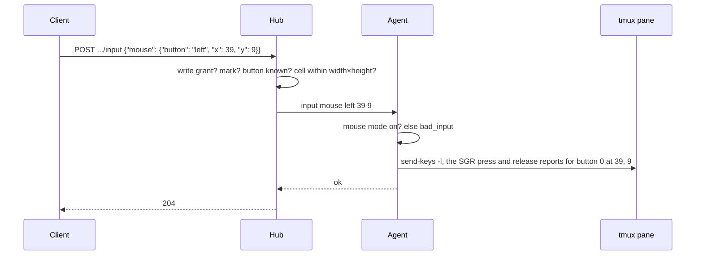

# Feature: mouse input (a click at a cell)

> Status: implemented 2026-10-24. Specified by the Android client's plan
> of the same name (`muxway-android`, `docs/plans/2026-10-24-mouse-input.md`),
> which the core picks up here.

## 1. Goal

A tap or click on a pane becomes a mouse click at that cell on the host,
for programs that asked their terminal for the mouse, so an option an AI
CLI shows can be chosen by touching it. Out of scope: drags, selection,
and the wheel in the web client (the protocol has it).

## 2. Design

A third body for `POST /v1/panes/{address}/input`:
`{"mouse": {"button", "x", "y"}}`, buttons `left`, `middle`, `right`,
`wheelup`, `wheeldown`, the cell 1-based within the pane. The hub checks
the button and the cell against the pane's size; the agent checks that
the program asked for the mouse (tmux's `mouse_any_flag`,
`mouse_button_flag`, `mouse_standard_flag` or `mouse_all_flag`) and
answers `bad_input` otherwise, so the bytes never land as text in a
shell. It then writes the xterm sequence with `send-keys -l`: SGR
(`ESC [ < b ; x ; y M`, and `m` for the release) when the program chose
it (`mouse_sgr_flag`), the old `ESC [ M` with three offset bytes
otherwise, refused beyond cell 223. The listing gains `"mouse": true`
on a pane whose program asked for the mouse, so a client knows where a
tap means something.

In the web client a click on a pane's screen, in the pane view, a
window cell or a board cell, is sent as a left click at the cell under
the pointer when the pane is writable and its program asked for the
mouse; otherwise a click only focuses, as before.

## 3. Protocol and API changes

The body shape and the listing field above; compatible v1 additions. An
older hub answers `400 bad_json` to the new shape.

## 4. Security analysis

- A click is a narrow interface like a key: five buttons and two numbers,
  never raw bytes from a client.
- Gated like typing: write grant, write mark, audited as
  `op=input mouse=<button>`, the same rate limits.
- The ranges are checked twice (hub and agent) and the mouse mode on the
  host, so a click cannot become typed text in a program that would read
  it as such.

## 5. Privacy check

Fixtures use `alice-laptop`; the flow test types into a throwaway pane.

## 6. Test plan

| # | Test | Kind | Expected |
|---|------|------|----------|
| 80 | Click with a read-only token; on a read-only pane; on a shell without mouse mode; bad buttons, cells, shapes | e2e-security | 403, 403, 400, 400s; the pane unchanged; audited |
| 81 | `cat -v` with SGR mouse on: a click and a wheel notch; then the old encoding | e2e | `^[[<0;5;3M^[[<0;5;3m`, `^[[<65;1;1M`, `^[[M""$^[[M#"$`; the listing says `mouse: true` |
| 82 | Browser: click a cell of a pane running `cat -v` with the mouse on | UI | the sequence for that cell appears; a click in a shell pane types nothing |

## 7. Documentation

`docs/protocol/v1.md`, `docs/features/web-client.md`.

## 8. Implementation steps

1. wire, tmux, agent, hub; tests 80 and 81. 2. Web client; spec 82.
3. Docs; record the run.

---

## Review

- [x] Diff matches the plan
- [x] Security rules hold
- [x] Privacy check: `scripts/prepush-check.sh` clean and diff read
- [x] Docs updated

Deviation from the Android plan: the agent accepts any of tmux's mouse
mode flags, not only `mouse_any_flag`, and encodes for the mode the
program chose; a program that asked for the old encoding would otherwise
have been refused or misread.
