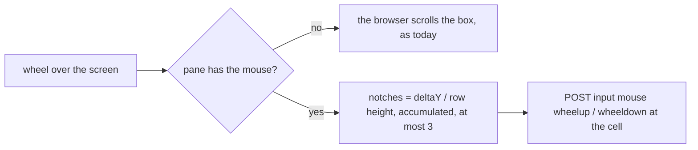

# Feature: scrolling: the wheel reaches a program that has the mouse; the tab strip scrolls

> Status: approved by the owner on 2026-10-24. Asked for
> as "on web, scroll still doesn't work, on Android it works well" and
> "there's no easy way to scroll through tabs in web".

## 1. Goal

**The screen.** The browser's screen scrolls through what the hub sent:
400 lines of the pane, its history included. That is what the scrollback
test checks and it holds for a shell. It does nothing for Claude Code,
`htop`, `vim` and every other program that uses the terminal's
*alternate screen*: tmux keeps no history for it, so the hub's 400 lines
are the screen's rows and nothing more, and there is nothing for the
browser to scroll. Such a program scrolls itself, and asks for the mouse
to be told about the wheel. Claude Code's panes on the owner's host are
exactly that: alternate screen on, history empty, mouse on. The Android
client already sends a wheel notch per row of a drag when the pane has
the mouse, which is why it works there. The web client sends only clicks.
This makes the wheel over such a pane reach the host as `wheelup` and
`wheeldown` at the cell under the pointer, through the mouse input that
exists.

**The strip.** The tab strip scrolls sideways with its scrollbar hidden,
so on a mouse without a horizontal wheel there is no way to move it, and
nothing says that `}` and `{` already walk the focused tile through the
strip. The wheel over the strip moves it sideways, and `‹ ›` marks at its
ends say there is more and move it when clicked.

Out of scope: history for alternate-screen programs (tmux has none to
give); keyboard paging into a pane without mouse mode (the key bar's
`PageUp` / `PageDown` do that); any protocol change.

## 2. Design

> Changed while implementing: the plan had a second test, "does the box
> overflow?", sending the browser's scroll instead when it does. tmux's
> capture gives the base screen's history even while the alternate screen
> is on, so a program started from a shell that had been used would never
> have got the wheel. The pane's `mouse` flag alone decides, as it does on
> Android; the history above the program stays reachable by the box's
> scrollbar.

- `Screen` takes an `onWheel(up, x, y)` like `onCell`; `Tile`, the
  window view's cell and the board's cell pass it when the pane is
  writable and `pane.mouse` is true, as they pass `onCell`.
- Delta accumulates per screen; every full row height sends one notch at
  the cell under the pointer, at most three per event, and `preventDefault`
  stops the page and the box from moving. Notches are sent one request at
  a time; up to three wait behind the one in flight and the rest of a
  burst is dropped, so a fast wheel is neither a flood nor a backlog that
  lands after the hand has stopped.
- The strip: a `wheel` listener on `.mx-tabs` turns `deltaY` into
  `scrollLeft`; two small buttons `‹` `›` at its ends, shown only when
  `scrollWidth > clientWidth`, move it by half its width. Tabs no longer
  shrink to fit the row (they did, so the strip never overflowed and
  twelve tabs were twelve slivers): they keep their width and the strip
  scrolls. The buttons' titles and the docs name `}` `{` as the
  keyboard's way.

## 3. Protocol and API changes

None. `{"mouse": {"button": "wheelup", "x": 12, "y": 3}}` exists and the
agent already sends it in the encoding the program asked for.

## 4. Security analysis

- Nothing new reaches the host: the same mouse endpoint, the same write
  grant, the same `bad_input` for a pane without mouse mode, the same
  audit line (`mouse`, the button). A wheel in a read-only pane is refused
  by the hub as a click is; the client does not send it.
- Rate: at most three notches per wheel event and one in flight, under the
  token's general limit of 20 requests a second; a stuck wheel cannot
  exceed what a held key does today.
- No input from the pane decides anything but `pane.mouse`, which already
  decides clicks.

## 5. Privacy check

Synthetic panes only; `cat -v` after `printf '\e[?1000h\e[?1006h'` shows
the bytes in the test run. No real pane content.

## 6. Test plan

| # | Test | Kind | Expected |
|---|------|------|----------|
| 1 | read-only token, a pane with mouse mode on | e2e-security (UI) | the wheel sends nothing; `cat -v` shows nothing |
| 2 | shell with 120 lines of history (spec 67) | UI | unchanged: the box scrolls, nothing is sent |
| 3 | `cat -v` with the mouse asked for, on the alternate screen of a pane without history | UI | three and a half rows up: `^[[<64;5;yM` three times; four rows down: `65` three times; one event of twenty rows: three more, not twenty; the page does not move; screenshot `91-wheel` |
| 3b | `cat -v` with the mouse asked for, the shell's history still above | UI | the notches reach the program and the box stays at its bottom |
| 4 | the strip with twelve panes at 800 px | UI | `‹ ›` shown, the wheel moves the strip, `‹` back to the start, `›` on again, `}` changes the focused tile's pane; screenshot `91-strip` |

Spec `91-wheel.spec.ts` runs them as four tests; the harness gained
`/clear-history`, `/key` and `/split?dir=h` for them.

## 7. Documentation

- `docs/ui-guideline.md` §1.4 *mouse* row: the wheel; §1.6: `wheel`
  (web) beside Android's drag; the strip's `‹ ›`.
- `docs/features/web-client.md` Using it (3): what scrolls where, and why
  an alternate-screen program has no history to read back.

## 8. Implementation steps

1. Guideline rows; `Screen.onWheel`; the three views pass it.
2. The strip's wheel and `‹ ›`.
3. Spec 91; `web/dist`; docs; run, record, push.
