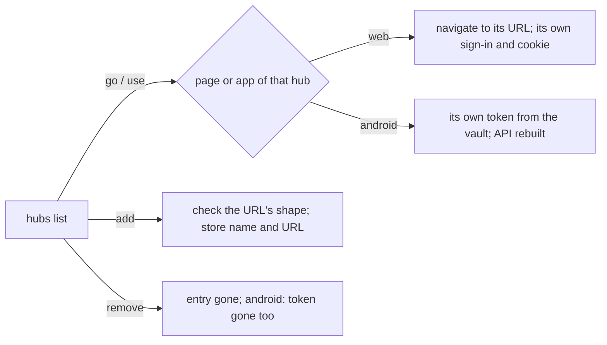

# Feature: several hubs in one client

> Status: approved by the owner on 2026-10-24 with the decision below.
> Asked for as "we should be able to connect to multiple hosts; support
> that in settings / selection", web and Android. In muxway's words a
> client connects to a **hub**, and a hub already gathers hosts; so this
> is several hubs in one client.

## 1. Goal

A person with a hub at home and one at work, or one per customer,
re-enters an address and a token for each. A client should remember
several hubs and switch between them in one move, each hub with its own
sign-in. **The owner's decision:** the architecture stays as it is. On
the web, another hub is kept as a *link* in the browser's storage,
nothing more; each hub authenticates the person separately, in its own
page with its own session cookie; and every request goes to the hub it
is about, from that hub's own page. No token ever lives in a page and
no page talks to two hubs.

Out of scope: one list mixing several hubs' panes (that would need one
page to hold other hubs' credentials, which the decision rules out);
one hub relaying another; notifications from a hub whose page is not
open.

## 2. Design

**Web.** `hubs.ts` keeps `mx-hubs` in the browser: `[{name, url}]`,
names `[a-z0-9-]{1,32}` given by the person, URLs that are `https://`
origins (or loopback) with no path. The hub serving the page is always
the first entry, named by its origin until renamed. The header shows the
current hub's name beside the brand when there is more than one, and a
`⇄` button (key `H`) opens the **hubs** box: the list, the current one
marked, **go** to one (a plain navigation to that URL, which is that
hub's own web client and sign-in), **add** (name and URL; the URL is
checked for shape only, nothing is fetched), **rename**, **remove**. The
same list is reachable from the help overlay. Because the list lives in
the browser's storage under each hub's origin, it is per hub page: a
hub's page shows the links the person added *on that page*. Adding a
hub offers to carry the list over: **go** opens the other hub with the
list in the URL's fragment (`#hubs=…`, names and URLs only), which that
page reads once into its own storage and strips. Nothing but names and
URLs is ever carried.

```
┌ hubs ────────────────────────────────────┐
│ ▸ home   https://hub.example.com   here   │
│   work   https://work.example.com  [go]   │
│ name: ______  url: https://______  [add]  │
└──────────────────────────────────────────┘
```

**Android.** `Settings.hubs: List<Hub(id, name, url)>` and the Vault
holds one token per hub id, each encrypted as today; `current` names the
active one. The Connect screen becomes the hubs list: **use** switches
(the API client and the pane list are rebuilt for it, the watch service
follows the current hub), **add** (name, URL, token; or scan a connect
code, which adds a hub rather than replacing the one there), **edit**,
**remove** (its token goes with it). One hub at a time talks to the app,
as on the web; a single hub looks as it does today.



## 3. Protocol and API changes

None.

## 4. Security analysis

- The web page holds names and URLs, no secret; each hub's session stays
  the HttpOnly cookie its own page has. The CSP is unchanged
  (`connect-src 'self'`): no page calls another origin.
- **go** is a navigation to a URL the person typed; the shape check
  (`https://` origin or loopback, no path, no credentials in the URL)
  keeps a `javascript:` or `data:` entry out. The fragment hand-over
  carries names and URLs only, is validated the same way on arrival, and
  is stripped from the address bar.
- A hostile hub reached by its link gets nothing from the first hub: the
  navigation carries no cookie, no token, no referrer (the client's
  `Referrer-Policy` is `no-referrer`).
- Android keeps several tokens under the Keystore key as it kept one;
  removal deletes the token; a connect code adds a hub and never
  overwrites another's token silently (it asks when the URL exists).
- No new dependencies.

## 5. Privacy check

Fixtures: `home`, `work`, `hub.example.com`, `work.example.com`;
the UI test's second hub is the harness's second loopback hub.

## 6. Test plan

| # | Test | Kind | Expected |
|---|------|------|----------|
| 1 | add `javascript:…`, `http://work.example.com`, a URL with a path, with `user:pw@` | e2e-security (UI) | refused in the form; nothing stored |
| 2 | `#hubs=` with a bad entry | e2e-security (UI) | the bad entry dropped, the rest kept, the fragment gone |
| 3 | go to the second hub | e2e-security (UI) | the request to it carries no cookie of the first (the harness's second hub logs it) and no referrer |
| 4 | two hubs, go, sign in, come back | UI | each page has its own session; the list on both; screenshot `94-hubs` |
| 5 | rename, remove | UI | the list follows; a removed hub's link is gone |
| 6 | `hubs.ts` | unit | shape check, first entry is the origin, fragment round trip |
| 7 | Android: hubs store and vault | unit | several tokens, switching, removal, connect code adds |

## 7. Documentation

- `docs/ui-guideline.md` §1.6 (`H`), §2 and §3 (what each client holds
  and why the web holds links only).
- `docs/features/web-client.md`: a *Several hubs* section with the
  decision; Android `connect.md`.

## 8. Implementation steps

1. Guideline; `hubs.ts` and tests; the box, the header, the key, the
   fragment hand-over.
2. Spec 94 (the harness already runs a second origin for the cross-site
   test; it gains a second hub); `web/dist`; docs.
3. Android: store, vault, list screen, switch; tests; docs; version.
4. Run, record, push.

## Test run

[Run 20261024-220850-c3f8cd7](https://github.com/notmarkopadjen/muxway/issues/89): passed, 89 tests, with spec 94's five tests
(a hub address must be an https origin, nothing else stored; a carried
list drops what is ill shaped and leaves the address bar; going to the
second hub carries neither cookie nor referrer, and its page has no
session of the first; two hubs: go, sign in there, come back, a session
each; rename and remove, and the help's *hubs* button) against the
harness's second hub, reached as `localhost` so the browser keeps the two
hubs' cookies apart, with the screenshot `94-hubs`; and `hubs.test.ts`
(the shape check, this page first, the fragment round trip). The same
tests passed before the rebase onto the one-view work as
[Run 20261024-220028-3b532c7](https://github.com/notmarkopadjen/muxway/issues/88).
Android:
[Run 20261024-220721-991c24d](https://github.com/notmarkopadjen/muxway-android/issues/18):
passed, 106 tests, at `991c24d` (0.7.7 (19)), with `HubsTest` (the list's
round trip, what is dropped, names from the host, fresh ids, the legacy
id); no device was attached, so the on-device flow test was not run. A
first run of the same commit
([#17](https://github.com/notmarkopadjen/muxway-android/issues/17)) lost
`aDeadServerIsOffline` to the core suite running on the same loopback at
the same time.
