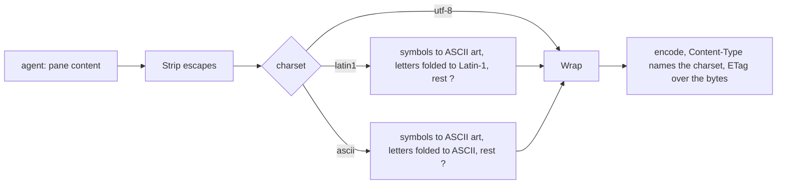

# Feature: text mode in Latin-1 and ASCII

> Status: implemented 2026-10-24.

## 1. Goal

Text mode exists for small clients, and the smallest of them cannot show
what it sends. The Nokia 6310i, a 2002 MIDP 1.0 phone, has no glyphs for
the box-drawing characters Claude Code draws its rules with, and its Java
decodes bytes as Latin-1 unless told otherwise, so `─` arrives as three
odd glyphs. On the owner's phone the Claude Code lens of the MIDP client
therefore did not recognise the screen, and the rules showed as garbage.
Each rule is also 80 to 200 three-byte characters on a link that is paid
by the kilobyte.

This adds a `charset` parameter to text mode: `utf-8` as today, `latin1`
and `ascii`. The hub transliterates what the charset cannot carry: lines
become `-`, `|` and `+`, bullets `*`, arrows `>` and `<`, letters lose
their accents, and whatever is left becomes `?`. Clients that can show
Unicode change nothing.

Out of scope: colours, and any change to JSON mode.

## 2. Design

One function in `internal/text`, applied to the pane's content after
escape sequences are stripped and before wrapping, since `…` becomes
three characters and `─` one. The hub reads `charset`, picks the
transliteration, encodes the body (Latin-1 as single bytes, ASCII as
itself) and names the charset in `Content-Type`.

The table, kept small and readable:

| Characters | Become |
|---|---|
| horizontal lines `─ ━ ═` and dashed variants | `-` (`=` for the double line) |
| vertical lines `│ ┃ ║` and dashed variants | `\|` |
| corners, tees and crosses (U+250C to U+254B, U+2552 to U+2570) | `+` |
| diagonals `╱ ╲ ╳` | `/ \ X` |
| block elements (U+2580 to U+259F) | `#` |
| `❯ › » ▶ ▸ ⏵ ➜ →` | `>`; `←` `<`; `↑` `^`; `↓` `v` |
| bullets `● • ○ ◦ ■ □ ▪ ◆ ★ ☆`, braille spinners (U+2800 to U+28FF) | `*` |
| `·` `.`; `…` `...`; `— – ‐ −` `-`; `×` `x`; `✓ ✔` `v`; `✗ ✘ ✖` `x`; `⚠` `!` | |
| curly quotes | `'` and `"`; no-break space a space |
| Latin letters with marks (Latin-1 Supplement, Latin Extended-A) | the base letter; `ß` `ss`, `æ` `ae`, `ø` `o`, `đ` `d`, `ł` `l` |
| anything else outside the charset | `?` |

For `latin1` the letters that Latin-1 has (`ä`, `é`, `ñ`) stay as they
are; only the ones beyond it (`č`, `ł`) are folded. Nothing is folded in
`utf-8`.

## 3. Protocol and API changes

`GET /v1/panes/{address}` gains the text-mode query parameter `charset`:
`utf-8` (default), `latin1`, `ascii`. Anything else is `400
bad_parameter`. The answer's `Content-Type` is
`text/plain; charset=utf-8`, `text/plain; charset=iso-8859-1` or
`text/plain; charset=us-ascii`. JSON mode ignores the parameter, as it
ignores `width`. A compatible v1 addition: old hubs ignore the parameter
and keep answering UTF-8, so a client must decode by the `Content-Type`
it receives, not by what it asked for.

## 4. Security analysis

- Abuse gains nothing: the parameter changes the encoding of content the
  token may already read. It cannot make the hub read more, read another
  pane or write.
- Same authentication and grants as every read.
- Input crossing the boundary: one query parameter, matched against three
  fixed values; everything else is refused before the agent is asked.
- The transliteration maps runes to short fixed strings; the longest
  expansion is `…` to three bytes, so the body cannot grow past three
  times the agent's cap. No regular expressions, no allocation per rune
  beyond the builder.
- Logging unchanged: no content.
- No new dependency: the fold table is written out in the source.

## 5. Privacy check

Test strings are synthetic (`čćž 日本`, rules, a fake prompt). No real
host, person or secret.

## 6. Test plan

| # | Test | Kind | Expected |
|---|------|------|----------|
| 1 | `charset=utf-16`, `charset=`, `charset=ASCII` | e2e-security | `400 bad_parameter`, agent not asked |
| 2 | `charset=ascii` in JSON mode | e2e | ignored, JSON unchanged |
| 3 | transliteration table: rules, box, symbols, letters, `?` | unit | each row of the table above |
| 4 | Flow: pane with `─`, `❯`, `čćž 日本`, `ä` read with each charset | e2e | `utf-8` as today; `latin1`: `-`, `>`, `ccz ??`, `ä` as byte `0xE4`, header `iso-8859-1`; `ascii`: `a`, header `us-ascii` |
| 5 | ETag differs between charsets of the same content | e2e | three different ETags, each stable |

## 7. Documentation

`docs/protocol/v1.md` (the read endpoint, text mode); new
`docs/features/text-mode.md` describing text mode for small clients, with
the table; `docs/ARCHITECTURE.md` mentions the charset in the read flow.

## 8. Implementation steps

1. `internal/text`: `Fold(s, charset)` and its unit test.
2. Hub: the parameter, the encoding, the header; e2e tests; docs. One
   commit with the first step if small enough.
3. Run the suite, record the run.

---

## Review (after implementation)

- [x] Diff matches the plan. Two deviations: `▶` and `»` map to `>` as
      the table says, but in `latin1` every character Latin-1 has stays,
      `»` and `·` included, since the phone shows them; and a query
      parameter given twice (`charset`, `lines`, `width`) is now refused
      with `400` instead of the first value being taken.
- [x] Security rules (AGENTS.md section 2) hold: fixed values, same grants,
      bounded growth, nothing logged
- [x] Privacy check passed: `scripts/prepush-check.sh` clean and diff read
- [x] Docs and diagrams updated: protocol page, `features/text-mode.md`,
      architecture

## Test run

(after the run)

## Decisions

- 2026-10-24: approved by the owner in the console, together with the
  MIDP client's plan that uses it.
