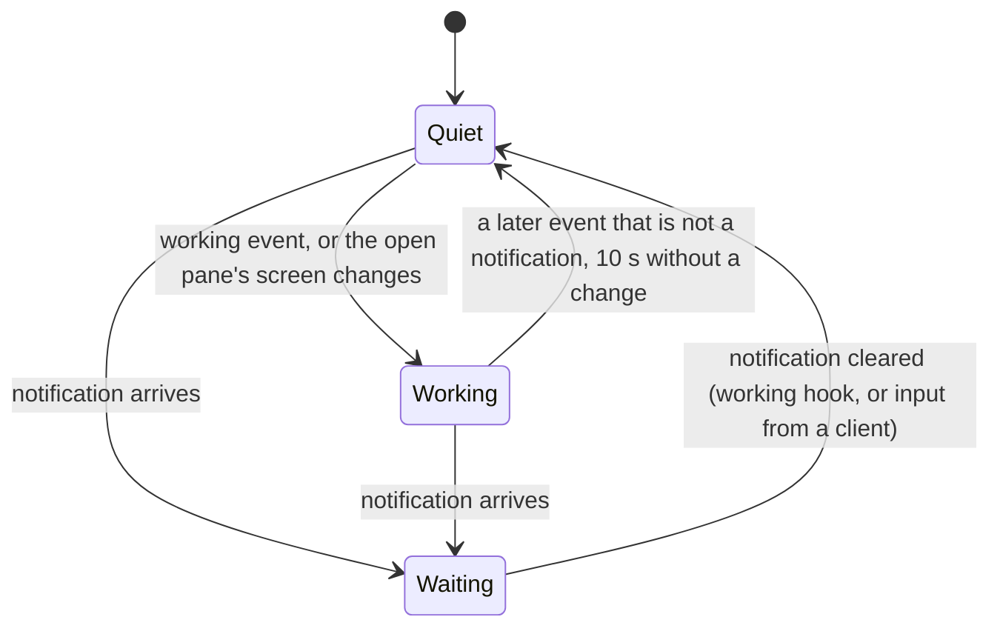

# Feature: the Android layout in the browser: tabs, tiles, a lens

> Status: asked for by the owner on 2026-10-24 ("first do the Android
> layout, then we check"), implemented the same day.

## 1. Goal

The Android client has settled on a way of working with panes that the
web client lacks: a **tab strip** of every pane the token may read, each
painted with what the pane is up to; one to four panes open as **tiles**
in a handful of arrangements that cycle; a pane list where several panes
are picked and opened **side by side**. The web client, by contrast,
opens one pane at a time, keeps its arrangements in two other views
(window and board), and names panes in a header that the owner finds
misaligned, with the status in the same type as the name.

This feature brings the Android pane view and pane list to the browser,
so the two clients read as one product and a person switching between
them finds the same thing in the same place. The **window view** (the
host's own arrangement, "mirror layout") stays, and its entry in the
pane list is made to look like the control it is. The header names the
pane as the Android tabs do: the name upright, the status in italics,
the place dimmed, all on one line.

Out of scope: boards (they stay as they are; a tile set is the Android
view, a board is the browser's own longer-lived arrangement), zoom in the
tile view (the window view and boards keep theirs), pinch zoom and swipe
(a browser has keys and a wheel), and any change to the hub or the
agent.

## 2. Design

### The lens

A small module, `web/src/term/lens.ts`, mirrors the Android `Lens`: it
says whether a pane is **waiting** for its owner (the listing carries a
notification), **working** (a pane running Claude Code whose last event
from the hub was `working`, or whose content changed in the last ten
seconds while open here), or **quiet**. The last event kind per pane is
kept in a store the shell feeds from the event stream, the change time
by the tile that reads the pane. The glyph and word are Android's:
`!` `?` `z` `✓` with the kind for waiting, `⟳ working` for working.



### The pane list

The tree stays (host, session, window, panes), with the Android row:

```
── alice-laptop ──────────────────────────────────────────── online ──
  work
  ├─ [▦ 0: main · 2 panes · mirror layout ▸]
  │  [ ] * ✳ Claude · fixing the build     alice-laptop/work/0.0   ! permission
  │  [ ]   bash                            alice-laptop/work/0.1
  ├─ [▦ 1: logs · 1 pane · mirror layout ▸]
  │  [ ] * tail · build.log                alice-laptop/work/1.0   ⟳ working
         tap to open · [ ] or space picks several
```

- The window row is drawn as a button, bordered and lit on hover, and
  says what it opens (`mirror layout ▸`); it used to be dimmed text,
  which read as disabled.
- A row has a pick box, `*` when the token may write, the lens glyph
  and the pane's name, the address dimmed, and the lens's word in the
  attention colour (waiting) or dim (working). A click opens the pane;
  the pick box, `space` on the highlighted row, or a click while
  something is picked toggles the pick, up to four. A bar under the
  list offers `clear` and `open N side by side`; `Enter` with a pick
  opens it.

### The tile view

`/p/<address>` grows to `/p/<a>,<b>,...`: one to four addresses, comma
separated (an address never contains a comma). The page is the Android
view:

```
[‹] [⟳ fixing the build][! review][bash][tail]    [▦] [fit on 96×28] [⟳] [window ▸]
┌─ ✳ fixing the build · claude · write ── ⟳ working 96×28 ─┐ ┌─ bash · write ─┐
│                                                           │ │                │
└───────────────────────────────────────────────────────────┘ └────────────────┘
> ______________________________________________________________________ [send]
[Enter][Tab][BSpace]…
```

- The **tab strip** lists every pane the token may read, in listing
  order, by name: for Claude Code the status it wrote into the title
  (the "codename"), else the command and its title. Each tab is painted
  with its lens state; open tabs have a border, the focused one a thick
  border and bold name. A click on an open tab focuses its tile; a click
  on a closed tab swaps it into the focused tile (the route changes).
  The strip scrolls sideways and keeps the focused tab in view.
- **Tiles** share the area in one of the Android arrangements: `row`,
  `column`, and with three or more `main-left`, `main-top`, and with four
  `grid`. `▦` (or `l`) cycles those that make sense for the count. A
  wide window starts with `row`, a tall one with `column`. The bar
  between tiles drags; no tile goes under fifteen percent. Dragging a
  tile's header onto another swaps the two. `x` (or the `×` in a header)
  closes a tile when more than one is open. The arrangement is the
  browser's own and never reaches the host.
- A tile's **header** is painted like its tab and shows the glyph, the
  name, the command, the mode, the lens's word and, with fit on, the
  size. The focused tile has the thick border and the bold name. One
  input line and one key bar serve the focused tile, as today.
- **Fit** is per tile, with `scope: pane`, as on a board. One writable
  pane opens with fit on; several open with fit off, as on Android.
  `f` toggles the focused tile, `F` every writable tile, `r` sends the
  size again. The `fit` button and the size in the header are the
  focused tile's.
- Keys: `]` `[` focus the next or previous tile; `}` `{` replace the
  focused tile with the next or previous pane in the strip (Android's
  swipe); `1`–`4` focus a tile; `l` next arrangement; `x` close; `f`
  `F` `r` fit; `w` the focused pane's window view; `b` the board;
  `Enter` the focused pane alone; `Esc` back to the list.
- Each tile reads its pane as a board cell does: the focused one every
  second, the others every two seconds.

```mermaid
flowchart LR
    L[pane list: pick 1–4] -->|open| V["/p/a,b,c"]
    P[selector, toast, notification] -->|one pane| V
    V -->|tab click, } {| V
    V -->|w| W[window view: the host's layout]
    V -->|b| B[board]
    W -->|Enter| V
```

### The header

The crumb is aligned with the brand on the centre line, not the
baseline, and names the pane as the tabs do: the mark, the name upright,
the status in italics and dimmed, the place smaller and fainter after
it. The status is italic wherever a pane is named.

## 3. Protocol and API changes

None. Tiles use `GET /v1/panes`, `GET /v1/panes/{address}`,
`POST .../input`, `POST .../resize` with `scope: pane`, and the event
stream as they are. A `working` event is already in the protocol.

## 4. Security analysis

- **What an attacker gains**: nothing new. Several panes on one screen
  are several reads under the same grants, the same input endpoint for
  the focused one, and the same per-pane fit. The arrangement is browser
  state.
- **Grants**: a tile for a pane the session may not read shows the
  refusal and no content; its input line is disabled, its fit button
  absent, a click on it sends nothing.
- **Input across a boundary**: the route's addresses are checked against
  the address grammar and capped at four before any request is made; a
  bad route shows an error and asks the hub for nothing. Tab and header
  names are text from the hub, rendered as text. Drag and drop carries
  an address through React state only.
- **Lens**: it reads the kind of an event, the attention and a
  timestamp; a pane can make itself look busy, nothing more.
- **Logging**: nothing new.
- **Dependencies**: none new.

## 5. Privacy check

Specs run against the harness (`alice-laptop`, `bob-desktop`, `work`,
synthetic titles); screenshots come from the run. The docs use the
same names.

## 6. Test plan

| # | Test | Kind | Expected |
|---|------|------|----------|
| 83 | A read-only token opens two panes side by side; a route of five addresses; a route with a bad address | UI-security | the read-only tile has a disabled input, no fit button and a click types nothing; five addresses show "up to four" and request nothing; a bad address shows the error and requests nothing |
| 84 | Pick two panes in the list, open side by side; `▦` cycles the arrangements; drag the bar; drag a header onto the other tile; `x` closes one | UI | two tiles, the `data-layout` runs through `row column`, the bar moves the split, the headers swap, one tile remains; `84-tiles.png`, `84-list-picked.png` |
| 85 | Tabs: every readable pane is a tab; a click on a closed tab swaps it into the focused tile; `]` moves focus; typing goes to the focused pane only; the window row opens the window view | UI | as specified |
| 86 | Lens: a `working` event paints the pane's tab and row as working; a `question` notification paints them waiting; input clears it | UI | `data-state` goes `working`, `waiting`, then neither; `86-lens.png` |
| 48, 74 | header: crumb carries the name, the status in italics and the place | UI (updated) | as specified |
| u7 | arrangement model: options per count, cycling, drag with the floor, swap, close | unit (Vitest) | as specified |
| u8 | lens: status from attention, event kind and recency; glyph and word | unit (Vitest) | as specified |

## 7. Documentation

- `docs/features/web-client.md`: the pane list, the tile view, the
  header, the key table, screenshots from the run.
- `docs/ARCHITECTURE.md`: a line that the lens and the arrangement are
  client state.

## 8. Implementation steps

1. `term/lens.ts` and `term/tiles.ts` with unit tests.
2. The shell feeds the lens; the header crumb.
3. The pane list: window button, Android rows, picking, the bar.
4. The tile view replaces the pane page: strip, tiles, arrangements,
   drag, swap, fit per tile, keys.
5. Specs 83 to 86; the existing specs updated where the page changed.
6. Docs; record the run.

---

## Review

- [x] Diff matches the plan, deviations explained here
- [x] Security rules (AGENTS.md section 2) hold
- [x] Privacy check passed: `scripts/prepush-check.sh` clean and diff read
- [x] Docs and diagrams updated

Deviations:

- The route keeps its comma: the router is told that `,` is allowed in a
  path parameter, so `/p/a,b` is not rewritten to `/p/a%2Cb`.
- The `fit` button lives in the focused tile's header rather than in the
  top row, next to the size it reports, as on a board.
- A fit release can land within the second of the resize it undoes and
  be refused by the hub's limit; it is now tried again. Specs that fit a
  pane leave it before they end, so the next spec finds the host at
  rest; one that ended on the pane page left the window sized and the
  spec after it compared against that.
- The top row keeps a minimum height, so the tiles do not shift when the
  strip fills in after the panes load; a shift delayed the fit by a
  debounce each time.
- The mode text on a painted header needed its own colour rule.

## Test run

Run `20261024-110526-428af74`: the full suite, 70 Go tests with the UI
harness carrying every spec including 83 to 86, all passed. Recorded as
[test run #41](https://github.com/notmarkopadjen/muxway/issues/41).
