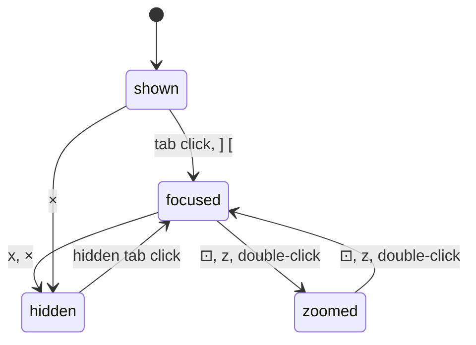

# Feature: the window view's top row, as the Android pane view has it

> Status: asked for by the owner on 2026-10-24 ("the buttons should be
> icons all the way to the right, and pane titles starting from left
> acting as tab switches"), approved the same day.

## 1. Goal

The window view's top row was a line of words and bordered text
buttons: the place, `focus: …`, `fit on`, `⟳`, `equalise`, `reset`, and
a `hidden:` bar. It read as prose, not as controls, and the focused pane
was named in text rather than shown. The pane view and the Android
client settled this already: `‹` back, a tab strip on the left painted
by the lens, icon buttons on the right. The window view takes the same
row. Its cell headers also gain the lens word, so the paint (dim for a
working pane, the attention colour for a waiting one) explains itself
the way the tile headers do.

Out of scope: the cell headers otherwise, boards (except the key
below), the hub and the agent, the Android client.

Two keyboard changes the owner asked for while this was being built
ride along, since they touch the same input line and views:

- **Escape in the input line.** First asked for as the pane's Escape;
  the input-line feature (#57), built alongside, gave `Esc` the line to
  leave (closing an open completion list first) and `Shift+Esc` the
  pane's Escape. The owner settled on that: leaving the line is the
  more frequent move and should not need Shift.
- **`]` and `[` go to the next pane** everywhere: the next tile, or
  with one tile open the strip's neighbour shown in it (what `}` and
  `{` did; those go, and so does the Ctrl+arrow pair tried in between,
  which a Mac keeps for itself). The window view and a board had them
  already.
- **Zoom is the pane view.** The window view's own zoom (one cell shown
  alone, the host zooming with fit on) goes; `⊡`, `z`, `Enter` or a
  double-click on a cell or its header open the focused pane in the
  pane view, and from there `⊡`, `z`, `w` or a double-click on the tile
  come back to the window. One set of features at two distances instead
  of two modes.
- **Shift+click on a tab** opens the pane beside the open tiles, up to
  four, so a second pane and the `▦` arrangements are reachable from
  the pane view itself, not only from the list's pick.
- **Enter on the completion list** sends the highlighted completion.
  The input-line feature had Enter send the typed text only, so `/`
  followed by Enter reached Claude Code as a bare slash and its own menu
  picked whatever came first (`/cd`, in the owner's screenshot).
- **Claude's mark on every Claude tab.** The strip showed the state
  glyph instead of the mark whenever a pane was not quiet, so only idle
  Claude panes kept their spark; now the mark stays and the glyph
  follows it.
- **More under the input line.** The key bar grows from sixteen keys to
  forty-two (`BTab`, `Space`, `Insert`, `Delete`, ten more control
  keys, `F1` to `F12`), which is a protocol change: the named-key
  whitelist on the hub and the agent grows the same way, and the
  protocol page says so. The command row offers twenty-four Claude Code
  slash commands and twenty-eight shell starters instead of eight and
  nine.

## 2. Design

Web only. The strip moves out of `pages/Pane.tsx` into
`components/Tabs.tsx` so both pages share it, with one addition: a tab
may be marked hidden.

```
[‹] [✳ Claude · fixing the build][bash][! review][ logs ]      [⤢][⟳][⊡][⊞][↺]
┌ ✳ Claude · fixing the build · work/0.0 · 98×40 · ⟳ working              × ┐
```

- Left: `‹` back to the pane list. Then one tab per pane of this window
  the token may read, in layout order, named as the guideline §1.1
  says, painted as §1.2 says. The focused pane's tab has the thick
  border and the bold name. A click focuses the pane, and moves the zoom
  with it as `]` and `[` do. A hidden pane's tab is dimmed with a dashed
  border; a click brings the pane back and focuses it. The `hidden:` bar
  goes.
- Right, icons only, the tooltip carries the word and the key:
  `⤢` fit on and off (selected when on, for a writable focus),
  `⟳` fit again (with fit on), `⊡` the focused pane alone and the whole
  window again (selected while zoomed), `⊞` equal shares (`=`),
  `↺` the host's layout (`0`).
- The window's place and name stay in the shell heading. The `focus:`
  text goes; the bold tab shows it.
- The strip lists this window's panes, not every readable pane: the
  view is the window. The pane view's strip is unchanged.
- Cell header: after the place and size, the lens mark with its word,
  and the attention text, as the tile header has them.



## 3. Protocol and API changes

The named-key whitelist of `POST /v1/panes/{address}/input` grows (see
`docs/protocol/v1.md`): `Space`, `Insert`, `Delete`, `C-a`, `C-e`,
`C-u`, `C-k`, `C-w`, `C-r`, `C-x`, `C-n`, `C-p`, `C-f`, `F1` to `F12`.
Compatible: an older hub answers `400 bad_input` to the new names, as
it does to any name it does not know. Nothing else changes.

## 4. Security analysis

Nothing new crosses a trust boundary: no new request, grant or input.
Tab names are pane titles already rendered as text through React, never
as HTML. The arrangement (hidden panes, fractions) stays in the
browser's localStorage as before. Nothing is logged.

## 5. Privacy check

Docs and screenshots use the test environment (`alice-laptop`,
`work/0.0`). The owner's screenshot that prompted the change is not
committed.

## 6. Test plan

| # | Test | Kind | Expected |
|---|------|------|----------|
| 1 | a pane title with `<b>` and script text shown in the window strip (74) | e2e-security | shown as text, no element created |
| 2 | 66: a tab click, `]` and `[` | e2e | the focused tab carries the address |
| 3 | 63: `x` hides, the hidden tab is dimmed, a click brings the pane back; `⊞` and `↺` by icon | e2e | arrangement as before, no hidden bar |
| 4 | 75: `⊡` selected while zoomed, a click toggles | e2e | as before, by the icon |
| 5 | 62, 64, 76, 86: `fit` on the `⤢` icon with `data-on` | e2e | unchanged |
| 6 | 86: a waiting pane's cell header says `permission: run it?` | UI | `86-window-glow` |
| 7 | 48, 92: Escape leaves the input line, Shift+Esc reaches the pane | e2e | the pane list after a second Escape |
| 8 | 85, 91: `]` / `[` with one tile open show the strip's neighbour; Shift+click opens beside; 75: zoom in and out between the window view and the pane view by key, icon and double-click | e2e | the neighbour shown; the URL changes both ways |
| 9 | Sec07: the new key names are accepted, `F13`, `C-b` and the rest stay refused | e2e-security | 204 for a listed key, 400 otherwise |

## 7. Documentation

`docs/ui-guideline.md` §1.4 (Escape in the line), §1.6 (the arrow
keys), §2 (the window view's row); `docs/features/web-client.md` (The
window view, Keyboard); the help overlay; the window screenshots
retaken.

## 8. Implementation steps

1. `components/Tabs.tsx` shared, with `hidden`.
2. The window view's top row; `focus:` and the hidden bar removed.
3. The lens word in the cell header.
4. Tests updated and run; the run recorded.
5. Docs and screenshots.

---

## Review (after implementation)

- [x] Diff matches the plan. One deviation: the strip marks only the
  shown panes open, so a hidden pane's tab carries the dashed border
  alone. The attention text on a painted header is now drawn in the
  background colour like the rest of it; the tile header had the same
  gap and takes the same rule.
- [x] Security rules (AGENTS.md section 2) hold: no new endpoint, no
  new input shape; Ctrl with an arrow and Escape in the line only pick
  which pane the existing input call goes to, or send a key already in
  the whitelist.
- [x] Privacy check passed: `scripts/prepush-check.sh` clean and diff read.
- [x] Docs and diagrams updated; the window screenshots are from the run.

## Test run

[Run 20261024-192208-5f261c4](https://github.com/notmarkopadjen/muxway/issues/80):
passed, 82 tests, on the tree pushed as `5f5d619` (a docs-only rebase
after the run). The earlier rounds of the same plan:
[Run 20261024-182003-a596712](https://github.com/notmarkopadjen/muxway/issues/71),
81 tests, the window row and the first key changes, and
[Run 20261024-174524-614d2d7](https://github.com/notmarkopadjen/muxway/issues/68),
78 tests, before the rebases. Screenshots `62-window`, `63-local`,
`76-window-fit` and `86-window-glow`; the first three are the feature
page's images.
