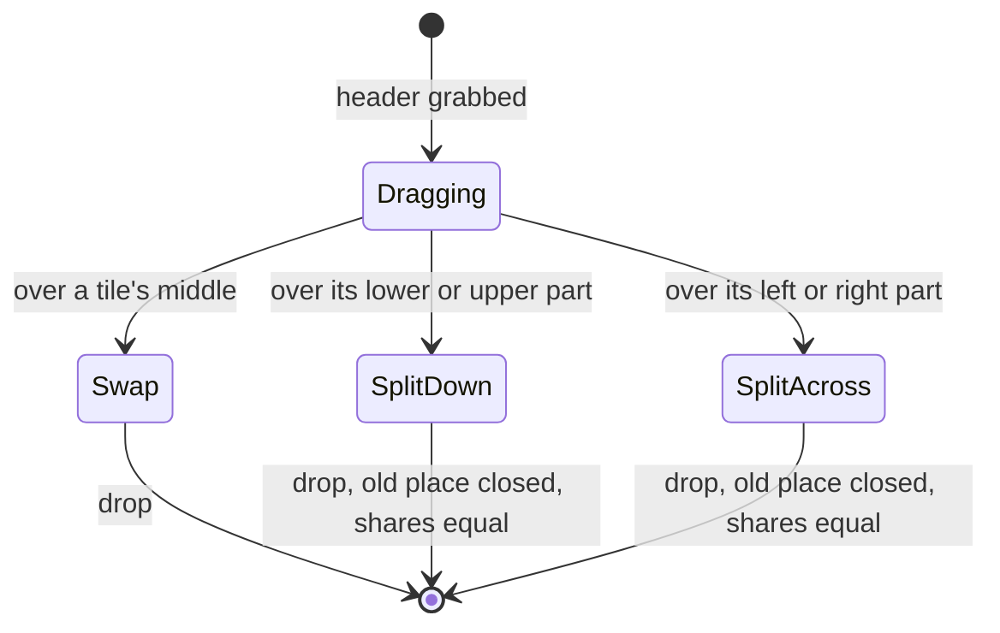

# Feature: one pane view: a free tile layout, a new header, closing for real

> Status: approved by the owner on 2026-10-25 as written. Asked
> for as: one view instead of two (the board goes), drag a header onto
> the lower half of a tile to split it, a `+` after the tabs, bigger
> pane buttons, the brand and the tabs on one row with a profile menu,
> `x` closing the pane on the host, no amber in the green theme, and
> Claude Code's "done" while a shell still runs.

## 1. Goal

The web client has two ways to show several panes: the pane view's tiles
and the board. The owner wants one, the tiles, with what the board could
do and the tiles could not: arranging panes freely. The header spends a
row on things said twice. Its buttons are small. Closing a tile does not
close the pane. And a Claude pane says *done* while Claude still has work
running.

## 2. Design

### 2.1 One view: the board goes, the tiles take its layout

- `/b/…`, `pages/Board.tsx`, `term/board.ts`, the `b` key, the palette's
  board entries and specs 68 to 73 are removed. A bookmarked `/b/main`
  opens its panes as tiles once, then is forgotten (browser storage).
- The tiles' layout becomes a **tree** (the board's model): splits across
  or down, each with shares, panes at the leaves; still at most four.
  `▦` cycles the preset arrangements by building the tree for them, as
  now; the window fit lays the window out as the tree, as now.
- **Drag a tile's header onto another tile**: the target shows where it
  lands as you move.
  - middle third: swap the two (today's behaviour);
  - lower or upper part: the target's place splits down, the target on
    top (lower) or below (upper), the dragged pane in the other half;
  - left or right part: the same across.
  The dragged pane's old place closes up, and every split goes back to
  equal shares.



### 2.2 The header: one row

```
┌─ muxway ─┐ [⟳ fixing the build][! review][bash] [+]   [▦][⤢][⟳][⊡][≡]  [alice ▾]
```

- The brand is the way back (it replaces `‹`), and the tabs follow it on
  the same row. The second row (the crumb repeating the pane's name) goes.
- **`+`** after the last tab, in the strip's style with a short glow when
  it appears: opens a small menu, *split here* (a new pane beside the
  focused one on its host, when the token may type there) and
  *new session on <host>* (where the agent allows it). Keys stay: `+`
  and `S`.
- The **pane buttons** at the right become 32 px squares with the glyph
  at text size and a label under the pointer, glowing on hover like the
  key row; `≡` (go to a pane) moves among them.
- Everything the header has today on the right (`⇄` hubs, the name, `?`,
  *admin*, *logout*) goes behind one **profile button** showing the
  principal's name, opening a menu: *hubs*, *help*, *admin* (admins
  only), *logout*. Keys stay: `H`, `?`.
- On the list and the admin page the row is the brand, the place, and
  the profile button.

### 2.3 Closing a pane for real

- `×` in a tile's header and `x` ask on the header itself,
  `close the pane on <host>? y n`, and on `y` the host closes the pane
  (tmux kill-pane); the tile leaves when the hub lists it gone.
- Only where the agent allows it: a new agent flag `--allow-close`, off
  by default, like `--allow-sessions`, and only for a pane the principal
  may write. Without it, `×` and `x` close the tile as today and say so in
  their title.

### 2.4 Colours

The attention colour is the theme's own ink in every theme: a waiting
pane's tab and header are drawn **inverted** (ink background, background
ink) and pulse; *working* stays dim. No second hue in the green or amber
theme, so no amber in green. The key and command rows keep their tints
(they are groups, not states). The alert colour stays for errors only.

### 2.5 Claude Code: "done" while work still runs

`Stop` carries `background_tasks` (running or pending tasks: shells,
agents, workflows, monitors) in Claude Code 2.1 and later.

- A `Stop` with any of them is sent as **`working`**, with a text of
  counts only: `1 shell still running`, `2 shells, 1 agent still running`.
- An `idle` notice for a pane whose last `Stop` had work running is
  dropped until the pane's next event.
- Scheduled wake-ups alone (`session_crons`, no task running) stay
  `done`, with the text `next wake scheduled`.
- A long-lived background task (a dev server, a monitor) keeps the pane
  *working* until the next turn ends, as Claude Code's own status line
  says "1 shell still running".

## 3. Protocol and API changes

- `POST /v1/panes/{address}/close`: the principal needs a write grant on
  the pane and the agent `--allow-close`; `204`, `403 read_only`,
  `404 not_found` (also when the agent does not allow closing),
  `503 host_offline`. Agent op `close-pane` (the existing `kill-pane`
  stays for undoing a refused split). Hosts list `"close": true` beside
  `"sessions"`.
- No other change: `working` with a text already exists.

## 4. Security analysis

- **Closing** kills whatever runs in the pane. It needs the host owner's
  flag, a write grant, the client's confirmation, the creation rate limit
  (one per two seconds per principal), and is audit-logged on hub and
  agent (who, when, which pane). Read-only panes cannot be closed;
  `deny`-marked panes do not exist for muxway.
- **Drag and the header** change only the browser's view; nothing reaches
  the host but the fit, as today.
- **Status text** is built from counts by type, never from a task's
  description, command or a cron's prompt, which can hold anything typed
  into a shell, secrets included.
- Removing the board removes code; its stored layouts are read once and
  deleted.

## 5. Privacy check

Fixtures: `alice-laptop`, `bob-desktop`, `alice@example.com`.
Screenshots from the run.

## 6. Test plan

| # | Test | Kind | Expected |
|---|------|------|----------|
| 1 | close without `--allow-close`, read-only token, read-only pane, no token | e2e-security | `404` / `403` / `401`; the pane lives |
| 2 | close with the flag and a write grant | e2e | the pane is gone on the host; audit lines on hub and agent |
| 3 | close twice fast, two principals | e2e-security | the rate limit holds per principal |
| 4 | a Stop payload with a running shell, then idle, then a Stop with none, then idle | e2e | `working` with the count text; idle dropped; `done`; idle passes |
| 5 | a Stop payload whose task command holds `mxt_…` | e2e-security | not in the event, the hub's log, the agent's log |
| 6 | drag a header to the lower part, upper, left, right, middle of another tile | UI | split down/up/across, or swap; old place closed; equal shares; screenshot `97-drop` |
| 7 | `/b/main` bookmarked | UI | opens the panes as tiles; storage cleared |
| 8 | the header: one row, `+` menu, pane buttons, profile menu with admin only for an admin | UI | screenshots `97-header`, `97-profile` |
| 9 | waiting tab in green and amber themes | UI | the computed colours are the theme's ink and background; no `#ffb000` in green |
| 10 | `x` on a tile: confirm, `y` closes on the host, `n` keeps it | UI | as said |

## 7. Documentation

`docs/ui-guideline.md` first (§1.2 paint, §1.4 header and tiles, §1.6
actions, §2 boards removed), then `docs/features/web-client.md`,
`docs/features/notifications.md` (the Stop mapping), `docs/features/new-panes.md`
(closing), `docs/protocol/v1.md` (close, `close` on hosts).

## 8. Implementation steps

1. The status fix (agent only): mapping, idle suppression, tests, docs.
   Deploy: no hook change needed.
2. Closing: agent flag and op, hub endpoint, tests, docs.
3. Colours: tokens and paint; Android `Theme.kt` and the lens paint
   (muxway-android issue).
4. The tree layout in the tiles, drag zones, the board removed.
5. The header row, `+` menu, pane buttons, profile menu.
6. Android: close (`×` with confirmation) and colours; version.
7. Run, record, push, deploy after each step.

## Review (after implementation)

## Test run

Step 1, background work: [run 20261025-081419-b6f509e](https://github.com/notmarkopadjen/muxway/issues/105), passed, 103 tests, with
TestFlow110 (working with a count text, idle dropped, done, idle passes,
"next wake scheduled") and TestSec111 (no description, command or
prompt reaches a client or a log).

Steps 2 and 3, closing and colours: [run 20261025-082542-743ebeb](https://github.com/notmarkopadjen/muxway/issues/106), passed, 106
tests, with TestSec112 and TestFlow113 (the flag, grants, the read-only
pane, the rate limit, audit lines), spec 89 in the close environment and
without the flag, and spec 88 (a waiting tab and header in the theme's
ink, inverted, in green, amber and paper; screenshot `88-waiting-green`).
Android: muxway-android c79898e, 0.9.1 (25), to be run and pushed with
the Android session's release.
