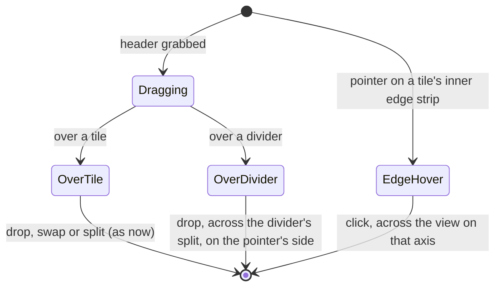
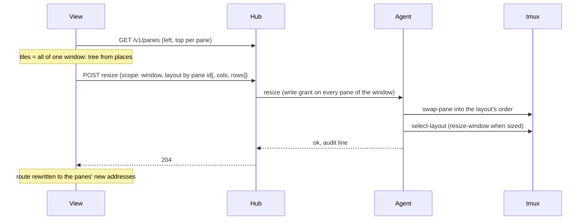

# Feature: a tile across the view, and one window's tiles in sync with the host

> Status: approved by the owner on 2026-10-25 as written: the view keeps
> its own arrangement (tiles from anywhere), and one window's tiles are
> kept in sync with the window both ways. Asked for as: drop a header on a
> splitter to lay the pane across the whole view, click a tile's far edge
> to stretch it to that side, in every direction; the top-left tile
> jiggles and the right one does not fill in a three-tile layout of one
> window.

## 1. Goal

A tile can be drawn across the view in one gesture, without rebuilding
the arrangement from presets and drops. And a layout of one window's
panes fits each pane to its own tile, whatever order the tiles are in.

Out of scope: Android (it has no free layout; its tiles keep swap only,
and follow the window's sizes through the fit as now),
more than four tiles, resizing by the new edge strip (the dividers stay
the way to resize).

## 2. Design

### 2.1 Drop a header on a divider: across that split

While a header is dragged, every divider becomes a drop target, drawn
wider (16 px) and lit when the pointer is on it. The pane lands across
the whole split the divider belongs to:

- a divider between columns (a vertical line): the pane spans the
  split's full **width**, as a row on top when the pointer is in the
  divider's upper half, at the bottom in its lower half;
- a divider between rows (a horizontal line): the pane spans the
  split's full **height**, as a column on the left or right by the
  pointer's half.

The divider shows the landing as the tile drops do: the half of the
split the pane will take is outlined, with `══ across ══` (or `║`
down) in its middle. The dragged pane's old place closes up and every
share goes equal, as for the other drops. The root divider spans the
whole view; an inner one, its own part.

```
 before                 drop on │, lower half      after
┌────────┬────────┐                               ┌────────┬────────┐
│ A      │ C      │                               │ A      │ C      │
├────────┤        │      ┌────────┬────────┐      │        │        │
│ B ───────▶ │    │      │        │        │      ├────────┴────────┤
│        │        │      ├────────▓▓▓▓▓▓▓▓▓┤      │ B               │
└────────┴────────┘      └────────▓▓▓▓▓▓▓▓▓┘      └─────────────────┘
```

### 2.2 Click a tile's far edge: stretch to that side

Along each inner edge of a tile that does not lie on the view's own edge,
a 12 px strip just inside the divider's grip:

- on hover the pointer becomes a one-way arrow (`e-resize`,
  `w-resize`, `n-resize`, `s-resize`), and the strip lights with a row
  of `»` (or `«`, `˄`, `˅`) and a label under the pointer, *across* or
  *full height*;
- a click lays the tile across the **whole view** on that axis, on the
  side where its middle is (B above: right edge → B is a full-width row at
  the bottom; the same from its left edge would not show, it is on the
  view's edge). Shares go equal.

A tile already across the view on an axis shows no strip on that axis.
With one tile there are no strips.

Keys (added to the guideline's table first): `e` lays the focused tile
across the view's width, `E` down its height.



Both are a new function on the tree, `across(tree, tile, split, axis,
first)`: take the tile out, wrap the named split's place in a split the
other way with the tile first or last, flatten, relabel. The edge click
is `across` on the root.

### 2.3 One window's tiles follow the host, and the host follows them

The view keeps its own arrangement (tiles from any hosts, sessions and
windows, side by side). When the open tiles are **every pane of one
window**, the view and the window are kept the same both ways:

- **From the host:** the listing gives each pane's place in its window
  (`left`, `top`, new). The view builds its tree from the places, so a
  split, resize or swap made at the host, or by another client, shows in
  the view within a poll.
- **To the host:** every change made in the view (a divider dragged, a
  swap, a drop on a tile's edge or on a divider, a tile laid across) is
  sent as the window's layout, by pane id. The agent makes the window
  match: it puts the panes into the layout's order with `swap-pane`, then
  `select-layout`. With fit on, the window is also sized to the view, as
  now; with fit off, only the arrangement is sent and tmux keeps the size.

This also fixes the reported bug. tmux fills a layout's places in the
window's pane order and ignores the pane ids written in it (checked: a
layout naming `%2` on the left puts `%0` there). The view sends tiles in
any order, so each pane got another tile's size: `.0` on the right, full
height, got the top-left place, 98×20, and draws a short screen in a tall
tile; `.1` top-left got the lower-left place, a little taller than its
tile, overflows, and the view chasing its bottom on every redraw is very
likely the jiggle (test 4 confirms it before the fix).

Addresses are by pane index, and reordering changes the indexes. The view
follows its tiles by pane id: after an arrangement it rewrites its route
to the panes' new addresses, so each tile keeps its program. Another
client's open route to `.1` may then show another pane; that is the same
as when someone at the host swaps panes today.

Rearranging a shared window is a write to the host, so it needs a write
grant on **every** pane of the window. Without one, the view still
follows the host but its drags and drops on those tiles are off, saying
why in their title. The host owner can see the change; it is audit-logged.



## 3. Protocol and API changes

- Pane listing: `left` and `top`, the pane's cell in its window
  (compatible addition).
- `POST /v1/panes/{address}/resize` with `scope: window` and a `layout`:
  the layout's pane ids are honoured, in any order. `cols` and `rows` may
  be left out to arrange without sizing. Needs a write grant on every
  pane of the window (`403 read_only` otherwise). Panes may change index;
  the answer lists the window's panes with their new addresses.
- Compatible for readers; a client that relied on tmux's own placing of a
  layout gets what it asked for instead.

## 4. Security analysis

- Drag, drop and edge clicks change only the browser's arrangement;
  nothing reaches the host but the fit, as now.
- Arranging a window moves other panes than the one addressed, so it
  needs a write grant on every pane of the window. A token that may type
  into one pane cannot rearrange its neighbours.
- The layout is parsed by the agent's own parser; its pane ids must be
  exactly the window's (as now); `swap-pane` and `select-layout` get only
  ids and a re-serialised layout, never the client's string.
- One arrangement per second per window (the resize limit). Audit line on
  hub and agent: who, when, which window, `arrange`.
- Tiles from different windows: nothing new reaches any host.

## 5. Privacy check

Fixtures: `alice-laptop`, panes of a throwaway tmux server. Screenshots
from the run only (the reported screenshot is not committed).

## 6. Test plan

| # | Test | Kind | Expected |
|---|------|------|----------|
| 1 | arrange with a write grant on one pane of two; read-only token; a layout with a foreign pane id; twice in a second | e2e-security | `403`, `403`, `400`, `429`; the window unchanged |
| 2 | arrange `.0` right, `.1` top-left, `.2` bottom-left; then without `cols`/`rows` | e2e | tmux's places as asked; the answer's new addresses; audit lines; size kept the second time |
| 2b | a split made at the host while the view shows the window | UI | the view's tree follows within a poll |
| 3 | `across` on the root and on an inner split, both sides; edge click from each edge | unit | the trees as drawn above; equal shares |
| 4 | three tiles of one window, `.1` over `.2` on the left, `.0` on the right | UI | each pane's listed size matches its tile within one cell; the top tile's scroll stays put over 10 s of redraws; screenshot `98-order` |
| 5 | drag a header onto the root divider, lower and upper half, and onto an inner one | UI | the landing shows; the layout after; screenshots `98-divider-hover`, `98-across` |
| 6 | hover a tile's right edge strip: cursor, strip, label; click | UI | `e-resize`; the tile across; no strip on the view's edge; screenshot `98-edge` |
| 7 | `e`, `E` on the focused tile | UI | across, down |

## 7. Documentation

`docs/ui-guideline.md` (tiles row, actions table: the divider drop, the
edge strip, `e` / `E`, web only), `docs/features/web-client.md`,
`docs/protocol/v1.md` (resize: layout order).

## 8. Implementation steps

0. README and `docs/features/web-client.md`: tiles from any hosts,
   sessions and windows side by side, as a headline feature.
1. Sync: `left`/`top` in the listing, the agent's arrange (swap into
   order, select-layout, optional size), the tree from places, the route
   following pane ids; tests 1, 2, 2b, 4; protocol page. Run, record,
   push, deploy.
2. `across` and the divider drop: tests 3, 5.
3. The edge strip and `e` / `E`: tests 6, 7; guideline and feature page.
   Run, record, push, deploy.

## Review (after implementation)

- [x] Diff matches the plan, with these deviations:
  - The listing already carried `window_layout` for every pane, so the
    view builds its tree from that; no `left` / `top` fields were added.
  - A release now gives back the saved proportions only when the window
    still has the shape it had; an arrangement made since, here or at
    the host, stays (found by spec 100: a fit turned off put back an
    older arrangement over one made at the host).
  - Shape changes and the grant: a layout of the window's own shape (a
    divider dragged) still needs only the write grant on the pane, as
    before; one that moves panes needs every pane, and the agent checks
    the shape against the live window itself.
  - Specs are 100 (sync) and 101 (across), screenshots `100-order`,
    `101-divider-hover`, `101-across`, `101-edge`; 98 and 99 were taken.
  - One recorded run after all steps instead of one per step.
- [x] Security rules hold: moving panes needs write on every pane of the
  window, hub and agent both check, one per second per window, audited
  `arrange=true`; drags and drops stay browser-only otherwise.
- [x] Privacy: fixtures `alice-laptop`, throwaway tmux; the reported
  screenshot is not committed.
- [x] Docs: README, `web-client.md` (tiles from anywhere, the sync, the
  divider and edge, `e` / `E`, security), `ui-guideline.md`,
  `protocol/v1.md` (resize with a layout).

## Test run

[Run 20261025-142757-6336c68](https://github.com/notmarkopadjen/muxway/issues/115), passed, 124 tests, with Sec123, Flow124 (the agent puts panes where the layout says, the grants, the release keeping an arrangement), spec 100 (sync both ways, each pane its tile; `100-order`) and spec 101 (the divider, the edge strip, `e` / `E`; `101-divider-hover`, `101-across`, `101-edge`).
