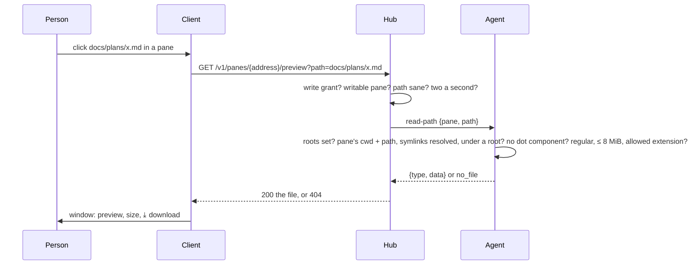

# Feature: files of the host previewed from a pane

## 1. Goal

A pane is full of paths: `docs/plans/2026-10-26-fit-keeps-still.md`,
`~/notes/todo.txt`, `/var/log/app.log`, a CSV an agent just wrote. To
read one you leave the browser for the host. Now, where the host's owner
allows it, a path printed in a pane is a link: a click opens a window
over the page with a preview of the file (text, Markdown, CSV, JSON,
logs, images, PDF) and a button to download it. The inbox window from
`2026-10-26-inbox-files-in-place.md` becomes the same window, download
button included.

Out of scope: editing, directory listings, files outside the roots the
owner names, rendering Markdown (it is shown as the text it is, in
monospace, the terminal way), files over 8 MiB.

## 2. Design

**The owner names the roots.** `muxway agent run --preview <dir>`,
repeatable, says which directories clients may preview files under.
Without it nothing is served and nothing is a link. The agent says
`"preview": true` in its listing when it has roots, as it says `inbox`.

**The agent resolves a path.** A new op `read-path` names a pane and a
path as printed. A relative path (`docs/x.md`, `./x`, `../x`) is joined
to the pane's current directory (`#{pane_current_path}`); `~/x` to the
agent's home; an absolute path stands. Symlinks are resolved on the
path and on every root, and the result must lie under a root; any
component starting with a dot (`.git`, `.ssh`, `.env`) is refused, so
a secret kept the usual way is never served even inside a root. The
file must be regular and at most 8 MiB, and its extension must be in
the preview list: `txt md markdown csv tsv json log yaml yml toml ini
xml html` served as `text/plain; charset=utf-8`, `png jpg jpeg gif webp`
as themselves, `pdf` as itself. The agent reads with its own rights,
which is why the roots are the owner's choice.

**The hub asks for a writer.** `GET /v1/panes/{address}/preview?path=…`
needs the write grant on the pane and a writable pane: a writer can
already read every such file by typing `cat` into the shell, a reader
cannot, and this keeps it so. Two a second per principal, burst five.
The answer is the file with the type above, `nosniff`, `no-store`,
`inline`; or `404 not_found` for anything the agent will not serve,
one code for "outside a root", "hidden", "missing" and "no roots", so
the endpoint cannot be used to map the host.

**The client links paths.** On a host with `preview`, a run of text that
looks like a path with a previewable extension, with at least one `/`
or a leading `~`, is a link in a writable pane. A click opens the
window: text in a `pre` with the file's name, size and line count in
the bar; an image as itself; a PDF in an `iframe` from the blob, which
the policy allows (`frame-src blob:`); `⤓` downloads the file under
its own name; `Escape`, `×` or a click outside closes. Lines longer
than the window scroll sideways. A file the host refuses shows `the host
does not preview this file`.

## 3. Protocol and API changes

Compatible. New: `GET /v1/panes/{address}/preview?path=<as printed>`
(path at most 1024 bytes, no control characters); agent op `read-path`
with `{"pane", "path"}` answering `{"type", "data"}` (up to 12 MiB like
a file's message) or `no_file` / `not_allowed`; `"preview": true` in
the listing. The inbox endpoint stays as it is.

## 4. Security analysis

This weakens "nothing is exposed unless the host owner marked it" from
panes to files, by the owner's explicit decision: the roots are opt-in
and named at start, nothing is served by default.

- What an attacker gains: a stolen write token reads files under the
  roots. It could already read them through the shell, so the roots
  add no reach to a writer; they add convenience. A reader gains
  nothing. A program in the pane that prints a path cannot make the
  client fetch it: the person clicks.
- The agent reads as its own user. On a host where the agent runs with
  more rights than the pane's shell, a root must be chosen with that in
  mind; the docs say so in one sentence, and the run command prints the
  roots at start.
- Path handling: no path from the client touches the file system before
  it is resolved under a root with symlinks followed; `..` and absolute
  paths are fine because the check is on the result, not the text;
  dot components are refused outright; the extension list keeps keys,
  binaries and scripts out; every text type is served as plain text so
  HTML or SVG are never rendered as a page.
- Enumeration: one 404 for every refusal; the rate limit is per
  principal.
- Logs: hub and agent audit the principal, pane, the path as asked and
  as resolved, the size and the result. Never the content.
- Dependencies: none new.

## 5. Privacy check

Fixtures use `/home/alice/work`, `alice-laptop`; screenshots are of the
test environment.

## 6. Test plan

| # | Test | Kind | Expected |
|---|------|------|----------|
| 1 | No `--preview`; a read-only token; a read-only pane | e2e-security | 404, 403, 403; nothing read; no `preview` in the listing without roots |
| 2 | `../../etc/passwd`, `/etc/passwd`, a symlink out of the root, `.env`, `.git/config`, `a/.ssh/id_ed25519`, `x.sh`, `x.pem`, a directory, a 9 MiB file, a path with NUL, a 2 KB path | e2e-security | 404 or 400, one code; the agent audits the refusal |
| 3 | Rate limit | e2e-security | the sixth in a second is 429 |
| 4 | Audit lines | e2e-security | paths and size, no content |
| 5 | A relative path from the pane's cwd; `~/x`; an absolute path under a second root | e2e | the bytes, `text/plain` for `.md`, `image/png` for `.png` |
| 6 | Click a `.md` path printed in the pane | UI | the window with the text, size, line count; `⤓` downloads under the file's name; screenshot `web-preview.png`; Escape closes |
| 7 | Click an image path and a PDF path | UI | image shown; PDF framed; download works |
| 8 | A path the host refuses | UI | the window says so |
| 9 | Pane on a host without `preview` | UI | no links for plain paths; inbox paths still link |
| 10 | The inbox window | UI | has `⤓` too |

## 7. Documentation

New `docs/features/preview.md`; `docs/protocol/v1.md`; running an
agent (the flag, the warning about rights); `docs/features/web-client.md`;
`docs/ui-guideline.md`; the Android plan gains the sheet.

## 8. Implementation steps

1. Agent: `--preview`, `read-path`, the resolver with its unit tests
   (roots, symlinks, dot components, extensions).
2. Hub: the endpoint, grant, limits, audit; `preview` in the host's
   capabilities for the client.
3. Go end-to-end tests 1 to 5.
4. Web: path links on preview hosts, the window grown from `Picture`
   (text, image, PDF, download), `frame-src blob:`.
5. Specs 6 to 10.
6. Docs.

---

## Review (after implementation)

- [x] Diff matches the plan. Deviations: `html` is in the text list as
  planned and served as plain text; the inbox window and this one are
  one component (`FileWindow`), so inbox files of other types now open
  in the window as text or a framed PDF instead of a tab; a bare file
  name without a slash is not a link, by the plan's rule, and neither is
  a dotfile without a shown extension (`.env`), which the host would
  refuse anyway.
- [x] Security rules hold: roots opt-in, write grant, resolution with
  symlinks followed, dot components refused, extension list, plain text
  with nosniff, one refusal code, rate limit, audit without content,
  roots printed at start.
- [x] Privacy check: `scripts/prepush-check.sh` clean, diff read;
  fixtures under the test's temporary directories.
- [x] Docs: `preview.md`, protocol, agent flags, web client, guideline,
  attachments.

## Test run

Go end-to-end tests 140 to 143, browser spec 82 (three tests) and the
reworked third test of 81. Run recorded as the test-run issue linked
from the commit.
